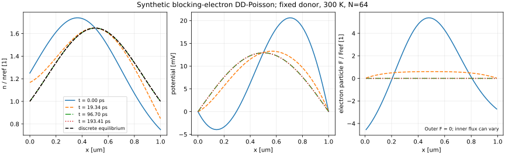
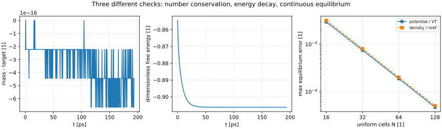

# 阻挡边界下，电子怎样一边守恒一边回到平衡

一张稳态图回答“最后停在哪里”，不能回答“怎样走到那里”。若电子在某处积起来，邻边电子电流就应不同；若电势随之改变，位移电流还要补上这一差。把所有瞬态边电流都强行抹成相等，反而删除了所求的积累。本课从一根两端不让电子穿出的条形体出发，连续走过物理假设、空间和时间离散、可停止也可失败的求解、独立答案与失效判断。

基础入口先算“某一小段里多了几个电子”；深入入口直接检查后面的矩阵正性、自由能与平衡唯一性。沿用 [[电子电路/60-TCAD与器件场模型/01-漂移扩散Poisson与接触网格#指数拟合通量保留平衡抵消|原有 SG 边积分]]，不把它再次当成新增发现。本课新增的是**全空间电子密度随时间改变，同时每一步重求 Poisson**的有限链。它接在 [[物理/50-半导体物理/14-偏置异质结两载流子DD-Poisson与电流收支#稳态传导账怎样回到总电荷守恒|两载流子稳态收支]] 后面：这里以单材料、单移动载流子和阻挡边界，换来可以完整证明的结构；它不是该异质结器件直接接上时钟后的全部物理。

## 封闭的是电子数，电极仍能充电

位置 $x\in[0,L]$ 向右，电子粒子通量 $\mathcal F$[m⁻²s⁻¹] 向右为正，电子传统电流 $J_n=-q\mathcal F$[A/m²]。设固定正离化施主 $N_D(x)$，空穴、产生复合、界面与隧穿均省略。低场、等温、非简并、局部热化及常迁移率条件下，$D_n=\mu V_T$、$V_T=k_BT/q$，

$$\partial_t n+\partial_x\mathcal F=0,\qquad
\mathcal F=\mu n\partial_x\phi-D_n\partial_xn,\qquad
-\epsilon\partial_{xx}\phi=q(N_D-n).$$

电子漂移与 $E=-\phi_x$ 反向，因此第一项为 $+\mu n\phi_x$。去 [[电子电路/22-半导体与真实元件/01-能带载流子掺杂与输运#电场和浓度梯度，两种不同的推动|电子电流符号]] 后带回这个负电荷换算，不能在图上把粒子箭头直接标成传统电流。

两端 $\phi=0$，电子 $\mathcal F(0,t)=\mathcal F(L,t)=0$。这是理想电势控制与无电子穿透的边界合同，可视作忽略显式介质层的理想阻挡电极近似；它没有 Ohmic 储库的浓度 Dirichlet 条件。积分连续性给 $d\int_0^L n\,dx/dt=0$。电极可通过外部电源交换自身电荷来维持电势，所以“电子没有穿出材料”不等于“外端总电流为零”。真实绝缘接触的介质厚度、势垒和电容要另建模型，不能从本理想边界读出。

固定施主不能跟着每步的 $n$ 移动，也不能为了电中性而每步改成 $N_D=n$。该操作会偷偷删掉场反馈。空穴省略也不是所有半导体的普遍真理：本例 n 型、无光生和短时弛豫用于隔离该机制；若出现双载流子注入、复合或简并，回 [[物理/50-半导体物理/05-准Fermi陷阱占据与产生复合#一个陷阱为何需要四种过程|复合模型]] 与第14课重建状态和收支。常数 $\mu$ 是教学输入，未当作真实材料的校准卡。

取 $s=x/L$、$\nu=n/n_{ref}$、$u=\phi/V_T$、$\tau=tD_n/L^2$、$d=N_D/n_{ref}$，下文省略密度符号上的 $\nu$，用无量纲 $n$：

$$\partial_\tau n+\partial_s F=0,\quad F=nu_s-n_s,
\qquad -\lambda^2u_{ss}=d-n,\quad
\lambda^2=\frac{\epsilon V_T}{q n_{ref}L^2}.$$

物理粒子通量为 $(n_{ref}D_n/L)F$；传统电子电流为 $-(qn_{ref}D_n/L)F$。$L=1\ \mu$m、$T=300$ K、$\mu=0.1$ m²/(V·s)、$n_{ref}=10^{21}$ m⁻³、$\epsilon=11.7\epsilon_0$ 给 $V_T=25.8520$ mV、$D_n=2.58520\times10^{-3}$ m²/s、$t_0=L^2/D_n=386.8173$ ps、$\lambda^2=0.01671546$。对应参考 Debye 长度 $L\lambda\simeq0.1293\ \mu$m；它提示网格需分辨的尺度，不能单凭 $h<\lambda$ 就认证所有边界层已收敛。

## 同一条边只存一个通量，两个相邻格子共用

均匀节点 $s_i=ih$，$i=0,\ldots,N$、$h=1/N$。节点电子密度全为未知量，包括两端；控制长度内部 $w_i=h$，端点 $w_0=w_N=h/2$。$u_0=u_N=0$ 固定，内部电势未知。Poisson 用

$$\lambda^2\frac{2u_i-u_{i-1}-u_{i+1}}{h^2}+n_i-d(s_i)=0,
\quad i=1,\ldots,N-1.$$

连续源 $d(s)$ 在每一张网格只重新采样，不能按本张网格差分重新制造。外端粒子通量严格设零；内边 $i+1/2$ 的 SG 通量是

$$F_{i+1/2}=\frac{n_iB(-\delta_i)-n_{i+1}B(\delta_i)}h,
\quad \delta_i=u_{i+1}-u_i,\qquad B(z)=\frac{z}{e^z-1},\quad B(0)=1.$$

这是原课电子传统电流除以负尺度后的形式。$B(-z)=e^zB(z)>0$，所以 $n_{i+1}=n_ie^{\delta_i}$ 时通量严格抵消。程序小 $z$ 用 $1-z/2+z^2/12-z^4/720+z^6/30240$，其余用 `expm1`，不以随意设零的小分母掩盖误差。

Backward Euler 的一步为

$$w_i\frac{n_i^{k+1}-n_i^k}{\Delta\tau}
+F_{i+1/2}^{k+1}-F_{i-1/2}^{k+1}=0.$$

其中 $F_{-1/2}=F_{N+1/2}=0$。对全部节点求和，内部边成对消去，因此 $\sum_iw_in_i^{k+1}=\sum_iw_in_i^k$。这不依赖网格够细，也不依赖平衡；有限残差只会带来对应容差的偏离。漏掉两个半控制体积，便改变了质量定义，端点的积累也会丢失。

**正性具体来自哪里？** 暂把新时刻电势固定。写 $a_i=B(-\delta_i)/h>0$、$b_i=B(\delta_i)/h>0$，每边 $F_i=a_in_i-b_in_{i+1}$。线性方程为 $A n^{k+1}=Wn^k$，$W=\operatorname{diag}(w_i)$；$A$ 对角为正、非对角非正，且第 $j$ 列对角减其余元素绝对值恰为 $w_j>0$。所以 $A^T$ 严格行对角占优，是非奇异 M 矩阵；$A^{-1}\ge0$，连通网格和严格正旧密度进一步给严格正新密度。这里不需要扩散显式步长限制。

不先记住“M矩阵”也能看见逆正性：令 $C=A^T$，若 $Cx=b\ge0$ 的某个最小分量 $x_j<0$，由非对角 $C_{j\ell}\le0$、$x_\ell\ge x_j$，有 $(Cx)_j\le(\sum_\ell C_{j\ell})x_j=w_jx_j<0$，矛盾；故 $C^{-1}\ge0$，转置也得 $A^{-1}\ge0$。同样的行列结构还给可逆性：齐次方程若有非零解，对其最大绝对值分量使用严格占优就矛盾。若旧密度严格正而新密度某节点为零，该行 $An=Wn^k$ 的非正邻项使左侧非正、右侧严格正，也矛盾；若只要求非负且非零旧密度，零点条件沿连通邻接传播才排除孤立零点。

它没有证明任意全耦合 Newton 初值或步长都会成功：$u$ 也是 $n$ 的函数，求解器还没解到根前，Newton 的修正可把 $n$ 推过零。线性子步的好性质不能签收另一个非线性算法。

一个可手算的坏捷径：规定两节点电势差 $\delta=4$，$h=1$、端控制长度 $1/2$，中心边通量为 $F=3n_L+n_R$。取旧密度 $(1,1)$、$\Delta\tau=1$，BE 矩阵是 $\begin{bmatrix}7&2\\-6&-1\end{bmatrix}$，解为 $(-0.6,2.6)$：总数守住了，左端电子却成负数。换 SG 后两个密度均正。这个**独立固定场诊断**与主问题两端零势的自洽运行分别标明；它反驳“守恒加隐式就自动正”的一般断言，不冒充主轨迹发生了负密度。

## 自由能把平衡抵消提升为整条轨迹的检查

平衡时 $F=0$，得 $n=C e^u$；常数 $C$ 由总电子数决定，并非边界强行给定。对正的光滑解、固定 $d$、零电势 Dirichlet 和阻挡通量，定义

$$H[n]=\int_0^1 n(\log n-1)\,ds
+\frac{\lambda^2}{2}\int_0^1u_s^2\,ds.$$

固定 $d$ 的 Poisson 时间导数为 $-\lambda^2(u_\tau)_{ss}=-n_\tau$。两次分部积分且 $u=u_\tau=0$ 在端点，给场能导数 $-\int u n_\tau ds$，故

$$\frac{dH}{d\tau}=\int(\log n-u)n_\tau ds
=\int(\log n-u)_sF\,ds
=-\int n\left|\partial_s(\log n-u)\right|^2 ds\le0.$$

没有把材料的宏观电热耗散全部压进 $H$：这是该等温约化模型的无量纲自由能。其常数参考可平移，图上H为负不代表物理场能为负；此处检查的是变化和耗散。若边界电势驱动随时间变化、粒子储库开通或有反应，边界功和化学源项会进入，不能沿用本负号判据。

离散对应

$$H_h(n)=\sum_iw_i n_i(\log n_i-1)
+\frac{\lambda^2}{2h}\sum_{i=0}^{N-1}(u_{i+1}-u_i)^2.$$

Poisson 消元后场能是 $n_{1:N-1}$ 的凸二次型；熵也是凸函数，且 $\partial H_h/\partial n_i=w_i(\log n_i-u_i)$。端点 $u_i=0$，其场能导数为零，正好仍符合此式。记 $\eta_i=n_ie^{-u_i}>0$、$\xi_i=\log\eta_i$，则

$$F_{i+1/2}=\frac{B(\delta_i)e^{u_{i+1}}}{h}(\eta_i-\eta_{i+1}),$$

所以 $F_{i+1/2}(\xi_{i+1}-\xi_i)\le0$。用凸性 $H_h(n^{k+1})-H_h(n^k)\le\nabla H_h(n^{k+1})\cdot(n^{k+1}-n^k)$，代入 BE 并离散分部求和，得到

$$H_h^{k+1}-H_h^k
\le\Delta\tau\sum_{i=0}^{N-1}F_{i+1/2}^{k+1}
(\xi_{i+1}^{k+1}-\xi_i^{k+1})\le0.$$

这是**正的、真正解到 BE–Poisson 根**的结构。有限容差时只按记录误差检查；不能用事后把能量向下裁剪来制造耗散。代码既不裁密度，也不裁能量。

平衡的唯一性也可检查。若同一 $d$、边界和质量有两平衡 $(n_1,u_1),(n_2,u_2)$，则 $\log n_1-\log n_2=u_1-u_2+\log(C_1/C_2)$。乘 $n_1-n_2$ 积分，质量相同使常数项消失。由两 Poisson 式相减，

$$\int(\log n_1-\log n_2)(n_1-n_2)ds
=-\lambda^2\int|(u_1-u_2)_s|^2 ds\le0.$$

左侧逐点非负，只能有 $n_1=n_2,u_1=u_2$。有限维版本把积分换成 $w_i$ 加权和、梯度换边差，论证相同。它证明“至多一个”平衡；本例另由连续制造解和实际有限网格求根给出存在见证，不将唯一性冒充所有输入的存在定理或瞬态全局收敛率。

[Bessemoulin-Chatard等的研究](https://arxiv.org/pdf/1303.4378)可继续读全隐式有限体积与准中性极限，但其§1.2分析采用两载流子、零掺杂和共同划分的Ohmic/绝缘边界；本课的单电子、固定非零施主、全边阻挡粒子而Dirichlet电势不属该同一合同。本节H与唯一性按本课边界直接推导，未把该论文定理搬来担保本算法任意输入收敛。

## 求解一步时，同时诚实地定义失败

未知向量 $y=(n_0,\ldots,n_N,u_1,\ldots,u_{N-1})$，长度 $2N$。密度残差取 $n^{k+1}-n^k+\Delta\tau\,\mathrm{div}_hF$，Poisson 残差取上面的无量纲式；不能把 m⁻³s⁻¹ 和 C/m³ 原值直接比较。源码解析组装 $2N\times2N$ 稀疏 Jacobian。边对 $\delta$ 的导数为 $[-B'(-\delta)n_L-B'(\delta)n_R]/h$，再经 $\delta=u_R-u_L$ 链到左右势。

以旧解作初值，解 $J\Delta y=-R$，依次试 $\alpha=1,1/2,\ldots,2^{-24}$。仅接收全部 $n>10^{-12}$、$|u|\le40$ 且 $\|R(y+\alpha\Delta y)\|_\infty\le(1-10^{-4}\alpha)\|R(y)\|_\infty$ 的候选。停止容差 $10^{-10}$；至多30个 Newton 修正、每次25个步长。Bernoulli 输入域另限 $|\delta|\le80$，不是把指数硬截到80再宣布收敛。

非有限修正、超域、无可接受步长或预算用尽，均报告 `FAIL`，退出码2；不把失败步接到轨迹，也不自动改材料、加导电旁路或减小源。若需要减时间步，应把它作为显式的新运行卡并比较结果。此处固定步长足够完成声明模型，未实现通用自适应误差控制。

**瞬态的第二本账。** 位移 $\mathscr D=-\lambda^2u_s$ 以 $qn_{ref}L$ 归一。任意内部控制体的 Poisson 时间差和电子连续式给

$$j_{tot,i+1/2}=-F_{i+1/2}^{k+1}
-\lambda^2\frac{(u_{i+1}^{k+1}-u_i^{k+1})-(u_{i+1}^k-u_i^k)}{h\Delta\tau},$$

且 $j_{tot}$ 在各内边相同。端点有半体积电荷，外边位移须取

$$\mathscr D_L=\mathscr D_{1/2}-(d_0-n_0)w_0,
\qquad \mathscr D_R=\mathscr D_{N-1/2}+(d_N-n_N)w_N.$$

外端传统电子穿透电流为零，但 $\Delta\mathscr D_{L,R}/\Delta\tau$ 应与内边总流同值。少一个端半格会出现假端口不守恒。总流再乘 $qn_{ref}D_n/L=4.141947\times10^5$ A/m²，乘实际给定截面积才是 A；本输入未指定截面，所以不虚报器件安培数。

## 固定连续输入，分开检验根、网格、时间和模型

制造连续平衡

$$u^*(s)=0.5\sin\pi s,\quad n^*(s)=e^{u^*(s)},
\qquad d(s)=e^{u^*(s)}+\lambda^2\pi^2u^*(s).$$

直接代回有 $F^*=0$ 和 $-\lambda^2u^{*\prime\prime}=d-n^*$。总量 $M=\int_0^1e^{0.5\sin\pi s}ds=1.3907240701355044$，每个网格都保持这个**同一连续目标量**。初态先取 $e^{u^*}[1+0.25\cos\pi s]$，再乘一个常数使 $\sum_iw_in_i^0=M$，由初态密度独立解 Poisson；这既不假装初态已平衡，也不使不同网格使用不同目标质量。该对初态的求积归一与连续初态差为二阶，跨网格比较也包含该误差。

连续精确式提供一条答案；另一条有限网格答案从 $n_i=e^{c+u_i}$、Poisson 与 $\sum_iw_i n_i=M$ 联立求 $(u,c)$，不调用时间推进器。后者通常有 $c\ne0$，因为连续源采样和求积带离散误差；强令离散 $c=0$ 会改变总量。平衡结果作为时间步初值应原样保持，不能用“最后看上去不动”代替这个独立试验。

图中每条时间曲线来自同一次运行的同组 $n,u,F$；横轴 $x$[μm]，密度除 $10^{21}$ m⁻³，电势 mV，通量除 $2.58520\times10^{24}$ m⁻²s⁻¹。外端通量零不要求内部通量零。图展示合成阻挡模型，无真实工艺坐标或仪器读数。

网格实验固定上述 $d,M$，N=16/32/64/128 的 $\max|u_h-u^*|$ 分别约 $2.93263\times10^{-3},7.47502\times10^{-4},1.87799\times10^{-4},4.70081\times10^{-5}$；相邻误差比趋近4，是该光滑问题的二阶观察。换成伏特要乘 $V_T$，N=64 的平衡电势离散误差约4.855 μV。它和 Newton 的 $10^{-10}$ 残差不同，也和还没走到平衡的时间轨迹误差不同。

时间实验固定N=64，在 $\tau=0.02$ 比较 $\Delta\tau=.002,.001,.0005,.00025$ 与参考 $.0000625$：最大密度差约 $.00382770,.00183219,.000848537,.000362048$。参考仍有离散时间误差，所以不把相对参考的比率当严格真误差阶。用相邻三个近似的差商可见一阶趋势；它检验同一半离散模型，没有消除N=64空间误差。

还做一条不借平衡根的独立答案：关闭 Poisson 反馈，规定 $u=0$ 的诊断问题，取 Neumann 初态 $n=1+.2\cos\pi s$，连续解为 $1+.2e^{-\pi^2\tau}\cos\pi s$。相同半格有限体积的余弦特征值为 $\Lambda_h=4\sin^2(\pi h/2)/h^2$，BE精确离散振幅为 $.2(1+\Delta\tau\Lambda_h)^{-k}$。N=64、$\Delta\tau=.001$、$\tau=.02$，线性矩阵推进与该标量答案差 $3.7\times10^{-15}$；对连续解仍差 $1.65\times10^{-4}$。这个“规定零场”诊断不能充当完整耦合瞬态的连续精确解。

规范源码、固定输入、实际 JSON 与图见 [[电子电路/80-实践/55-阻挡边界瞬态DD/README#运行同一条模型链|实践入口]]。其中分别保留质量、正性、能量、逐边总电流、制造平衡、时间收敛与预算失败，不能用一个 `PASS` 替代各断言的证据。

## 先撤掉提示，再检查所用条件

**题一。** 有人证明固定场的线性 BE 系统可逆且正，就宣布任意耦合 Newton 步长都收敛。这个论证缺什么？给一个可执行的接收/失败合同。

> [!question]- 答案与理由
> 固定场线性子步不等于同时求 $n,u$ 的非线性迭代。每次 Newton 修正必须检查正密度域和残差下降，说明初值、缩放、容差、修正/回溯预算；预算失败不能发布为新时刻。固定场 M 矩阵可逆证明只保证已经给定的场下的子问题，不消除全耦合 Jacobian 的条件问题。本实现把非平衡初态的允许修正次数设0，会确定地报告预算失败而非输出假轨迹。

**题二。** 保持 $d$、$M$、温度和电势边界，迁移率变成2倍。平衡、同一物理时刻的密度和外端总流怎样变化？只有平衡剖面能识别迁移率吗？

> [!question]- 答案与理由
> 平衡由 $F=0$、Poisson 和质量决定，与常数 $\mu$ 无关。同一无量纲轨迹在物理时间压缩一半，故 $n_{2\mu}(x,t)=n_\mu(x,2t)$；同一物理时刻通常已经更靠近平衡。电流尺度乘2，所以 $J_{tot,2\mu}(t)=2J_{tot,\mu}(2t)$，不是任意固定时刻都直接把旧电流乘2。单一平衡剖面对 $\mu$ 的敏感度为0，不能识别；有已知几何/温度的时间信息才增加该方向。若物理钟存在未知倍数、迁移率依赖场或有遗漏反应，仍需重新审查可辨识性。数值平衡算到很多位，也不会长出一只实验秒表。

**题三。** 将右端改为规定 $n(1,\tau)=1$，仍用 $|M(\tau)-M(0)|$ 判模型失败，合理吗？该怎样改账和未知量？

> [!question]- 答案与理由
> 右端成为粒子储库，可注入或吸收；不能同时任意保留该端 $F=0$。边界节点的密度不再由阻挡半格BE方程决定，需给与储库离散一致的边界通量/控制体积。连续账为 $\dot M=F(0)-F(1)$；离散应核质量变化等于相同步长所用端流差，必要时计入端半格约定。固定场正性和边界项需重推，自由能也可能有储库输入，不能拿原封闭模型的耗散式不加条件判错。

**题四。** 每个N把 $d_i$ 重新设为 $e^{u_i^*}-\lambda^2\Delta_hu_i^*$，得到所有格点精确相符，就可宣布SG–Poisson连续二阶收敛了吗？

> [!question]- 答案与理由
> 不可。它制造的是每张网格各自的离散源；可以核代码装配，却没保持同一连续输入。本例固定解析 $d(s)$ 与连续目标M，才比较 $u_h$ 对连续 $u^*$ 的误差。若还固定离散 $c=0$，通常连M也改了。零残差和零离散制造误差都不能代替这个区分。

**题五。** 阻挡边界的传统电子电流为零，报告却给非零外端电流；仅凭这点能否判定伪造？怎样用同一时刻的数据作检查？

> [!question]- 答案与理由
> 不能。需要看报告是否给总电流，及电极位移随时间的变化。用各内边 $-F+\partial_\tau\mathscr D$，再用半格 Gauss 重建的外端 $\partial_\tau\mathscr D_{L,R}$ 比较，应该同值。若只把内部电子电流平均后称端流，就缺了守恒推导；若场不变且无粒子穿透，才有本模型的零端总流。需要仪器/寄生模型才能把理想端流换成真实测量读数。

## 从有限代表链返回专业判断

现在可以独立完成：选定载流子/接触/尺度 → 写守恒与Poisson → 用共享SG边和半控制体积保留质量 → 区分固定场正性与耦合算法 → 用自由能、制造平衡、线性极限、网格和时间系列交叉检查 → 判断哪种结论不能识别材料参数。它是TCAD学习路线的一条连续代表主线，不能据此宣布TCAD专业方向或研究生训练完备。

回 [[电子电路/60-TCAD与器件场模型/01-漂移扩散Poisson与接触网格#接触决定未知量能否被确定|接触合同]]，带回阻挡边界和储库边界不同的未知量；去 [[电子电路/60-TCAD与器件场模型/02-从场求解到端口紧凑模型#同一条形体的精确低场约化|场到低场端口]] 时说明本例有分布状态和位移流，不能直接塞成固定DC电阻；回 [[电子电路/60-TCAD与器件场模型/03-网格收敛材料敏感度与校准复现#把校准设计成可复查实验|校准计划]] 时带回平衡对 $\mu$ 零敏感这个具体反例。再返回 [[物理/50-半导体物理/14-偏置异质结两载流子DD-Poisson与电流收支#稳态传导账怎样回到总电荷守恒|两载流子稳态]]，区分它的SRH/CQFL与本例的单电子封闭弛豫；若加入空穴、动态陷阱、有限热发射界面，需要逐一加入状态方程和界面账。

后续专业能力仍包括材料/工艺卡与真实界面校准、非均匀多维网格和复杂边界、双载流子反应与陷阱瞬态、简并/热/高场/量子耦合、端口观测与不确定度。实践README留可接续输入与可证伪清单；本机CPU求得合成模型的有限解，不认证真实工艺、商业TCAD、仪器、Obsidian显示或真人学习结果。
