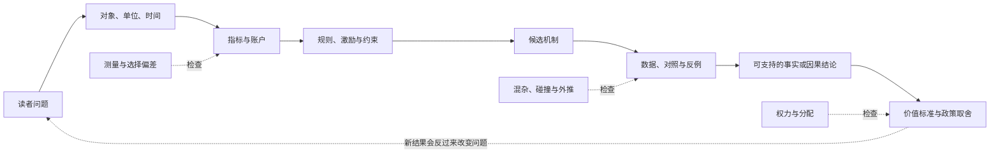
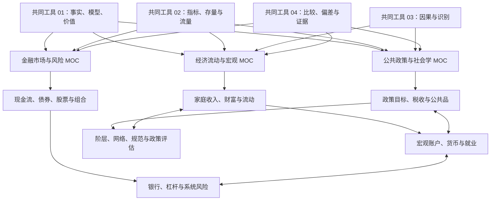

# 社会科学

工资涨了，为什么生活仍可能更紧？利率变动为什么会同时影响房贷、企业融资、债券价格和就业？一项政策公布后指标改善，怎样判断是政策造成的，还是趋势、选择和口径变化制造的？

这些问题横跨经济、金融、政策和社会结构，但可以用同一组动作开始：**先确认研究对象与单位，再检查账户和约束，提出机制，寻找反例，最后才讨论因果与价值选择。**

本域以“通用理论 + 中国案例 + 国际比较”为默认视角。它不预设读者是投资者、政策制定者或研究人员；三类读者都要先学会读定义、账户、机制和证据。

> [!info] 证据边界
> 本页负责固定路径和组合关系，不替目标页证明具体公式、史实或因果结论。阅读时以目标页自己的 `content_status`、`evidence_status` 和来源说明为准。

## 从一个真实问题进入

| 你想解释的问题 | 第一站 | 接下来要补的层次 | 最容易犯的错误 |
| --- | --- | --- | --- |
| 为什么家庭收入提高却更难积累财富？ | [[社会科学/10-共同工具/02-指标分布与存量流量核算\|指标、分布与存量流量]] | [[社会科学/20-经济流动与宏观/00-经济流动与宏观-MOC\|经济流动与宏观]] | 把收入、现金流、消费和财富当成同一个量 |
| 利率变化为什么会穿过债券、银行、房贷和就业？ | [[社会科学/30-金融市场与风险/00-金融市场与风险-MOC\|金融市场与风险]] | 回到[[社会科学/10-共同工具/02-指标分布与存量流量核算\|资产负债表与资金流量]]，再连接宏观传导 | 只画价格曲线，不检查谁持有资产、谁承担负债 |
| 为什么政策常出现“一个指标改善，另一个群体受损”？ | [[社会科学/40-公共政策与社会学/00-公共政策与社会学-MOC\|公共政策与社会学]] | [[社会科学/10-共同工具/01-事实模型与价值判断\|事实、模型与价值判断]] → [[社会科学/10-共同工具/03-因果图反事实与识别\|因果识别]] | 把目标、工具、结果、福利评价写成一句话 |
| 跨国排行榜或新闻数字可信吗？ | [[社会科学/10-共同工具/04-比较研究偏差与证据审计\|比较研究、偏差与证据审计]] | 根据指标转向经济、金融或政策专题 | 只比较数值，不比较分母、口径、期间和数据生成过程 |
| 阶层、关系网、组织与文化怎样影响机会？ | [[社会科学/40-公共政策与社会学/00-公共政策与社会学-MOC\|公共政策与社会学]] | 回链[[哲学与文化/10-主题/01-文化政治与组织结构/00-文化政治与组织结构-MOC\|文化政治与组织结构]]看历史专题 | 把群体平均外推给个人，或把文化当作不会变化的原因 |

## 一张共同推理图

箭头不表示所有研究都严格按直线进行。新证据会迫使我们改定义，制度反应会改变行为，政策也会改变以后能观察到的数据。图的作用是防止跳步：**没有先说明对象和口径，就无法判断数字；没有机制和对照，就不能从先后变化直接跳到因果；没有价值标准，就不能从因果效果直接推出“应该”。**

## 四层先修，而不是四个互不相干的学科

### 第 0 层：分清自己在说什么

先读 [[社会科学/10-共同工具/01-事实模型与价值判断|事实、模型与价值判断]]。这页用房租和公共交通案例区分六种句子：定义、描述、预测、机制、因果与规范判断。

完成后，你应能把“青年失业率高，所以某政策失败”拆成至少四个待答问题：失业率怎样定义？与谁、哪一时期比较？政策通过什么机制影响它？“失败”使用了什么目标和权重？

### 第 1 层：让数字有单位、分母和账户

[[社会科学/10-共同工具/02-指标分布与存量流量核算|指标、分布与存量流量核算]]是本域唯一的核算权威页。收入、消费、储蓄、财富、资产、负债、名义/实际、存量/流量和部门余额都在那里完整定义。

金融和政策页可以画自己的资产负债表或预算例子，但不会另造第二套定义。若两个页面看似矛盾，先检查它们是否使用了相同主体、期间、价格口径和合并范围。

### 第 2 层：从相关走到可反驳的机制

指标相关只说明共同变化。要解释“为什么”，需要明确行为者拥有什么信息、面临什么约束、能采取什么行动，以及谁承担后果。

例如，利率上升后住房成交减少，至少存在几条不同路径：月供提高压低需求；开发商融资变贵压低供给；对未来收入的预期同时转弱；监管或统计口径同期变化。它们会给出不同的时间顺序、群体差异和反例。

### 第 3 层：识别因果并说明外推范围

[[社会科学/10-共同工具/03-因果图反事实与识别|因果图、反事实与识别]]是本域唯一的因果概念权威页。它负责潜在结果、DAG、混杂、中介、碰撞、选择、ATE/ATT、SUTVA 和识别假设。

领域页负责把这些工具用于具体问题。例如，教育与收入课必须说明比较的是谁、处理是什么、结果何时测量；政策评估课必须说明 RCT、DID、RD、IV 或合成控制依赖哪些假设。方法名称本身不是可信结论。

## 三条领域主线

双向箭头表示真实依赖。例如，银行风险要同时读资产负债表与市场流动性；社会流动要同时看收入分布、教育住房、阶层网络和政策归宿。它不表示同一解释应在两处复制。

### 经济流动与宏观

入口：[[社会科学/20-经济流动与宏观/00-经济流动与宏观-MOC|经济流动与宏观 MOC]]。

这条线从家庭账本出发，区分收入、消费和财富，再学习绝对/相对流动、教育与地域的累积优势，最后进入国民账户、货币信用、通胀、增长、周期和就业。

它要回答的不是“宏观好不好”，而是：哪个总量在变，变化怎样分布到家庭和组织，账户恒等式约束了什么，又有哪些行为和制度机制仍需证据。

### 金融市场与风险

入口：[[社会科学/30-金融市场与风险/00-金融市场与风险-MOC|金融市场与风险 MOC]]。

这条线从跨期现金流开始，依次解释债券、股票、组合、信息、衍生品、银行与系统性风险。教学例只用于理解价格与风险，不提供实时价格、交易信号或个性化投资建议。

真正的主线不是资产名称，而是：未来状态下谁付给谁多少现金，价格依赖哪些假设，风险能否分散，杠杆和流动性怎样把局部损失放大成系统问题。

### 公共政策与社会学

入口：[[社会科学/40-公共政策与社会学/00-公共政策与社会学-MOC|公共政策与社会学 MOC]]。

这条线把政策目标—工具矛盾与社会结构放在一起：税收由谁实际承担，公共品如何治理，阶层、地位、网络和身份怎样影响机会，最后怎样用实验和准实验评估政策。

社会学部分不把文化写成固定民族性格。它把关系网络、组织位置、规范和权力当作可观察、可比较、会被制度与行动改变的对象。

## 职业课程路径：CFA

如果问题是“客户同意是否足够”“利润为什么不是现金”“互斥项目怎样比较”，进入 [[社会科学/50-CFA课程/00-CFA课程-MOC|CFA课程路径]]。01–03聚焦职业责任、冲突情景与GIPS呈现边界；10–12和20–21连接三表、政策调整、盈利质量、资本预算、融资与治理，80提供合成账本复算。

收益比较与统计问题接30–32和82；债券曲线、存续合约及另类收费接40–42和83；厂商产出与贸易汇率接50–51和84。各组沿同一合成算例解释机制与边界；年度能力缺口用CFA入口中的04核对表和25单元表定位。

它是一条职业课程路径，与经济、金融、政策三条主线互联。已建页面只覆盖限定主题；完整年度LOS、更多资产估值、组合、跨级案例和所选三级路径仍须继续学习。备考年度、级别、路径、官方题库及PSM要求去目标MOC核对，本库练习不构成官方考试或个人资格完成证明。

## 三个贯穿案例

### 家庭为什么难以向上流动

同样月入 20,000 元的两个家庭，可能因为住房负债、照护责任、公共服务、资产继承和就业风险不同，拥有完全不同的抗冲击能力。单看工资会遗漏财富、时间和制度资源。

这条案例连接：核算 → 收入/财富 → 代际流动 → 教育住房 → 阶层与网络 → 税收转移 → 政策评估。

### 利率变化为什么影响整个社会

利率既是借款人的成本，也是储蓄者和债权人的收益要求；它还会改变资产价格、抵押品、银行融资、企业投资和汇率。任何“加息利好/利空”的单句总结都会遗漏主体、期限和资产负债表位置。

这条案例连接：存量/流量 → 货币信用 → 债券 → 银行期限转换 → 杠杆反馈 → 就业与分配 → 政策目标冲突。

### 一项政策为什么可能平均有效却仍有争议

假设公共交通降价使平均通勤量增加。我们仍要问：新增出行来自哪些群体？财政成本由谁承担？拥堵或碳排发生什么变化？没有线路覆盖的人是否受益？观察到的变化是否由同期油价或就业恢复造成？

“平均效果为正”只是一个经验结论；是否值得实施还需要分配、权利、预算、替代方案与不确定性判断。

## 如何读一则新闻

遇到“某指标创历史新高，因此某政策必须改变”时，依次写下：

| 层次 | 要问的问题 |
| --- | --- |
| 对象 | 指个人、家庭、企业、金融机构、政府还是整个经济？ |
| 指标 | 分子、分母、单位、价格基期、期间和样本是谁？ |
| 比较 | 与上月、上年、其他地区还是某个反事实相比？ |
| 账户 | 一方收入或资产变化，对应了谁的支出、负债或权益变化？ |
| 机制 | 哪些规则、激励、预期与约束会产生这个结果？ |
| 证据 | 是描述相关、事件前后、实验、准实验，还是模型模拟？ |
| 分配 | 平均值掩盖了哪些群体、地区、年龄或财富差异？ |
| 价值 | 评价使用了效率、平等、自由、稳定、程序还是代际责任？ |

这不是为了拖延判断。它让你知道争论发生在哪一层，也让新证据真正有机会改变结论。

## 与现有知识域的分工

| 需要的能力 | 去哪里读 | 本域怎样使用 |
| --- | --- | --- |
| 概率、抽样、置信区间和模型评测 | [[数学/30-概率与统计/05-统计估计置信度与模型评测\|统计估计、置信度与模型评测]] | 作为统计先修；本域补社会测量、因果识别和制度解释 |
| AI 实验里的估计与因果边界 | [[AI/11-数学与统计桥梁/05-统计估计置信区间与因果边界\|统计估计、置信区间与因果边界]] | 借用 estimand、选择偏差和预测/因果区分，不复制 AI 评测示例 |
| 历史文化、国家与组织自治 | [[哲学与文化/10-主题/01-文化政治与组织结构/00-文化政治与组织结构-MOC\|文化政治与组织结构]] | 当作历史专题与待核验研究地图，不充当现代跨国实证权威 |
| 数据表、代码和可复现实验 | [[计算机知识/10-编程语言/01-Python/00-Python基础-MOC\|Python 基础 MOC]] 与相应数据工具课程 | 数据处理仍需代码、测试和可恢复输入；结论边界由社会科学问题决定 |

## 来源怎样支持结论

本域不按“链接数量”给证据加分。每条承重来源应说明支持的是定义、数据、机制、识别设计还是价值论证。

- 联合国等机构的《System of National Accounts 2008》提供账户概念与部门框架；它明确自身是概念框架，不替代各国具体编制指南，也不从核算恒等式推出政策因果。[官方入口](https://unstats.un.org/unsd/nationalaccount/sna2008.asp)
- CORE Econ 的开放教材可作为经济学问题路线和课堂案例入口；具体命题仍需定位到相应单元和原始材料，不能把教材首页当成全书核验。[教材入口](https://www.core-econ.org/the-economy/)
- 中国政策、统计方法与市场规则会变化。具体断言必须链接主管机关原文，并记录机构、标题、发布日期、适用期和访问日期。

## 学完首页后的检查

- [ ] 我能把一条社会新闻拆成对象、指标、账户、机制、证据、分配和价值七层。
- [ ] 我知道收入是流量、财富是存量，也知道完整定义应去 `10-共同工具/02` 查。
- [ ] 我不会因为两个量一起变化就直接声称政策造成结果；完整因果概念应去 `10-共同工具/03` 查。
- [ ] 我能解释为什么同一政策可能对平均指标有利，却让某些群体受损。
- [ ] 我知道哲学文化专题提供历史讨论和候选机制，不自动证明现代跨国事实。
- [ ] 我已根据当前问题选择一个 MOC，而不是按顺序读完所有页面。

---

**共同工具**：[[社会科学/10-共同工具/01-事实模型与价值判断|事实、模型与价值判断]] · [[社会科学/10-共同工具/02-指标分布与存量流量核算|指标、分布与存量流量]] · [[社会科学/10-共同工具/03-因果图反事实与识别|因果图、反事实与识别]] · [[社会科学/10-共同工具/04-比较研究偏差与证据审计|比较研究、偏差与证据审计]]

**领域入口**：[[社会科学/20-经济流动与宏观/00-经济流动与宏观-MOC|经济流动与宏观]] · [[社会科学/30-金融市场与风险/00-金融市场与风险-MOC|金融市场与风险]] · [[社会科学/40-公共政策与社会学/00-公共政策与社会学-MOC|公共政策与社会学]]

**返回**：[知识库总入口](../../README.md)
