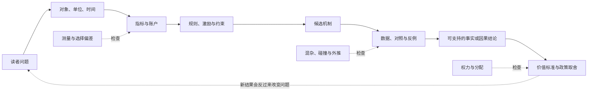
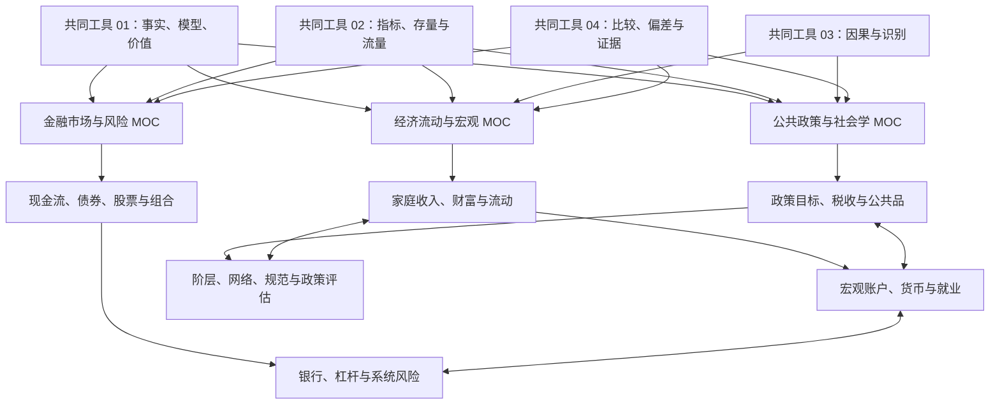

# 社会科学

工资涨了，为什么生活仍可能更紧？利率变动为什么会同时影响房贷、企业融资、债券价格和就业？一项政策公布后指标改善，怎样判断是政策造成的，还是趋势、选择和口径变化制造的？

这些问题横跨经济、金融、政策和社会结构，但可以用同一组动作开始：**先确认研究对象与单位，再检查账户和约束，提出机制，寻找反例，最后才讨论因果与价值选择。**

本域以“通用理论 + 中国案例 + 国际比较”为默认视角。它不预设读者是投资者、政策制定者或研究人员；三类读者都要先学会读定义、账户、机制和证据。

> [!info] 证据边界
> 本页负责固定路径和组合关系，不替目标页证明具体公式、史实或因果结论。阅读时以目标页自己的 `content_status`、`evidence_status` 和来源说明为准。

## 日常通识入口：组织、公共决定与工资

- 想从工资、贷款、贸易和公共决定建立社会认知，读[[社会科学/00-开始/01-社会认知学习路线与32个问题|社会认知学习路线与32个问题]]，按八组问题找到具体解释、可算例子与条件边界。
- 想检验自己能否在条件改变时重新判断，做[[社会科学/80-实践/01-社会认知32问与四个贯穿案例|32问与四个贯穿案例]]，跟同一笔工资、贷款、跨境货款和阅览室决定逐步回访，再对照迁移题解。

会计和金融概念可从 [[社会科学/50-CFA课程/00-CFA课程-MOC#不以考试为前提的选读|收入与收现、税收、汇率和跨境账户]] 按问题选读，不要求先选考试年度、补齐LOS或读高级组合；原有职业/考试路线保持可选。

初次接触社会科学，可以先问三个近身问题，无须先学金融、哲学史或把统计名词全部背完。熟悉基础的读者也沿同一正文快进：每课提供账本或全过程，随后改变一个条件，再核对带答案练习。

| 日常问题 | 从这里开始 | 本课承担什么，接着读什么 |
| --- | --- | --- |
| 老板、会员、职工和使用者，谁能决定组织的钱怎样花？ | [[社会科学/40-公共政策与社会学/09-社会组织公司协会与公共机关\|组织、公司、协会与公共机关]] | 沿采购追踪目的、成员、受影响者、资源、决策、退出申诉和责任；进一步的组织位置去阶层主解释 |
| “政府决定”究竟是哪个机构、怎样形成、谁执行和追责？ | [[社会科学/40-公共政策与社会学/10-政治制度公共决策与问责\|政治制度、公共决策与问责]] | 区分国家、政府、政党与机关，用同问题有限比较中国、美国、德国的正式规则；效果转政策评估，正当性转哲学 |
| 月薪、到手、雇主成本和家庭生活资源为什么不同？ | [[社会科学/20-经济流动与宏观/08-工资劳动关系税费与生活成本\|工资、税费与生活成本]] | 虚构税制逐笔算账，接入家庭收入、价格和服务；完整收入财富定义仍由共同工具承担 |

三课的法律文本、科普模型与经验结果分别标明；来源是正式规则不等于已证明现实效果，做完教学题不等于个人已掌握或获得具体法律税务结论。新课的draft状态与具体来源读取边界以目标页为准。

## 从一个真实问题进入

| 你想解释的问题 | 第一站 | 接下来要补的层次 | 最容易犯的错误 |
| --- | --- | --- | --- |
| 为什么家庭收入提高却更难积累财富？ | [[社会科学/10-共同工具/02-指标分布与存量流量核算\|指标、分布与存量流量]] | [[社会科学/20-经济流动与宏观/00-经济流动与宏观-MOC\|经济流动与宏观]] | 把收入、现金流、消费和财富当成同一个量 |
| 利率变化为什么会穿过债券、银行、房贷和就业？ | [[社会科学/30-金融市场与风险/00-金融市场与风险-MOC\|金融市场与风险]] | 回到[[社会科学/10-共同工具/02-指标分布与存量流量核算\|资产负债表与资金流量]]，再连接宏观传导 | 只画价格曲线，不检查谁持有资产、谁承担负债 |
| 为什么政策常出现“一个指标改善，另一个群体受损”？ | [[社会科学/40-公共政策与社会学/00-公共政策与社会学-MOC\|公共政策与社会学]] | [[社会科学/10-共同工具/01-事实模型与价值判断\|事实、模型与价值判断]] → [[社会科学/10-共同工具/03-因果图反事实与识别\|因果识别]] | 把目标、工具、结果、福利评价写成一句话 |
| 跨国排行榜或新闻数字可信吗？ | [[社会科学/10-共同工具/04-比较研究偏差与证据审计\|比较研究、偏差与证据审计]] | 根据指标转向经济、金融或政策专题 | 只比较数值，不比较分母、口径、期间和数据生成过程 |
| 阶层、关系网、组织与文化怎样影响机会？ | [[社会科学/40-公共政策与社会学/00-公共政策与社会学-MOC\|公共政策与社会学]] | 回链[[哲学与文化/10-主题/01-文化政治与组织结构/00-文化政治与组织结构-MOC\|文化政治与组织结构]]看历史专题 | 把群体平均外推给个人，或把文化当作不会变化的原因 |

## 一张共同推理图

箭头不表示所有研究都严格按直线进行。新证据会迫使我们改定义，制度反应会改变行为，政策也会改变以后能观察到的数据。图的作用是防止跳步：**没有先说明对象和口径，就无法判断数字；没有机制和对照，就不能从先后变化直接跳到因果；没有价值标准，就不能从因果效果直接推出“应该”。**

## 四层先修，而不是四个互不相干的学科

### 第 0 层：分清自己在说什么

先读 [[社会科学/10-共同工具/01-事实模型与价值判断|事实、模型与价值判断]]。这页用房租和公共交通案例区分六种句子：定义、描述、预测、机制、因果与规范判断。

完成后，你应能把“青年失业率高，所以某政策失败”拆成至少四个待答问题：失业率怎样定义？与谁、哪一时期比较？政策通过什么机制影响它？“失败”使用了什么目标和权重？

### 第 1 层：让数字有单位、分母和账户

[[社会科学/10-共同工具/02-指标分布与存量流量核算|指标、分布与存量流量核算]]是本域唯一的核算权威页。收入、消费、储蓄、财富、资产、负债、名义/实际、存量/流量和部门余额都在那里完整定义。

金融和政策页可以画自己的资产负债表或预算例子，但不会另造第二套定义。若两个页面看似矛盾，先检查它们是否使用了相同主体、期间、价格口径和合并范围。

### 第 2 层：从相关走到可反驳的机制

指标相关只说明共同变化。要解释“为什么”，需要明确行为者拥有什么信息、面临什么约束、能采取什么行动，以及谁承担后果。

例如，利率上升后住房成交减少，至少存在几条不同路径：月供提高压低需求；开发商融资变贵压低供给；对未来收入的预期同时转弱；监管或统计口径同期变化。它们会给出不同的时间顺序、群体差异和反例。

### 第 3 层：识别因果并说明外推范围

[[社会科学/10-共同工具/03-因果图反事实与识别|因果图、反事实与识别]]是本域唯一的因果概念权威页。它负责潜在结果、DAG、混杂、中介、碰撞、选择、ATE/ATT、SUTVA 和识别假设。

领域页负责把这些工具用于具体问题。例如，教育与收入课必须说明比较的是谁、处理是什么、结果何时测量；政策评估课必须说明 RCT、DID、RD、IV 或合成控制依赖哪些假设。方法名称本身不是可信结论。

## 三条领域主线

双向箭头表示真实依赖。例如，银行风险要同时读资产负债表与市场流动性；社会流动要同时看收入分布、教育住房、阶层网络和政策归宿。它不表示同一解释应在两处复制。

### 经济流动与宏观

入口：[[社会科学/20-经济流动与宏观/00-经济流动与宏观-MOC|经济流动与宏观 MOC]]。

这条线从家庭账本出发，区分收入、消费和财富，再学习绝对/相对流动、教育与地域的累积优势，最后进入国民账户、货币信用、通胀、增长、周期和就业。

它要回答的不是“宏观好不好”，而是：哪个总量在变，变化怎样分布到家庭和组织，账户恒等式约束了什么，又有哪些行为和制度机制仍需证据。

### 金融市场与风险

入口：[[社会科学/30-金融市场与风险/00-金融市场与风险-MOC|金融市场与风险 MOC]]。

这条线从跨期现金流开始，依次解释债券、股票、组合、信息、衍生品、银行与系统性风险。教学例只用于理解价格与风险，不提供实时价格、交易信号或个性化投资建议。

真正的主线不是资产名称，而是：未来状态下谁付给谁多少现金，价格依赖哪些假设，风险能否分散，杠杆和流动性怎样把局部损失放大成系统问题。

### 公共政策与社会学

入口：[[社会科学/40-公共政策与社会学/00-公共政策与社会学-MOC|公共政策与社会学 MOC]]。

这条线把政策目标—工具矛盾与社会结构放在一起：税收由谁实际承担，公共品如何治理，阶层、地位、网络和身份怎样影响机会，最后怎样用实验和准实验评估政策。

社会学部分不把文化写成固定民族性格。它把关系网络、组织位置、规范和权力当作可观察、可比较、会被制度与行动改变的对象。

## 职业课程路径：CFA

如果问题是“客户同意是否足够”“利润为什么不是现金”“互斥项目怎样比较”，进入 [[社会科学/50-CFA课程/00-CFA课程-MOC|CFA课程路径]]。01–03聚焦职业责任、冲突情景与GIPS呈现边界；10–12和20–21连接三表、政策调整、盈利质量、资本预算、融资与治理，80提供合成账本复算。

收益比较与统计问题接30–32和82；债券曲线、存续合约及另类收费接40–42和83；厂商产出与贸易汇率接50–51和84。各组沿同一合成算例解释机制与边界；年度能力缺口用CFA入口中的04核对表和25单元表定位。

它是一条职业课程路径，与经济、金融、政策三条主线互联。已建页面只覆盖限定主题；完整年度LOS、更多资产估值、组合、跨级案例和所选三级路径仍须继续学习。备考年度、级别、路径、官方题库及PSM要求去目标MOC核对，本库练习不构成官方考试或个人资格完成证明。

## 三个贯穿案例

### 家庭为什么难以向上流动

同样月入 20,000 元的两个家庭，可能因为住房负债、照护责任、公共服务、资产继承和就业风险不同，拥有完全不同的抗冲击能力。单看工资会遗漏财富、时间和制度资源。

这条案例连接：核算 → 收入/财富 → 代际流动 → 教育住房 → 阶层与网络 → 税收转移 → 政策评估。

### 利率变化为什么影响整个社会

利率既是借款人的成本，也是储蓄者和债权人的收益要求；它还会改变资产价格、抵押品、银行融资、企业投资和汇率。任何“加息利好/利空”的单句总结都会遗漏主体、期限和资产负债表位置。

这条案例连接：存量/流量 → 货币信用 → 债券 → 银行期限转换 → 杠杆反馈 → 就业与分配 → 政策目标冲突。

### 一项政策为什么可能平均有效却仍有争议

假设公共交通降价使平均通勤量增加。我们仍要问：新增出行来自哪些群体？财政成本由谁承担？拥堵或碳排发生什么变化？没有线路覆盖的人是否受益？观察到的变化是否由同期油价或就业恢复造成？

“平均效果为正”只是一个经验结论；是否值得实施还需要分配、权利、预算、替代方案与不确定性判断。

## 如何读一则新闻

遇到“某指标创历史新高，因此某政策必须改变”时，依次写下：

| 层次 | 要问的问题 |
| --- | --- |
| 对象 | 指个人、家庭、企业、金融机构、政府还是整个经济？ |
| 指标 | 分子、分母、单位、价格基期、期间和样本是谁？ |
| 比较 | 与上月、上年、其他地区还是某个反事实相比？ |
| 账户 | 一方收入或资产变化，对应了谁的支出、负债或权益变化？ |
| 机制 | 哪些规则、激励、预期与约束会产生这个结果？ |
| 证据 | 是描述相关、事件前后、实验、准实验，还是模型模拟？ |
| 分配 | 平均值掩盖了哪些群体、地区、年龄或财富差异？ |
| 价值 | 评价使用了效率、平等、自由、稳定、程序还是代际责任？ |

这不是为了拖延判断。它让你知道争论发生在哪一层，也让新证据真正有机会改变结论。

## 与现有知识域的分工

| 需要的能力 | 去哪里读 | 本域怎样使用 |
| --- | --- | --- |
| 概率、抽样、置信区间和模型评测 | [[数学/30-概率与统计/05-统计估计置信度与模型评测\|统计估计、置信度与模型评测]] | 作为统计先修；本域补社会测量、因果识别和制度解释 |
| AI 实验里的估计与因果边界 | [[AI/11-数学与统计桥梁/05-统计估计置信区间与因果边界\|统计估计、置信区间与因果边界]] | 借用 estimand、选择偏差和预测/因果区分，不复制 AI 评测示例 |
| 历史文化、国家与组织自治 | [[哲学与文化/10-主题/01-文化政治与组织结构/00-文化政治与组织结构-MOC\|文化政治与组织结构]] | 当作历史专题与待核验研究地图，不充当现代跨国实证权威 |
| 数据表、代码和可复现实验 | [[计算机知识/10-编程语言/01-Python/00-Python基础-MOC\|Python 基础 MOC]] 与相应数据工具课程 | 数据处理仍需代码、测试和可恢复输入；结论边界由社会科学问题决定 |

## 来源怎样支持结论

本域不按“链接数量”给证据加分。每条承重来源应说明支持的是定义、数据、机制、识别设计还是价值论证。

- 联合国等机构的《System of National Accounts 2008》提供账户概念与部门框架；它明确自身是概念框架，不替代各国具体编制指南，也不从核算恒等式推出政策因果。[官方入口](https://unstats.un.org/unsd/nationalaccount/sna2008.asp)
- CORE Econ 的开放教材可作为经济学问题路线和课堂案例入口；具体命题仍需定位到相应单元和原始材料，不能把教材首页当成全书核验。[教材入口](https://www.core-econ.org/the-economy/)
- 中国政策、统计方法与市场规则会变化。具体断言必须链接主管机关原文，并记录机构、标题、发布日期、适用期和访问日期。

## 学完首页后的检查

- [ ] 我能把一条社会新闻拆成对象、指标、账户、机制、证据、分配和价值七层。
- [ ] 我知道收入是流量、财富是存量，也知道完整定义应去 `10-共同工具/02` 查。
- [ ] 我不会因为两个量一起变化就直接声称政策造成结果；完整因果概念应去 `10-共同工具/03` 查。
- [ ] 我能解释为什么同一政策可能对平均指标有利，却让某些群体受损。
- [ ] 我知道哲学文化专题提供历史讨论和候选机制，不自动证明现代跨国事实。
- [ ] 我已根据当前问题选择一个 MOC，而不是按顺序读完所有页面。

---

**共同工具**：[[社会科学/10-共同工具/01-事实模型与价值判断|事实、模型与价值判断]] · [[社会科学/10-共同工具/02-指标分布与存量流量核算|指标、分布与存量流量]] · [[社会科学/10-共同工具/03-因果图反事实与识别|因果图、反事实与识别]] · [[社会科学/10-共同工具/04-比较研究偏差与证据审计|比较研究、偏差与证据审计]]

**领域入口**：[[社会科学/20-经济流动与宏观/00-经济流动与宏观-MOC|经济流动与宏观]] · [[社会科学/30-金融市场与风险/00-金融市场与风险-MOC|金融市场与风险]] · [[社会科学/40-公共政策与社会学/00-公共政策与社会学-MOC|公共政策与社会学]]

**返回**：[知识库总入口](../../README.md)

## 非职业课程的跨层理解切片

本组围绕一般社会科学问题，CFA专项正文、习题与脚本不在本轮改进范围内；已有职业课程入口保留。

| 问题族 | 主解释与案例 | 可检查产物 | 证据与当前边界 |
| --- | --- | --- | --- |
| 测量、账户与机制 | 共同工具、经济流动与财政货币课程 | 说明单位、分母、时点、账户与竞争解释 | 恒等式不识别因果；相邻课程列出不等于整域复核 |
| 政策局部效果与累积优势 | [[社会科学/40-公共政策与社会学/08-局部有效政策与累积优势的判断\|局部政策与累积优势案例]]，回到RD和教育住房主解释 | 比较对象/识别假设、分配和价值目标，制度+人群联合变化题 | MTO邀请与实际搬迁不同；RD局部总体与政策外推不同 |
| 历史与社会解释的联系 | [[哲学与文化/10-主题/01-文化政治与组织结构/09-科举命题的证据与竞争解释\|历史竞争解释]] | 区分特定时期材料与现代社会数据的结论强度 | 比较史学、观察研究和实验各有证据合同 |

下一组单元优先“政策效果的异质性与外推”：沿已有RCT/准实验和政策目标课程，固定处理、结果、对象与时点，再改变参与者选择与实施容量。完整的新制度评估与溢出/长期反馈仍未认证；金融市场、宏观和公共政策各自保留深入主线，页面数不转换为全学科完成率。

## 具名问题族回查：非CFA参照范围

本表只记录共同工具、经济流动与宏观、金融市场与风险、公共政策与社会学中的具体问题。“已有/部分/未定位/不适用”是内容定位；核验和真实学习状态另列，不据其他域矩阵推定本域完成。

| 问题族 | 覆盖 | 主解释、产物与边界 | 本次核验 |
| --- | --- | --- | --- |
| 存量/流量、主体与部门核算 | 已有 | [[社会科学/10-共同工具/02-指标分布与存量流量核算\|核算主解释]]；给一组同主体同期间的账本，解释恒等式为何不证明行为因果 | 核对首页责任指向；本次未逐式复核所有宏观与金融页 |
| MTO的邀请、搬迁、局部效应与扩容 | 已有 | 教育住房页承担机制与识别，[[社会科学/40-公共政策与社会学/08-局部有效政策与累积优势的判断\|政策案例]]承担外推与取舍；新制度及溢出/长期反馈需要额外证据 | 已读独立接受的教育住房/08责任及主张卡；新制度、溢出与长期反馈未由本组认证 |
| RD的手定带宽局部线性与诊断 | 已有 | [[社会科学/40-公共政策与社会学/30-断点设计与制度阈值/02-真实众议院数据的局部线性复算\|RD复算]]；同时报告估计量、核、带宽与区间身份 | 已读规格和来源差异；本次未重跑数据实验 |
| RD的自动带宽、稳健偏差修正及聚类方差实现 | 未定位 | 普通HC1及粗分箱诊断不兑现更强推断，也不冒充论文规格 | 查非CFA共同工具、宏观、金融、政策全部Markdown文件名/正文“自动带宽/稳健偏差/聚类标准/聚类方差”，回读RD的MOC/02/05；仅限制及论文对照，未定位本地完整单元 |

“未定位”绑定此次范围和表达，不把搜索结果外推为全社会科学缺课。机构、制度与时期变化时重新核对来源和可迁移性；金融风险、宏观机制与政策分配仍保留各自深入路线。

历史组织比较若把“能执行”与“正当”混在一起，去 [[哲学与文化/10-主题/01-文化政治与组织结构/00-文化政治与组织结构-MOC#两种入口，同一份证据说明|组织专题的双入口]]：基础读社团小例，本科快进读五项主张卡。携带时期、组织、所说的结果与现有材料，回来分别写描述事实、候选机制及仍需价值理由的句子；自治组织限制成员退出的反例不能靠组织存续事实消除。

要先检查比较究竟是谁与谁，读 [[社会科学/10-共同工具/03-因果图反事实与识别#先固定单位、时点与目标总体|单位、时点与总体]]，带着处理版本、观察单位和样本来源，回来把估计目标写成具体句子，再选择识别设计。判断扩容时到 [[社会科学/40-公共政策与社会学/08-局部有效政策与累积优势的判断#用同一张主张卡进入扩容选择|MTO主张卡与扩容]]：基础入口先区分事实/识别/外推/规范，本科入口按同卡重建比较对象；回来列可识别、不宜外推和需价值理由的判断，并在新规则联合改变后重新选证据。

效果确定后仍有规范争议时，去 [[哲学与文化/20-论证知识与规范/02-伦理与政治正当性#基础入口：先看少数人被要求做什么|伦理与强制理由]]，快进者从同页“快进入口”比较两种立场。携带受影响者、代价和强制方式，回来给可向异议者说明的规则、最强反对意见与撤回条件；政策效应估计仍由本域证据承担。

## 非CFA研究生方向的范围与下一完整单元

本表在2026-10-04按已选范围核对现有正文及同义表达；“部分”表示相关教学切片，“未定位”只限此次定位范围，均不代表来源、客户端或个人学习已通过。下一单元是计划名称，不是已存在的新页。P0为范围校准，P2为共同理论与方法，P3为方向纵深，P4为真实研究；阶段表示依赖深度，不要求等其它学科全批完成。每个单元仍需正文、原始依据、反例、迁移任务与独立复核。

| 分支 | 当前定位与范围边界 | 下一完整单元（规划） | 阶段 |
| --- | --- | --- | --- |
| 测量 | **部分**：[[社会科学/10-共同工具/04-比较研究偏差与证据审计\|04-比较研究偏差与证据审计]]；口径审计未完成操作化/等值方法 | 同一组织参与概念的两种测量 | P2 |
| 抽样 | **部分**：[[社会科学/10-共同工具/04-比较研究偏差与证据审计\|04-比较研究偏差与证据审计]]；总体/覆盖说明未完成设计型抽样推断 | 抽样框、入样概率与不响应的手算调查 | P2 |
| 定量方法 | **部分**：[[社会科学/10-共同工具/02-指标分布与存量流量核算\|02-指标分布与存量流量核算]]；[[社会科学/40-公共政策与社会学/30-断点设计与制度阈值/00-断点设计与制度阈值-MOC\|00-断点设计与制度阈值-MOC]]；核算/局部回归不等于完整定量研究方法 | 同一数据的估计量、误差来源和不确定性 | P2 |
| 定性方法 | **部分**：[[社会科学/10-共同工具/06-访谈个案与过程追踪\|06-访谈、个案与过程追踪]]；这是入门方法页，不等于完整定性研究训练 | 访谈、个案与过程追踪的证据区别 | P2 |
| 混合方法 | **未定位**：本域未定位独立单元；多类证据并列不等于设计整合 | 调查与访谈冲突时如何调整研究解释 | P2→P3 |
| 因果 | **部分**：[[社会科学/10-共同工具/03-因果图反事实与识别\|03-因果图反事实与识别]]；基础识别已定位，运输/动态/均衡效应未成课 | 识别、估计与外推责任分离 | P2 |
| 实验 | **部分**：[[社会科学/40-公共政策与社会学/07-政策评估RCT与准实验\|07-政策评估RCT与准实验]]；[[社会科学/20-经济流动与宏观/04-教育住房地域与累积优势\|04-教育住房地域与累积优势]]；MTO解读不是自行开展实验 | 随机分配、依从、失访和溢出的一体设计 | P2→P4 |
| 准实验 | **部分**：[[社会科学/40-公共政策与社会学/20-最低工资与就业证据/00-最低工资与就业证据-MOC\|00-最低工资与就业证据-MOC]]；[[社会科学/40-公共政策与社会学/30-断点设计与制度阈值/00-断点设计与制度阈值-MOC\|00-断点设计与制度阈值-MOC]]；手定带宽/HC1不认证RBC或聚类方差 | RD规格、自动带宽与偏差修正的同数据比较 | P2 |
| 研究生微观 | **部分**：[[社会科学/20-经济流动与宏观/01-生产交换分配与制度约束\|01-生产交换分配与制度约束]]；机制入门未建立一般选择/均衡理论 | 偏好、需求与比较静态的完整推导 | P2 |
| 研究生宏观 | **部分**：[[社会科学/20-经济流动与宏观/07-增长周期就业与政策传导\|07-增长周期就业与政策传导]]；[[社会科学/40-公共政策与社会学/10-财政货币与分配/00-财政货币与分配-MOC\|00-财政货币与分配-MOC]]；账户和传导不是动态一般均衡 | 跨期预算、最优条件与稳态的最小增长模型 | P2 |
| 研究生计量 | **部分**：[[社会科学/40-公共政策与社会学/30-断点设计与制度阈值/00-断点设计与制度阈值-MOC\|00-断点设计与制度阈值-MOC]]；应用切片不认证渐近/结构计量 | 矩条件、识别秩与估计误差 | P2 |
| 博弈 | **部分**：[[社会科学/40-公共政策与社会学/03-外部性公共品公地与集体行动\|03-外部性公共品公地与集体行动]]；公地收益例不覆盖均衡与动态信息 | 最佳反应、均衡与改变信息的反例 | P2 |
| 机制设计 | **未定位**：本域未定位独立单元；政策工具选择不等于激励相容设计 | 私人信息下分配、支付与激励约束 | P3 |
| 经济史 | **部分**：[[哲学与文化/10-主题/01-文化政治与组织结构/09-科举命题的证据与竞争解释\|09-科举命题的证据与竞争解释]]；历史制度材料为邻接，非完整经济史课 | 制度变化的时序材料与竞争经济解释 | P3 |
| 发展经济学 | **部分**：[[社会科学/20-经济流动与宏观/03-代际流动机会不平等与测量\|03-代际流动机会不平等与测量]]；[[社会科学/20-经济流动与宏观/04-教育住房地域与累积优势\|04-教育住房地域与累积优势]]；流动/住房案例不替代发展理论 | 教育约束、家庭选择与政策识别 | P3 |
| 劳动经济学 | **部分**：[[社会科学/40-公共政策与社会学/20-最低工资与就业证据/00-最低工资与就业证据-MOC\|00-最低工资与就业证据-MOC]]；最低工资单例不能认证整个劳动力市场 | 劳动供需、选择与最低工资证据的连接 | P3 |
| 公共经济学 | **部分**：[[社会科学/40-公共政策与社会学/02-税收转移公共服务与归宿\|02-税收转移公共服务与归宿]]；[[社会科学/40-公共政策与社会学/03-外部性公共品公地与集体行动\|03-外部性公共品公地与集体行动]]；归宿/公共品入门未完成最优税理论 | 税楔、效率和分配的可辩护比较 | P3 |
| 国际经济学 | **部分**：[[社会科学/20-经济流动与宏观/05-国民账户部门余额与开放经济\|05-国民账户部门余额与开放经济]]；开放账户不证明贸易理论/国际宏观 | 比较优势、贸易收益与分配的一般条件 | P3 |
| 金融经济学 | **部分**：[[社会科学/30-金融市场与风险/00-金融市场与风险-MOC\|00-金融市场与风险-MOC]]；金融八讲不等于研究生资产定价；CFA排除 | 状态价格、无套利与风险补偿 | P2→P3 |
| 社会理论 | **部分**：[[社会科学/40-公共政策与社会学/04-阶层地位权力与组织\|04-阶层地位权力与组织]]；[[社会科学/40-公共政策与社会学/05-网络社会资本制度与文化\|05-网络社会资本制度与文化]]；概念切片未构成理论史与范式比较 | 同一社会现象的行动/结构两种解释 | P3 |
| 组织 | **部分**：[[社会科学/40-公共政策与社会学/04-阶层地位权力与组织\|04-阶层地位权力与组织]]；[[哲学与文化/10-主题/01-文化政治与组织结构/00-文化政治与组织结构-MOC\|00-文化政治与组织结构-MOC]]；文化制度案例不能替代组织理论 | 权威、激励与非正式规则的个案 | P3 |
| 人口 | **未定位**：[[社会科学/20-经济流动与宏观/07-增长周期就业与政策传导\|07-增长周期就业与政策传导]]；年龄与劳动力提示不是人口分析 | 队列、时期和年龄的不可混同 | P3 |
| 分层 | **部分**：[[社会科学/40-公共政策与社会学/04-阶层地位权力与组织\|04-阶层地位权力与组织]]；[[社会科学/20-经济流动与宏观/03-代际流动机会不平等与测量\|03-代际流动机会不平等与测量]]；收入/地位切片不覆盖分层研究 | 阶级地位权力的不同测量与解释 | P3 |
| 政治制度 | **部分**：[[哲学与文化/10-主题/01-文化政治与组织结构/03-国家形成科举与文化整合\|03-国家形成科举与文化整合]]；[[社会科学/40-公共政策与社会学/01-政策目标工具约束与矛盾\|01-政策目标工具约束与矛盾]]；历史组织和政策工具不等于政治制度课 | 代表、问责与执行的一组制度比较 | P3 |
| 比较政治 | **部分**：[[哲学与文化/10-主题/01-文化政治与组织结构/08-路径依赖反例与可检验命题\|08-路径依赖反例与可检验命题]]；比较史建议不是完整比较政治研究设计 | 选案与过程证据如何检验竞争解释 | P3 |
| 公共政策 | **部分**：[[社会科学/40-公共政策与社会学/00-公共政策与社会学-MOC\|00-公共政策与社会学-MOC]]；[[社会科学/40-公共政策与社会学/08-局部有效政策与累积优势的判断\|08-局部有效政策与累积优势的判断]]；局部效应不替代实施/扩容 | 人群、容量与制度联合变化的政策判断 | P2→P4 |
| 国际关系 | **未定位**：本域未定位独立单元；归社科独立方向；国际贸易不替代国际关系 | 国际体系史、理论竞争与一项研究设计 | P3 |
| 心理与认知 | **未定位**：本域未定位独立单元；归社科独立方向；AI是模型接口，哲学承担心灵论证 | 认知任务的构念效度、测量与替代解释 | P3→P4 |
| 社会文化人类学 | **未定位**：本域未定位独立单元；归社科独立方向；文化专题为邻接，访谈非完整民族志 | 亲属/交换或仪式的民族志文本与理论比较 | P3→P4 |
| 人文地理 | **未定位**：[[社会科学/20-经济流动与宏观/04-教育住房地域与累积优势\|04-教育住房地域与累积优势]]；归社科独立方向；住房案例非地方/空间理论课 | 地方、尺度与空间实践的竞争解释 | P3 |
| 经济地理 | **未定位**：[[社会科学/20-经济流动与宏观/04-教育住房地域与累积优势\|04-教育住房地域与累积优势]]；归社科独立方向；地域相关不证明集聚机制 | 集聚、迁移选择与区域差异 | P3 |
| 空间研究 | **未定位**：本域未定位独立单元；归社科研究解释；数学/计算机提供空间方法实现 | 空间权重、聚合尺度与空间依赖反例 | P3→P4 |

心理/认知、社会文化人类学、人文与经济地理/空间研究、国际关系均由社会科学保留独立研究责任：分别处理认知任务与人类行为、民族志与理论、空间尺度与社会过程、国际体系与政治关系。AI、哲学、数学和计算机可提供模型、论证或实现接口，不能吞并这些方向。首组可从已有 [[社会科学/10-共同工具/05-测量抽样与调查设计|测量、抽样与调查设计]] 与 [[社会科学/10-共同工具/06-访谈个案与过程追踪|访谈、个案与过程追踪]] 进入；两页是入门教学，不将方法设计记作真实调查或田野完成。

本范围保留经济、金融与政策独立路线，CFA课程正文、题目和脚本不在本批范围。临床诊断/治疗训练、考古与生物人类学、自然地理/遥感全课程、各区域完整政治史未纳入当前共同核心：它们需要额外专业方法或对象范围，后续分别在心理、人类学、地理、国际关系方向选题时明确扩展；不存在由本表推导的全社会科学完成率。

### 培养参照与适用范围

2026-10-04实际读取以下独立来源，用于界定责任与下一研究产物；培养纲要只证明课程设置，不证明学科知识命题或本库课程等价。

- [LSE Social Research Methods](https://www.lse.ac.uk/resources/calendar2026-2027/programmeRegulations/taughtMasters/2025/MScSocialResearchMethods.htm)：Part 1/选修列研究设计、定量、定性、论文与人口方法。URL含2026–27，正文适用2025/26入学并含2026/27停开注记，以正文为准。
- [MIT Economics Curriculum and Thesis](https://economics.mit.edu/academic-programs/phd-program/curriculum-and-thesis)：Core courses/List of fields/Research methods区分微观、宏观、计量核心、领域选择和独立研究；页面含2025入学及2025–26生效条款，未标整页统一版次。它不把所有方向变成每人共同必修，也未单列覆盖本表每一个分支。
- [Oxford Experimental Psychology](https://www.ox.ac.uk/admissions/graduate/courses/msc-research-experimental-psychology)：2027–28招生页Research areas及Assessment用于认知、行为与独立研究责任；[LSE Social Anthropology](https://www.lse.ac.uk/study-at-lse/graduate/msc-social-anthropology)：2026/27 Programme content的AN404/AN499用于理论、民族志与论文责任；不能以采访技巧替代人类学。
- [LSE Human Geography and Urban Studies](https://www.lse.ac.uk/study-at-lse/graduate/msc-human-geography-and-urban-studies-research)：2026/27的GY403/研究方法/论文；[GY460 Spatial Economic Analysis](https://www.lse.ac.uk/resources/calendar2026-2027/courseGuides/GY/2026_GY460.htm)：2026/27 Course content的空间权重、聚合与空间模型，且明确不是完整GIS训练。
- [Oxford International Relations](https://www.ox.ac.uk/admissions/graduate/courses/mphil-international-relations)：2027–28招生页Core courses/Research Methods含国际体系史、理论与多元方法；国际经济和历史文化案例不替代这些训练。
