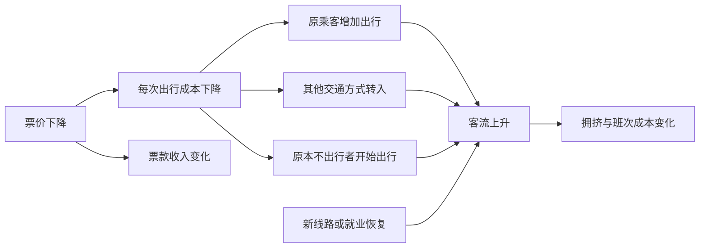
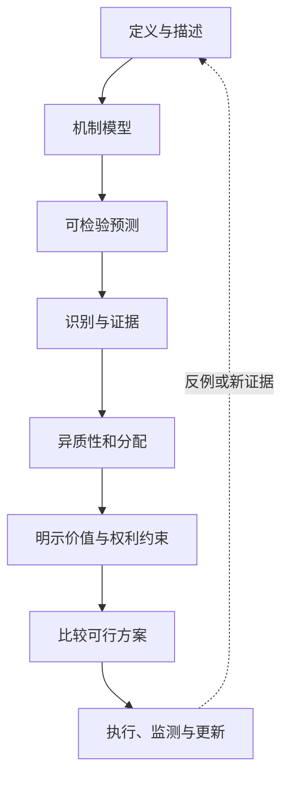

# 事实、模型与价值判断：一条新闻到底说了几件事

> [!question] 本页问题
> “某市房租一年上涨 10%，年轻人负担更重，所以政府应该限租。”这句话中，哪些部分可以直接查数据，哪些需要机制和因果证据，哪些必须公开价值标准？

社会争论常常不是一方有事实、另一方只有立场。更常见的情况是，双方把定义、观察、模型、因果和价值判断叠成一句话，然后在不同层次上彼此反驳。

本页提供一套可以实际拆新闻、论文和政策争论的方法。它不要求你暂时放弃价值立场，而是要求每一步说明：**这是什么类型的主张，凭什么成立，又是哪一步把事实接到了“应该”。**

## 先把一句话拆成六层

仍用开头的房租句子。下面所有房租数值都是合成教学设定，不对应某个真实城市：

| 层次 | 改写后的主张 | 需要什么才能判断 |
| --- | --- | --- |
| 定义 | “房租”指挂牌价、成交租金、每平方米租金，还是同品质住房的价格指数？ | 统计口径、样本、单位、时间和质量调整 |
| 描述 | 按已声明口径，指数在一年内上涨 10% | 原始数据、计算、修订状态和不确定性 |
| 分配 | 哪些租客的住房支出占收入比提高最多 | 家庭收入、住房类型、地区、迁移和群体分布 |
| 机制 | 供给受限、人口流入、收入预期、信贷条件或短租需求推动租金 | 可反驳的行为链、时序和竞争解释 |
| 因果 | 若采取限租，相对于不采取时，租金、供给、维护和分配会怎样 | 明确反事实、处理、结果、比较组和识别假设 |
| 规范 | 是否应限租，以及愿意承受什么代价 | 目标、权利、分配权重、时间偏好、风险和替代方案 |

这六层之间有关联，但没有哪一层能自动替代下一层。房租确实上涨，不足以证明某个原因；某政策确实降低平均租金，也不足以证明它在所有价值标准下都“更好”。

## 事实：不是“裸数据”，也不是任意意见

一个事实主张至少要给出对象、操作定义和观察程序。比如：

> 在一个合成案例中，2025 年 1 月到 2026 年 1 月，样本中持续出租、面积和区位可比的住宅，其质量调整后成交租金指数上升 10%。

它比“房租涨了 10%”多说明了：

- 时间窗口是一年，而不是某个月乘十二；
- 观察的是成交而非挂牌；
- 比较对象控制了部分房屋质量变化；
- 数字来自样本，并不一定覆盖所有住房；
- 这是价格指数变化，不直接告诉我们租客总支出或负担。

定义需要选择，因此事实并非脱离概念自动出现。但选择定义不等于任何说法都同样正确。定义固定后，数据是否支持主张、计算能否复现、遗漏是否改变结论，仍然可以公开核查。

### 最小事实卡

读到一个数字时，先补齐：

```text
对象：谁或什么？
指标：怎样操作定义？
单位：元、百分比、指数点还是人数？
分母：占谁的比例？
范围：哪个地区、群体、市场？
期间：时点、月度流量、年度累计还是移动平均？
来源：调查、行政记录、交易、模型估计还是预测？
版本：何时发布，是否修订？
```

完整的存量、流量、名义/实际和分布定义由 [[社会科学/10-共同工具/02-指标分布与存量流量核算|指标、分布与存量流量核算]] 维护；本页不重复推导。

## 模型：把复杂世界压缩成可检查的关系

模型不是现实的缩小照片。它明确忽略一些东西，以便追踪另一些关系。

假设我们先用最简单的租赁市场模型：

```text
租客愿意租多少：受租金、收入、家庭规模和替代住房影响
房东愿意供给多少：受租金、维护成本、空置风险和其他用途影响
短期约束：住房数量和区位几乎固定
长期调整：新建、改造、迁移、合租和退出市场
```

这个模型可以产生一个有用预测：在其他条件相近时，需求突然增加、短期供给又难调整，租金会承受上行压力。但它没有证明现实中本轮上涨就是由需求造成，也没有告诉我们限租的净效果。

### 模型要交代四件事

1. **对象**：家庭、企业、政府、金融机构还是群体？
2. **约束**：预算、时间、规则、信息、技术和权力边界是什么？
3. **行为**：对象怎样选择、协商、学习或遵从规范？
4. **结果**：价格、数量、分配、组织或观念怎样由互动产生？

模型越简单，越要写清省略了什么。加入更多变量也不自动更真实；如果新变量无法测量、关系无法反驳，只会让故事更难检查。

## 预测、机制和因果不是同一个问题

“高收入地区房租通常更高”可以是稳定预测。它可能来自收入提高需求，也可能因为高生产率城市同时吸引企业和人口，或因为住房供给规则不同。

下面三类问题需要不同证据：

| 问题 | 例子 | 结论边界 |
| --- | --- | --- |
| 预测 | 已知收入、区位和空置率，能否预测下月租金？ | 预测准不等于变量是可干预原因 |
| 机制 | 新增就业怎样经人口流入和住房搜索影响租金？ | 机制链应给时序、中介和反例 |
| 因果 | 建设更多住房相对于不建设，会把租金改变多少？ | 需要反事实和识别假设 |

完整的混杂、中介、碰撞和识别定义在 [[社会科学/10-共同工具/03-因果图反事实与识别|因果图、反事实与识别]]。在读完那一页以前，最低限度是不要把“在之后发生”“可以预测”或“模型里有一条箭头”写成已识别因果。

## 价值判断：把“更好”拆成对象与代价

“政府应该限租”不只是事实句。它至少需要回答：

- **目标是什么**：住房可负担、居住稳定、供给增长、社区连续性还是财政节约？
- **谁的结果重要**：现有租客、新租客、低收入家庭、房东、未来居民或纳税人？
- **怎样加总**：平均改善、最弱者优先、权利底线还是机会平等？
- **时间多长**：本月租金、五年供给还是代际居住机会？
- **承受何种风险**：愿意用多大的供给不确定性换短期保障？
- **程序是否可接受**：即使结果更高效，权利、透明度和申诉是否满足？

David Hume 在《人性论》卷三第一部分第一节提醒读者：论证常从“是”悄然跳到“应当”，却没有说明新的关系从哪里来。[原文定位](https://davidhume.org/texts/t/3/full) 这条提醒并不证明事实与价值毫无关系；它要求把连接两者的规范前提写出来。

Max Weber 在 1904 年的方法论文章中主张严格区分经验知识与价值判断，同时也承认研究问题的选择会受价值关切影响。[英译文本](https://authortomharper.com/wp-content/uploads/2022/04/1904-Objectivity-of-Social-Science-and-Social-Policy-Max-Weber.pdf) 因此，公开价值前提与严谨核查经验主张可以同时成立。

## 一个完整例子：公共交通降价

下面也是合成教学案例：某市把公交票价从 3 元降到 2 元，半年后日均客流上升 8%。支持者说政策成功，反对者说财政补贴浪费。

### 第一步：描述发生了什么

需要知道客流统计是否覆盖相同线路、是否剔除季节性、同期是否开通新线、基期是否受特殊事件影响。若口径不一致，“8%”连描述性事实都不稳定。

### 第二步：列候选机制



图中 `O` 是竞争解释。即使票价下降在前、客流上升在后，也不能仅凭时间顺序排除新线路或就业恢复。箭头是待检验机制，不是证据强度标记。

### 第三步：定义效果

可能关心：

- 所有居民平均新增多少次出行；
- 低收入居民通勤时间或就业可达性怎样变化；
- 私家车出行和排放是否减少；
- 票款减少、运营成本和财政补贴怎样变化；
- 未被线路覆盖的人是否承担税收却没有受益。

“客流上升 8%”只覆盖第一组结果的一部分。政策可以在客流目标上成功，却在拥挤、财政或地区公平上失败。

### 第四步：写出规范桥梁

一种完整但仍可争论的政策论证是：

```text
事实：降价使低收入居民的就业可达性提高，估计效果与不确定性为……
机制：效果主要经更低的边际出行成本和更高班次利用率产生……
规范前提：在满足最低服务可靠性的前提下，低收入群体的基本通勤机会应获得较高权重……
制度约束：补贴来源、线路容量和申诉程序为……
结论：与候选方案 X、Y 相比，选择方案 Z；若容量指标超过阈值则调整……
```

这样写不保证结论唯一正确，却让争论可以定位：是效果估错、机制不成立、价值权重不同，还是替代方案被遗漏？

## 事实与价值会相互影响，但不能混成一团

### 价值会影响测量什么

如果只测平均通勤时间，就可能看不见轮椅使用者的可达性；选择报告中位数还是最弱群体，本身反映关切。但一旦指标和采样规则公开，数据质量仍可检验。

### 事实会约束可行的价值实现

两人都重视住房稳定，却可能因对供给反应的经验判断不同而支持不同政策。新证据可以改变政策选择，即使价值没有改变。

### 制度会改变偏好表达

公开调查中的偏好、实际支付、投票和组织行动回答不同问题。人们也会在规则下学习和适应，不能把一次选择直接当作永恒价值。

## 三个反例：为什么简单口号会失败

### “只要数据，不谈价值”

数据可以估计政策对不同群体的效果，却不能自行决定怎样在群体之间加权，也不能决定某项权利是否允许用总收益交换。

### “价值都是主观的，所以事实不重要”

即使价值多元，政策仍受预算、技术、行为反应和副作用约束。忽略事实会让珍视的目标落空，或把代价转嫁给没有被看见的人。

### “模型证明政策正确”

模型只在给定目标、假设和参数下产生结论。换一个信息结构、时间范围或分配权重，最优方案可能改变。模型输出是条件句，不是命令。

## 一套可以复用的论证格式



每个框都允许结论是“不知道”。真正危险的是跳过中间框，却用确定语气替代缺失的证据或价值前提。

## 练习：拆一条新闻

新闻标题：

> 某国青年失业率高于邻国，因此教育扩招政策失败，应立即削减大学名额。

尝试回答：

1. “青年”“失业”“劳动力”“高于”各需什么定义？
2. 扩招如何可能影响劳动参与、求职时点、工资和行业匹配？
3. 哪些同期变化会同时影响扩招和失业率？
4. 评价政策只看短期失业率，遗漏了哪些结果与群体？
5. “应削减名额”依赖哪些价值和制度前提？

完成后读 [[社会科学/10-共同工具/04-比较研究偏差与证据审计|比较研究、偏差与证据审计]]，那里会用具体分母算例说明两个青年失业率为何可能不可直接比较。

## 来源与证据边界

1. David Hume, *A Treatise of Human Nature*, Book III, Part I, Section I，尤其 `T 3.1.1.27` 附近的“is/ought”段落。[可定位原文](https://davidhume.org/texts/t/3/full)
2. Max Weber, “The ‘Objectivity’ of Knowledge in Social Science and Social Policy” (1904)，英译本开头及关于经验分析、价值判断和文化意义的讨论。[英译文本](https://authortomharper.com/wp-content/uploads/2022/04/1904-Objectivity-of-Social-Science-and-Social-Policy-Max-Weber.pdf)
3. Lionel Robbins, *An Essay on the Nature and Significance of Economic Science* (1932)，用于追踪经济分析中目的、稀缺手段与规范判断的经典区分。[第一版入口](https://mises.org/library/book/essay-nature-and-significance-economic-science)
4. National Academies, *Reproducibility and Replicability in Science* (2019)，用于区分可重复计算、独立重复研究、证据综合与结论可信度。[报告章节](https://www.nationalacademies.org/read/25303/chapter/10)

这些来源支持方法论区分，不替本页的房租或公交教学例提供实证结果。Hume、Weber 与 Robbins 的立场也不能压成完全相同的“事实/价值二分”；本页只提取共同的最低要求：经验断言和规范结论之间的桥梁必须可见。

## 学完本页

- [ ] 我能把一句政策口号拆成定义、描述、分配、机制、因果和规范六层。
- [ ] 我能说明模型是条件化的压缩，而不是现实照片或政策命令。
- [ ] 我不会用预测准确替代可干预因果，也不会把时间先后当成充分识别。
- [ ] 我能写出一个政策结论所依赖的目标、群体权重、权利、时间和风险前提。
- [ ] 我知道下一步该去核算页、因果页还是比较审计页，而不是继续在同一句话里争论。

---

**返回**：[[社会科学/00-开始/00-社会科学-首页|社会科学首页]]  
**下一步**：[[社会科学/10-共同工具/02-指标分布与存量流量核算|指标、分布与存量流量]] · [[社会科学/10-共同工具/03-因果图反事实与识别|因果图、反事实与识别]] · [[社会科学/10-共同工具/04-比较研究偏差与证据审计|比较研究、偏差与证据审计]]
