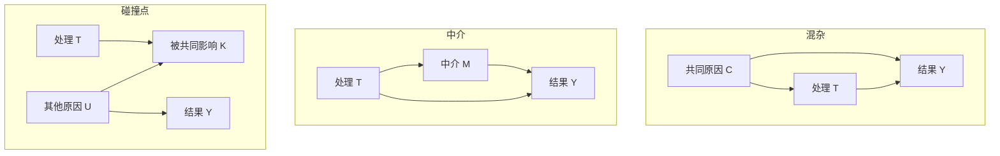

# 因果图、反事实与识别：数据何时能回答“如果当时不同”

## 要解决的问题

某市上线就业培训后，参加者平均工资比未参加者高 1200 元。这是培训的效果，还是本来更积极、资源更多的人更愿意参加？因果问题不是“两个变量是否相关”，而是：**对同一个目标人群，若把处理从 0 改成 1，结果会怎样变化？**

统计可以精确描述观察到的联合分布；因果结论还需要一座从观察分布通向反事实的桥。潜在结果写清要比较什么，因果图写清这座桥依赖哪些结构假设，“识别”则检查这些假设是否足以把目标量写成可由数据估计的表达式。

## 三层对象先分开

设单位为人，处理 $T\in\{0,1\}$ 表示是否参加培训，结果 $Y$ 是六个月后的月工资，单位为元。

- **观察事实**：每人只看到 $Y=Y(T)$；参加者看到 $Y(1)$，未参加者看到 $Y(0)$。
- **反事实变量**：$Y_i(1)$、$Y_i(0)$ 是同一个人分别接受和不接受处理时的两个潜在结果。两者的差 $\tau_i=Y_i(1)-Y_i(0)$ 不能同时观察。
- **目标量**：总体平均处理效应 $ATE=E[Y(1)-Y(0)]$；已参加者平均处理效应 $ATT=E[Y(1)-Y(0)\mid T=1]$。二者在效应异质时不是同一个问题。

一致性要求实际接受 $T=t$ 时，观察结果等于该版本处理下的 $Y(t)$。若“培训”有线上、线下、不同课时等多个会影响结果的版本却仍编码成一个 1，一致性就没有被清楚定义。无干扰是 SUTVA 常见部分：甲的处理不改变乙的结果；疫苗、同伴教育和污染治理常会违反它，因此不能默默假定。

## 因果图把结构主张放到桌面上

下面是一个候选数据生成过程。箭头表示直接因果假设，不表示仅凭数据已经证明；$Z$ 是处理前技能，既影响参训又影响工资。

从 $T$ 到 $Y$ 的总效应受到后门路径 $T\leftarrow Z\rightarrow Y$ 混杂。若图完整、$Z$ 在处理前测量且满足下述条件，可以按 $Z$ 调整。结构因果模型会进一步写成 $T=f_T(Z,U_T)$、$Y=f_Y(T,Z,U_Y)$；潜在结果则把 $f_Y(t,Z,U_Y)$ 记作 $Y(t)$。两套语言强调点不同，但都要求研究者公开模型外的结构知识。

三种常被混淆的变量位置：

若目标是总效应，调整中介 $M$ 会截掉处理经 $M$ 产生的间接作用；图中的 $T\rightarrow Y$ 则保留不经 $M$ 的直接路径。碰撞点 $K$ 原本封闭路径 $T\rightarrow K\leftarrow U\rightarrow Y$；按 $K$ 分层或只选择 $K=1$ 的人反而会打开虚假关联。所谓“控制越多越好”因此是错的，变量角色必须相对一个明确的处理、结果和时间顺序判断。

## 从反事实到可估计表达式

观察数据中 $E[Y\mid T=1]-E[Y\mid T=0]$ 比较的是两个不同人群。要把它解释为 ATE，最常用的一组充分条件是：

1. **一致性**：$T=t$ 时 $Y=Y(t)$，处理版本定义清楚；
2. **条件可交换性**：$Y(t)\perp T\mid Z$。给定 $Z$ 后，谁接受处理不再携带潜在结果信息；
3. **正值性/重叠**：对目标人群中每个 $z$，$0<P(T=t\mid Z=z)<1$；
4. **测量与抽样适配**：$Z,T,Y$ 的测量、缺失和样本选择没有另造未处理的偏差。

在这些条件下，标准化公式是

$$
E[Y(t)]=\sum_z E[Y\mid T=t,Z=z]P(Z=z),
$$

连续 $Z$ 时把求和换成积分。公式本身是代数；“为什么右侧等于反事实均值”依靠可交换性、一致性与正值性，而不是依靠回归软件。

### 一个能手算的混杂例子

下面全是教学构造的期望人数，不是真实培训数据。低技能组不培训的成功率为 0.60、培训为 0.80；高技能组相应为 0.20、0.40。每组内部处理效应都是 0.20，但参训者中高技能者更多：

| 处理前技能 | 参训人数 | 参训成功率 | 未参训人数 | 未参训成功率 |
| --- | ---: | ---: | ---: | ---: |
| 低 | 10 | 0.80 | 30 | 0.60 |
| 高 | 30 | 0.40 | 10 | 0.20 |

粗比较为 $(10\times0.8+30\times0.4)/40=0.50$，未参训也为 $(30\times0.6+10\times0.2)/40=0.50$，看似没有效果。若目标总体两种技能各占一半，标准化后参训潜在成功率为 $(0.8+0.4)/2=0.60$，未参训为 $(0.6+0.2)/2=0.40$，ATE 为 0.20。差异来自组成人数，不是算术魔法。

这个复算只证明“给定表格与识别条件时公式算出 0.20”。它没有证明现实中技能已经测全，也没有证明成功率会按表中机制生成。

## 识别、估计与外推是三道门

**识别**问：在无限数据下，目标量能否由观察分布唯一决定？未测混杂会让多个不同因果过程产生同一观察分布，此时更复杂模型也不能凭空补信息。**估计**问：有限样本中怎样近似已识别表达式，并量化抽样不确定性。**外推**问：样本中的效应能否迁移到目标地区、时期和实施版本。

因此，预测准确不等于因果识别。一个模型可从处理后的变量准确预测结果，却在干预时完全失效；反过来，随机试验可识别平均效应，即使个体结果很难预测。机器学习在因果工作中的特定用途，如估计倾向分数、条件均值和异质效应，应在 ML 应用页讨论；一般 DAG、反事实与识别以本页为主解释。

## 反例与敏感性

- **未测混杂**：动机同时影响参训与工资，但没有可靠测量。调整已观测技能不够；应讨论负对照、工具变量、敏感性分析或更强设计，而不是写“已控制所有变量”。
- **缺乏重叠**：某资格组人人参训。该组没有未参训对照，ATE 需要模型外推；删去该组会改变目标人群。
- **选择碰撞**：只分析获聘者，而参训和原始能力都影响获聘，可能在获聘者内部制造负关联。
- **时间变化混杂**：早期处理改变后续健康，而健康又影响后续处理。简单把后续健康当普通控制变量会同时阻断机制并引入偏差，需要纵向 g 方法等专门工具。
- **干扰与均衡效应**：培训提高一部分人的求职排名，却挤走他人。个体处理效应与扩大项目后的市场均衡效应不同。

当核心假设不可直接检验时，诚实做法是写出会推翻结论的未观测因素强度、处理版本、溢出范围和目标总体。可检验诊断只能攻击假设的一部分：例如重叠图能发现观测上的极端倾向分数，却不能证明没有未测混杂。

## 证据类型检查框

| 句子 | 类型 | 可以怎样核对 |
| --- | --- | --- |
| 本构造表标准化 ATE 为 0.20 | 数学推导 | 按四个率和目标组权重复算 |
| 图中 $Z$ 同时导致参训与工资 | 模型假设 | 学科知识、时间顺序、替代图与敏感性分析 |
| 某真实培训提高工资 | 经验因果结论 | 具体设计、识别条件、估计与不确定性 |
| 应优先帮助低收入者 | 规范判断 | 公开公平原则、权利与机会成本，不能由 ATE 单独推出 |

## 下一步

- 进入 [[社会科学/40-公共政策与社会学/07-政策评估RCT与准实验|政策评估]]，比较 RCT、DID、RD、IV 与合成控制分别借哪座识别桥。
- 回到 [[数学/30-概率与统计/05-统计估计置信度与模型评测|统计估计]]，区分识别偏差与有限样本误差。
- 网络中“相似”究竟是选择还是影响，见 [[社会科学/40-公共政策与社会学/05-网络社会资本制度与文化|网络、社会资本、制度与文化]]。

## 来源定位

1. Judea Pearl, “Causal Diagrams for Empirical Research,” 1995，摘要及第 1—3 节：图模型如何把学科假设与统计信息结合，并用图判断识别与调整；作者所在 UCLA 技术报告全文已打开核对。
2. Miguel Hernán、James Robins, *Causal Inference: What If*, 2024 在线版，第 1—3 章：潜在结果、个体/总体效应、一致性、可交换性、正值性与标准化；作者官网全文已打开核对。
