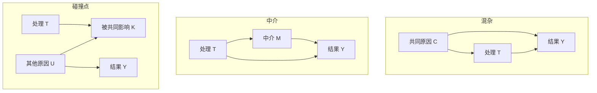

# 因果图、反事实与识别：数据何时能回答“如果当时不同”

## 要解决的问题

某市上线就业培训后，参加者平均工资比未参加者高 1200 元。这是培训的效果，还是本来更积极、资源更多的人更愿意参加？因果问题不是“两个变量是否相关”，而是：**对同一个目标人群，若把处理从 0 改成 1，结果会怎样变化？**

统计可以精确描述观察到的联合分布；因果结论还需要一座从观察分布通向反事实的桥。潜在结果写清要比较什么，因果图写清这座桥依赖哪些结构假设，“识别”则检查这些假设是否足以把目标量写成可由数据估计的表达式。

## 三层对象先分开

### 先固定单位、时点与目标总体

在第一次写潜在结果前，先给主张卡补三句话。**单位**是被处理和观察的对象：家庭随机获券、儿童报告收入时，两者不同，不能把同一家多个孩子当独立随机化。**时点**至少分处理前测量、分配/实施时点和结果窗口；“六个月工资”不能静默换成终身收入。**目标总体**是希望对谁说结论，样本/抽样框是实际能看见谁；报名家庭的效应不会因样本大就自动成为所有家庭的效应。

本页培训例先把目标限制为这套教学构造中的人；若换成另一个城市的全部求职者，要另查覆盖、制度和处理版本。带着“目标里谁没有进入记录，何时测量”，读 [[社会科学/10-共同工具/04-比较研究偏差与证据审计#先把目标总体、抽样单位与时点对齐|比较审计的总体与单位小节]]，回来写**目标总体、抽样单位、处理版本和两端时点**。信息缺失时可交这四项的未知清单，暂不裁决 ATE；其余分类仍可继续。

首轮产物沿用 [[社会科学/10-共同工具/01-事实模型与价值判断#一张主张卡：让同一论证带着范围跨页|同一张主张卡]]，不另建因果专用卡。初读者先把“参加者工资更高”标为描述，把“培训提高工资”标为因果；本科读者先写目标量再核单位。两者都返回这里的三层对象和下面的识别条件。

设单位为人，处理 $T\in\{0,1\}$ 表示是否参加培训，结果 $Y$ 是六个月后的月工资，单位为元。

- **观察事实**：每人只看到 $Y=Y(T)$；参加者看到 $Y(1)$，未参加者看到 $Y(0)$。
- **反事实变量**：$Y_i(1)$、$Y_i(0)$ 是同一个人分别接受和不接受处理时的两个潜在结果。两者的差 $\tau_i=Y_i(1)-Y_i(0)$ 不能同时观察。
- **目标量**：总体平均处理效应 $ATE=E[Y(1)-Y(0)]$；已参加者平均处理效应 $ATT=E[Y(1)-Y(0)\mid T=1]$。二者在效应异质时不是同一个问题。

一致性要求实际接受 $T=t$ 时，观察结果等于该版本处理下的 $Y(t)$。若“培训”有线上、线下、不同课时等多个会影响结果的版本却仍编码成一个 1，一致性就没有被清楚定义。无干扰是 SUTVA 常见部分：甲的处理不改变乙的结果；疫苗、同伴教育和污染治理常会违反它，因此不能默默假定。

## 因果图把结构主张放到桌面上

下面是一个候选数据生成过程。箭头表示直接因果假设，不表示仅凭数据已经证明；$Z$ 是处理前技能，既影响参训又影响工资。

从 $T$ 到 $Y$ 的总效应受到后门路径 $T\leftarrow Z\rightarrow Y$ 混杂。若图完整、$Z$ 在处理前测量且满足下述条件，可以按 $Z$ 调整。结构因果模型会进一步写成 $T=f_T(Z,U_T)$、$Y=f_Y(T,Z,U_Y)$；潜在结果则把 $f_Y(t,Z,U_Y)$ 记作 $Y(t)$。两套语言强调点不同，但都要求研究者公开模型外的结构知识。

三种常被混淆的变量位置：

若目标是总效应，调整中介 $M$ 会截掉处理经 $M$ 产生的间接作用；图中的 $T\rightarrow Y$ 则保留不经 $M$ 的直接路径。碰撞点 $K$ 原本封闭路径 $T\rightarrow K\leftarrow U\rightarrow Y$；按 $K$ 分层或只选择 $K=1$ 的人反而会打开虚假关联。所谓“控制越多越好”因此是错的，变量角色必须相对一个明确的处理、结果和时间顺序判断。

**把碰撞点带回裁判记录。** 在 [[社会科学/63-法学/06-同题比较与共同案例完整解答#费用和时间数据怎样参与比较|法律费用比较]] 中，携带费用口径、程序资源、争议总体和进入时点，进入 [[社会科学/63-法学/06-同题比较与共同案例完整解答#进入裁判样本后，胜诉率还代表谁|100件合成争议的四格例]]。那里 $R\to S\leftarrow H\to Y$ 固定了资源、证据、选择和潜在裁判标签；总体中资源与证据独立，只看 $S=1$ 后却相关。先遮答案复算“覆盖增加而记录胜诉率下降”，再返回法律小节说明：费用表没有证明这个进入机制真实成立，$S$的条件化也不是把裁判规则改成按资源判决。两页共享的是变量角色与可检查的选择逻辑，培训、获聘和采购争议各自的单位与数字保持独立。

## 从反事实到可估计表达式

此处已固定单位、处理版本、目标总体与结果时点；如果这四项仍未知，先返回上一节，识别假设不能替它们作答。观察数据中 $E[Y\mid T=1]-E[Y\mid T=0]$ 比较的是两个不同人群。要识别同一目标总体中经 $Z$ 调整、按共同目标权重标准化的 ATE，最常用的一组充分条件是：

1. **一致性**：$T=t$ 时 $Y=Y(t)$，处理版本定义清楚；
2. **条件可交换性**：$Y(t)\perp T\mid Z$。给定 $Z$ 后，谁接受处理不再携带潜在结果信息；
3. **正值性/重叠**：对目标人群中每个 $z$，$0<P(T=t\mid Z=z)<1$；
4. **测量与抽样适配**：$Z,T,Y$ 的测量、缺失和样本选择没有另造未处理的偏差。

在这些条件下，标准化公式是

$$
E[Y(t)]=\sum_z E[Y\mid T=t,Z=z]P(Z=z),
$$

连续 $Z$ 时把求和换成积分。对两种处理状态使用同一目标总体的 $P(Z=z)$ 标准化，再相减，得到该总体 ATE。仅有条件可交换性并不让未经调整的组均值差等于 ATE；原始均值差还需额外条件，例如目标总体中的无条件可交换性（有效随机分配可提供这种设计基础），以及适当的测量与抽样。下例的原始差为 0、标准化差为 0.20，正说明二者不能混用。公式本身是代数；“为什么右侧等于反事实均值”依靠可交换性、一致性与正值性，而不是依靠回归软件。

### 一个能手算的混杂例子

下面改用一个**新的二元结局** $Y^\star$，不再沿用前文“六个月后的月工资（元）”的结果定义：$Y^\star=1$ 表示六个月后达到本构造预先规定的成功标准，$Y^\star=0$ 表示未达到。因此表中的 0.20、0.40、0.60、0.80 都是成功概率；后面的效应 0.20 是 **20 个百分点**，不是工资金额，也不是相对增长 20%。以下全是教学构造的期望人数，不是真实培训数据。为避免给组名附加未经解释的技能含义，令处理前分层变量 $Z\in\{A,B\}$：A 组不培训的成功率为 0.60、培训为 0.80；B 组相应为 0.20、0.40。每组内部处理效应都是 0.20，但参训者中 B 组更多：

| 分层 $Z$ | 参训人数 | 参训成功率 | 未参训人数 | 未参训成功率 |
| --- | ---: | ---: | ---: | ---: |
| A | 10 | 0.80 | 30 | 0.60 |
| B | 30 | 0.40 | 10 | 0.20 |

粗比较使用的是观察到的处理组构成：$P(Z=A\mid T=1)=10/40$、$P(Z=B\mid T=1)=30/40$，所以

$$
E[Y^\star\mid T=1]
=\frac{10\times0.8+30\times0.4}{40}
=0.50.
$$

未参训组的构成反过来是 $30/40,10/40$，故 $E[Y^\star\mid T=0]=0.50$。这两个观察条件均值是在不同 $Z$ 构成的人群中得到的预测性比较，并不是同一目标总体分别接受和不接受培训后的反事实比较。

现在另行声明目标总体权重为 $P_{\mathrm{target}}(Z=A)=P_{\mathrm{target}}(Z=B)=0.5$。目标权重不是处理组构成，也不是由本表人数自动决定的。这里的目标总体不是另一个未经连接的外部人群，而是在**同一教学构造内**按 $Z$ 层重新赋权：它沿用表中 A、B 两层各自的潜在结局分布，只把目标层权重设为 $(0.5,0.5)$。在这一范围内，若对新二元结局满足一致性、条件可交换性 $Y^\star(t)\perp T\mid Z$ 和正值性 $0<P(T=t\mid Z=z)<1$，则标准化可识别该重加权目标的潜在成功概率：

$$
\begin{aligned}
E_{\mathrm{target}}[Y^\star(1)]
&=0.5\times0.8+0.5\times0.4=0.60,\\
E_{\mathrm{target}}[Y^\star(0)]
&=0.5\times0.6+0.5\times0.2=0.40.
\end{aligned}
$$

因此目标总体 ATE 为 $0.60-0.40=0.20$，即 20 个百分点。这不是声称观察样本的条件结果可自动运输到任意新总体；若目标总体改变了 A、B 层内的潜在结局分布，还需要额外的运输性或外推假设。这里的“反事实”是把同一目标总体都设为 $T=1$ 或都设为 $T=0$ 后的 $Y^\star(t)$；“条件化”只是描述已观察到 $T=t$ 的人。只有在上述识别条件和此处 DAG 的结构主张成立时，观察条件均值才可用于计算干预意义下的 $E[Y^\star(t)]$，不能把 $P(Y^\star=1\mid T=t,Z=z)$ 自动当作无需假设的 $P(Y^\star(t)=1\mid Z=z)$。

这个复算只证明“给定表格、明确目标权重和识别条件时公式算出 0.20”。它没有证明现实中混杂已测全，也没有证明真实成功概率会按表中机制生成。

## 识别、估计与外推是三道门

**识别**问：在无限数据下，目标量能否由观察分布唯一决定？未测混杂会让多个不同因果过程产生同一观察分布，此时更复杂模型也不能凭空补信息。**估计**问：有限样本中怎样近似已识别表达式，并量化抽样不确定性。**外推**问：样本中的效应能否迁移到目标地区、时期和实施版本。

因此，预测准确不等于因果识别。一个模型可从处理后的变量准确预测结果，却在干预时完全失效；反过来，随机试验可识别平均效应，即使个体结果很难预测。机器学习在因果工作中的特定用途，如估计倾向分数、条件均值和异质效应，应在 ML 应用页讨论；一般 DAG、反事实与识别以本页为主解释。

## 顺时序且预测相同，干预为何仍不同

先另建一个二元有限模型，与培训成功、技术损害和裁判标签各自分开。$X_0\in\{0,1\}$ 是时间0的行动，$Y_1\in\{0,1\}$ 是时间1的结果；观察者只记录这两量。只按 $X_0$ 预测 $Y_1$ 不会读取未来。以下两种候选 SCM 都顺时序，$\oplus$ 表示 XOR（两位不同为1），$\mathrm{Bern}(p)$ 表示取1的概率为 $p$。

- **模型 A：共同原因。** 时间0之前生成 $Z\sim\mathrm{Bern}(1/2)$、$U\sim\mathrm{Bern}(1/5)$，二者独立；$X_0=Z\oplus U$，$Y_1=Z$。Z 是本模型的隐藏二元共同原因，不是前面培训表的 A/B 层变量。
- **模型 B：行动改变结果。** 时间0以外生随机量生成 $X_0\sim\mathrm{Bern}(1/2)$；噪声 $V\sim\mathrm{Bern}(1/5)$ 与它独立，$Y_1=X_0\oplus V$。B中没有A的隐藏共同原因路径。

A 可枚举四个外生状态：$(Z,U)=(0,0),(0,1),(1,0),(1,1)$ 的质量依次为 $.4,.1,.4,.1$，映到 $(X_0,Y_1)=(0,0),(1,0),(1,1),(0,1)$。B枚举 $(X_0,V)$ 的同四项质量，映到 $(0,0),(0,1),(1,1),(1,0)$。按观测坐标排列，两者都给出完整联合表：

| $P(X_0=x,Y_1=y)$ | $y=0$ | $y=1$ | 行和 |
| --- | ---: | ---: | ---: |
| $x=0$ | $2/5$ | $1/10$ | $1/2$ |
| $x=1$ | $1/10$ | $2/5$ | $1/2$ |

所以两者同有 $P(Y_1=1\mid X_0=x)=1/5+(3/5)x$。预测最可能标签 $\widehat Y_1=X_0$ 的准确率都是 $2/5+2/5=4/5$；该规则只用时间0的信息。每个观测格均有正概率，此处缺的不是某格的观察支持，而是选择哪个生成机制的依据。

**干预要替换方程，不能只筛选已有的 $X_0=x$ 人群。** A中把 $X_0=Z\oplus U$ 改为常数 $X_0=x$，其余外生分布和 $Y_1=Z$ 保留；因此两臂 $E_A[Y_1\mid do(X_0=x)]=P(Z=1)=1/2$。B中把外生分配 $X_0$ 的方程替换为 $X_0=x$，保留 V 与 $Y_1=x\oplus V$；$x=0$ 时均值 $1/5$，$x=1$ 时为 $4/5$。同一个干预问题得到

| 目标量 | 模型 A | 模型 B |
| --- | ---: | ---: |
| $E[Y_1\mid do(X_0=0)]$ | $1/2$ | $1/5$ |
| $E[Y_1\mid do(X_0=1)]$ | $1/2$ | $4/5$ |
| 两臂均值差（1减0） | $0$ | $3/5$ |

在每个模型内固定同一外生状态再替换方程，A的两个潜在结果都为Z；B为 $Y_1(0)=V,Y_1(1)=1-V$。平均差不同，而**观测联合分布完全相同**，因此仅给此表、时间先后及预测准确率，不能点识别这项干预效应。此结论是两候选机制构成的不可识别反例，不是说加上可信随机化、足够结构知识或新实验后仍永远不可识别。方程替换与识别的定义定位到 [Pearl 2009 §3.2.1–3.2.2，印刷页107–110](https://web.cs.ucla.edu/~kaoru/SS-2009-57-Sup.pdf)；这里的 XOR 双模型与数字是本节教学推导。

| 主张 | 被检查的对象 | 本例提供的证据 |
| --- | --- | --- |
| 系统/掩码是否读取未来 | 固定算子对输入前缀的依赖 | 任意共同前缀论证及有限值改动检查 |
| 给定过去怎样预测未来 | 观测条件分布 $P(Y_1\mid X_0)$ | 两模型同一联合表、准确率 $.8$ |
| 替换生成方程后结果怎样变 | 具名 SCM 中的 $P(Y_1\mid do(X_0=x))$ | 明示结构、外生分布与两臂替换；仅观察表不能择一 |

attention 的 A 权重是软件内部的一次混合系数；在固定模型内消融 token/表示可检查该软件输出怎样变。现实培训等对象的干预另有单位、处理版本、实施和结果机制，不能把这种软件操作或时间 mask 直接当现实因果贡献。

**撤去方法提示。** 把两模型的噪声概率同时改为 $3/10$，其他条件保留。遮住答案，重建联合表、最可能标签准确率、两模型的两臂干预均值和均值差；说明更多同类观察是否会选出唯一效应。

> [!answer]- 迁移答案
> 两表对角各 $7/20$、非对角各 $3/20$，条件预测为 $.3+.4x$，准确率 $.7$。A两臂仍 $.5/.5$、差0；B为 $.3/.7$、差 $.4$。仍同观测、不同干预，更多来自同一观察机制的数据不能区分两者；若新增有效随机实验或结构依据，是证据改变，须另核。

### 带着信息缺口往返

从 [[信号与系统/10-连续与离散系统/01-信号单位复指数与系统性质#共同前缀怎样检验非预见性|信号前缀]] 经 [[AI/20-LLM/20-架构/02-注意力MHA-MQA与GQA#causal mask 的共同前缀检查|causal mask]] 到此，延续的是可用信息的限制；离开时到 [[AI/90-资源/04-术语表#非预见、预测与干预各需要什么证据|三种证据的术语边界]]，带回本节 $.5/.5$ 与 $.2/.8$ 的差别。[[数学/30-概率与统计/20-随机过程/01-一般条件期望与过滤#过滤与可用信息|过滤的数学入口]]说明何时可知道什么，[[信号与系统/30-随机信号与推断/03-Wiener滤波线性预测与创新#滤波 预测与平滑的信息集|预测与平滑的信息窗口]]说明输出的发布时间；两者都不补上A/B的结构选择。

[[AI/13-搜索推理与规划/20-部分可观测决策/03-信息价值科学取证与行动#固定后果与行动时点后再算|主动取证]]已给定行动后果，返回时先问后果来自假设还是干预证据。[[AI/65-可信AI与真实数据实践/04-区间代价分组失败与发布漂移#部署改变分布时的重训与风险|部署反馈]]同样须先核分布反应函数的来源，不能用小预测误差在这里挑出A/B。[计量识别 #195](https://github.com/EunsonZ/WWL/issues/195) 与 [多主体学习 #167](https://github.com/EunsonZ/WWL/issues/167) 的后续扩展分别还要声明识别设计、行动/环境及对手变化的机制；它们是接续责任，未由时间顺序认证。

对 [[AI/10-机器学习与深度学习基础/21-因果机器学习选择偏差与反事实评估#反事实评估从支持集开始|策略日志]]，带去“所有格有支持仍不保证无混杂”，分别核随机化与目标量。下面的 [[社会科学/10-共同工具/03-因果图反事实与识别#已知群体风险，为什么个体归因仍有界|PN 四格例]]更进一步：干预边缘已识别仍可能缺联合反事实信息；那是另一层缺口，不把两个反例合成同一模型。

## 已知群体风险，为什么个体归因仍有界

上面的识别问题是从观察资料到干预平均值。再向前走一步：**即使同一总体在两种配置下的损害风险都精确已知，一个已经受损的单位若换另一配置是否仍会受损，也未必有唯一答案。** 缺的可能是同一单位两个潜在结果如何配在一起，而非样本数量。先从 [[数学/30-概率与统计/06-随机变量变换联合分布与常见分布#3. 联合、边缘、条件：分别回答什么|联合、边缘与条件分布]] 回顾“边缘求和会丢掉依赖信息”，回来具体指出本例哪一格仍自由。

### 固定配置、结果窗口与参考总体

这里重新定义一个**合成技术模型**，与前文工资、培训成功标准和合成书架案 F2 均分开。单位是一件装置的一次指定使用；$A=1$ 表示运行技术配置1，$A=0$ 表示运行技术配置0；两配置的部件、运行方式与使用条件事先固定，不把不同版本混成同一个值。$Y=1$ 表示在这次使用的固定观察窗口内发生指定损害，$Y=0$ 表示未发生。$Y(1),Y(0)\in\{0,1\}$ 属于**同一单位、同一窗口**；模型参考总体是按下表四类比例随机抽取的单位，不是已入诉讼记录的事故集，也不是 Lin 的已知所属总体。所有概率无量纲，风险差以百分点解释。

本节先声明这些条件：

| 条件 | 本例中承担的工作 | 不成立时的停点 |
| --- | --- | --- |
| 明确处理版本、结果与窗口 | 让 $Y(1),Y(0)$ 是可比较的两个量 | 更换部件、用途或损害定义须重新建模，不能沿用数字 |
| 一致性：实际 $A=a$ 时 $Y=Y(a)$ | 把已观察的 $A=1,Y=1$ 换成 $A=1,Y(1)=1$ | 不能直接用潜在结果的事件代替实际结果 |
| 无干扰 | 其他单位的配置不改变本单位结果，足以只用自己的 $A$ 作下标 | 有相互碰撞或风险转移时需把相关配置纳入潜在结果 |
| $A\perp(Y(1),Y(0))$，即与整对潜在结果联合独立 | 分配不改变四类构成，下面才能从条件于 $A=1$ 的联合事件化成参考总体联合事件 | 两个边缘各自与 $A$ 独立，不自动给出整对独立 |
| $0<P(A=1)<1$ 且两组来自该参考总体 | 两配置均有支持，观察组可在上述条件下提供各自干预边缘 | 只见某配置或只见被选择记录时，先核支持与选择 |

这是一份声明条件的有限反例，不是对真人实施伤害的实验。配置的技术编号不表示违法/合法，也不表示已尽/未尽法律义务。为直观起见可以令 $P(A=1)=1/2$，但下面的联合独立推导只要求它严格介于0和1。

### 同样的两种风险，可以来自不同的四格机制

四类是模型对同一单位两个反事实的描述；实际对该单位只观察一个结果。表格不是把配置1组某人与配置0组某人配成同一个人，也不是四次可观察实验。

| 同一单位的类型 $(Y(1),Y(0))$ | 若换配置，结果怎样 | 模型甲的总体比例 | 模型乙的总体比例 |
| --- | --- | ---: | ---: |
| $(1,1)$ | 两配置下均发生损害 | $1/10$ | $0$ |
| $(1,0)$ | 只在配置1下发生损害 | $1/10$ | $1/5$ |
| $(0,1)$ | 只在配置0下发生损害 | $0$ | $1/10$ |
| $(0,0)$ | 两配置下均不发生损害 | $4/5$ | $7/10$ |

按列求和，两个模型均归一化。按类型求和，甲的两风险是 $1/10+1/10=1/5$ 与 $1/10+0=1/10$；乙的是 $0+1/5=1/5$ 与 $0+1/10=1/10$。因此两模型均有

$$
p_1=P(Y(1)=1)=1/5,\qquad p_0=P(Y(0)=1)=1/10,\qquad
ATE=E[Y(1)-Y(0)]=p_1-p_0=1/10.
$$

配置1比配置0的平均损害风险高 **10个百分点**。乙中却有 $1/10$ 的单位只在配置0下受损；总体风险较高不表示每个单位的风险方向都相同。即使按联合独立分配观察到的两组风险也分别为 $1/5,1/10$，两组数据仍没有揭示同一单位反事实的配对方式。

对从该参考总体随机抽到、且实际满足 $A=1,Y=1$ 的单位，必要原因概率（probability of necessity, PN）问：“若该单位改用配置0，这次损害是否不会发生？”它是条件于已用配置1且已受损这类单位的模型概率，不是其违法概率或胜诉概率。由条件事件一步一步化简：

$$
\begin{aligned}
PN&=P(Y(0)=0\mid A=1,Y=1)\\
&=P(Y(0)=0\mid A=1,Y(1)=1) &&\text{一致性}\\
&=\frac{P(Y(0)=0,Y(1)=1\mid A=1)}{P(Y(1)=1\mid A=1)}\\
&=\frac{P(Y(1)=1,Y(0)=0)}{P(Y(1)=1)} && A\perp(Y(1),Y(0)).
\end{aligned}
$$

分母非零，因为 $p_1=1/5>0$。甲中配置1下会受损的两类各占一半，所以 $PN_\mathrm{甲}=(1/10)/(1/5)=1/2$；乙中该组全是 $(1,0)$ 类型，故 $PN_\mathrm{乙}=(1/5)/(1/5)=1$。这两个不同答案与完全相同的两种干预风险相容；即使无限样本已使风险估计没有抽样误差，也不能据此选择甲或乙。

### 从四格非负性推出能说到哪里

令 $q=P(Y(1)=1,Y(0)=1)$。在给定 $p_1,p_0$ 后，四格必为

$$
(p_{11},p_{10},p_{01},p_{00})
=(q,\ p_1-q,\ p_0-q,\ 1-p_1-p_0+q).
$$

四格均非负，分别要求 $q\ge0$、$q\le p_1$、$q\le p_0$、$q\ge p_1+p_0-1$，因此

$$
\max(0,p_1+p_0-1)\le q\le\min(p_1,p_0).
$$

反过来，该范围内每个 $q$ 都给出总和为1的合法四格；再令 $A$ 独立分配即可构成满足上述条件的模型。故这不只是必要限制，范围内的答案都能实现。对本例，$0\le q\le1/10$，从而

$$
PN=\frac{1/5-q}{1/5}=1-5q\in[1/2,1].
$$

两端分别由甲、乙达到，这是**模型内的识别区间**：缺联合信息留下的一组可能答案。它不是有限样本置信区间，也不是“有95%概率真值在这里”；更多同类样本可以把两边缘估得更准，却不能自动观察反事实联合。一般 $p_1>0$ 时，上述代数也给 $PN\in[\max(0,p_1-p_0)/p_1,\ \min(p_1,1-p_0)/p_1]$；若 $p_1=0$，条件事件在本分配模型中概率为零，不能继续报一个 PN。

**单调性是另加的信息。** 若另有机制依据支持 $Y(1)\ge Y(0)$ 对每个单位成立，即“配置1不会对任何单位预防该损害”，便排除 $(0,1)$ 类型。此时 $p_0-q=0$，故 $q=1/10$，本例才点识别为 $PN=1/2$。若把从1换到0称为改进措施，该方向的单调性就是“换到0不会让任何单位新增此损害”；这是对单位机制的额外假设。乙已经证明平均改善不能推出它。撤掉单调性后须恢复 $[1/2,1]$，不能保留唯一的 $1/2$；新增一句“配置1平均更危险”没有补上缺失条件。

**联合独立也有自己的作用。** 只把 $A$ 与 $Y(1)$、$Y(0)$ 分别独立，会使两边缘在处理组间相同，但不保证四类构成相同。一个可检查的失效例令 $P(A=1)=1/2$，在 $A=1$ 与 $A=0$ 两组分别给四类分布 $(.08,.12,.02,.78)$ 与 $(.02,.18,.08,.72)$。两组的 $Y(1)$ 边缘均为 $.2$，$Y(0)$ 边缘均为 $.1$，平均后的参考总体四格是 $(.05,.15,.05,.75)$；然而实际 $A=1,Y=1$ 组中的 $PN=.12/.2=.6$，不能用参考总体的 $.15/.2=.75$ 代替。这个例子只否定上面的联合约分，**没有宣称较弱条件下不存在其他界限**；本节始终在明确声明的联合独立范围内证明。

### 复算、撤去提示与返回任务

有限复算保留 [固定输入](../80-实践/03-潜在结果联合与必要原因概率/inputs.json)、[标准库 Fraction 源码](../80-实践/03-潜在结果联合与必要原因概率/pn_joint.py)、[精确结果](../80-实践/03-潜在结果联合与必要原因概率/outputs/exact-results.json) 与 [四格表 CSV](../80-实践/03-潜在结果联合与必要原因概率/outputs/exact-table.csv)。在库根运行 `python3 -B 社会科学/80-实践/03-潜在结果联合与必要原因概率/pn_joint.py`，只重建该例输出；通过 `--input`、`--output-dir` 可把改动输入和输出放到独立目录。它逐项复算甲、乙、中间四格和上述失效例，用有理数保留恰当分母；这不是拟合真实风险或替代一般证明。

**先完整示范，再遮住公式做迁移。** 保持配置、窗口、参考总体、两风险和联合独立分配，仅新增 $q=1/20$；补齐四类比例，算这类已受损单位的必要原因概率，判断单调性与 ATE 怎样变化。随后另做条件改变题：①撤去单调性，只给原两风险与联合独立；②风险研究仅含进入裁判记录的单位，未说明如何选择；③只保证 $A$ 分别与两个潜在结果独立。分别交代可以报告什么、关键未知是什么。不要先套模型甲，也不要用样本增大补足假设。

> [!success]- 参考答案：改变的是哪一层信息
> $q=1/20$ 时，四格是 $(1/20,3/20,1/20,3/4)$，两风险仍为 $1/5,1/10$，ATE仍为 $1/10$；在已声明联合独立下，$PN=(3/20)/(1/5)=3/4$。$(0,1)$ 的比例非零，故本模型违反上述单调性。①可以报告锐的识别区间 $[1/2,1]$，不能从平均差保留唯一 $1/2$。②须先查选择、参考总体和干预风险识别；记录中的两个比例不自动是本例的 $p_1,p_0$，不能照抄界限到 Lin。③不足以保证参考总体的联合约分；上述失效例给实际条件 PN 为 $.6$ 而总体四格约分为 $.75$。三个停点分别是联合自由度、选择/运输问题与联合独立问题，不混称“误差太大”。

带同一个中间四格返回 [[AI/10-机器学习与深度学习基础/21-因果机器学习选择偏差与反事实评估#处理效应异质性不是普通分组排行榜|CATE 返回题]]：在固定 $X=x$ 层内已知两个风险，也不能用平均差补齐个人的两潜在结果。再返回 [[社会科学/63-法学/06-同题比较与共同案例完整解答#F2：危险知识可以共用，责任结论不能共用|F2 返回题]]，把参考总体机制与 Lin 的事故证据、义务和证明条件逐项分开；其证明出口为 [[社会科学/63-法学/02-主体事实解释与证据程序#认识上的相信不代替法律上的证明|法律证明的独立条件]]。F1-S的抽样似然回答固定批次状态问题；这里即使精确给定干预边缘仍有联合自由度，不能把两个合成模型拼成真实司法数据。

若手里只有进入裁判记录后的风险或结果比例，先携“参考总体是谁、什么使单位进入记录、哪些标签被观察”到 [[社会科学/63-法学/06-同题比较与共同案例完整解答#进入裁判样本后，胜诉率还代表谁|裁判样本选择的有限模型]]；返回本例先判断这些比例是否真是已识别的干预边缘，不能直接当成 $p_1,p_0$。两例的合成数字来自不同机制，不拼成一份司法数据。

本节 PN 的定义与条件定位到 [Tian 与 Pearl，*Probabilities of Causation: Bounds and Identification*，UAI 2000 作者论文](https://arxiv.org/pdf/1301.3898)：印刷页590 Definition 1与一致性式(1)，页592 §3.3.1 Definition 5及式(25)，页592–593 Definition 6与§3.5。作者 [UCLA 原始论文目录](https://bayes.cs.ucla.edu/csl_papers.html) 将此会议版列为 R-271-U；这里已读原文，以四格非负性独立推导本例，不把论文中历史诉讼例子作为当前三法域规则。上述脚本执行与静态链接可单独核查；Obsidian 客户端实走、真人迁移表现及真实诉讼结果均不是本例已有证据。

## 反例与敏感性

- **未测混杂**：动机同时影响参训与工资，但没有可靠测量。调整已观测技能不够；应讨论负对照、工具变量、敏感性分析或更强设计，而不是写“已控制所有变量”。
- **缺乏重叠**：某资格组人人参训。该组没有未参训对照，ATE 需要模型外推；删去该组会改变目标人群。
- **选择碰撞**：只分析获聘者，而参训和原始能力都影响获聘，可能在获聘者内部制造负关联。
- **时间变化混杂**：早期处理改变后续健康，而健康又影响后续处理。简单把后续健康当普通控制变量会同时阻断机制并引入偏差，需要纵向 g 方法等专门工具。
- **干扰与均衡效应**：培训提高一部分人的求职排名，却挤走他人。个体处理效应与扩大项目后的市场均衡效应不同。

当核心假设不可直接检验时，诚实做法是写出会推翻结论的未观测因素强度、处理版本、溢出范围和目标总体。可检验诊断只能攻击假设的一部分：例如重叠图能发现观测上的极端倾向分数，却不能证明没有未测混杂。

## 证据类型检查框

| 句子 | 类型 | 可以怎样核对 |
| --- | --- | --- |
| 本构造表标准化 ATE 为 0.20 | 数学推导 | 按四个率和目标组权重复算 |
| 图中 $Z$ 同时导致参训与工资 | 模型假设 | 学科知识、时间顺序、替代图与敏感性分析 |
| 某真实培训提高工资 | 经验因果结论 | 具体设计、识别条件、估计与不确定性 |
| 应优先帮助低收入者 | 规范判断 | 公开公平原则、权利与机会成本，不能由 ATE 单独推出 |

## 下一步

- 进入 [[社会科学/40-公共政策与社会学/07-政策评估RCT与准实验|政策评估]]，比较 RCT、DID、RD、IV 与合成控制分别借哪座识别桥。
- 回到 [[数学/30-概率与统计/05-统计估计置信度与模型评测|统计估计]]，区分识别偏差与有限样本误差。
- 网络中“相似”究竟是选择还是影响，见 [[社会科学/40-公共政策与社会学/05-网络社会资本制度与文化|网络、社会资本、制度与文化]]。

## 来源定位

1. Judea Pearl, “Causal Diagrams for Empirical Research,” 1995，摘要及第 1—3 节：图模型如何把学科假设与统计信息结合，并用图判断识别与调整；作者所在 UCLA 技术报告全文已打开核对。
2. Miguel Hernán、James Robins, *Causal Inference: What If*, 2024 在线版，第 1—3 章：潜在结果、个体/总体效应、一致性、可交换性、正值性与标准化；作者官网全文已打开核对。
