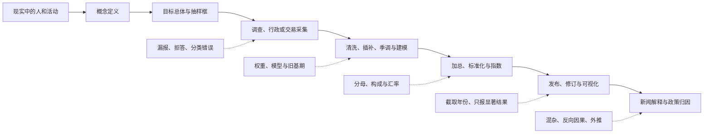

# 比较研究、偏差与证据审计：同一个数字真的能横着比吗

> [!question] 本页问题
> 新闻说“甲国青年失业率 18%，乙国只有 12%，所以甲国教育和就业政策更失败”。即使两个数字都抄对了，这个结论还可能在哪些地方错？

跨国、跨地区和跨时期比较的难点，往往不在除法，而在**两个数是否由同一种人、同一套定义、同一观察程序和同一时期生成**。只要其中一项不同，排行榜就可能把口径差异画成现实差异。

本页不教你见到数字就怀疑一切。它教你把一条比较主张还原成可以核查的结构，并判断现有证据最多支持到哪一步。

## 先算一个会骗人的正确数字

假设每个国家都有 1,000 名青年：

|  | 青年总人口 | 属于劳动力 | 失业且在求职 | 失业率 | 失业者占青年总人口 |
| --- | ---: | ---: | ---: | ---: | ---: |
| 甲国 | 1,000 | 500 | 90 | 90 / 500 = **18%** | 90 / 1,000 = **9%** |
| 乙国 | 1,000 | 800 | 96 | 96 / 800 = **12%** | 96 / 1,000 = **9.6%** |

甲国失业率更高，但乙国青年总人口中失业者的比例反而略高。两个结果都算对，因为它们回答不同问题：

- 失业率问：**已经就业或正在进入劳动市场的人中，有多少人在求职但没有工作？**
- 失业人口占比问：**全部青年中，有多少人失业？**

没有进入劳动力的人可能在校、照护家人、健康受限、不想工作，或想工作却没有采取被定义为“求职”的行动。劳动力参与本身会受教育制度、社会保障、家庭结构和调查规则影响。因此，只看失业率既不能描述全部青年处境，也不能单独评价一国政策。

## 数字是怎样走到图表上的



偏差可以在每一步进入。最后一张图再精美，也不能反向证明前面的定义、样本和推断可靠。

### 先把目标总体、抽样单位与时点对齐

生成链的每一箭头是资料加工或解释步骤，不是“现实导致新闻政策结论”的已识别因果。先把它缩成一个可交付动作：填写 [[社会科学/10-共同工具/01-事实模型与价值判断#一张主张卡：让同一论证带着范围跨页|主张卡]] 的前两栏，逐项比较目标与已观察记录。

| 问题 | 青年失业率 | 住房券评估 |
| --- | --- | --- |
| 想对谁说结论 | 某地区、年龄、在校状态的人群 | 某规则下的资格家庭及其儿童；不可静默改成所有居民 |
| 实际抽到谁 | 抽样框、回应者、进入劳动力分母者 | 报名/分配家庭、实际连上随访资料的儿童 |
| 一个单位是什么 | 人；重复月份可能重复观察同一人 | 分配单位可能是家庭，结果单位可能是儿童；记录行数不等于独立单位数 |
| 何时、哪个版本 | 调查月份/年、口径调整与发布修订 | 资格规则/随机分配/搬迁各自日期，结果窗口与政策实施版本 |

先从每列各写一句已知与一句未知。缺少年龄或分母，就不能判断排名差异；缺少分配时点或新旧规则，就不能判断“同一政策”的效果。此时交付**不可比的具体位置与下一项元数据请求**，也是完成，不必硬给一个结论。

口径对齐只让比较对象更清楚。如果之后要说政策造成变化，带着填好的前两栏，读 [[社会科学/10-共同工具/03-因果图反事实与识别#从反事实到可估计表达式|反事实到可估计表达式]]，回来写比较对象、需要的假设和未能检验的部分；不要把抽样代表性误作处理可交换性，也不要把随机处理误作对新总体的代表性。下面七关仍是通用比较审计清单，应用页只取所需关口。

## 第一关：先找分母，而不是先看涨跌

百分比至少包含三个问题：

1. 分子是谁？
2. 分母是谁？
3. 哪些人同时不在分子和分母中？

常见混淆包括：

| 指标 | 分子 | 分母 | 没回答的问题 |
| --- | --- | --- | --- |
| 失业率 | 失业且满足求职、可工作条件者 | 劳动力人口 | 非劳动力为何退出、工作质量怎样 |
| 劳动参与率 | 劳动力人口 | 相应年龄人口 | 就业是否充分、收入多少 |
| 就业人口比 | 就业人口 | 相应年龄人口 | 工作时长、工资、求职者处境 |
| 贫困率 | 低于所用贫困线的人 | 所覆盖人口 | 贫困深度、资产、公共服务与生活成本 |
| 不良贷款率 | 被认定为不良的贷款余额 | 贷款余额 | 核销、展期、分类规则和表外风险 |

当分母随行为或政策改变时，比例尤其容易误读。失望的求职者停止求职后，失业率可能下降；这不等于他们找到了工作。

## 第二关：同名指标可能不是同一个对象

### 青年失业的真实口径差异

国际劳工组织按现行国际建议，把失业人口界定为工作年龄中没有就业、近期采取了求职行动并且当前可以开始工作的人；“潜在劳动力”包含想工作但在求职或可工作条件上差一步的人，是另一类劳动未充分利用。[ILO 概念说明](https://www.ilo.org/resource/labour-underutilization)

世界银行 WDI 的 `SL.UEM.1524.ZS` 指标写明：对象是 **15—24 岁劳动力**，数据来自 ILO modeled estimates。建模序列用于提高覆盖和一致性，其中可能同时包含国家报告与对缺失数据的估计。[WDI 指标元数据](https://databank.worldbank.org/metadataglossary/world-development-indicators/series/SL.UEM.1524.ZS)

中国国家统计局在 2024 年 1 月 17 日发布说明：分年龄组数据改为发布不含在校学生的 16—24 岁、25—29 岁和 30—59 岁劳动力失业率。[国家统计局说明](https://www.stats.gov.cn/sj/zxfb/202401/t20240117_1946641.html) 2024 年 5 月 8 日的官方答复进一步说明，全国城镇调查失业率与这些分年龄组指标在在校生处理上并不完全相同。[国家统计局答复](https://www.stats.gov.cn/hd/lyzx/zxgk/202406/t20240619_1955075.html)

因此，“中国 16—24 岁、不含在校生的城镇劳动力调查指标”与“WDI 的 15—24 岁、ILO 建模估计”不能只因都被简称为“青年失业率”就直接横比。至少要说明：

- 年龄下限和上限；
- 城镇还是全国、常住还是其他覆盖范围；
- 在校生如何处理；
- 原始国家估计还是 ILO 模型估计；
- 调查月份、年度平均还是季调值；
- 该值是否跨越口径调整，能否接成长序列。

这里没有判定哪一种口径“更真实”。不同口径服务不同问题。错误在于不说明问题就把它们排在同一张榜上。

## 第三关：平均数会被群体构成反转

即使每个子群都可比，总体比例仍可能因构成不同而反转。下面是一个纯教学例：

| 年龄组 | 甲国劳动力 / 失业率 | 乙国劳动力 / 失业率 |
| --- | ---: | ---: |
| 16—19 岁 | 900 / **20%** | 100 / **22%** |
| 20—24 岁 | 100 / **10%** | 900 / **12%** |
| 总体 | 1,000 / **19%** | 1,000 / **13%** |

甲国在两个年龄组内的失业率都更低，总体却更高，因为甲国劳动力更集中在高失业的 16—19 岁组。这是构成效应的一种形式，常被称为 Simpson 反转。

正确处理不是永远只看分组，也不是永远只看总体，而是说明你要回答什么：

- 若问每个年龄组的处境，报告分层结果；
- 若问整个劳动力市场承受多少失业，构成本身就是现实的一部分；
- 若问政策效果，需要判断政策是否也改变了群体构成，并定义目标总体。


### 共同人群权重能保持什么

原表的分母是各年龄组劳动力人数。甲有 $900\times20\%+100\times10\%=190$ 名失业者，乙有 $100\times22\%+900\times12\%=130$ 名，所以各自实际总体率是19%和13%。这里两国年轻组权重分别为 $0.9、0.1$，年长组权重分别为 $0.1、0.9$；组内比较和总体比较使用了不同构成。

若问题改为“在两个年龄组各占一半的**同一个标准劳动力总体**中，保留各国当前组内率会怎样”，描述性标准化给出

$$
r_{\text{甲}}^*=0.5\times20\%+0.5\times10\%=15\%,\qquad
r_{\text{乙}}^*=0.5\times22\%+0.5\times12\%=17\%.
$$

这不是把19%或13%改算正确，而是改变了所问的总体。各半权也不天然优于真实构成：各自总体率描述各自劳动力中的失业比例，标准化率描述指定共同构成下的组内率加权比较。此处用的是劳动力分母，不是全部青年人口，也不是某个个人的失业概率变化。

一般地，若每组 $r_{\text{甲},k}<r_{\text{乙},k}$，采用共同固定的 $w_k\ge0$、$\sum_kw_k=1$，则

$$
\sum_kw_kr_{\text{乙},k}-\sum_kw_kr_{\text{甲},k}
=\sum_kw_k(r_{\text{乙},k}-r_{\text{甲},k})>0.
$$

至少一组有正权，且所有组内差都严格为正，故不会反转。若只有非严格优势，则只能保证不更差；严格结论还需某个正权组严格占优。若两对象各用自己的权重、分组定义或条件总体，此证明的共同前提就不成立。

带着“**同一组固定权为何保持组内优势**”去 [[AI/15-卷积神经网络/06-检测分割匹配损失与评估协议#同两张图，为什么平均顺序会翻转|同两张图，为什么平均顺序会翻转]]。那里在同一批真值上逐图比较模型，并从混淆计数展开池化分母；回来要能指出：视觉例的逐图 Dice 都是A更高，池化却各自使用随预测变化的分母权，并没有采用这段证明所需的共同固定权。年龄例的构成来自劳动力人数，视觉例来自预测与真值的前景面积；相似的是比值聚合算术，不能把两者说成同一种社会或因果机制。

分层标准化仍是描述性比较，尚未回答“甲的政策使失业率降低多少”。年龄之外可能还有混杂，政策本身还可能影响劳动力参与和进入分母的资格；选什么变量、条件化是否合适、可交换性与目标总体等需回到 [[社会科学/10-共同工具/03-因果图反事实与识别#从反事实到可估计表达式|从反事实到可估计表达式]]。回来只能在相应识别条件成立时谈政策效应，不能把15%与17%的2个百分点差直接当作因果效果，也不能把国家汇总关系直接赋给个人。

### 换一个目标总体，再作结论

保留原表的两个年龄组失业率。某次比较的目标劳动力总体中，16—19岁占 $1/4$、20—24岁占 $3/4$。报告甲乙在这个目标中的比例与排名，说明它同原19%/13%的关系；一位编辑据此写“采用甲国政策会让每个年轻人的失业风险降低2个百分点”，这句话哪些部分还缺依据？完成后到视觉页的 [[AI/15-卷积神经网络/06-检测分割匹配损失与评估协议#撤去提示：只改总体或汇总顺序|改总体或汇总顺序题]]，用同样的 $1/4、3/4$ 场景构成检验是否可以照搬排名理由。

<details>
<summary>参考答案</summary>

甲为 $\tfrac14\times20\%+\tfrac34\times10\%=12.5\%$，乙为 $\tfrac14\times22\%+\tfrac34\times12\%=14.5\%$，甲低2个百分点。所报告的是指定共同劳动力构成下的描述性标准化率；原19%/13%仍是各国原构成的总体率。共同权保持组内优势，没有证明这份标准总体最适合所有政策问题。编辑把描述比较升级成政策反事实，又把组级差升级成每个个体的效应，均缺识别与个体归因依据；即便平均政策效应可识别，也不推出每人都有同一效果。视觉题须分别看“先取逐图比值再平均”与“先汇总计数再取比值”，不能只因场景权共同就认定池化的隐含权也共同。

</details>


### 带着分母迁移到人口、空间、教育与裁判记录

人口年龄标准化可以直接复用本节的共同权检查，但必须带回年龄分组、年龄别率和标准人口权重；不同研究各用自己的标准人口时，不能套用“共同固定权保持优势”的证明。空间比较还须带回区域划分、区域内人数或暴露量和对应分母：改区域边界后组与权都可能改变，区域率仍不自动成为个人关系。学校或题组比较则先区分个人、班级/学校和题组记录，列每层人数、题量与汇总分母，再判断是先算个人分数、群组均值还是先合并计数；群组等权与个人等权回答不同目标。这里交接的是一项可复算的权重检查，不代替人口动态、空间分析或教育评价的完整方法；尤其不能由汇总排名翻转判定教学的因果效果。

若数据只含进入程序者，先去 [[社会科学/63-法学/06-同题比较与共同案例完整解答#进入裁判样本后，胜诉率还代表谁|进入裁判样本后，胜诉率还代表谁]]，带上本节“谁进入分母”的问题，核对其中全部争议、进入程序、形成裁判记录的三层对象。那里的有限合成例除了比例算术，还明确设定 $R\to S\leftarrow H\to Y$：资源与证据共同决定进入，条件化 $S=1$ 会产生选择关联；改变进入规则可以改变记录构成。回来应分别指出**汇总权重如何变**和**哪条选择机制使记录可见**，不能把碰撞机制等同于 Dice 的预测相关分母，也不能从观察胜诉率判断制度正当性。零支持层缺失标签时，仅重加权不能恢复它；该限制来自可观察性与识别条件，不由一张分组表自动解除。

## 第四关：把五类“偏差”分开

“这有偏差”太模糊，无法指导修正。至少要区分：

### 1. 测量偏差

指标系统性地没有测到目标概念。例如用挂牌房租代替成交房租，用注册失业代替调查失业，用 GDP 增长代替居民福利。

检查办法：写出目标概念与观测变量，找出漏掉的维度，比较另一种测量会怎样改变排序。

### 2. 抽样与覆盖偏差

抽样框遗漏了特定人群，或愿意回答的人与不回答者不同。例如线上问卷遗漏不上网者，企业调查中倒闭企业无法回答。

检查办法：核对目标总体、抽样框、响应率、权重和未覆盖群体；样本量再大也不能自动修复系统性漏人。

### 3. 选择与幸存偏差

进入分析的数据取决于研究变量或结果。只研究成功上市企业，会把失败公司从创新回报中删除；只研究住院患者，可能让两个在总体中无关的风险因素在样本内相关。

因果图中的碰撞和选择机制由 [[社会科学/10-共同工具/03-因果图反事实与识别|因果图、反事实与识别]] 完整解释。本页只保留审计问题：**什么条件决定一条记录被看见？**

### 4. 聚合与生态偏差

地区平均关系不能直接赋给地区内个人。一个高学历地区收入更高，不代表其中每个高学历者都更富；地区产业结构、迁移和住房成本可能同时变化。

检查办法：把个体、家庭、组织、地区和国家层次分别写出，不让同一个变量名跨层滑动。

### 5. 认知与激励偏差

研究者和读者可能偏好确认原观点、记住显眼案例、忽视基准率；机构也可能因考核而改变记录、分类或行为。前者是判断过程，后者是规则下的策略反应。

检查办法不同：认知偏差需要盲化、预注册、反方证据和重复研究；激励问题需要理解指标怎样进入奖惩、对象能否操纵，以及是否出现目标替代。

### 一张区别表

| “偏差”来自哪里 | 典型句子 | 优先修正 |
| --- | --- | --- |
| 测量 | 实际想测福利，却只有 GDP | 补指标或缩窄结论 |
| 抽样/覆盖 | 只抽到能接触和愿回应的人 | 改抽样框、权重和追访 |
| 选择/幸存 | 结果影响了能否进入样本 | 建选择机制，找未入样本证据 |
| 聚合 | 用国家平均推断个人 | 分层或多层模型，限制外推 |
| 认知 | 只搜支持自己观点的研究 | 预先写判据，主动找反例 |
| 激励 | 被考核者优化指标而非目标 | 改指标组合、审计与制度设计 |

## 第五关：跨国比较还要对齐价格、汇率与时间

### 名义金额与实际购买力

工资折成美元可以用市场汇率，也可以用购买力平价；两者回答的问题不同。市场汇率更接近跨境购买或偿债条件，PPP 更适合比较一篮子本地商品和服务的购买力。不能看到“美元人均收入”就默认生活水平已经可比。

### 流量、存量与期间

年度财政赤字是期间流量，年末政府债务是时点存量；把两者都除以当年 GDP 只是构造了两个比率，不会让它们变成同一种量。完整定义回到 [[社会科学/10-共同工具/02-指标分布与存量流量核算|指标、分布与存量流量核算]]。

### 修订与断点

统计机构会因新基期、新数据源、季节调整和方法改进修订历史序列。修订不是自动造假，但意味着旧截图和当前数据库可能都曾“官方”，却属于不同版本。

时间图至少记录下载日期、数据版本、是否季调、名义/实际、频率和口径断点。遇到断点时，应分段显示或做经说明的桥接，不能静默连线。

## 第六关：复合指数的排名包含模型与价值选择

“创新指数”“宜居指数”“金融发展指数”会把多个维度标准化、加权再汇总。每一步都可能改变排名：

```text
选择哪些维度
→ 缺失值怎样插补
→ 指标方向怎样统一
→ 用 z-score、min-max 还是名次
→ 权重相同、专家指定还是数据驱动
→ 维度之间能否互相补偿
→ 怎样做敏感性分析
```

OECD 与欧盟联合研究中心 2008 年的复合指标手册明确把理论框架、数据选择、插补、标准化、权重/聚合和不确定性分析放在同一建构流程中。[官方手册入口](https://www.oecd.org/en/publications/handbook-on-constructing-composite-indicators-methodology-and-user-guide_9789264043466-en.html)

复合指标可以压缩信息，却不是从数据中自然长出的事实。若小幅改变权重就让排名大幅交换，新闻应报告敏感性，而不是只展示一个精确名次。

## 第七关：描述差异不能直接归因于政策

发现甲国指标比乙国差，最多先得到描述性差异。要说政策造成差异，还要处理：

- 政策是否因原本更严重的问题才被采用；
- 两国是否同时在产业、人口、教育、战争或疫情上不同；
- 政策是否改变了谁进入指标分母；
- 人和企业是否跨地区迁移；
- 效果是否有滞后、提前反应或溢出；
- 比较结果能否外推到别的制度和时期。

完整识别方法在 [[社会科学/10-共同工具/03-因果图反事实与识别|因果图、反事实与识别]]，政策设计在 [[社会科学/40-公共政策与社会学/00-公共政策与社会学-MOC|公共政策与社会学]]。本页的最低结论是：**排行榜提供候选问题，不提供自动反事实。**

## 一条新闻的实际审计

假设标题是：

> 甲国青年失业率比乙国高 6 个百分点，大学扩招应为主要原因。

按下面顺序处理：

### 1. 先重写主张

```text
总体：哪一地区、哪一年龄、是否只含城镇？
指标：失业率还是失业人口占比？
来源：国家调查、行政登记、ILO 模型估计？
时间：哪个月/年，是否季调，是否跨口径断点？
差异：点估计 6 个百分点，不确定性是多少？
原因：扩招相对于什么反事实、通过什么机制、在多长时间内影响？
政策：评价目标是短期就业、长期收入、机会还是财政成本？
```

### 2. 给出当前最多能说什么

如果只有两个不完全同口径的年度值，合格结论是：

> 两个公开指标的点值不同，但年龄、在校生处理、覆盖范围和估计方法尚未对齐，不能据此确定真实差异大小；即使完成可比化，这一横截面差异也不能单独识别大学扩招的因果效果。

这不是拒绝结论，而是给出下一步：统一指标、重建可比序列、提出扩招影响劳动参与和就业的机制，再寻找适当对照。

### 3. 找会推翻原故事的观察

- 对齐口径后差异显著缩小；
- 失业率上升主要来自更多青年进入劳动力，而非就业人数下降；
- 扩招前趋势已开始；
- 未扩招但产业冲击相似的地区也同样变化；
- 长期收入和就业稳定性改善，短期求职等待却延长。

一条解释若没有可能使它变弱的观察，就更像立场保护装置，而不是经验命题。

要继续查同一事实怎样被写成不同新闻、谁真正看到并怎样解释，读 [[社会科学/69-新闻传播/01-新闻框架触达与受众解释|新闻框架、触达与受众解释]]：带回标题／排序、来源独立性、曝光分母与理解证据，别把事实审计通过当作传播效果已证。

## 证据卡：让读者知道来源支持哪一步

证据卡是主张卡“测量与描述”栏的来源附件，具体数字需要时再填写，并不要求再交一套平行分层。每个图表或承重数字旁至少记录：

| 字段 | 示例 |
| --- | --- |
| 主张 | 2024 年起发布不含在校生的 16—24 岁分年龄组调查失业率 |
| 来源主体 | 国家统计局 |
| 原文标题 | 《关于完善分年龄组调查失业率有关情况的说明》 |
| 发布日期 | 2024-01-17 |
| 来源类型 | 统计方法/口径说明 |
| 支持范围 | 支持年龄组与在校生处理变化 |
| 不支持 | 不证明调整后的指标高低由某项政策造成 |
| 版本/访问 | 记录实际访问日期与存档位置 |

联合国大会第 68/261 号决议认可的《官方统计基本原则》要求统计机构按科学和专业标准决定方法，并公开来源、方法和程序以便正确解释。[UN 官方入口](https://unstats.un.org/fpos) 这为“必须读元数据”提供制度依据；它不保证任何单个数字没有误差，也不免除使用者的比较责任。

## 快速检查与深入检查

### 五分钟检查

1. 找分子、分母、单位和时间。
2. 点开原始发布者，而不是只读转述。
3. 看标题附近是否有“估计、模型、季调、修订、预测”。
4. 问谁不在样本或分母中。
5. 把“因此造成”暂时改写为“与之同时出现”。

### 需要正式结论时

1. 固定数据版本并保存元数据。
2. 检查抽样、覆盖、响应、权重、插补和断点。
3. 分层查看构成、分布和极端群体。
4. 为机制画出变量和选择路径，连接因果权威页。
5. 列至少一个竞争解释与能推翻当前解释的观察。
6. 区分统计不确定性、系统偏差和外推不确定性。
7. 把政策评价中的价值标准另列，不夹进指标定义。

## 来源与证据边界

1. United Nations General Assembly, Resolution 68/261, *Fundamental Principles of Official Statistics*，2014-01-29 通过；重点看原则 2—4 关于专业方法、透明解释和纠正误用。[UN Statistics Division](https://unstats.un.org/fpos)
2. ILO, 19th ICLS (2013) 后的 labour underutilization 概念说明；用于就业、失业和潜在劳动力的国际定义。[ILO 说明](https://www.ilo.org/resource/labour-underutilization)
3. World Bank, WDI *Sources and Methods*；该页明确提醒跨国、跨时方法、覆盖和定义差异会限制完全可比性。[方法入口](https://datatopics.worldbank.org/world-development-indicators/sources-and-methods.html)
4. World Bank WDI, `SL.UEM.1524.ZS` metadata；用于 15—24 岁、劳动力分母和 ILO modeled estimate 的指标身份。[指标元数据](https://databank.worldbank.org/metadataglossary/world-development-indicators/series/SL.UEM.1524.ZS)
5. 国家统计局，《关于完善分年龄组调查失业率有关情况的说明》，2024-01-17；以及人口和就业统计司公开答复，2024-05-08；用于中国相关指标的年龄、在校生处理和劳动力定义。[说明](https://www.stats.gov.cn/sj/zxfb/202401/t20240117_1946641.html) · [答复](https://www.stats.gov.cn/hd/lyzx/zxgk/202406/t20240619_1955075.html)
6. OECD/European Union/EC-JRC, *Handbook on Constructing Composite Indicators: Methodology and User Guide*, 2008；用于复合指数建构、权重、聚合和敏感性分析。[官方入口](https://www.oecd.org/en/publications/handbook-on-constructing-composite-indicators-methodology-and-user-guide_9789264043466-en.html)

本页的甲乙国人数、分组反转和新闻标题均为教学构造，不是真实国家数据。官方统计来源支持定义、口径与方法事实，不自动支持任何政策因果或价值判断。具体数据用于正文时仍需记录下载日期和版本。

## 学完本页

- [ ] 我能为百分比找出分子、分母和被排除的人。
- [ ] 我能解释为何两个“青年失业率”可能因年龄、学生、地区和模型估计而不可直接比较。
- [ ] 我能区分测量、抽样、选择、聚合、认知和激励偏差，并为每类选择不同修正。
- [ ] 我会检查群体构成、时间断点、修订、汇率/价格口径和复合指数权重。
- [ ] 我不会从跨国差异直接跳到政策因果，也能写出会削弱自己解释的反例。
- [ ] 我能制作一张说明“来源支持什么、没有支持什么”的证据卡。

---

**返回**：[[社会科学/00-开始/00-社会科学-首页|社会科学首页]]  
**方法先修**：[[社会科学/10-共同工具/01-事实模型与价值判断|事实、模型与价值判断]] · [[社会科学/10-共同工具/02-指标分布与存量流量核算|指标、分布与存量流量]] · [[社会科学/10-共同工具/03-因果图反事实与识别|因果图、反事实与识别]]  
**进入应用**：[[社会科学/20-经济流动与宏观/00-经济流动与宏观-MOC|经济流动与宏观]] · [[社会科学/30-金融市场与风险/00-金融市场与风险-MOC|金融市场与风险]] · [[社会科学/40-公共政策与社会学/00-公共政策与社会学-MOC|公共政策与社会学]]
