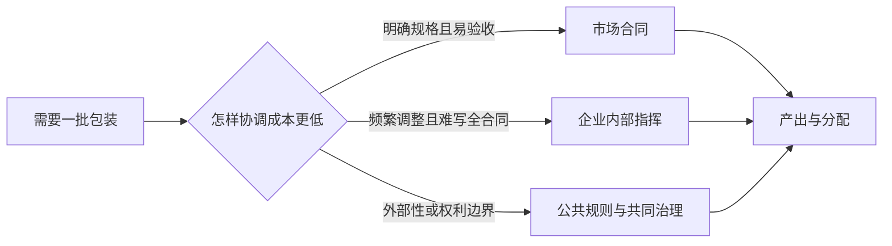

# 生产、交换、分配与制度约束：一份收入来自哪里

面包卖出 10 元，不等于面包师“创造并拿走了 10 元”。其中有面粉、电力等别处生产的投入，有本店新增加的价值；增加值又通过工资、税和营业盈余分配，之后还会发生利息、地租、股息、所得税与转移。把这些层次混在一起，就会把会计分配误叫作个人贡献，或把生产率问题误写成道德评价。

> [!info] 证据状态
> 已核对 Smith《国富论》卷一第 1、3、6 章的分工、市场范围和价格组成讨论，Coase 1937 第 2—5 节关于使用价格机制与企业内部组织的成本，North 1991 对正式/非正式约束和激励结构的定义，以及 2008 SNA 第 6 章的生产账户与收入构成框架。数值为教学构造；因果效果与当代中国制度均未作实证估计。

## 第一步：生产不是销售额，增加值不能重复算

一家面包店一年销售 1000 万元，从别的企业购入面粉 300、能源与外包服务 100。教学上先忽略库存变化和税价差：

$$
\text{总增加值}=\text{产出}-\text{中间消耗}=1000-400=600.
$$

面粉厂已在自己的生产账户记录增加值；面包店若把 1000 全算作自身贡献，会重复计算那 400。假设面包店的 600 按生产收入账户分成雇员报酬 360、生产税净额 40、总营业盈余 200，三项恰好加回 600。

| 层次 | 金额（万元/年） | 解释 |
| --- | ---: | --- |
| 销售产出 | 1000 | 产品价值，不是本店增加值 |
| 中间消耗 | -400 | 本期生产中消耗的外购产品 |
| 总增加值 | 600 | 本店新增加的价值 |
| 雇员报酬 | 360 | 工资及雇主社会缴款等 |
| 生产税净额 | 40 | 生产/产品税减补贴的简化数 |
| 总营业盈余 | 200 | 尚未在此处拆成利息、地租、股息等 |

关键易错点：利息和土地租金等财产收入通常在增加值形成后的收入分配账户出现，不能再与工资、税、营业盈余并列加一次，否则超过 600。企业的现金支出表、利润表和国民账户回答的不是同一个问题。

## 第二步：分工提高产出，但受市场范围约束

Smith 用制针工场说明，把任务拆开能通过熟练、节省切换时间和专用工具提高生产率；他也在卷一第 3 章强调分工程度受市场范围限制。可用一个最小模型看直觉：

- 一人包办和面、烘焙、包装，每小时做 10 个；
- 三人分工后每人对应一道工序，整线每小时做 45 个；
- 但小镇每天只买 60 个时，扩线的设备、协调和滞销成本可能超过收益。

所以“分工提高技术效率”不推出“企业越大越好”。需求规模、运输、信息、质量控制与协调成本共同决定边界。

## 第三步：为什么有市场，也有企业和公共规则

箭头表示三种协调安排在不同条件下可能被选择，不是“企业必然比市场有效”的因果结论。Coase 的问题是：若价格机制足以协调一切，企业为何存在？他的回答把搜寻价格、谈判和逐笔签约等市场协调成本，与企业内部组织的成本放在一起比较。企业扩大也会因管理失误、信息损失和异质任务而增加内部成本。

North 把制度概括为塑造政治、经济和社会互动的人为约束，包括正式规则与非正式约束。制度通过改变选择集合、执行预期和交易/生产成本影响哪些交换可行。这个定义不意味着所有存续制度都有效率：同一规则可能降低一类人的不确定性，却把成本转给另一类人。

## 第四步：产出怎样变成“谁拿到多少”

工资可以同时受四组因素影响：

1. **生产率与互补资产**：同一技能配上更好机器、数据或组织，产出可能提高。
2. **市场与稀缺性**：产品需求、替代品、行业进入和劳动力供给改变可支付空间。
3. **所有权与合同**：谁拥有机器、品牌、土地与剩余索取权，影响营业盈余之后的财产收入。
4. **议价与制度**：最低工资、工会、竞业限制、社会保险、执行能力与身份资格改变可接受合同和退出选项。

用简化纳什议价直觉表示：合作产生可分剩余 $R=100$，劳动者不合作可得 20，企业可得 10。合作比退出多出的剩余为 $100-20-10=70$。若双方议价权对称，可各分额外 35，结果为劳动者 55、企业 45。若劳动者外部选项因失业保险或紧缺技能升至 40，即使生产率不变，分配也会改变。这里的公式是机制模型，不是对现实工资的估计。

## 效率、分配、权利与公平分别判断

一个安排可能让总产出从 100 增到 120，却让最弱一方所得从 20 降到 10。以下结论不能互相替代：

- **效率**：是否用更少资源得到更多目标产出；
- **分配**：新增与既有收入落到哪些人；
- **权利**：哪些交换可拒绝，财产和人身边界怎样保护；
- **公平**：依据需要、贡献、平等或其他原则怎样评价结果。

“市场自愿”也不自动证明机会对称：饥饿、债务、信息差和退出障碍都会影响可选集合。反过来，有不平等也不自动证明某一项交易造成它；需要明确反事实和识别设计，技术主解释见 [[社会科学/10-共同工具/03-因果图反事实与识别|因果图与反事实]]。

## 中国情境与国际对照

用一个不声称真实估计的中国平台用工情境：骑手收入取决于每单技术效率、订单密度、平台所有权、算法规则、承揽/劳动关系、保险和申诉渠道。把收入差全归为“个人努力”会漏掉互补资产和规则；把差异全归为“制度”又会抹掉技能、时段和随机需求。真正研究需要按具体法域、合同版本和时点获取数据。

国际上，Coase 的企业边界问题适用于市场合同与内部组织的比较，但各国劳动法、社会保障、竞争政策和非正式规范不同，不能从抽象模型直接推出统一制度处方。历史组织如何把观念转为财产、人事和规则，可把 [[哲学与文化/10-主题/01-文化政治与组织结构/02-普遍性竞争与组织载体|组织载体]] 当作问题地图阅读；该页自身标为 `source-synthesis`，本课不采纳其未核验史实为前提。

## 反例、练习与证据框

- 反例：自动化使每工时产出翻倍，而产品价格因竞争减半；名义销售与劳动者工资都未必翻倍。生产率、价值与收入不是一对一映射。
- 反例：把清洁外包后，本企业雇员人数和工资份额下降，但相同工作转入中间投入；组织边界变化会改变报表，未必改变全经济实物生产。
- 练习：销售 800、中间投入 260、雇员报酬 300、生产税净额 20。总增加值 540，总营业盈余应为 220。若另把利息 30 加入增加值分配，总数 570，说明重复计算。

证据类型：增加值分解是**会计定义**；分工、交易成本和议价图是**模型机制**；“某项规则在某地提高工资”属于尚需识别的**因果主张**；选择何种分配原则属于**价值判断**。

下一步读 [[社会科学/20-经济流动与宏观/02-收入消费财富与生命周期|家庭如何把所得变成消费、储蓄和财富]]；若关心总量如何跨部门闭合，转 [[社会科学/20-经济流动与宏观/05-国民账户部门余额与开放经济|国民账户与部门余额]]。

## 来源定位

- Adam Smith, *The Wealth of Nations*（1776），卷一第 1、3、6 章：分工、市场范围、价格组成的原始论述。
- Ronald Coase, “The Nature of the Firm”（1937），*Economica* 4(16): 386–405，尤其第 2—5 节：使用价格机制的成本、企业内部协调及边界。
- Douglass North, “Institutions”（1991），*Journal of Economic Perspectives* 5(1): 97–112，摘要与 pp. 97–100：正式/非正式约束和激励结构。
- 2008 SNA，第 6 章 6.1—6.9、6.75—6.83：生产账户、增加值，以及雇员报酬、生产税净额和营业盈余在增加值中的位置。
