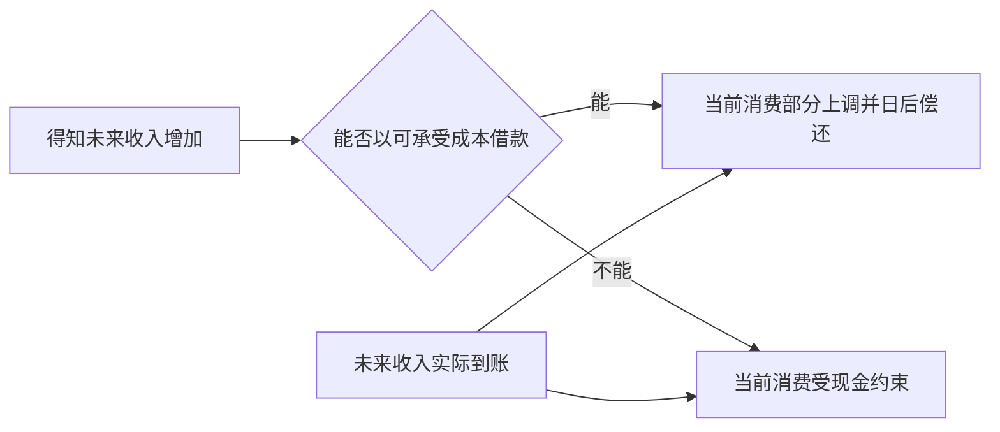

# 收入、消费、财富与生命周期：同样年收入，为何抗风险能力完全不同

两户家庭都年入 12 万元。甲有 5 万现金、低债务和稳定公共服务；乙住房市值更高，却只有 5000 元现金、每月房贷与抚养支出很重。按收入分位两户相同，遇到三个月停工时却可能走向完全不同。要解释这种差异，必须同时看期间现金流、时点资产负债表、未来承诺和家庭内部共享。

> [!info] 证据状态
> 已核对 CORE Econ《The Economy》Unit 13 第 13.6 节的消费平滑与信贷约束、2008 SNA 第 24 章住户部门边界、OECD 收入分布口径和 WID 方法入口。模型数字为教学构造；没有使用个人理财数据，也不提供投资或借贷建议。

## 四个盒子不要混

| 盒子 | 类型 | 典型单位 | 关键问题 |
| --- | --- | --- | --- |
| 收入 | 期间流量 | 元/年 | 本期可支配资源怎样形成 |
| 消费 | 期间流量 | 元/年 | 哪些资源用于当前生活 |
| 资产/负债 | 时点存量 | 某日的元 | 拥有什么、欠什么、能否变现 |
| 财富/净值 | 时点余额 | 资产减负债 | 价格、储蓄和其他变化怎样累积 |

“有房”不是流动性指标，“收入高”不是净财富指标，“净财富为正”也不保证下月还得出债。完整存量—流量桥见 [[社会科学/10-共同工具/02-指标分布与存量流量核算#存量、流量与账户桥|共同核算页]]。

## 两户同收入家庭的压力测试

以下全为教学构造，单位万元，时点为年初；必需支出和债务偿付为当年流量。

| 项目 | 家庭甲 | 家庭乙 |
| --- | ---: | ---: |
| 年可支配收入 | 12 | 12 |
| 现金与活期存款 | 5 | 0.5 |
| 其他金融资产 | 2 | 0 |
| 住房市值 | 20 | 32 |
| 房贷 | 10 | 30 |
| 消费贷 | 0 | 1 |
| 净财富 | 17 | 1.5 |
| 年必需消费 | 6 | 7 |
| 年债务本息现金支出 | 1.2 | 4.5 |

若收入停三个月，损失 3 万元。甲的现金可覆盖，乙即使“拥有 32 万元住房资产”，也可能需要展期、出售资产或削减消费。这里还没计交易成本、提前还款条件、住房不可分割性和亲属支持，因此压力测试只是诊断，不是违约预测。

## 两期预算：消费平滑为何有吸引力

设两期实际可支配收入为 $(y_1,y_2)$；$a_0$ 是第一期消费决策刚开始时已经可用、按第一期价格计值的净金融资产，因此在第一次消费前不再计息；两期之间的实际利率 $r>-1$。不留遗产时：

$$
c_1+\frac{c_2}{1+r}=y_1+\frac{y_2}{1+r}+a_0.
$$

右边是可用于两期消费的现值资源。若 $r=0$、$(y_1,y_2)=(50,90)$、$a_0=20$，总资源为 160，各金额使用同一实际货币单位。若家庭偏好两期消费相近且可自由借贷，可选 $(c_1,c_2)=(80,80)$：第一期收入和资产合计70，还需借10；第二期收入90，偿还10后消费80。等额消费是这里选定的偏好下的方案，预算式本身不要求家庭如此选择。

但假设住房等资产不能及时变现，且第一期最多只能使用 $y_1+a_0=70$，借款约束要求 $c_1\le70$。此时“完全平滑”的 80 不可行；可取 $(70,90)$。未来收入相同，信贷与资产流动性不同，就会产生不同的当前消费反应。

把预算继续推成选择条件，进入 [[社会科学/20-经济流动与宏观/40-宏观经济学/02-跨期消费借贷约束与最优积累#两期家庭：先求可行集，再求平滑|家庭Euler与借款下限]]：收入(2,8)、β=R=1，自由借贷得(5,5)，禁借则(2,8)，边界用乘子和Euler不等式。再改额度或未来风险，并核两户债权需求是否清算，避免把个体消费平滑直接加成宏观均衡。

图中的箭头是生命周期模型的条件机制。CORE Unit 13.6 用类似对照说明信贷约束家庭要等收入真正到来后才能调整消费；它不证明所有人都追求完全平滑，也不证明借款越多越好。

## 永久变化、暂时变化与风险

沿用刚才 $r=0$、收入 $(50,90)$、期初可用资产20和等额消费偏好，先只改收入：若仅第一期意外增加10，两期资源从160变成170，可自由借贷时的等额方案为 $(85,85)$；本期消费比原来的80增加5，另外5减少借款，使第一期只需借5。若两期收入各增加10，资源变成180，等额方案为 $(90,90)$，第一期消费比原来增加10。这里的“两期都增加”是在有限模型内表示持续变化，不是对无限未来收入的预测。

若仍禁止借款，两种变化后的第一期可用资源都只有 $60+20=80$，上述85和90均不可行；在这个等额消费偏好的对照中，可行的最平滑方案分别为 $(80,90)$ 和 $(80,100)$。同样收到本期10，能否提前使用未来资源会改变当前消费；若变的是偏好或利率，也要重判，不能只凭总资源选等额方案。现实中还会有：

- 收入不确定性带来的预防性储蓄；
- 借款利率高于储蓄收益的楔子；
- 失业、疾病和照护责任的相关冲击；
- 现在偏好、习惯、遗产动机与家庭冲突；
- 公共教育、医疗、养老和住房服务改变私人预算需求。

因此“高边际消费倾向”可能来自信贷约束，也可能来自预期变化、偏好、债务压力或测量误差。仅凭相关不能识别机制。

## 财富变动不是储蓄的同义词

家庭乙的住房从 32 涨到 40，净财富因重估增加 8；若当年可支配收入为 12、最终消费支出为 13，则当年储蓄为 $12-13=-1$。这里不另扣已经进入可支配收入账户的财产收入，也不把偿还贷款本金算消费，因而避免重复扣除。重估收益提高账面净值，却未必带来可支付食品的现金；若房价随后回落，净值又会下降。主公式及重估账户边界见 [[社会科学/10-共同工具/02-指标分布与存量流量核算#存量、流量与账户桥|存量—流量桥]]。

家庭内部也不是一个自动公平共享的“代表性人”。同样的家庭可支配收入，儿童、老人、主要挣钱者和无收入照护者实际控制的资源可以不同。家庭级收入数据不能直接推出个人福利相等。

到这里，生活问题已经有有限答案：两期总资源不等于本期现金，暂时与持续收入变化不能一概而论，账面财富增加也不等于可支付消费的现金。初读可先继续 [[#中国情境与国际可比性|中国情境与国际可比性]] 和后面的反例；若要追问预算中的商品选择及“多一元预算值多少”，再读下面这条深化。

## 消费选择与预算的影子价值

前面已经回答两期之间怎样安排消费；现在换一个更小的问题：给定本期可用预算，怎样在两种商品之间分配？继承的是“先定可行集，再说明偏好”的方法，不继承两期收入数值：$x,y$ 是当期两种商品数量，不是前面的 $c_1,c_2$。要从可行集选出一束消费，还须明确偏好。先固定一个可手算的当期模型：两种商品的数量数值为 $x,y$，各以一份为基准，价格均为每份1元，预算数值为 $B>0$。可行集是 $x,y\ge0,\ x+y\le B$。这里不同时改变价格、家庭成员或偏好，也不把未来住房市值当成本期可用现金。

这条深化只需先认清预算 $B$、数量 $x,y$ 与效用表示；先用直接比较求选择，再看对数、乘子和保证条件。读完要带回“预算改为8元时买什么、乘子以什么单位计、为何不是商品价格”的具体问题；完整理论沿数学链接借读后返回本节即可。

若用 $u(x,y)=xy$ 表示偏好，在固定总支出 $s=x+y$ 时，

$$
xy=\frac{s^2-(x-y)^2}{4}\le\frac{B^2}{4}.
$$

等号在 $x=y=B/2$ 取得。因此 $B=10$ 时最优消费为 $(5,5)$，效用数值25。这个可行集比较同时排除了边界 $x=0$ 或 $y=0$；不用先相信切线条件就能确认全局最优。

**同一选择可以有不同的效用数值和乘子。** $xy$ 的 Hessian 有一正一负特征值，它本身不是凹函数。正消费域中可改用

$$
w(x,y)=\ln x+\ln y=\ln(xy),\qquad x,y>0.
$$

对数作用于以一份为基准的无量纲数量数值。此处严格递增变换保留正消费束的排序；预算最优束也仍在正消费域。对数在零消费处未定义，不能把本页所有边界偏好都默认为这个表示。

最大化凹函数 $w$ 等价于最小化凸函数 $-w$，配预算约束的 Lagrangian 为

$$
\mathcal L=-\ln x-\ln y+\lambda(x+y-B),\qquad \lambda\ge0.
$$

驻点给 $1/x=1/y=\lambda$；预算活动后得到 $x=y=B/2,\ \lambda=2/B$。这一次凸性提供全局充分性，$B>0$ 时取 $x=y=B/4$ 又有严格预算余量，满足 Slater 条件。因而这个有限、取到最优值的模型有强对偶及最优乘子；“求出了乘子方程”与“已核对其许可证”是两步。

记最佳对数效用为 $W(B)=2\ln(B/2)$，则

$$
W'(B)=\frac2B=\lambda,\qquad
W(B)\le W(B_0)+\lambda(B_0)(B-B_0).
$$

后一式是凹值函数的支撑上界：$\lambda$ 是超梯度；最小负效用值 $v=-W$ 的次梯度为 $-\lambda$，可微处 $v'=-\lambda$。不可微时保留支撑界并检查单侧导数，不强选唯一价格。一般证明及参数边界回到 [[数学/40-微积分与优化/08-凸优化对偶与最优性证书#乘子表示什么：边界参数、活动集和最优值导数|乘子、支撑界与值函数导数]]。

在 $B=10$，对数乘子为0.2；若直接对已求解的 $u=xy$ 模型写最大化 Lagrangian $xy+\eta(B-x-y)$，内点条件给 $\eta=5$，也等于 $U(B)=B^2/4$ 在10处的导数。这不把 $xy$ 变成凹目标：$U$ 是凸函数，不能套用上面的凹支撑上界。两个乘子的单位都是“所选效用表示的单位／元”，数值随表示改变；商品价格仍是1元／份。不能把效用乘子当成可跨家庭比较的幸福量或市场商品价格。

从10元改为12元，对数模型的新选择为 $(6,6)$，实际效用数值变化为 $2\ln(6/5)$，旧乘子给的一阶预测为 $0.2\times2=0.4$；对 $xy$ 表示，实际变化为 $36-25=11$，旧乘子的一阶预测为 $5\times2=10$。有限变化需要重算，不能把局部边际值当成总收益。

**改变条件再返回数学。** 若偏好改为 $u=2x+y$，同一预算下最优束为 $(B,0)$；“两种边际效用除以价格相等”的内点口诀已不适用。改写最小化 $-2x-y$，并把非负条件也列为 $-x\le0,-y\le0$，在最优束的乘子为预算 $\lambda=2$、非负约束 $\alpha=0,\beta=1$，驻点为 $-2+\lambda-\alpha=0,\ -1+\lambda-\beta=0$，互补也成立。角点本身并不取消 KKT，遗漏非负约束才会误判。

若改用 $u=x^2+y^2$，内点 $(B/2,B/2)$ 在预算线上反而最差，最优束在两个端点；若商品必须整件购买，可行集又成为离散集合，值函数可能跳跃，没有连续边际导数。约束资格失效也须另查，不能从“预算活动”推出有限乘子必存在；数学主解释的 [[数学/40-微积分与优化/08-凸优化对偶与最优性证书#退化反例：零 gap 却没有最优乘子|强对偶与资格边界]] 提供具体反例。

带回问题：只把预算改为8元，先独立写出两种表示的最优束、预算乘子与单位，再回数学页解释哪个表示允许使用凹支撑界。**答案：** $(4,4)$；$xy$ 的乘子4，对数表示的乘子 $1/4$，均按各自效用单位／元解释；凹支撑界用于对数值函数，不能原样套给 $B^2/4$。若资源改为生产容量，继续读 [[社会科学/20-经济流动与宏观/12-价格供需与市场势力#生产者容量与利润的影子价值|生产容量的边际利润]]，核对为什么单位变成元／件。

继续让价格改变，读 [[社会科学/20-经济流动与宏观/30-微观经济学/01-价格变化普通需求与补偿需求|普通需求与补偿需求]]：同一偏好下，固定10元、保持旧效用25、让旧篮子仍可买，为何分别需要10、20、25元？

## 中国情境与国际可比性

教学型中国情境：一户拥有自住房但背负按揭，另一户租房且持有更多现金。房价上升会提高前者账面财富，也可能同时推高潜在换房成本；租户不获得同一持有收益。要把它变成真实中国结论，必须注明城市、产权、房贷合同、调查波次、价格估值方法和公共服务资格，本页没有做这种外推。

国际比较常用税后转移后的等价家庭可支配收入，但财富调查还要处理自住房、养老金权益、私人企业估值和顶端家庭漏报。WID 的分配国民账户尝试让分布总额与国民账户聚合量一致；它结合税务、调查和其他资料，不能被当成单一原始调查。

## 反例、练习与证据框

- 反例：退休者当前工资为零、养老金与资产充足；“工资低”不等于“消费能力必低”。
- 反例：年轻医生当前收入高但教育债务和未来收入风险也高；当前收入分位不能替代终身资源。
- 练习：$r=0$、收入 $(40,100)$、期初资产 0。可借贷且偏好等额消费时为 $(70,70)$；若禁止借款，第一期最多 40，等额方案不可行。
- 检查：看到“家庭财富增加 20%”时，先问是储蓄、资本转移、价格重估还是样本构成变化。

证据类型：预算约束是**会计可行集**；平滑消费是含偏好的**行为模型**；某类家庭对转移支付反应更大是需数据识别的**因果/经验主张**；是否应补贴借贷或住房是含分配权重的**政策选择**。

下一步读 [[社会科学/20-经济流动与宏观/03-代际流动机会不平等与测量|绝对与相对代际流动怎样测]]；若要理解就业冲击从何而来，读 [[社会科学/20-经济流动与宏观/07-增长周期就业与政策传导|增长、周期与就业]]。

## 来源定位

- Boyd 与 Vandenberghe, *Convex Optimization*，第5章的 Slater 条件、凸 KKT 与5.6节扰动／灵敏度：支撑界和乘子解释的数学条件。上面的预算、效用变换与角点数值为本页教学推导，不是家庭行为的经验估计。

- CORE Econ, *The Economy*, Unit 13（2021 PDF），13.6 与图 13.11—13.12：消费平滑家庭和信贷约束家庭面对可预期未来收入的差别。
- 2008 SNA，第 24 章：住户作为机构部门、家庭生产与收入/消费账户边界。
- OECD, *Income Distribution Database Guidelines*，概念与指标公式：等价家庭可支配收入、税收转移和人口排序单位。
- World Inequality Database, “Methodology”页的 “Beyond GDP: Distributional National Accounts” 与数据局限段：把收入财富分布与国民账户总量对接、组合多种资料来源的方法范围；本页未核验任何当期国家数值，也未把方法入口当成具体国家估计的验证。
