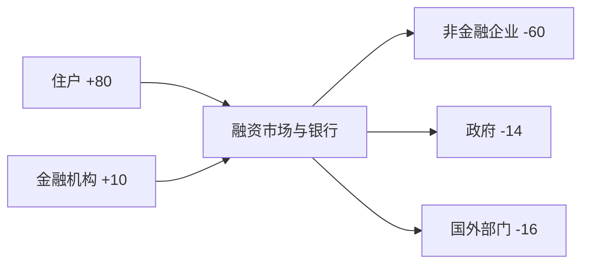

# 国民账户、部门余额与开放经济：恒等式怎样把所有人的账接起来

“政府赤字等于私人储蓄”只在特定分组和简化条件下成立；开放经济中还必须放入国外部门。更完整时，储蓄、资本形成、资本转移和非生产资产交易共同决定净借出。账户能迫使叙述闭合，却不能告诉我们谁先行动、赤字是否最优。

> [!info] 证据状态
> 本页应用 [[社会科学/10-共同工具/02-指标分布与存量流量核算|共同核算页]] 的唯一完整定义，不另建第二套口径。已核对 2008 SNA 第 10、11、26 章，BPM6 第 2、10—14 章，以及国家统计局 2024-12-30 支出法 GDP 方法页。采用 2008 SNA/BPM6 的明确历史版本，不声称是最新标准。

版本关系以共同核算页为准：2025 SNA 已获采纳、BPM7 预编辑版已发布，目标实施窗口为 2029—2030。本课继续用 2008 SNA/BPM6 复算，是为了匹配所引用的 2024 中国方法材料；没有核验中国何时迁移，也不把国际标准的发布日当作各国统计序列已同步换版。

## GDP 三面是一项生产活动的不同切面

在统计差异为零的理想账户中：

$$
GDP_{市场价}=\sum VA_{基本价}+\text{产品税}-\text{产品补贴}=\text{生产产生的收入}=C+G+I+NX.
$$

- 生产面：按基本价计算产出减中间消耗所得增加值，再加产品税减产品补贴转为市场价GDP；不是加全部政府税收；
- 收入面：雇员报酬、生产税净额、营业盈余/混合收入等；
- 支出面：居民消费 $C$、政府消费 $G$、资本形成 $I$、货物服务净出口 $NX$。

三个角度理论上相等，实务数据来自不同调查和行政记录，可能出现统计差异。库存增加属于资本形成，即使货物还没有卖给最终使用者；旧房转售本身不是当期新生产，但中介服务可以是。

## 一套同时区分 GDP、GNDI、CA 与 B9 的手算

构造某经济一年数据，单位亿元：

| 项目 | 数值 |
| --- | ---: |
| 居民消费 $C$ | 600 |
| 政府消费 $G$ | 220 |
| 总资本形成 $I$ | 180 |
| 货物服务净出口 $NX$ | 0 |
| 国外净初次收入 $NPI$ | +20 |
| 国外净二次收入 $NSI$ | -5 |
| 净资本转移 | +3 |
| 非生产非金融资产净购置 $ANNA$ | 2 |

第一步，$GDP=600+220+180+0=1000$。第二步，国民总收入 $GNI=GDP+NPI=1020$；国民总可支配收入 $GNDI=GNI+NSI=1015$。第三步，总储蓄

$$S=GNDI-C-G=1015-820=195.$$

第四步，经常账户

$$CA=NX+NPI+NSI=0+20-5=15=S-I.$$

第五步，SNA/BPM 资本账户完整调整后

$$B9=CA+3-2=16.
$$

这个算例一次暴露三个常见偷换：CA 不是 NX；全经济储蓄基于国民可支配收入而非只用 GDP；净借出 B9 在资本转移和非生产资产交易存在时不等于单纯 $S-I$。

## 部门余额为何必须有交易对手

把常住单位分成住户、非金融企业、金融机构、政府，再把非居民作为国外部门。仍用同一教学经济：

| 部门 | 净借出 B9（亿元/年） |
| --- | ---: |
| 住户 | +80 |
| 非金融企业 | -60 |
| 金融机构 | +10 |
| 政府 | -14 |
| 国内全经济 | +16 |
| 国外 | -16 |

国内金融债权债务在合并全经济时互相抵销；国内对外净借出 16 对应国外净借入 16。若只写“私人（前三部门）+30、政府 -14”，仍留下 +16，说明国外部门不能省略。

图中数字是净余额，箭头仅示意盈余部门资源经金融关系对应到赤字部门；真实毛流量可以大得多，方向也可能通过多级中介。净余额看不见期限、币种、抵押品和风险集中。

## 从资本账户走到金融账户

2008 SNA 第 10—11 章给出两侧相同的 B9：

$$
\underbrace{S_{net}+KT_{net}-NCF-ANNA}_{\text{资本账户}}
=\underbrace{\Delta FA-\Delta L}_{\text{金融账户}}.
$$

一个部门储蓄不足以支付非金融资产净购置时，可以出售金融资产或增加负债。金融账户解释怎样融资，不把借款本身当收入。政府发行债券、家庭增加银行存款、银行购买债券可能是同一组交易在不同部门的对应记录。

实务中资本账户与金融账户可能因来源、时间和估值差异不能精确相等，国际收支还列净误差与遗漏。误差项是统计残差，不应被解释为某个神秘经济部门。

## 恒等式无法回答的三个问题

1. **因果方向**：政府赤字、私人储蓄和经常账户同时变化，可能由财政政策、私人去杠杆、出口冲击或自动稳定器驱动。
2. **可持续性**：相同 B9 可对应本币/外币、短期/长期、固定/浮动利率和不同资产回报。
3. **福利与分配**：政府借入用于疫苗、战争、基建或转移支付，账户余额相同，受益人和长期结果完全不同。

因此部门余额是约束，不是政策结论。要讨论目标冲突，转 [[社会科学/40-公共政策与社会学/01-政策目标工具约束与矛盾|政策目标、工具与约束]]，把增长、稳定、分配与执行能力放进同一政策决策框架。

## 中国方法案例与国际对照

国家统计局 2024-12-30 方法页说明，中国支出法 GDP 的年度核算分别估计居民/政府最终消费、固定资本形成/存货变化，以及货物与服务净出口；后者采用 BOP 经常账户下货物服务差额。这里“经常账户下的货物服务差额”仍是 $NX$ 子项，不能把整个 CA 都塞进 GDP 支出式。

BPM6 对居民与非居民交易使用国际收支框架；2008 SNA 第 26 章解释国外账户与 BOP 的联系。跨国比较须对齐版本、常住原则、总/净、现价/不变价与修订。中国季度支出法 GDP 在该 2024 页面仍称研究试算、以年度发布为主；这只是该页当时的公开方法状态。

## 反例与检查点

- 反例：$NX=-10,NPI=+30,NSI=-5$，则 CA=+15；贸易逆差可以与经常账户顺差并存。
- 反例：政府赤字扩大 20、国内私人余额只增加 5，其余可由国外余额变化对应；“一比一进私人账户”不成立。
- 练习：若 $CA=-8$、净资本转移 +2、$ANNA=-1$（净处置），则 $B9=-8+2-(-1)=-5$。
- 核对：部门表各行必须同期间同单位；国内部门和国外部门相加为零，统计误差另列。

证据类型：账户式是**恒等式**；某部门为何改变支出是**行为机制**；财政扩张对产出或通胀的大小是需识别的**因果效应**；赤字用途是否值得是**价值/政策判断**。

下一步读 [[社会科学/20-经济流动与宏观/06-货币信用银行与通胀|银行资产负债表如何把融资落到存款和贷款]]，再读 [[社会科学/20-经济流动与宏观/07-增长周期就业与政策传导|总量怎样传导到就业与价格]]。

## 来源定位

- 2008 SNA，第 10 章 10.18—10.27、第 11 章 11.1—11.2、第 26 章 26.46 起：资本账户 B9、金融对应和国外账户。
- IMF, BPM6（2009），2.12—2.14、12.1—12.7、14.4—14.5：BOP 账户组成、CA 与储蓄—投资联系。
- 国家统计局，《支出法 GDP 的核算方法》（2024-12-30），“一、核算方法”“二、基础资料来源”：中国年度支出法核算项目和资料边界。
