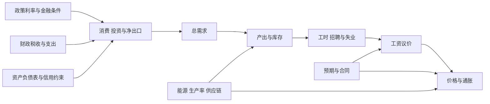

# 增长、周期、就业与政策传导：为什么四个指标不会总同向

实际 GDP 增长时，失业率可能上升：劳动参与增加得更快，或产出增长仍低于维持就业所需速度。通胀上升时，产出可能扩张，也可能因供给冲击收缩。总量平均工资上涨，还可能伴随低收入群体实际购买力下降。先把水平、增速、缺口和分布拆开，才有资格谈政策。

> [!info] 证据状态
> 已核对 Phillips 1958 原文的英国 1861—1957 货币工资变化—失业关系及进口价格例外，ILO 2013 第 19 届 ICLS 关于就业、失业和劳动低利用的定义框架，国家统计局 2024-05-08 对中国调查失业口径的答复，以及 Okun 1962、Lucas 1976 原作中本课使用的经验关系与政策外推边界。历史系数未外推为当代常数。

## 四个量：水平、增长率、趋势与缺口

实际产出水平 $Y_t$ 表示当期数量；增长率为

$$g_t=\frac{Y_t-Y_{t-1}}{Y_{t-1}}.$$

潜在产出 $Y_t^*$ 是在给定制度与可持续资源利用下的模型估计，不可直接观察。产出缺口可写为

$$gap_t=100\times\frac{Y_t-Y_t^*}{Y_t^*}.
$$

正增长不等于缺口为正：从深度衰退恢复时，$Y$ 上升仍可能低于潜在水平；潜在产出估计本身也会修订。

要从“增长率”进入一条可解长期路径，读 [[社会科学/20-经济流动与宏观/40-宏观经济学/01-资本积累有效劳动与增长过渡#先把一期的时间顺序写进账本|资本、人口与技术的离散更新]]，再逐步比较储蓄率、技术水平和技术增长率；正稳态与全局收敛各有证明。该模型假设劳动充分使用，不能替本页的短期失业、产出缺口或通胀机制。

### 三期合成数据逐步算

| 年 | 实际 GDP | 潜在 GDP | 就业人数 | 劳动力 | 失业人数 | CPI |
| --- | ---: | ---: | ---: | ---: | ---: | ---: |
| 1 | 100 | 102 | 60.0 | 67.0 | 7.0 | 100 |
| 2 | 104 | 105 | 61.0 | 68.5 | 7.5 | 103 |
| 3 | 103 | 108 | 60.5 | 68.5 | 8.0 | 108 |

注意表为教学构造；每年都满足“劳动力＝就业＋失业”，工作年龄人口中的其余人属于非劳动力。

- GDP 增长：第 2 年 $4\%$；第 3 年 $(103/104-1)\approx-0.962\%$。
- 产出缺口：约 `-1.961%, -0.952%, -4.630%`。第 2 年增长为正，缺口仍为负。
- 失业率：$7/67\approx10.448\%$，$7.5/68.5\approx10.949\%$，$8/68.5\approx11.679\%$。
- 通胀率：第 2 年 $3\%$；第 3 年 $(108/103-1)\approx4.854\%$。第 3 年出现产出下降、失业上升、通胀上升，符合供给冲击或预期/成本持续等多种机制，而不是简单需求过热。

## 就业、失业和非劳动力不能混

失业率分母是劳动力，不是全部工作年龄人口：

$$u=\frac{U}{E+U}.
$$

没有工作但未寻找、不能马上开始或不满足调查定义的人可能被归入非劳动力。于是就业人数不变时，更多人开始找工作可使失业率暂时上升；人们停止寻找又可能让失业率下降，却不是劳动力市场改善。

ILO 2013 框架把就业界定为为报酬或利润而工作，并建议同时报告时间相关就业不足、失业和潜在劳动力等劳动低利用指标。一个失业率不能覆盖工时不足、非正式工作、无薪照护或退出劳动力。

国家统计局 2024-05-08 答复说明，中国劳动力调查当时把 16 岁及以上人口按就业、失业、非劳动力三类划分；参考周工作一小时及以上或暂时未工作可进入就业，失业还要求近期寻找并能马上开始。分年龄青年指标是否含在校生是口径选择，跨时期比较必须检查变化。

## 从需求到就业：一条有条件的传导链

箭头是可能的机制和方向，不是一次政策的已识别因果图。时滞、汇率、财政反应、银行资本、家庭债务、供给能力和预期都会改变强弱；利率上升也会直接提高部分借款人的现金支出。

## Phillips 与 Okun：经验关系不是自然常数

Phillips 1958 研究的是英国 1861—1957 的**货币工资变化率**与失业水平/变化，不是无条件的 CPI—失业定律。原文还单独处理进口价格快速上涨的时期。后来把它用于价格通胀与政策时，必须再加入生产率、加价、预期与供给冲击。

Okun 1962 把失业变化和实际产出相对潜在水平的变化联系起来，提供测量潜在产出的一种经验办法。系数受生产率、平均工时、参与率和劳动力囤积影响，国家与时期不同；“GDP 增长 1% 就减少固定失业百分点”不是会计恒等式。

## 政策反应会改变你从历史估出的关系

设历史中央行遇到预期通胀上升就加息，于是数据里高通胀常与高利率同时出现。不能据此说“高利率造成高通胀”；二者共同由政策对冲的冲击驱动。Lucas 1976 的核心警告是：若政策规则改变，家庭和企业的预期与决策规则也可能改变，旧的统计关系不一定保持。

一个只对过去政策制度拟合良好的方程，不能自动预测从未出现的新制度。评估降息、财政扩张或就业政策要写清反事实、政策规则、预期和可迁移范围。

## 供给冲击为何制造艰难组合

能源供应下降会提高成本并压低可供产出，形成“通胀高、增长弱”的组合。需求收缩可以降低价格压力，却可能加重短期就业损失；补贴缓和某些价格又有财政成本和分配差异。这里没有一个指标能替代目标权重。

总量恢复也可能掩盖分配：高生产率行业扩张拉高 GDP，低工资服务业工时仍低；平均工资因低工资岗位消失而机械上升。应同时看就业人数、工时、参与率、分位工资、实际收入和群体差异。 [[社会科学/40-公共政策与社会学/20-最低工资与就业证据/04-从单案例到政策判断|最低工资案例的政策判断页]]用真实快餐店研究具体区分店均FTE、人数、总工时、家庭收入与福利，适合继续练习“指标不同向时怎样下结论”。

## 中国情境与国际比较

中国调查失业率以国家统计局具体年份的方法和口径为准；ILO 标准提供国际共同语言，但各国最低年龄、调查问题、非正式就业覆盖和季节调整仍可不同。把中国城镇调查失业率与另一国登记失业率直接排成高低榜，会比较不同制度产生的数据。

本页不报告 2026 实时 GDP、失业或通胀，也不据历史 Phillips/Okun 系数给中国政策数值预测。若用真实数据，应保存 vintages，因为 GDP、潜在产出和季调序列会修订。

## 反例、练习与证据框

- 反例：参与率下降使失业率下降，但就业人数也下降；“失业率改善”不代表更多人在工作。
- 反例：进口能源涨价使通胀和失业同时上升；稳定的向下 Phillips 曲线失效。
- 练习：实际 GDP 从 200 到 206、潜在从 204 到 210。增长 3%，缺口从约 -1.961% 变为 -1.905%，仍未超过潜在。
- 检查：看到政策前后指标变化，先问同期冲击、政策反应、预期、时滞和对照组；前后差不等于政策效应。

证据类型：增长率、失业率是**定义**；传导图是**机制模型**；Phillips/Okun 是特定样本的**经验关系**；政策规则改变后的预测需要结构与识别；增长、稳定、就业和分配怎样权衡是**价值/政策判断**。

下一步读 [[社会科学/40-公共政策与社会学/01-政策目标工具约束与矛盾|政策目标、工具、约束与矛盾]]，把多个目标放进同一决策框架；回看 [[社会科学/20-经济流动与宏观/06-货币信用银行与通胀|货币信用页]] 理解资产负债表渠道。

## 来源定位

- A. W. Phillips, “The Relation Between Unemployment and the Rate of Change of Money Wage Rates in the United Kingdom, 1861–1957”（1958），*Economica* 25(100): 283–299，Section I 及分期图：原始对象是货币工资变化，且讨论进口价格例外。
- ILO, *Statistics of work, employment and labour underutilization*（19th ICLS, 2013），paras. 57—61、工作形式图、最终决议 paras. 27—40：就业/失业/潜在劳动力与一小时准则。
- 国家统计局人口和就业统计司，咨询答复（2024-05-08）：中国当时就业、失业、非劳动力和青年分年龄口径；本页不把该历史答复外推为 2026 实时数值。
- Arthur Okun, “Potential GNP: Its Measurement and Significance”（1962），Cowles Foundation Paper 190，原刊 pp. 98—104，尤其 “The Gap from Unemployment to Output” 与 “Statistical Evidence”：产出—失业经验关系；本页不使用其历史系数作当代参数。
- Robert Lucas, “Econometric Policy Evaluation: A Critique”（1976），*Carnegie-Rochester Conference Series* 1: 19—46，尤其 §7、p. 41 起的总结：政策规则变化与历史约化关系的外推边界。
