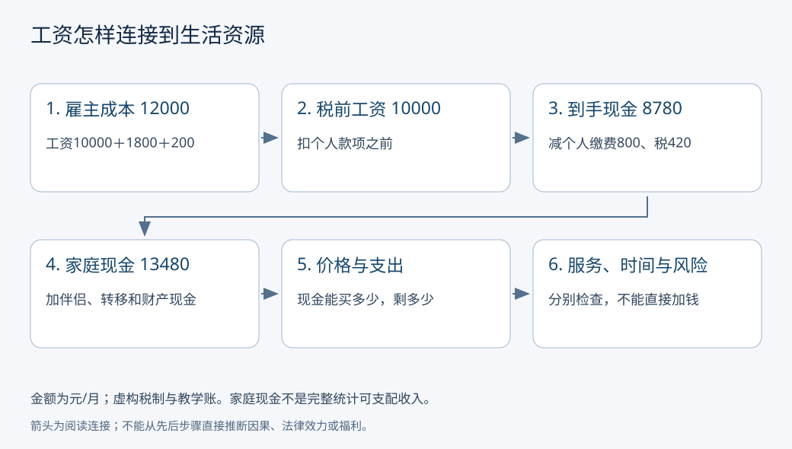

# 工资、劳动关系、税费与生活成本：涨薪后能多生活多少

一份职位写着“月薪10000”，工资卡到账8600，雇主说它每月花了12000。三人不一定有人算错：他们可能在说税前工资、到手现金和雇主用工成本。再问“这份工资够生活吗”，还要知道家庭其他收入、债务、住房、照护、公共服务和价格。**先把账列开，才谈工资高低、税费负担与生活质量。**

## 基础与快进入口

第一次看工资单，顺着下面的逐笔账本读；熟悉税前税后概念，可直接改变涨薪、住房和家庭条件，再回答练习。全部数字和税制都是原创教学设定，**不是中国或其他国家现行税率、缴费基数或计算器**。例子只保留一个月、一个劳动者，忽略年度结算和奖金等复杂性。

“劳动关系”影响谁承担支付工资、保险、工时等责任及争议处理路径；名称为合作、外包或平台接单不能单独决定法律性质。这里不据合同标题给具体个人认定，现实需核对实际工作控制、合同事实和适用规则。

## 一张工资单的完整账本

设教学雇主每月支付税前工资10000元，另付雇主缴费1800、其他用工福利成本200。劳动者个人缴费800。教学所得税定义为：税基等于税前工资减个人缴费再减虚构免税额5000；税基在0以上按10%征税，负数按0处理。

$$B=\max(10000-800-5000,0)=4200\text{元/月},\quad T=0.10B=420\text{元/月}.$$

| 一步一步记账 | 元/月 | 谁的什么量 |
| --- | ---: | --- |
| 雇主用工成本 | 12000 | 10000＋1800＋200，本例限定成本范围 |
| 税前工资 | 10000 | 扣个人款项之前的工资 |
| 个人缴费 | −800 | 从劳动者工资扣下，用途与权益另查 |
| 本例预扣所得税 | −420 | 经雇主代扣支付，不是雇主凭空另付的420 |
| 到手现金 | 8780 | 10000−800−420 |

合计检查有两层：12000＝10000＋1800＋200；10000＝8780＋800＋420。把雇主1800再从税前工资扣掉会少算到手；把800扣款既当税基扣除又当税额扣除会少算税。免税额减少的是税基，它不是再发5000现金。

图中箭头表示换一个核算层次，家庭与服务部分没有自动相加成一个总福利数。雇主缴费可能关联保障权益，却不等于现在能消费的现金；其他用工福利也须查是否已经计入工资统计，不能照搬本例的分类。

## 从个人到账到家庭生活

该劳动者与伴侣共同生活。伴侣到手现金4000，家庭另得现金转移500、当月到手财产收入200；这里后两项已经按本例约定处理相关扣款。家庭本月可用现金为8780＋4000＋500＋200＝13480元。**这是简化现金账，不自称完整国民账户可支配收入**：实际统计还涉及非现金收入、实物转移、归属与核算口径。

若住房与通勤3500、食品2000、照护1500、其他生活支出2000，总现金生活支出9000，则现金结余4480。若再偿还贷款本金1000，现金结余3480；还本金减少现金也减少负债，不应一概叫消费。收入、消费、储蓄和财富的完整定义去[[社会科学/10-共同工具/02-指标分布与存量流量核算|核算主解释]]，未来收入、借贷约束和家庭内部共享去[[社会科学/20-经济流动与宏观/02-收入消费财富与生命周期|收入与生命周期]]。

家庭每月获得某公共服务，财政成本估算600，并不意味着它可把600当现金花掉。服务可减少自付支出、改善风险和机会，也可能因排队、距离和质量而价值有限。不能将财政成本600加到13480，就称全家福利14080；更不能把服务成本与已减少的现金支出重复算。公共服务和税收净受益的比较转[[社会科学/40-公共政策与社会学/02-税收转移公共服务与归宿|税收转移与服务归宿]]。

## 涨薪、价格和时间要一起看

只改变税前工资到11000，个人缴费仍固定800：本例税基5200、税520，到手9680，增加900。平均税率从420/10000＝4.2%变为520/11000≈4.73%；这一段的教学边际所得税率是10%。平均税率与边际税率不是同一个问题。若缴费也随工资改变，900就需重算。

以固定生活篮子作对照：原先到手8780可以买8.78个价格1000元的篮子；涨薪后的9680，若同一篮子涨到1120元，只能买约8.643个，反而少约1.56%。这里固定商品数量与质量，结果不代表真实家庭消费者价格指数，也不捕捉住房差异和替代消费。

另一个条件改变：工资不变，通勤从30分钟变为90分钟，照护负担上升。现金账可能不变，但可支配时间减少。生活资源因此至少要同时记录现金购买力、可用时间、保障风险与服务可及性；把它们压成一个分数需要额外的价值权重。

## 中国文本支持到哪一层

江苏省统计局2026-06-24发布的2025年度工资报告附注，明确工资总额是税前口径，含个人代扣个税、社保与公积金；也说明其城镇单位统计范围及未覆盖的个体工商户、自由职业者。此页正文已实际读取于2026-10-07。[官方报告的指标解释与范围](https://tj.jiangsu.gov.cn/art/2026/6/24/art_87595_11794085.html)。因此报告的平均工资不能解释成全体劳动者到手收入。本课不使用其地区工资数值，也不把一个报告的口径外推到所有调查。国家统计局相应问题页本次只读到搜索摘录、完整题文未读到，未用作全文核验。

2018年修正《个人所得税法》官方税务总局全文第9条区分所得人的纳税身份和支付者的扣缴身份，第10—11条说明信息提供、预扣预缴与年度处理。它支持“扣缴不是最后全部责任或全年税额的同义词”。本次读取于2026-10-07，不由此认证所有后续配套细则仍与旧网页完全相同。[法律文本](https://www.chinatax.gov.cn/n810219/n810744/n3752930/n3752974/c3970366/content.html)

工资统计口径、个税税基和劳动合同约定可以各有边界。看某行业平均工资，要查覆盖单位、人员、期间、税前税后和平均方式；平均值不等于每个人工资，也不等于家庭资源。查真实工资争议还需有权限的劳动规则与事实，当前课不提供法定赔偿或具体申报结论。

## 反例与进一步机制

雇主成本上涨不必全转成劳动者工资；可能进入缴费、培训或其他成本。税费法定由谁缴也不能单独决定长期承担者：工资、利润、就业与价格的调整需证据。工资涨而总工时更长，时薪未必涨；工资下降但工作时间与风险显著下降，也不能仅据月额判定生活必然变差。

为什么同一工作报酬受到需求、资产、议价和退出选项影响，转[[社会科学/20-经济流动与宏观/01-生产交换分配与制度约束|生产与分配机制]]。本页固定账本层次，不复制其完整增加值解释。

## 六题练习与答案

1. **例中雇主成本、税前、到手分别多少？** 12000、10000、8780元/月。必须给名称和期间。
2. **把免税额改成6000，其他不变，到手多少？** 税基3200、税320、到手8880；免税额多1000只在本例节税100。
3. **税前涨1000，为何到手只增900？** 在固定缴费且未触其他阈值的教学制度中，新增税100。现实可有其他规则，不能移植结果。
4. **家庭偿还本金1000是否使消费多1000？** 现金少1000、负债少1000；本金偿还是金融交易。利息与服务费需另分类。
5. **服务财政成本600，家庭是否受益600？** 未知。需质量、使用、替代支出和可及性；有理由的不同估值可接受，不允许成本直接等于福利。
6. **两人税前工资一样，能否断言生活资源相同？** 不能。列住房价格、家庭收入与人数、照护、债务、工时、风险或服务中至少三项，并解释对应机制。

## 来源与例子的身份

来源版本和读取边界见上文；教学免税额、10%税率、全部金额与篮子均为虚构。本课未核验中国各地现行缴费、预扣细则、平台劳动关系判定或真实价格数据；实际问题必须回到具体法域、年度和资料。图由本组标准库生成源产生，仅说明分层核算。
