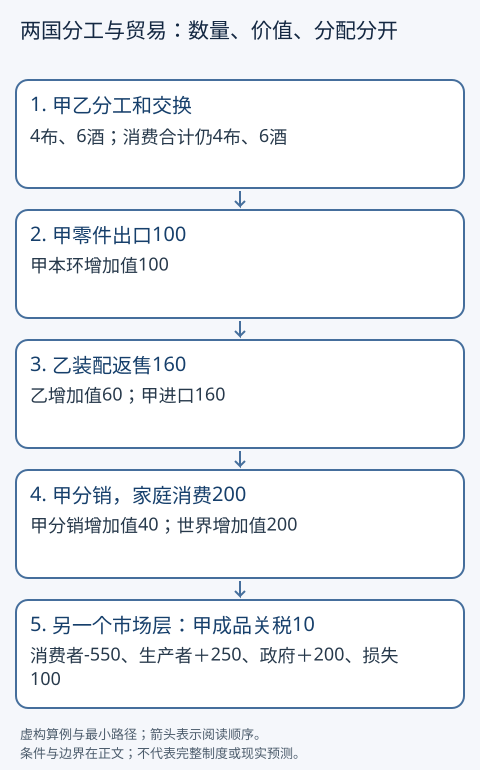
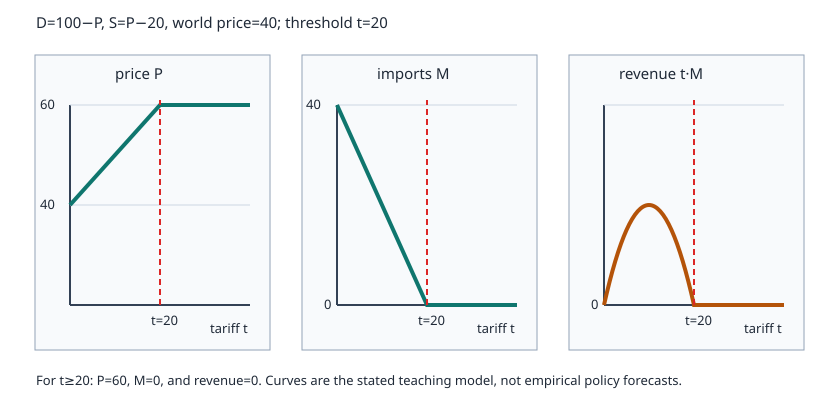

# 贸易、供应链、关税与分配

一种产品便宜了，消费者得益，原来生产它的工人却可能失业。两种变化能同时发生吗？贸易改变生产位置、商品价格和收入归属，国家总量的好处不自动落到每个人身上。本篇用同一对教学国家甲、乙，先看可以怎样分工，再看供应链和甲国的关税。它们是相互联系的三个模型层，不把抽象布酒技术当作现实电子产品数据。

## 两个入口，同一组条件

基础入口：从劳动时数与「少生产了什么」开始，再追踪一件跨境商品。

快进入口：复算两国商品守恒、供应链增加值和关税面积，再返回检查模型条件。两条路线都读分配边界与练习；详细市场推导回[[社会科学/50-CFA课程/50-厂商成本市场结构与竞争边界|厂商与市场的深入推导]]（该页只是已核验的通识推导参考，不是本篇先修或考试要求）。

## 谁更擅长：比较的是放弃了多少另一种商品

甲有12小时，乙有6小时；两国只生产布和酒，劳动可在两行业转移，单位劳动需求固定，没有运输成本和失业。

|国家|每单位布需时|每单位酒需时|做1布放弃的酒|
|---|---:|---:|---:|
|甲|3小时|6小时|0.5单位|
|乙|1小时|1小时|1单位|

乙两种产品都用更少时数，有绝对生产率优势；甲在布上放弃的酒更少，仍有比较优势。若按1布换0.75酒，价格位于两国机会成本之间。先看一种可行方案：甲生产4布、乙生产6酒；甲出口2布获得1.5酒，最后甲消费2布、1.5酒，乙消费2布、4.5酒。

核对资源：甲4×3=12小时，乙6×1=6小时；世界布4=2+2，酒6=1.5+4.5，贸易没有凭空造商品。选择一个不贸易基准：甲用6小时做2布、6小时做1酒；乙用2小时做2布、4小时做4酒。上面的贸易方案让两国布不减少、酒各增加0.5。若两国都喜欢更多酒且无需额外成本，这是一个双方获益的可检查方案。但不同偏好、基准和交易条件会改变选择；例如甲输出3布、换2.25酒，只剩1布，不能仅凭总量断言甲更幸福。贸易机会扩大可行消费集合，不证明随意选的每个分配方案都让双方更好。

规模经济是另一条机制：固定设计成本分摊到更多产量，单位成本可能下降；它不等于上表的恒定机会成本，还可能伴随集中、进入壁垒和供应依赖。技术、制度与转移成本的变化也能改变比较优势。收益机会不保证受损工人立即转岗。

## 同一甲乙之间：总贸易额与增加值为何不同

另看一批电子产品，所有生产都在当期，跨境时所有权转移，无税、运输、库存或其他投入。甲造零件，以税外100卖给乙；乙装配后以160卖回甲；甲提供分销服务后以200卖给本国家庭。



|生产环节|销售额|购入货物成本（交易链账）|本环增加值|
|---|---:|---:|---:|
|甲零件|100|0|100|
|乙装配|160|100|60|
|甲分销|200|160|40|
|世界|最终消费200|不把中间品重复计为最终品|200|

甲增加值140，乙60；总跨境毛额100+160=260不等于世界GDP。甲出口100、进口160，净出口−60；最终消费200，加净出口−60得甲GDP140。乙净出口60且无本例最终消费，GDP60。甲分销的200是销售额，160是购入转售货物成本；按SNA分销产出口径，在本例价格固定且没有其他投入时，该环节产出为商贸差额40，中间消耗为0，增加值为40。全链产出为100+160+40=300，中间消耗为100，GDP为200。460只是三个主体的毛销售额之和，不能称为SNA总产出。[IMF全球价值链指导文件G.7](https://www.imf.org/-/media/files/data/statistics/bpm6/approved-guidance-notes/g7-global-value-chains-and-trade-in-value-added.pdf)，Approved/Final版，段1—5、10—11及24，实际读取后用于支持毛流量与增加值的区别；它属于BPM6/2008 SNA更新工作文件，本例不宣称各国2026统计已采用统一新版本。

「乙出口160」不意味着乙创造160收入或取得160利润；甲的零件价值在其中。增加值还会分给工资、营业盈余等，不都属于企业主。国内增加值也不等于本国国民获得的全部收入，跨境财产收入另计。完整国民账户定义归[[社会科学/20-经济流动与宏观/05-国民账户部门余额与开放经济|国民账户主解释]]。

供应链可以降低成本，也会把某环停工传到其他环。替代供应商、库存、技术控制和运输时点决定韧性。对进口投入征税可能提高本国下游出口成本，不能只数受保护企业。这个例子不给中国、美国、德国现实电子产业的份额；没有企业投入与所有权数据时，来源国标签不足以推断全部收益归属。

## 甲国的小国关税：把四种变化分别算清

把视角收窄到一种进口成品市场。每期需求Qd=100−P，供给Qs=P−20（下列区间供给为正），P单位为货币/件，Q单位为件/期。世界价40，甲是不能影响世界价的小国。进口可无摩擦满足缺口，竞争、同质品、无外部性、曲线不变；这不是上段固定一批产品的会计表，而是甲国成品市场的行为模型。

自由贸易：P=40，需求60，国内供给20，进口40。每件加关税10且仍进口时：国内价50，需求50，供给30，进口20。消费者剩余是愿付金额超过实际支付的三角面积，生产者剩余是收到价格超过边际供给成本的面积，不等于会计利润。

|每期项目|自由贸易|关税10|变化|
|---|---:|---:|---:|
|消费者剩余|(100−40)×60/2=1800|(100−50)×50/2=1250|−550|
|生产者剩余|(40−20)×20/2=200|(50−20)×30/2=450|+250|
|政府关税收入|0|10×20=200|+200|
|三者总和|2000|1900|−100|

消费者少550，250转给生产者，200转给政府，余100为模型内的无谓损失：多生产10件的额外资源成本三角50，少消费10件的净收益三角50。关税收入是国内转移，不能把它再次算成额外无谓损失，也不能忽略它。

关税达到20时，封闭均衡价60、需求供给都40，进口0、收入0；再加关税不会把国内价按40+t无限抬升。这只是无走私和无其他冲击的小国模型。大国可能影响外国供货价，外部性、市场势力、报复、汇率和贸易转移也会改变结论；需另建模型，不能拿本表预测真实政策净效果。



图把同一题设写成分段关系：$P=40+\min(t,20)$，$M=\max(40-2t,0)$，税收为 $tM$。横线后的 $t\ge20$ 不是“税率失效”，而是进口已经截断为零；价格停在自给价 60，税收也为零。它只解释本段小国静态模型，不能用来预测真实关税政策。

## 总量允许补偿，与补偿已经发生相差一套制度

取消本例关税，消费者恢复550，生产者失去250，政府少200，总收益100。在无行政成本且可精确转移的假设下，消费者拿出超过450而少于550的金额，可以补偿另两方并留收益。但现实受益者分散，征收、识别受损者和支付需要规则；企业补助也未必到工人，职业、地点和社会网络损失不全是现金。理论可补偿不等于已补偿，更不证明每个人应接受政策。

判断政策至少分别问：总量按什么尺度变化，哪些家庭企业得到或失去什么，补偿谁支付给谁并怎样核验，非货币损失及价值标准是什么。法定关税缴款人和经济负担者也不同，接回[[社会科学/40-公共政策与社会学/02-税收转移公共服务与归宿|税收归宿]]。

## 迁移练习与答案

1. 乙生产1布放弃多少酒，甲多少？乙效率高为何甲还能出口布？**答：**乙1，甲0.5；比较优势按相对机会成本，而非谁两项更快。
2. 1布换1.2酒，甲乙是否仍都存在比自产更有利的交换？**答：**甲愿卖布，乙买布花1.2酒却自产只牺牲1酒，不符合双方获利区间；不能沿用0.75的结论。
3. 乙装配售价从160变180、甲最终售价220，甲乙增加值多少？**答：**甲零件100加分销40=140，乙80，世界220；甲消费220净出口−80，GDP仍140。
4. 关税为5，价格、进口、政府收入和无谓损失？**答：**45、30、150、25；两个三角各12.5。前提仍是世界价固定且进口为正。
5. 关税为30，能按70计算本模型国内价吗？**答：**不能。封闭价60截住涨价，进口和关税收入0；此时消费者和生产者剩余各800，总和1600，相对自由贸易的2000，无谓损失400。
6. 研究声称「国家总福利提高，所以所有工人得到补偿」，还缺什么？**答：**分配识别、补偿制度和实际领取证据；有明确缺口的未知答案合格。模型金额单位与替代价值标准不同，应注明而非硬排名。

复算见[[社会科学/20-经济流动与宏观/code/everyday_economy.py|本组经济算例源码]]。汇率和外部金融账接[[社会科学/20-经济流动与宏观/10-汇率跨境支付与国际收支|汇率与国际收支]]；本篇不维护CFA考试范围。

## 经济算例源码镜像与复算边界

本源码是四文共同的固定教学参数复算器，只用Python标准库，不复制CFA算例源码。下方与相邻code文件逐字一致。

从库根运行时须明确输出，例如：

```bash
python3 -B 社会科学/20-经济流动与宏观/code/everyday_economy.py --output /private/tmp/wwl-economy-examples.json
```

图源为相邻code/economy_figures.py，也要求显式`--output`指定候选或库根。它生成四图的布局与文字；来源条款、假设及图的解释位于对应正文，图本身不承载新增事实认证。两源码导入都不输出、不写文件。

<!-- code-sync: ./code/everyday_economy.py -->
```python
"""Exact arithmetic for four fictional general-education lessons; no tax/product advice.

Import is silent. CLI requires --output to write its JSON; no default write path.
"""
import argparse
import json
from fractions import Fraction as F
from pathlib import Path


def nonnegative_integer(value):
    if isinstance(value, bool) or not isinstance(value, int) or value < 0:
        raise ValueError("expected a nonnegative integer")
    return F(value)


def pit(income):
    x = nonnegative_integer(income)
    return F(min(max(x - 100, 0), 100)) / 10 + F(max(x - 200, 0)) / 5


def indemnity(loss):
    x = nonnegative_integer(loss)
    return min(max(x - 20, 0), 70)


def tariff(amount):
    t = nonnegative_integer(amount)
    p = min(40 + t, F(60))
    demand, supply = 100 - p, p - 20
    imports = demand - supply
    cs, ps = (100 - p) * demand / 2, (p - 20) * supply / 2
    revenue = t * imports
    return {"price": p, "demand": demand, "supply": supply,
            "imports": imports, "cs": cs, "ps": ps,
            "revenue": revenue, "dwl": 2000 - cs - ps - revenue}


def combined_budget(central_tax, central_service, local_tax, local_service, transfer):
    """Two-level teaching budget; internal transfer cancels in consolidation."""
    values = [nonnegative_integer(x) for x in (central_tax, central_service, local_tax, local_service, transfer)]
    ct, cs, lt, ls, tr = values
    return {"central_balance": ct - cs - tr, "local_balance": lt + tr - ls,
            "combined_tax": ct + lt, "combined_services": cs + ls,
            "combined_deficit": cs + ls - ct - lt}


def nonnegative_amount(value):
    """Exact teaching amounts: int/Fraction only; no implicit float rounding."""
    if isinstance(value, bool) or not isinstance(value, (int, F)) or value < 0:
        raise ValueError("expected a nonnegative int or Fraction")
    return F(value)


def unit_share(value):
    value = nonnegative_amount(value)
    if value > 1:
        raise ValueError("share must be in [0, 1]")
    return value


def import_payment(amount, opening_deposit, *, trade_credit=False):
    """One delivered import: payment from existing foreign deposit or new credit."""
    if not isinstance(trade_credit, bool):
        raise ValueError("trade_credit must be bool")
    a, d = nonnegative_amount(amount), nonnegative_amount(opening_deposit)
    if not trade_credit and d < a:
        raise ValueError("opening foreign deposit is insufficient")
    return {"china_CA": -a, "china_FA": -a, "foreign_CA": a, "foreign_FA": a,
            "deposit_change": F(0) if trade_credit else -a,
            "new_trade_credit": a if trade_credit else F(0),
            "closing_deposit": d if trade_credit else d - a,
            "foreign_deposit_liability_change": F(0) if trade_credit else -a,
            "foreign_trade_credit_asset_change": a if trade_credit else F(0)}


def two_period_transfer(transfer, c, m):
    """Two teaching periods, fixed prices/new production and next-period spending.

    Imports use the explicit trade-credit branch of import_payment, not deposit
    depletion; banks lend transfer to government at t1 only. No taxes/interest.
    private_saving is CURRENT disposable income minus CURRENT consumption,
    not the unspent portion of the lagged income used to decide consumption.
    """
    t, c, m = nonnegative_amount(transfer), unit_share(c), unit_share(m)
    spending_base = t
    rows = []
    for period in (1, 2):
        consumption = c * spending_base
        imports = m * consumption
        domestic = consumption - imports
        current_transfer = t if period == 1 else F(0)
        current_income = domestic + current_transfer
        rows.append({"period": period, "spending_base": spending_base,
                     "current_disposable_income": current_income,
                     "consumption": consumption, "imports": imports,
                     "domestic_output": domestic,
                     "unspent_spending_base": spending_base - consumption,
                     "private_saving": current_income - consumption,
                     "government_net_lending": -current_transfer,
                     "new_bank_loan_to_government": current_transfer,
                     "foreign_net_lending": imports,
                     "import_accounts": import_payment(imports, 0, trade_credit=True)})
        spending_base = domestic
    return rows


def examples():
    sales = [F(100), F(160), F(200)]
    output = [x / 10 for x in sales]
    credits = [F(0), output[0], output[1]]
    net = [a - b for a, b in zip(output, credits)]
    return {"vat": {"output": output, "credit": credits, "net": net,
                    "total": sum(net), "consumer": F(220)},
            "pit": {str(x): pit(x) for x in (180, 220, 250, 260)},
            "budget": combined_budget(80, 50, 20, 60, 30),
            "budget_transfer_40": combined_budget(80, 50, 20, 60, 40),
            "import_payment_100": import_payment(100, 100),
            "import_payment_120": import_payment(120, 120),
            "import_credit_120": import_payment(120, 0, trade_credit=True),
            "two_period": {"c08_m0": two_period_transfer(10, F(4, 5), 0),
                           "c02_m0": two_period_transfer(10, F(1, 5), 0),
                           "c08_m025": two_period_transfer(10, F(4, 5), F(1, 4)),
                           "c02_m025": two_period_transfer(10, F(1, 5), F(1, 4))},
            "finance": {"pv": F(105) / F(105, 100),
                        "real_return": F(105, 103) - 1,
                        "expected_terminal": F(99, 100) * 104,
                        "claim_50": indemnity(50), "claim_100": indemnity(100),
                        "claim_200": indemnity(200), "expected_claim": F(7)},
            "trade": {"production_cloth": F(4), "production_wine": F(6),
                      "H_consumption": [F(2), F(3, 2)],
                      "F_consumption": [F(2), F(9, 2)],
                      "H_va": F(140), "F_va": F(60), "world_va": F(200)},
            "tariff": {str(x): tariff(x) for x in (0, 5, 10, 20, 30)},
            "fx": {"E_old": F(7), "E_new": F(77, 10),
                   "inverse_change": F(10, 11) - 1,
                   "forward": F(7) * F(104, 102),
                   "china_CA": F(-100), "china_FA": F(-100),
                   "foreign_CA": F(100), "foreign_FA": F(100),
                   "reserve_example_CA": F(30),
                   "reserve_example_FA": F(10) + 25 - 5}}


def encode(value):
    if isinstance(value, (F, int)) and not isinstance(value, bool):
        value = F(value)
        return {"exact": str(value), "decimal": float(value)}
    if isinstance(value, dict):
        return {k: encode(v) for k, v in value.items()}
    if isinstance(value, list):
        return [encode(x) for x in value]
    raise TypeError("unexpected output type")


def main():
    parser = argparse.ArgumentParser(description=__doc__)
    parser.add_argument("--output", required=True, type=Path)
    args = parser.parse_args()
    args.output.parent.mkdir(parents=True, exist_ok=True)
    args.output.write_text(json.dumps(encode(examples()), ensure_ascii=False,
                                      indent=2) + "\n", encoding="utf-8")


if __name__ == "__main__":
    main()
```

## 参数账户的待运行合同

相邻 [test_everyday_economy.py](code/test_everyday_economy.py) 给合并抵销、付款分支、输入拒绝和两期外部闭合的6项测试定义。它们是待运行接口，不把断言存在称执行通过。获准运行时从库根执行：

```bash
python3 -B -m unittest discover -s 社会科学/20-经济流动与宏观/code -p test_everyday_economy.py -v
```

预期6项全部通过，失败须保留输入/输出再修；本轮按用户约束 **notrun**。

<!-- code-sync: ./code/test_everyday_economy.py -->
```python
"""Narrow teaching-account contracts. Prepared, not executed in this batch."""
import unittest
from fractions import Fraction as F
from everyday_economy import combined_budget, import_payment, two_period_transfer


class AccountContracts(unittest.TestCase):
    def test_transfer_changes_level_balances_not_consolidation(self):
        before = combined_budget(80, 50, 20, 60, 30)
        after = combined_budget(80, 50, 20, 60, 40)
        self.assertEqual((before['central_balance'], before['local_balance']), (0, -10))
        self.assertEqual((after['central_balance'], after['local_balance']), (-10, 0))
        for row in (before, after):
            self.assertEqual((row['combined_tax'], row['combined_services'],
                              row['combined_deficit']), (100, 110, 10))

    def test_deposit_and_credit_are_distinct_counterparts(self):
        cash = import_payment(120, 150)
        credit = import_payment(120, 150, trade_credit=True)
        self.assertEqual((cash['deposit_change'], cash['closing_deposit'],
                          cash['new_trade_credit']), (-120, 30, 0))
        self.assertEqual((credit['deposit_change'], credit['closing_deposit'],
                          credit['new_trade_credit']), (0, 150, 120))
        self.assertEqual(cash['foreign_deposit_liability_change'], -120)
        self.assertEqual(credit['foreign_trade_credit_asset_change'], 120)
        for row in (cash, credit):
            self.assertEqual((row['china_CA'], row['china_FA']), (-120, -120))
            self.assertEqual((row['foreign_CA'], row['foreign_FA']), (120, 120))

    def test_payment_rejects_insufficient_and_invalid_inputs(self):
        for args in ((120, 100), (-1, 100), (True, 100), (120.0, 150)):
            with self.assertRaises(ValueError):
                import_payment(*args)
        with self.assertRaises(ValueError):
            import_payment(120, 0, trade_credit='yes')

    def test_closed_two_period_expected_consumption_and_saving(self):
        for c, expected in ((F(4, 5), (8, F(32, 5))),
                            (F(1, 5), (2, F(2, 5)))):
            rows = two_period_transfer(10, c, 0)
            self.assertEqual(tuple(row['consumption'] for row in rows), expected)
            self.assertEqual(tuple(row['private_saving'] for row in rows), (10, 0))
            self.assertEqual(tuple(row['new_bank_loan_to_government'] for row in rows), (10, 0))

    def test_open_two_period_expected_outputs_and_external_accounts(self):
        rows = two_period_transfer(10, F(4, 5), F(1, 4))
        self.assertEqual(tuple(row['domestic_output'] for row in rows), (6, F(18, 5)))
        self.assertEqual(tuple(row['imports'] for row in rows), (2, F(6, 5)))
        self.assertEqual(tuple(row['private_saving'] for row in rows), (8, F(-6, 5)))
        for row in rows:
            self.assertEqual(row['private_saving'] + row['government_net_lending']
                             + row['foreign_net_lending'], 0)
            self.assertEqual(row['import_accounts']['new_trade_credit'], row['imports'])
            self.assertEqual(row['import_accounts']['deposit_change'], 0)

    def test_share_and_exact_amount_contract(self):
        for c, m in ((F(6, 5), 0), (F(-1, 5), 0), (F(4, 5), F(5, 4)),
                     (0.8, 0), (True, 0)):
            with self.assertRaises(ValueError):
                two_period_transfer(10, c, m)
        rows = two_period_transfer(F(1, 2), F(1, 2), F(1, 2))
        self.assertEqual(rows[0]['imports'], F(1, 8))


if __name__ == '__main__':
    unittest.main()
```
