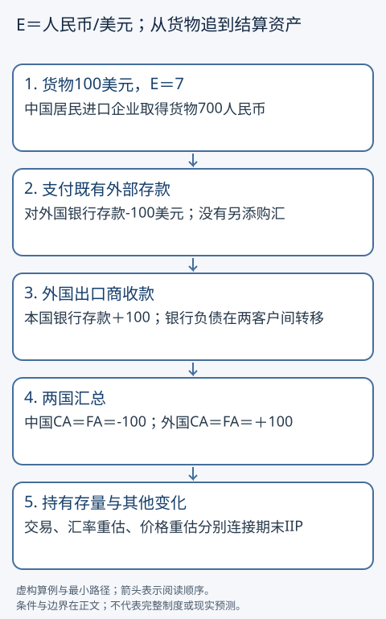

# 汇率、跨境支付与国际收支

一美元换更多人民币，谁的成本增加？一笔跨境汇款，为什么既要记进口，又要记金融账户？从报价单位开始，跟随一笔支付，再看国家汇总。汇率、利率与金额全部是教学参数，没有预测、申报或投资用途。

## 两个入口，先写单位

基础入口：从E的单位与进口账单读到付款的两边账本。

快进入口：先算倒数变化和国际收支符号，再回头检查居民、计价货币和结算资产。两条路线共读制度条件与练习，不以掌握考试汇率术语为前提。

## E是人民币/美元，倒数的百分比不对称

本文固定E=CNY/USD，即每1美元需要多少人民币。E从7变7.7，上升10%，美元相对人民币更贵，人民币相对美元贬值。倒数q=USD/CNY从1/7≈0.142857变1/7.7≈0.129870，下降1−1/1.1≈9.09%，不是10%。「人民币贬10%」如果没有说按哪个报价衡量，信息不够。

进口商约定付100美元，原成本700人民币，变770，多70；出口商收到100美元，换回人民币同样由700变770。若出口合同固定700人民币，外国买家付美元从100降到约90.91；若进口合同固定700人民币，本国买方金额不因当次E变动改变。固定外币售价的出口商如有美元进口投入，人民币成本也涨，不能把毛收入增加70当净利润增加70。是否调价、销量怎样响应，还须价格传递、合同和供需证据。

## 同一支付，两边如何闭合

居民是统计经济归属，不简单等于国籍或护照。按本文历史教学标准IMF BPM6（2009）第4.113—4.116段，关键是主要经济利益中心；持续经营或居住等事实以及特殊规则影响判断。本例中国进口企业是中国居民，外国出口企业为外国居民。

设中国企业从外国居民购买价值100美元货物，货物当期交付并转移所有权，汇率E=7；无运输、保险、费用和信用。为了只看一笔结算，设中国企业原有对外国银行100美元存款，直接从该存款支付；不同时虚构它又向本国银行购买100美元。

|单位|实物/支出一边|金融资产另一边|
|---|---|---|
|中国进口企业|取得货物100美元（700人民币）|对外国银行存款减少100美元|
|外国出口企业|交出货物，记录出口销售100美元|对该银行存款增加100美元|
|外国银行|资产在本模型中不变|对中国企业存款负债−100、对本国出口商存款负债+100，总负债不变|

若货物成为库存，进口企业库存资产加100；若本期消耗，进入相应使用账户。本例企业账不把「进口」一概当损失100或新增债务100。

中国国际收支：货物进口经常账户借方100，CA=−100；中国居民对外存款资产减少100，所以金融账户净取得对外资产=−100、净发生对外负债=0，FA=−100。外国经济的经常账户出口+100；其银行对中国居民外部存款负债减少100，对本国居民存款增加属于国内对应项，因此FA=0−(−100)=+100。双方CA=FA均成立。不是货物和资金都「支出」就把同一购买算成CA−200。

现实本国银行购汇、代理行、支付机构与延期结算会增加中间账户，需逐笔补齐；图不是所有跨境系统的路径。本文也不把跨境收款地点替代统计居民判断。

## 经常账户、资本账户和金融账户的符号

按BPM6的历史教学呈现，CA包括货物服务、初次收入、二次收入；KA是资本转移及非生产非金融资产交易，和日常所说的「资本流动」不是同一个大篮子。FA记录净取得对外金融资产减净发生对外负债。在没有测量误差时，CA+KA=FA；若定义净误差遗漏NEO=FA−(CA+KA)，则CA+KA−FA+NEO=0。实际数据的统计差异不能一律归因于某种非法行为。

再设一国CA=+30、KA=0。居民增加私人外部资产10，央行增加符合条件的储备资产25，另增加外部负债5，则FA=10+25−5=30。储备增加在本呈现里是「净取得资产+25」，不是自动负25。另一种分析呈现把储备作为融资项移到等式右侧或使用贷借符号，可能显示负号；先看表头和恒等式，不能混用。

储备是符合主管货币当局控制等条件的特定对外资产，不等于全部海外资产。期末外部资产负债存量（IIP）=期初存量+交易+价格和汇率重估+其他变化，储备估值上升不是当期出口收入。以上对应依据是[BPM6原文](https://data.imf.org/-/media/iData/External-Storage/Documents/73FBCD5B6CDE4D289C60B9B0CAA40622/en/2-bpm6.pdf)第2.12—2.21、4.113—4.116、6.64和8.1—8.7段；历史标准与各法域当前统计迁移须分开。账户更深入的储蓄投资与部门对应回[[社会科学/20-经济流动与宏观/05-国民账户部门余额与开放经济|国民账户与外部余额]]，此处不宣称已核验中国、美国、德国2026发布表的全部符号。

## 固定、浮动与资本流动：一个价格有多种约束

固定汇率安排要明确盯住什么、容许波动和谁承诺兑换。假设货币当局以E=7出售20美元储备，收回140人民币结算资金，外部储备减少20；若没有其他补充，储备有限。国内流动性影响取决于央行对应负债与是否用其他操作抵销。不能说保持固定价只需发布公告。

浮动汇率更多由市场买卖形成，当局仍可能干预。浮动不等于没有政策，固定不等于每笔任何规模随时可兑换；资本流动限制、储备、信用和金融机构条件都影响约束。在资本自由流动、资产可替代且维持可信固定汇率等强假设下，国内利率很难任意独立于锚货币利率：更高的回报可能吸引资金，需要干预维持价。资本管制、风险溢价及不可信承诺会改变该机制。这是条件推理，不把各国贴上固定制度标签；要描述中国、美国或德国现实安排还需读取对应时期主管机构材料，本篇不凭记忆给2026分类。

## PPP、CIP、UIP在回答不同问题

|关系|比较对象和条件|能推出什么，不能推出什么|
|---|---|---|
|购买力平价PPP|相同篮子在两地的价格，运输、非贸易品、税费等需处理|强假设下相对物价与汇率相联系；不保证短期或单件商品汇率预测|
|有抛补利率平价CIP|今日即期换币，存款，再用已经约定的远期锁定回兑；融资与合约可执行|理想无摩擦、同风险无套利条件约束远期价；远期价不是未来即期保证|
|无抛补利率平价UIP|没有远期锁定的跨币投资与预期未来即期汇率|依赖预期和风险溢价假设；即使成立也是期望关系，实际汇率可能很不同|

教学一年CIP：E=7，人民币利率4%、美元利率2%。1人民币留在本币账户变1.04；换成1/7美元存一年，再按远期F人民币/美元锁定，收到(1/7)×1.02×F。因此相等时F=7×1.04/1.02≈7.137255。没有锁定F的同一路径会承担未来E风险，不能称无风险套利。BIS 2016年研究的[Box A及约束讨论](https://www.bis.org/publications/qr-201609/covered-interest-parity-lost-understanding-cross-currency-basis)实际读取后用作CIP机制及偏离边界依据：风险、对手方、流动性和资产负债表成本会妨碍简单套利。更多合约推导回[[社会科学/30-金融市场与风险/06-远期衍生品无套利与期权|远期与无套利主解释]]。

相对PPP的教学关系E新/E旧=(1+本国通胀)/(1+外国通胀)，需篮子、期间和假设一致；UIP把CIP的锁定远期替换成条件预期未来即期还需要额外假设。三条都不是输入两国数字就可靠预测汇率的机器。

## 迁移练习与答案

1. E由7降到6.3，倒数上涨多少？**答：**E−10%，倒数+11.11%；人民币相对美元升值，须带报价单位。
2. 进口金额100美元，但出口企业应收也100美元，E涨10%就一定亏70人民币吗？**答：**毛进口成本增70、毛外币收入也增70，净暴露可能抵销；时点、金额、合约及成本仍需核验。
3. 本例进口改为尚未付款的赊购，其他条件不变，外部账怎么记？**答：**CA−100；对外贸易信用负债增加100，FA=0−100=−100。付款时减少存款及负债是另一期金融交易，不能重复记进口。
4. CA20、KA3，对外资产取得30、外部负债增加7，NEO多少？**答：**FA23，NEO0。把储备混成负号会错误破坏闭合。
5. 储备市值涨5，没有买卖，能记CA+5、FA+5吗？**答：**不能；为重估，进入存量桥接的其他变化。没有估值信息时保留未知。
6. 理想CIP算出F7.137255，是否保证一年后E达到它？**答：**不保证。F是今日可锁定合约价；未来即期仍有风险。UIP也不是每次实现值保证。能给融资摩擦或风险溢价反例合格。

复算见[[社会科学/20-经济流动与宏观/code/everyday_economy.py|本组经济算例源码]]；支付与货币的机构底层回[[社会科学/20-经济流动与宏观/06-货币信用银行与通胀|货币与银行]]。本篇不维护CFA考试要求。
