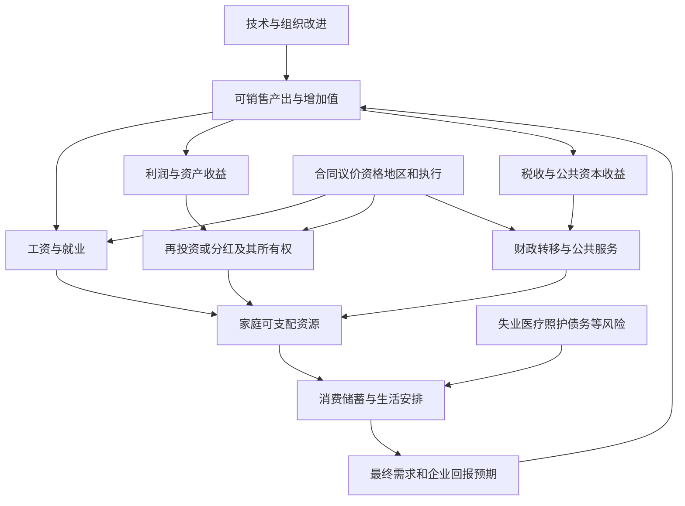

# 科技优先、产业收益与家庭福利：技术成功怎样成为可感受到的生活改善

某地工厂产量增加，企业融资更容易，居民却仍担心失业、医疗和房贷。也可能出现相反情景：技术压低商品价格、提高工资，家庭确实拥有更多收入与时间。两者都不能仅凭“发展高科技”这个标签判定。应当沿收益、风险和纠错三个问题追到具体人：谁取得新增资源，谁承担调整成本，受损者能否得到保障和促成改变。

本课将科技政策放入已有技术扩散、部门账户和分配主解释，增加中国时期证据与可反证的机制。2026-10-09为来源核读日，以下不是全年或此后的最新政策认证。解释图是待检验机制；统计、政策文本、研究说明和教学构造各有身份。

## 先将“优先”拆成能观察的判断

“存在消费政策”与“居民福利是增长模式的中心”不等价。“产业有战略地位”与“当前每一项新增资源都更偏产业”也不等价。优先至少包含战略目标、资源约束下保护什么、工具如何执行、家庭最终结果四层。

| 观察层 | 可以读什么 | 不能直接推出 |
| --- | --- | --- |
| 战略与规则 | 规划、预算安排、支持工具与退出制度 | 决策者内心全部权重，或政策已经有效 |
| 财政金融投入 | 同范围预算/执行、信用额度、实际使用、净成本 | 不同预算和贷款面额可直接相加比较 |
| 传导过程 | 工资、分红、税收、公共服务、资格与到账 | 企业有利润就已普惠到所有家庭 |
| 家庭结果 | 实际收入/时薪、消费、债务、工时、保障和分布 | 全国均值足以描述被替代者，或消费弱证明单一动机 |

“科技”“制造业”“基础设施”“消费”也非互斥四桶。公共交通投资可降低通勤成本，医院建筑既是资本支出也属卫生功能，耐用品补贴同时支持买方和制造业。政策目标与工具的主解释见[[社会科学/40-公共政策与社会学/01-政策目标工具约束与矛盾|目标、约束与政策结果]]。

因此这里采用可讨论的条件判断：产业战略支持与居民端补强可以并存；是否构成更大风险，要相对一个有融资方式、时间和对象的替代组合检验。保留高社会回报基础研究和必要技术能力，同时增加保障、转型支持及低回报项目退出，是一项比较方案；它不是由账户恒等式推出的唯一正确政策。

## 技术收益为什么没有自动到达原劳动者

[[社会科学/20-经济流动与宏观/13-生产率技术扩散与制度变迁|技术采用主解释]]先问流程、技能、资本和买家能否使潜力兑现。这里继续问，兑现的收益怎样分配。

箭头表示候选机制，没有宣称本课已识别每条因果效应。工资取决于技能互补/替代、需求与议价；利润可能留作投资或分给特定所有者；税收与公共资本收益进入预算，还要经过支出、资格和服务可得。它们是同一收入不同去向和后续交易，不应把增加值、利润、分红和税收重复加成总收益。

消费者也可能经降价受益，出口可以扩大市场，新技术可以创造新岗位。反过来，旧劳动者可能无法迁移、承担培训费用或受照护责任限制。行业新岗位增加，不能证明被替代的同一批人进入了这些岗位。这里需要追踪人的转移，而不只是企业与岗位总数。

## 居民消费有两道门：取得收入与愿意/能够使用收入

在同期间、匹配居民部门、同一核算体系的账户中，$Y>0$为GDP，$Y_H^d>0$为居民可支配收入，$C_H$为居民最终消费：

$$\frac{C_H}{Y}=\frac{Y_H^d}{Y}\times\frac{C_H}{Y_H^d}.$$

这是代数恒等式。第一项是居民取得收入的份额，第二项是消费相对于收入的比例；公式本身不给因果方向，也不是边际消费倾向。分红、工资和转移作用于收入来源；风险保障、预期和流动性约束可能改变消费安排。公共服务实物转移的分析须成对使用调整后可支配收入/实际最终消费等口径，不能只改一个分子。

进一步的定义见[[社会科学/20-经济流动与宏观/05-国民账户部门余额与开放经济|部门账户]]，风险与消费平滑见[[社会科学/20-经济流动与宏观/02-收入消费财富与生命周期|家庭跨期安排]]。比值上升还可能来自GDP下降，应同时看实际水平、分布、服务和时间。

### 中国住户调查的例子：数字是真的，换账户的解释会错

国家统计局2026-07-15发布上半年资料：人均可支配收入22981元，名义/实际增长5.2%/4.2%；消费14836元，名义/实际增长3.7%/2.7%；收入中位数19036元。这里是住户调查，附注说明季度数不含自产自用部分，且数据有舍入。[原始发布及表1、附注](https://www.stats.gov.cn/sj/zxfbhjd/202607/t20260715_1964129.html)。本次原`sj/zxfb`路径超时后取得同机构`sj/zxfbhjd`页面，保留旧定位在来源档案。

同调查口径的比值及反推接口为

$$r_{now}=14836/22981\approx64.6\%,\qquad r_{old}=\frac{14836/1.037}{22981/1.052}\approx65.5\%.$$

差约$-0.9$个百分点，全部由公布舍入数推算，未运行程序。它不是国民账户居民消费/GDP，不是每户比例的平均，不是精确储蓄率，更不能把22981与14836塞入上面的SNA分解。消费与收入的实际均值均增长，与“所有居民的实际收入和消费都下降”不相容，但还不能裁定每人的整体福利；平均与中位收入也不能取代受冲击者的真实时薪。

消费相对收入下降可以与谨慎储蓄相容，也可能涉及家庭构成、财富、债务偿还或预期变化。要区分H1“收入没有传到目标家庭”和H2“传到了但风险仍高”，就要匹配家庭收入来源、服务/保险、预期和资产负债；单个宏观比值识别不了这两条机制。

## 政策证据必须容纳反证：产业支持与民生执行并存

财政部2026-03-16发布的预算报告在2026安排部分列中央本级科技4264亿元、增长10%，基础研究增长16.3%；这是预算安排。该报告另在2025国有资本经营预算执行部分记载中央调入一般预算2400亿元，支持“企业利润到财政的通道真实存在”，还未证明家庭最终受益。[报告相应章节](https://www.mof.gov.cn/zhengwuxinxi/caizhengxinwen/202603/t20260316_3985331.htm)。本页采用原正文精度，不将旧稿4264.2自动当已核精度。

财政部国库司1—7月资料的网页实际发布日期是**2026-08-21**，不能由路径中的`20260814`推日期。全国一般公共预算名义执行如下，范围不同于中央本级全年预算：

| 项目 | 本期支出，亿元 | 同比 | 用舍入增速反推增量，约亿元 |
| --- | ---: | ---: | ---: |
| 总支出 | 162889 | 1.3% | 2090 |
| 科学技术 | 5408 | 1.5% | 80 |
| 社保与就业 | 29548 | 7.0% | 1933 |
| 卫生健康 | 13613 | 9.8% | 1215 |

来源及定位：[财政部原页“一（二）一般公共预算支出”](https://gks.mof.gov.cn/tongjishuju/202608/t20260814_3995497.htm)。反推式$\Delta x=x-x/(1+g)$，要求$g>-1$且两期口径匹配。社保卫生合计增量约3148，高于总净增量，其他类别合计抵消即可成立。这是本页解析预期，未执行计算程序；不是财政部公布的未舍入增量。

这些数据使“1—7月新增一般公共预算主要给科技”站不住脚。民生科目获得实质增长，必须改变判断；但功能科目并非全部直接给家庭，部分年度拨付、人口与机构支出也影响解释。它同样不能证明全部公共支持已经居民优先。比较增速时基数不同，比较预算与执行时期间、中央/全国都要对齐。

人民银行调整工具的广东省委金融办官方转载在2026-09-30发布，记载科技创新和技术改造再贷款额度从1.2万亿到1.4万亿元、支持比例60%到100%，并同时增加支农支小额度。[同一公告官方转载](https://www.gdjr.gov.cn/gdjr/jrzx/jryw/content/post_45615.html)。这是工具额度变更，不是实际用量、财政支出或贷款损失担保；本次不将转载日当央行原公告日期，也不计转载为独立第二份政策证据。

一亿元拨款、一亿元贷款、一亿元股权投资的现金、资产和风险不相同。比较须分别列支出时点、回收/收益、管理成本、优惠融资成本、损失风险与长期承诺，再判断最终承担者。居民消费贷款减少也可能是借贷需求下降，不能与科技企业贷款增加直接拼成“银行抢走家庭的钱”。贷款不是收入，让家庭更多负债也不等于福利提高。责任和经济归宿的定义回[[社会科学/40-公共政策与社会学/02-税收转移公共服务与归宿|法定责任、流量与福利归宿]]。

## 两种产业信贷解释可以同时值得检验

一种机制是投资当期形成工资和订单，之后新增产能若缺少最终购买，需要继续投资、出口或降价吸收。降价可能惠及消费者；若同时恶化工资、就业与债务偿付，风险则不同。不能说投资只加供给不加需求。

Chang、Xiong于2026-08-20的作者说明，用2008Q1—2025Q2季度VAR和行业关联讨论生产导向融资传导：信贷更直接维持生产和资产负债表，未必等量拉动居民最终需求。此处已读说明，不是重做其冲击识别；政策对弱需求的反应与共同冲击可能内生，不能由货币增长后价格弱宣布全部因果已定。[作者说明](https://voxchina.org/show-3-474.html)。

竞争解释是原市场已经存在融资配置扭曲，定向信贷可能纠正一部分。Chen等2026-07-14作者说明结合2009—2020企业资料和多部门模型，讨论跨行业配置改善与行业内低效企业退出减弱；模型的净结论依赖这个基准，不能为所有项目背书。高加价率、收入生产率与物理生产率不同，更不等于家庭福利。[作者说明](https://voxchina.org/show-3-467.html)。本次未完整核两项原论文或复现数据，不使用模型百分比作为全国政策效果。

这两项讨论的问题、时期与反事实不同。比较应落到具体新增项目：技术外溢、替代依赖、需求、就业、财政与分布；技术安全改善可能与转型风险增加并存。没有公开权重和可行反事实，不能做一个“总体风险”分数。削减基础研究和保障同样有机会成本，不能默认任一方向免费。

## 同收入、同消费，仍可能有不同的生活与权利

教学构造：劳动者每周40小时、时薪25元，收入1000；后来50小时、时薪20元，仍1000。若两期消费都900，收入与消费表会漏掉每周10小时损失。再加入社保、欠薪、照护和借债，结论继续变化。数字不是中国样本，也没有将时间折算成一个福利总分。

Giuntella、Lu、Wang的2023-04-26作者说明使用CFPS纵向资料与历史工业机器人暴露，报告时薪下降、工时/家庭借贷调整而消费未显著变化等研究结果。它提供“总量稳定可能由家庭吸收风险”的具体机制；本次未核完整估计表、置信区间或复现回归，不引用9%/14%作为当前AI预测。[研究者说明](https://voxchina.org/show-3-313.html)。保留就业者选择很关键：只看仍就业者时薪，会漏掉退出和失业者，不能据其平均判断全部原工人的结果。

保护劳动者与保护所有旧岗位也不同。可携带社保、失业期间收入、迁移/照护支持与能通向实际岗位的培训，可以保障人并允许低回报企业退出。仅报培训人数、新岗位数或平均工资，尚未证明原劳动者进入更好岗位。经济后果回[[社会科学/20-经济流动与宏观/08-工资劳动关系税费与生活成本|工资、家庭现金与时间]]；产业创业的资金和能力约束回[[社会科学/20-经济流动与宏观/15-资源受限科技创业与单位经济|科技创业的可靠交付与单位贡献]]。

劳动权利还有独立规范意义，不能只在提高消费或生产率时才承认。最高法2025-08-01发布的法释〔2025〕12号第19条认定放弃社保缴费的约定/承诺无效，第21条规定2025-09-01施行。[官方原文](https://www.court.gov.cn/fabu/xiangqing/472691.html)。这支持文本层反证，不能由“产业优先”推全部劳动保障规则已放松；也不能从文本证明全国落实改善。劳动关系、取证、追偿和执行仍需事实，本文不对具体争议给赔偿结论。

## 从经济困境到社会表达，中间证据不能省

经济损失→对不公的理解→责任归因→组织机会→表达，是不同环节。退出竞争、少消费、迁移、换工作、申诉或公开行动都可能出现；困难不自动成为中央归因或全国爆发。

观察机制本身还可能变动。设某时段真实事件数$N_t$，事件$i$被记录的概率$p_{it}\in[0,1]$，$O_t$为记录数，则由指示变量期望的可加性：

$$E[O_t]=\sum_{i=1}^{N_t}p_{it}.$$

同质概率假设下才化为$N_tp_t$，不需要假定事件独立就能使用期望可加性。记录数减少可以是真实事件减少，也可以是报告、删除、抓取和去重变化；没有额外信息不能同时恢复$N_t$与$p_t$。调查方式、样本和时期不同的历史态度，也不能直接充作当前民意。

这里没有运行事件监测，没有制作参与者名单，也没有给全国性政治爆发概率。反馈制度要另观察：欠薪/服务投诉能否进入办理、成本是否可承担、是否落实补偿、重复问题是否促成规则改变。沉默不是满足的直接测量，投诉多也可能来自渠道更可用。

## 能推翻上述风险判断的证据是什么

| 条件假说 | 需要追踪的同一对象 | 支持风险下降的反证 | 尚须处理的识别问题 |
| --- | --- | --- | --- |
| 产业收益未广泛传到家庭 | 企业工资/分红/税收与对应家庭资源 | 目标家庭实际收入和服务持续改善，而非只平均值提高 | 企业自选择、价格与迁移、共同冲击 |
| 家庭因风险而储蓄 | 到账待遇、医疗/养老可得、预期与债务 | 可兑现保障真实提高，并在可比家庭改善风险/消费安排 | 政策与衰退同出、年龄构成、预期 |
| 技术成本由原劳动者吸收 | 退出者与就业者的时薪、工时、净债务和照护 | 原劳动者进入更好时薪/保障岗位，时间和杠杆未恶化 | 就业选择、地区暴露内生、家庭成员调整 |
| 地方项目挤压保障 | 项目净回报、到期债务、转移、欠款和服务 | 中央转移有效切断冲击，或项目回报改善公共服务 | 反向因果、土地/人口共同变化 |
| 记录减少来自可见性 | 稳定观察渠道、去重和匿名聚合调查 | 稳定渠道一致下降且困境实质缓解 | 非随机缺失、同源转载、未知总体 |

每个设计要给处理、结果、对象、时期、反事实、假设与溢出，不能只列DID/IV/VAR名称。跨国比较也要对齐追赶阶段、产业、税制与转型保障，而非用国名代替机制。取得微观资料还需符合其访问条件；本页未获得CFPS数据权限，未运行回归。

## 来源边界与下一次复算接口

本页实际核读：财政预算报告相应章节、财政1—7月执行、住户收支原页与附注、金融工具官方转载、最高法原文，以及三篇研究者说明。交接中的IMF约4%GDP、世界银行85%资格与养老金2%—4%、消费规划具体2030目标、48.2小时参考期、贷款原表和抗议事件数字，本页**未完成相应原报告/表的补核，未作为已核正文事实**；保留完整历史主张与纠偏在#123来源档案。未补核不等于证伪。

复算输入固定为本页两张数表；输出接口是住户比值、反推上年比值/百分点变化，以及$x-x/(1+g)$的四项财政增量。预期为约64.6%、65.5%、−0.9个百分点及2090/80/1933/1215亿元；未来实施时报告舍入误差而非无限小数。改变期间或口径需换输入版本，不能只改结果。输入、来源与解析式在本页一处给出；没有新增源码、测试或code-sync镜像。

所有程序、实验、回归、基准、结构检查、Obsidian显示/同步与真人阅读均为`not_run`。重要恒等式、数字、政策/法律时期及条件因果解释需要非作者独立核对；作者阅读与代数自查不冒称独立审阅。读者应能对任一“产业成功”的新闻同时写出收益路径、风险承担者、可反证观察与尚未识别的箭头，而不由技术标签直接判断所有家庭的生活。
