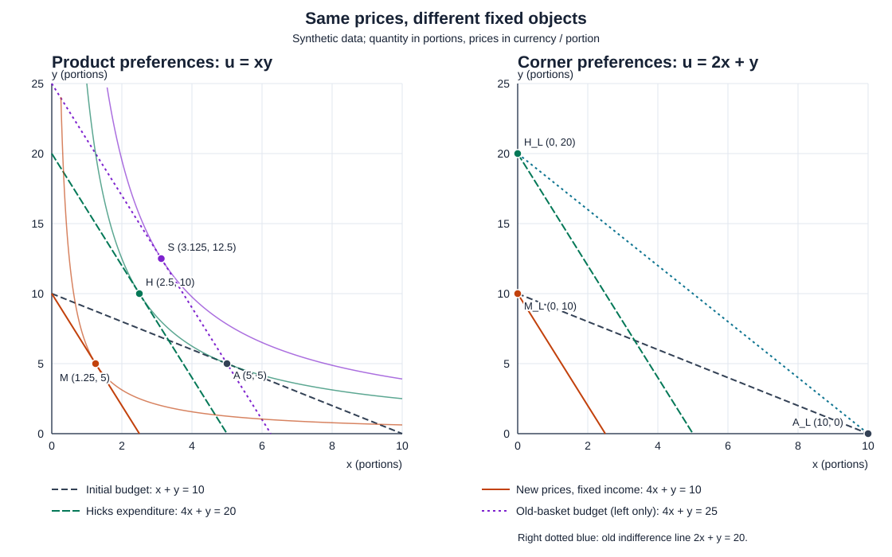

# 涨价以后买什么：普通需求与补偿需求

一种商品从每份1元涨到4元。“收入不变”“补到原来一样好”“补到原来的东西还买得起”，听起来都在讨论购买力，却提出了三个不同的问题。先把固定对象写出来，再算数；否则“补偿”两个字会悄悄换掉题目。名词没有替我们把钱算对的义务。

本课沿用 [[社会科学/20-经济流动与宏观/02-收入消费财富与生命周期#消费选择与预算的影子价值|两商品消费者]]，把价格也作为参数。读完应能在没有“用哪种需求”的提示时，辨认题目固定的是名义收入、旧偏好水平，还是原篮子的可购买性，再求相应选择。例子全为合成教学数字，不是家庭消费预测或补贴标准。

## 先把偏好和可行集分开

消费束是 $(x,y)\in\mathbb R_+^2$；两种商品可连续分割，每份是固定的数量基准。价格 $p_x,p_y>0$，单位元／份；本期可用于这两种商品的名义预算 $m>0$，单位元。这里不另留储蓄、不收交易费，也不变商品质量、家庭成员或偏好。预算集为

$$
B(p,m)=\{(x,y):x,y\ge0,\ p_xx+p_yy\le m\}.
$$

同一个预算集只说明“买得起”，尚未告诉我们买什么。用偏好关系 $(x,y)\succeq(x',y')$ 表示“至少一样喜欢”；效用表示把这个顺序写成数值。本例固定 $u(x,y)=xy$，即用数量相对于一份的数值计算乘积；25不是可跨人相加的幸福单位。

常见条件各干不同的事：**完备性**使任意两束可比较，**传递性**避免排序循环；它们不单独保证连续效用存在。此处直接给了连续函数表示，在正价格、有限预算形成的非空紧预算集上能取得最大值。**局部非饱和**意味着每束附近有更受偏好的束，在这里帮助排除“仍可买得更好却不花”的最优方案；$xy$ 在正域对两商品严格增加，在坐标轴上也能通过邻近正束改善。**凸偏好**说上轮廓集是凸的，描述愿意混合消费束；它不等于所写效用函数本身凹，更不保证内点。线性偏好也可有角点或一整段并列选择。

一条无差异线由同一效用水平的束组成。此例 $u=25$ 是 $y=25/x\ (x>0)$；向右下走是用更多 $x$ 换更少 $y$，仍在同一偏好水平。预算线是 $y=m/p_y-(p_x/p_y)x$，斜率为 $-p_x/p_y$。只改变 $p_x$、固定 $p_y,m$ 时，预算线绕 $y$ 截距转动；固定价格改变 $m$ 则使预算线平行移动。图中两轴始终都是商品数量，不是时间或效用。

## 固定名义预算：普通需求从哪里来

普通需求（Marshallian demand）解的是

$$
(x^M,y^M)\in\arg\max_{(x,y)\in B(p,m)}u(x,y).
$$

一般可能有多个最优束，此时应保留集合；本例有唯一解。这里固定价格和预算求选择，再让某个价格改变、其他价格与名义预算不变，才得到对应的普通需求曲线。

不用只凭切线猜答案。令花在两商品上的金额为 $a=p_xx,b=p_yy$。两者非负且 $a+b\le m$，所以

$$
xy=\frac{ab}{p_xp_y}
=\frac{(a+b)^2-(a-b)^2}{4p_xp_y}
\le\frac{m^2}{4p_xp_y}.
$$

等号要求同时 $a+b=m$、$a=b$，可由正束实现。因此

$$
x^M(p,m)=\frac{m}{2p_x},\qquad y^M(p,m)=\frac{m}{2p_y},\qquad
v(p,m)=\frac{m^2}{4p_xp_y}.
$$

$v$ 是间接效用：价格与预算先决定最优束，再代回原效用表示。这里一半钱买一种，是对称乘积偏好的结果；预算约束本身没有“钱应平分”的规定。这个不等式覆盖了全部可行束和边界，已经给出全局证明；$xy$ 的 Hessian 不定，不能拿“目标凹”作理由。正域的对数表示、KKT 资格和乘子证明沿用 [[数学/40-微积分与优化/08-凸优化对偶与最优性证书#乘子表示什么：边界参数、活动集和最优值导数|数学主解释]] 与经济02，不在这里重开一门优化课。

初始 $p^0=(1,1),m=10$，解为 $A=(5,5)$，$u(A)=25$。只把 $x$ 价格改为 $p^1=(4,1)$：

$$
M=(10/(2\cdot4),10/(2\cdot1))=(1.25,5),\qquad u(M)=6.25.
$$

账没有多一元：$4\times1.25+5=10$。$y$ 数量没变，是这个偏好下支出各占一半、$p_y$ 未变的特例，不能推广成“另一商品永远不受涨价影响”。

## 固定旧效用：最少要花多少钱

现在的问题是：在新价格下，至少回到旧束 $A$ 所代表的偏好水平，最少需要多少预算？Hicks 支出问题把 $m$ 从约束中拿走，改为固定目标 $\bar u>0$：

$$
e(p,\bar u)=\min_{x,y\ge0}\{p_xx+p_yy:xy\ge\bar u\},\qquad
(h_x,h_y)\in\arg\min\{\cdots\}.
$$

$e$ 是金额，$h$ 是达到它的消费束。“固定效用”在本例最优时表现为等号；题目应先写“至少达到”，不能事先把所有偏好模型都强行限制在等效用曲线上。[MIT 14.04 第3讲的支出问题](https://ocw.mit.edu/courses/14-04-intermediate-microeconomic-theory-fall-2020/1CCk8qfEU69EU6aPEC_u786kmSL-yyk7D_transcript.pdf#page=10)区分了预算约束最大化与目标效用约束最小化；本页下面的全局界和数字由直接代数推出。

对任意满足 $xy\ge\bar u$ 的束，

$$
p_xx+p_yy\ge2\sqrt{p_xp_yxy}\ge2\sqrt{p_xp_y\bar u}.
$$

第一步由 $(\sqrt{p_xx}-\sqrt{p_yy})^2\ge0$ 得到。要同时取得两次等号，必须 $p_xx=p_yy$ 且 $xy=\bar u$；解得

$$
h_x(p,\bar u)=\sqrt{\bar u\,p_y/p_x},\quad
h_y(p,\bar u)=\sqrt{\bar u\,p_x/p_y},\quad
e(p,\bar u)=2\sqrt{p_xp_y\bar u}.
$$

这是**所有可行支出的下界，加上实现下界的束**；不是再解一套乘子方程然后宣布最小。正价格和正目标使这两个数量为正。若目标降为0，在本非负消费域中最小支出为0，解为原点；若价格为0，下面公式和唯一性都要重判，不能继续除以它。

代入新价格和旧目标25，得到

$$
H=(2.5,10),\qquad e(p^1,25)=20,\qquad 2.5\times10=25.
$$

检查比“碰巧乘积对”多一步：任何 $xy\ge25$ 的束都有 $4x+y\ge4\sqrt{xy}\ge20$，$H$ 恰好花20。所以在这个模型里，使该消费者至少恢复旧偏好水平的最小总预算是20元，相对原来的10元要补10元。补偿后不需要买回 $(5,5)$；允许调整组合，正是它比“原样买回”便宜的原因。

## 固定原篮子的可购买性：为什么算出25元

第三问只固定旧篮子 $A=(5,5)$，把新预算设为其新价格成本：

$$
m^S=p^1\cdot A=4\times5+1\times5=25.
$$

这保证原篮子仍能买，补款为15元。消费者若可自由选择，会在这25元预算上重新最大化同一个 $xy$，所以

$$
S=(25/8,25/2)=(3.125,12.5),\qquad u(S)=625/16=39.0625>25.
$$

$A$ 位于新预算线上，却不是新预算的最优点。原篮子购买力补偿常称有限变化的 Slutsky 补偿；它与 Hicks 补偿的固定对象不同。此例最小恢复效用只需20，而原篮子成本是25；差额5来自允许替代。一般而言，旧篮子本身达到旧效用，因而是新价格下支出问题的可行方案，故有 $e(p^1,u(A))\le p^1\cdot A$，不保证总是严格小于。

| 新价格均为 $(4,1)$ | 固定什么 | 优化什么 | 总预算／最小支出 | 选择 | $xy$ |
| --- | --- | --- | ---: | --- | ---: |
| 普通需求 $M$ | 名义预算10 | 预算内效用最大 | 10 | $(1.25,5)$ | 6.25 |
| Hicks需求 $H$ | 旧效用25 | 达标支出最小 | 20 | $(2.5,10)$ | 25 |
| 原篮子成本补偿后 $S$ | 原篮子新成本25作为预算 | 新预算内效用最大 | 25 | $(3.125,12.5)$ | 39.0625 |

左图四条预算线：初始 $x+y=10$，新价固定收入 $4x+y=10$，Hicks补偿 $4x+y=20$，原篮子成本补偿 $4x+y=25$。$A,H$ 同在 $xy=25$；新价20元线在 $H$ 接触这条线，25元线经过旧束 $A$，重新选择却到更高无差异线的 $S$。线型和文字同时区分对象。图显示可买集合和最优选择，不表示一户家庭随时间必经四个状态。

可以把本次有限总变化写成以旧效用为参照的 Hicks 分解：

$$
M-A=(H-A)+(M-H).
$$

$x$ 的变化为 $-3.75=(-2.5)+(-1.25)$；$y$ 的变化为 $0=5+(-5)$。第一段在旧偏好水平下换相对价格，第二段在新价格下把预算从20降回10。这是本次价格跳变的**消费束差**，不是 Slutsky 偏导数或用旧乘子作的一阶近似；也不把不同补偿定义混成同一个替代效应。推导微分恒等式还需固定所求对象、匹配效用基点并检查可微性，本课先不引入。

## 换成角点偏好，先停止找切线

沿用相同非负选择集、初始价格和10元预算，只把偏好改为 $u_L(x,y)=2x+y$。此时每元带来的效用数值为 $2/p_x$ 与 $1/p_y$，直接比较两个系数：

- 初始价格 $(1,1)$，全部买 $x$：$A_L=(10,0)$，$u_L=20$。
- 新价格 $(4,1)$、预算10，全部买 $y$：$M_L=(0,10)$，$u_L=10$。
- 新价格下恢复旧目标20，$4x+y=(2x+y)+2x\ge20$，等号要求 $x=0,y=20$，故 $H_L=(0,20)$、最小支出20。
- 原篮子 $(10,0)$ 新成本40；若给40元再选择，得到 $(0,40)$、效用40，不是 Hicks 的20元方案。

右图把最优点放在轴上，旧无差异线是 $2x+y=20$；新价格20元线与它在 $(0,20)$ 相遇，那里没有两曲线的内点相切。若把价格只改为 $(2,1)$，两商品每元效用相等，预算线 $2x+y=10$ 上整段都是最优解；需求此时是集合，不能硬挑一个“唯一切点”。这仍是凸偏好；凸性没有消灭角点或并列最优。完整非负约束与 KKT 的处理回 [[社会科学/20-经济流动与宏观/02-收入消费财富与生命周期#消费选择与预算的影子价值|已有角点段]]。

若价格为零或负、商品不可分、有限配给、有最低购买量或交易费，现有预算集合与公式都可能改变；若偏好改成 $x^2+y^2$，内点驻点也可能是预算线上最差点。先重写集合与偏好，再决定能否使用这页的解。

## 同一偏好顺序，哪些数字能保持

对严格递增函数 $f$，$\widetilde u=f\circ u$ 保留消费束排序；若把目标一起变为 $f(\bar u)$，集合 $\{u\ge\bar u\}$ 也保持。因此普通需求、Hicks最优束、最低金额和原篮子成本都保持，效用标签和乘子数值不必保持。这里的“保持”是同一个人在确定性消费束间排序，不自动延伸到跨人加总、风险期望或带噪比较概率。

本例在正消费域可取 $w=\ln x+\ln y=\ln(xy)$：目标25必须同步写成 $\ln25$；不能换了表示却仍要求“对数效用25”。对数在轴上未定义，不能用它覆盖前面的线性角点模型，也不能当成整个闭非负域上的同一函数。

固定价格时，原表示的最优值为 $v=m^2/(4p_xp_y)$，预算边际值为 $m/(2p_xp_y)$；对数表示的边际值为 $2/m$。初始点分别为5与0.2，新价格且 $m=10$ 时分别为1.25与0.2。选择保持不代表“多一元的效用数”保持。它们的单位依赖所选效用刻度／元；价格始终是元／份。一般变换只有在相应可微与乘子条件成立时才用链式法则，不能从严格递增本身推出处处存在相同乘子。

## 逐步撤去提示，再辨认题目

先遮住答案，每题都**先用一句话写固定对象与选择集，再计算**。算出一个熟悉的数字但回答了另一个问题，仍需改正。

**一、只给参数与目标。** 保持乘积偏好。初始 $p=(1,1),m=12$；后来 $p=(9,1)$。现在名义预算仍是12，消费者选什么？如果要求至少达到初始偏好水平，最少需要多少钱、选什么？

**答案。** 前问固定新价、预算12和非负束，最大化 $xy$：$(2/3,6)$、效用4；后问固定新价、旧效用36和非负束，最小化支出：$(2,18)$、支出36、需补24。最近的错解是把旧篮子 $(6,6)$ 新成本60作为“最少恢复效用”的答案。60保证买得起旧篮子，但 $(2,18)$ 已花36达到36；不能略过最低支出证明。正价格、可分商品和同一偏好是沿用条件。

**二、只给一句补偿约定。** 回到本课10元例。政策说明“按涨价后购买原篮子需要的金额补足，并可自由购买”。应给多少补款？最终选择会是旧篮子吗？另一份说明改为“以最少支出保证原来的偏好水平”，答案如何改变？

**答案。** 第一份固定原篮子 $(5,5)$ 的新成本，补15使总预算25；再最大化得到 $(25/8,25/2)$，不必原样买回。第二份固定旧效用25，补10使总预算20，得到 $(5/2,10)$。最近的错解是只看到“补偿”就两份都填10，或补15后强制消费者仍选 $(5,5)$；后者额外加入了题目没有的购买命令。补款与总预算的单位都是元，但两者不是同一个量。

**三、不提示求解方法。** 旧价 $(1,1)$、预算10，偏好现为 $2x+y$；新价 $(4,1)$。某解答声称“两商品都买一半，并把原篮子成本当 Hicks 补偿”。请给出你自己的新价固定收入方案、最少恢复旧偏好水平的方案，以及若新价为 $(2,1)$ 时的选择结论。

**答案。** 先承认偏好已变，不能继续用 $xy$ 的旧束。旧最优 $(10,0)$、目标20；新价固定10元时 $(0,10)$；恢复目标时支出至少20，唯一达到者 $(0,20)$。原篮子新成本40，和最少支出不同。若新价 $(2,1)$、预算10，则所有 $x,y\ge0,2x+y=10$ 都最优。最近的错解是照搬内点“每元边际效用相等”来排除角点，或仍把旧目标写25。这个模型可微、偏好凸，角点照样存在；零价格、不可分商品和非凸偏好另需分析。

## 从模型返回现实，需要增加什么证据

本课识别的是**给定偏好与集合的反事实**：同一个人在新价下怎样选，保持旧偏好水平要花多少。若把它用于现实补贴，至少要记录地区和时期、商品质量与计量单位、实际支付价格及可用收入、补贴是否可自由使用、配给与交易成本、家庭成员和消费集合；再说明用什么数据或设计识别偏好及替代行为，如何处理价格与收入同时变化。观察涨价后的两组销量，不能直接观察 Hicks需求，也不能从本例固定份额假设反推出真实家庭偏好。

复算入口见 [实践说明](80-实践/01-需求与补偿/README.md)：固定输入、可改参数、精确金额、图形生成与预期结果同处一组。重要性较高的断言是“补偿目标改变最优问题”“20元是全局最低支出”“线性偏好可发生角点和并列解”；它们直接决定补偿是否算错及切线法是否适用。程序核固定数字，不能代替这些数学论证；外部现实数据、政策识别和真人迁移结果仍未验证。

本课完成消费者问题的第一段。生产技术到成本和供给、一般均衡、两福利定理各自的前提，以及实际补偿与分配正当性，还需分别建立；本课算出的“能恢复同一个人的旧排序水平”不证明补贴已发生、预算可筹得或分配公平。回 [[社会科学/20-经济流动与宏观/12-价格供需与市场势力|价格与市场势力]] 时带回问题：那条给定需求曲线固定了哪些家庭条件？回 [[社会科学/20-经济流动与宏观/00-经济流动与宏观-MOC|经济流动路线]] 时区分本期商品预算与跨期收入、财富。

## 来源与实际核对范围

- MIT 14.01，Jonathan Gruber，Fall 2023，*Full Lecture Summaries*，实际核对 PDF 第3—9页（印刷页码）：偏好／序数表示、预算、内点与角点、普通需求与固定效用的替代效应。本页没有照抄其中全部概括；例如预算线按本页方程推斜率，内点相切不作无条件最优保证。[讲义原文](https://ocw.mit.edu/courses/14-01-principles-of-microeconomics-fall-2023/mit14_01_f23_full.pdf#page=3)。
- MIT 14.04，Robert M. Townsend，Fall 2020，第3讲 *Income and Substitution Effects* 的官方转录，实际核对 PDF 第8—12页：Marshall固定名义收入、Hicks固定效用，预算最大化／支出最小化的对象与多解时需求对应；读取文本，不声称观看整段视频。[官方转录](https://ocw.mit.edu/courses/14-04-intermediate-microeconomic-theory-fall-2020/1CCk8qfEU69EU6aPEC_u786kmSL-yyk7D_transcript.pdf#page=8)。本页20与25的数值及角点证明为独立教学推导，没有将转录中的口语概括提升为普遍定理。
