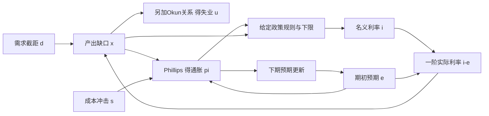

# 短期需求就业通胀与利率规则

需求增加时，产出、通胀和利率可能一起上升；成本上升时，产出却可能下降而通胀、利率仍上升。看到利率和通胀同向，就断言“加息制造通胀”，等于把消防车出现在火场当成起火机制。要分清冲击与反应，须先给一个完整、可被反驳的闭合模型。

本课从[[社会科学/20-经济流动与宏观/07-增长周期就业与政策传导#四个量：水平、增长率、趋势与缺口|指标与缺口]]进入短期：给定潜在产出，允许实际生产和就业偏离它。[[社会科学/20-经济流动与宏观/40-宏观经济学/01-资本积累有效劳动与增长过渡|增长课]]的充分利用资本路径不自动生成这条周期；这里也不把长期技术外生增长重新推一遍。

## 先固定对象、单位和谁在什么时候知道什么

时期t=0,1,…，每期一年。用实际产出指数Y_t，潜在产出Y^n_t>0先外生给定；缺口定义为

$$x_t=100(Y_t/Y^n_t-1),\qquad Y_t=Y^n_t(1+x_t/100). \tag{1}$$

x=1表示高于潜在产出1%，不是产出本身增加1%。通胀π_t、名义利率i_t和预期通胀e_t都用**百分数数值**：π=2意为2%，变化1是1个百分点。p_t=π_t−π*是通胀偏离固定目标，P_t才表示价格水平。用r_t=i_t−e_t作本线性模型的一阶实际利率；精确gross实际收益是100[(1+i_t/100)/(1+e_t/100)−1]，两者不能混算。本模型不模拟期限结构或各家庭实际借贷报价。

每期期初只用上期p形成预测：

$$e_t=\pi^*+\omega p_{t-1},\qquad0\le\omega\le1. \tag{2}$$

这里e_t用于本期商品/工资价格判断及从t到t+1借贷的通胀预测，模型为简化令二者相同，均在本期冲击前形成，作为签约/支出计划沿用的预测，期内不重新估计。它是**给定的预测规则**，不是已证明的理性条件期望：ω=1沿用上期通胀，ω=0完全锚在目标。冲击d_t、s_t随后实现；本课再理想化地允许本期政策规则观测x_t、π_t并同时反馈，求本期均衡。代数同时性不是政策先看到尚未发生的未来；它假定本期调整能在同一个期间内完成、观测无延迟。若只允许上期数据或利率作用滞后一期，必须另写动态方程，不能沿用本课分母。

| 对象 | 在本模型中的角色 |
| --- | --- |
| Y^n_t、参考失业率u*、r*、π*、利率下限i_min、a/b/κ/φπ/φx/ω | 给定参数、参考量或制度约束；不冒充实测常数 |
| 初始p_(−1)、两条冲击序列d_t/s_t | 外生输入；预期形成时不预知本期新冲击 |
| x_t、π_t、i_t，及由另外关系算出的Y_t/u_t | 同期内生结果 |
| 缺口定义(1)，以及π_t=100(P_t/P_(t−1)−1) | 定义/测量，不是行为或因果方程 |
| IS、Phillips、预期和Okun关系 | 明确加上的行为/经验近似 |
| 名义利率反馈与下限 | 本课给定政策规则；未由社会福利最优化推导 |

## 三条行为与政策方程如何闭合

需求方程取

$$x_t=-a(i_t-e_t-r^*)+d_t,\qquad a>0. \tag{IS}$$

在同一预期和需求截距下，实际融资条件提高压低需求。d以缺口百分点计，是消费、投资、财政等对总需求的净截距冲击；它**不是政府支出金额**，本课没有从财政预算推财政乘数。这里没有存量资本、部门预算和异质家庭完整微观基础。[[社会科学/20-经济流动与宏观/40-宏观经济学/02-跨期消费借贷约束与最优积累#两期家庭：先求可行集，再求平滑|消费Euler/KKT]]说明利率与约束怎样影响家庭选择，但不能直接证明所有家庭都服从一个固定a。

价格/工资压力取预期增广Phillips关系

$$\pi_t=e_t+b x_t+s_t,\qquad b>0. \tag{PC}$$

s是成本推动的供给侧冲击，单位为通胀百分点；例如同一产能下投入成本/加价压力。本课**不把s当永久产能损毁**，后者还会改变Y^n等方程。为把就业真正接上，另加

$$u_t=u^*-\kappa x_t,\qquad\kappa>0. \tag{O}$$

u与u*都是劳动力中的失业百分数。它是本课约定的Okun型缺口关系，不是(1)自动推出的恒等式；固定劳动参与、工时、生产率和劳动调整机制的近似才可能支持固定κ。若从失业压力写π=e−γ(u−u*)+s，则b=γκ；本例κ=b=1/2对应γ=1。实际参与率或工时改变，要重建(O)，不能把所有产出变化都转成人数失业。

给定政策规则

$$i_t=\max\{i_{min},\ i^*+\phi_\pi p_t+\phi_x x_t\},\quad
 i^*=r^*+\pi^*,\quad\phi_\pi,\phi_x\ge0. \tag{R}$$

Taylor1993原文给出有名的通胀/产出反馈示例；本课选φπ=3/2、φx=1/2作**教学基线**，不把历史四季度通胀口径、实际中央行反应、最优性和本课当期观测假设绑成同一个事实。银行资产负债表与政策利率如何影响各类贷款，返回[[社会科学/20-经济流动与宏观/06-货币信用银行与通胀|货币信用与银行]]；(R)不是“增加任意存款就控制实际支出”。

这些是模型内依赖；同一时期的环由下面联立求解，不是已识别的现实因果图。

## 没有触及下限时，一期与整条路径都能解出

令H=1+aφx，D=H+abφπ>0，先解允许负利率的内点规则。把PC与R代回IS：

$$x_t=\frac{a\omega(1-\phi_\pi)p_{t-1}+d_t-a\phi_\pi s_t}{D}, \tag{3}$$

$$p_t=A p_{t-1}+\frac bD d_t+\frac HDs_t,
\qquad A=\frac{\omega(H+ab)}D. \tag{4}$$

再以(1)、(O)、(R)恢复全部Y/u/π/i；只有内点i≥i_min时这条分支才有效。不是随便画四条相关曲线。

展开递推，有

$$p_t=A^{t+1}p_{-1}+\sum_{j=0}^t A^{t-j}\left(\frac bD d_j+\frac HDs_j\right). \tag{5}$$

因此有限冲击结束后，通胀偏差按A逐期更新。因参数范围使A≥0，回到目标的条件为A<1；若ω=1，恰好等价于φπ>1。φπ=1时A=1，初始偏差或冲击影响不消退；φπ<1时A>1。解释是名义反馈不足以抵消预期通胀更新，实际利率不够收紧。ω<1时阈值改为D>ω(H+ab)，所以“φπ一定必须大于1”也不是脱离预期规则的一般定理。这个一维稳定结论属于**本滞后预测、同期期反馈、无下限分支**，不是前瞻New Keynesian系统的一般唯一均衡定理。

本线性递推在代数上可对所有实初值计算；经济解释仍要求Y>0、0≤u≤100、π>−100等，并通常局限小偏离附近。不能把数学谱稳定当全部大冲击都可行。[[数学/20-线性代数与几何/12-特征结构对角化与动力系统#对角化如何解演化问题|离散稳定判据]]负责A的演化工具，参数与规则是否适用于数据仍由经济研究承担。

## 同一参数，需求与成本冲击为何走出不同第一步

基线a=1,b=κ=1/2、φπ=3/2、φx=1/2、ω=1、r*=π*=2、Y^n=100、u*=5、i_min=0、p_(−1)=0。H=3/2、D=9/4、A=8/9。两个经济分别只在日期0受到需求d=9/4或成本s=1，其他冲击都0。

| 情境/期 | e | x | Y | u | π | i |
| --- | ---: | ---: | ---: | ---: | ---: | ---: |
| 需求t0 | 2 | 1 | 101 | 9/2 | 5/2 | 21/4 |
| 需求t1 | 5/2 | −1/9 | 899/9 | 91/18 | 22/9 | 83/18 |
| 成本t0 | 2 | −2/3 | 298/3 | 16/3 | 8/3 | 14/3 |
| 成本t1 | 8/3 | −4/27 | 2696/27 | 137/27 | 70/27 | 130/27 |

需求先推高产出，随后为逐步压回已经上升的通胀，出现负缺口；成本先使通胀上升，规则立刻提高利率，需求受抑而失业上升。成本冲击不是“需求繁荣的另一种说法”。成本例t1名义利率反而高于t0，但预期也已上升，一阶实际利率从8/3降至58/27；看名义利率一个数仍不足解释需求松紧。冲击幅度单位不同，表中选值是方便复算，不表示两种现实冲击同样严重。

两例各自有p_0=1/2或2/3；t≥1时p_t=(8/9)^t p_0，x_t=−(2/9)(8/9)^{t−1}p_0。把这些式子代回可得所有后续变量。π→2并不等于P回到冲击前：P_t=P_(t−1)(1+π_t/100)，相对无冲击的2%价格路径，两例偏高通胀的累计影响留下更高价格水平。通胀率、价格水平和缺口没有交换名字。

![[社会科学/20-经济流动与宏观/40-宏观经济学/80-实践/02-短期冲击与政策动态/shocks.svg]]

图对同一参数的两种一次冲击并列Y/u/π/i，基准线分别是100、5、2、4。两条曲线共享模型，但各面板单位不同；图例fpi为φπ、w为ω。数值只核本合成经济的实现，不是历史政策估计。

## 更强反馈、锚定和下限分别改了哪一层

把φπ从3/2提高到3，其他参数相同、仍一次成本s0=1：D变3、A变2/3，第一期通胀偏差从2/3降到1/2，但x从−2/3到−1，失业从16/3到11/2。更快压住通胀与更深的初期缺口同时发生，规则不因“强”就自动最优。

适应预期ω=1下，把PC从0加到T：p_T−p_(−1)=bΣx+Σs。若最终p回到0、初始为0，一次成本冲击的无穷缺口和为−1/b=−2，与上述两个稳定反馈系数无关；一次纯需求冲击的缺口和为0，正初期由负尾部抵消。这是模型内PC的算术结果，不是现实牺牲率定律、总量福利或“衰退成本一样”的结论：时点、平方损失、折现、失业分配都可能不同。

如果可信预期**被假设**完全锚定ω=0，则A=0，一次冲击消失后下一期回到基准；它不是说一纸公告已在现实中把ω变成0。政策承诺怎样改变信念，需要制度、可观测沟通、家庭信息与信任的证据；[[社会科学/20-经济流动与宏观/40-宏观经济学/02-跨期消费借贷约束与最优积累#同一现值，约束、风险与可信承诺不同|家庭侧的可信信息与现金约束]]保留另一个不能被口号跳过的环节。

### 下限必须与需求和通胀一起重解

给定z=p_(t−1)，令E=π*+ωz、B=a(E+r*)+d，L=φπb+φx，C=i*+φπ(ωz+s)。IS给x=B−ai，规则给

$$i=\max\{i_{min},\ C+L(B-ai)\}. \tag{6}$$

函数i−max{…}连续严格递增（斜率为1或1+aL），且两端异号，故本期唯一解。无下限候选为i_U=(C+LB)/(1+aL)：若i_U≥i_min，用(3)；否则取i=i_min、x=B−a i_min、p=ωz+b x+s，再核影子规则值i_sh=C+Lx≤i_min。等号处分支结果相同。

基线一次需求d0=−9：无下限候选x=−4,p=−2,i_U=−1；真实受限解却是i=0,x=−5,p=−5/2，故Y=95,u=15/2,π=−1/2，影子利率−9/4。只把旧i剪成0却保留旧x，IS右侧等于−5而左侧仍−4，残差1；不能宣称新组合仍均衡。

下一期冲击消失时，联立解已离开下限：x=5/9,p=−20/9,π=−2/9,i=17/18。若d=−9持续第二期，则第二期仍绑定，x=−15/2,p=−25/4；不能把“暂时冲击会恢复”套在持续衰退上。

绑定期间的状态递推是

$$p_t=\omega(1+ab)p_{t-1}+b[a(i^*-i_{min})+d_t]+s_t. \tag{7}$$

基线系数3/2>1。再给一个有限冲击的明确失败：d=−9只持续两期后撤去，已得到p_1=−25/4。此后无冲击的绑定映射为p′=(3/2)p+2，有不动点−4；当p<−4时，影子利率仍低于下限，且p′+4=(3/2)(p+4)，负偏差继续扩大。因此本例两期有限冲击也能进入形式上的通缩区；价格/产出条件越出有效域后应停止经济解释，而不是宣称真实经济无限爆炸。即便无下限A=8/9稳定，也不能推出受限系统全局稳定；若持续负需求令它一直处于该分支，偏差可越出线性模型的可解释域。负通胀还会提高给定名义下限下的实际融资负担，这里用滞后预期传到下一期。模型没有量化宽、信用工具或财政接替的方程，不能凭一条i=0线宣布政策工具全部失效。

![[社会科学/20-经济流动与宏观/40-宏观经济学/80-实践/02-短期冲击与政策动态/regimes.svg]]

上栏用同一次成本冲击比较反馈强弱和预期锚定；下栏另换一次大负需求冲击，比较真实下限联立解与允许负利率的反事实。图中两组冲击不同，不能跨栏当一项政策的净收益。

到[[控制论/10-系统课程/08-约束预测控制从有限QP到终端保证|约束与重新求解]]比较为什么剪裁旧动作会破坏原轨迹；返回这里时，状态是通胀历史，动作是利率规则，允许信息和利率下限是经济约束，工程执行器增益不是实测家庭反应。同理，若把R改成仅响应上期x/p，需要新增滞后状态并重核特征值；本课当期解不能冒充该新制度。

## 观察同一条日志，机制仍可能不同

基线日期0记录x=1、π=5/2、i=21/4、e=2。已知a=1与IS，则d必为9/4；但若Phillips斜率未知，(b,s)=(1/2,0)和(1/4,1/4)都使p=1/2，且政策方程也完全相同。因此**即使观察四个宏观量，也不能在未知b时直接认定纯需求冲击**。这不是说任何参数都不可识别，而是要写明哪些固定、哪些未知，靠什么新变化区分。

更一般地，一条有限路径若用b生成，改成b'并把每期外生成本序列改为s'_t=s_t+(b−b')x_t，就有相同观测路径；可将这条构造的序列在比较开始前固定。它与原机制对新的政策干预通常给不同预测，原日志没有替我们观察该反事实。要识别b、a或政策冲击，须用额外限制/制度变化/有效工具及可反驳检验；[[社会科学/20-经济流动与宏观/60-计量经济学/01-样本正交外生性与独立信息|样本正交与结构识别]]与[[社会科学/10-共同工具/03-因果图反事实与识别|因果主解释]]承担一般方法。

实际利率和通胀同升，可能是中央行对同一个成本/需求冲击作反应，不能由同期回归倒推货币紧缩造成通胀。更换政策规则或信誉还可能改变a、b、ω，固定参数反事实不是自动跨制度有效。

## 产出稳定和家庭可用机会仍隔着分配

另做一个两户分配小例，与Y=100指数独立；固定同日物价和同一实际货币单位、总收入10，家庭A/B得到(2,8)或(5,5)，A不能借款且今天有3的必要支付，前者不够、后者够。总量相同不使期限和可用机会相同；这也未证明任何分配在所有权利/效率/风险目标下更好。

回到[[社会科学/20-经济流动与宏观/14-富足时间贫困与可支配生活#生产率到中位报酬：先拆账，再识别原因|总量到家庭报酬]]，再到[[哲学与文化/20-论证知识与规范/06-自主性意义与真实机会#真实机会包括期限，等待不是一个空白状态|机会与期限]]，携带物价、工资、失业落在哪些人、债务利率/额度、照护和支付时间修改判断。这里的u是一项总量结果，既不识别失业家庭是谁，也不直接给社会福利。若要让分配反过来影响消费和a，需要异质家庭闭合，不能只改图注。

## 自己改冲击，区分证明和现实检验

[[社会科学/20-经济流动与宏观/40-宏观经济学/80-实践/02-短期冲击与政策动态/迁移题|三道无答案综合题]]改变反馈、预期、Phillips斜率和利率约束；先自行写完整未知量与路径，再看[[社会科学/20-经济流动与宏观/40-宏观经济学/80-实践/02-短期冲击与政策动态/README|完整题解与复算]]。源码把每期联立方程的Fraction解与消元/卷积另算路线比较，图与输出同源，没有用随机模拟识别政策。

真实检验的重要性高：至少要固定数据版本、实时潜在产出/自然利率估计、预期调查及其形成时点、规则实际可用信息、货币政策公告/预期差、信用与财政同时变化、劳动参与/工时/就业定义、样本分配与外溢、参数跨制度稳定性。README给可接续输入/估计对象/缺失和失败接口；这些未验不阻塞本合成模型的数学交付，也不被本机通过伪装完成。

## 原范围与实际来源

本课补原#193短期需求—就业—通胀—政策的完整合成链，保留一般推导、同参数两冲击、规则与约束变化及迁移。开放宏观的汇率制度/跨境泄漏、广泛异质家庭/金融摩擦、内生信誉和政策最优承诺、真实结构识别仍是原范围；不据这一模型关闭整课。

- Taylor，1993，[原作者PDF](https://web.stanford.edu/~johntayl/Papers/Discretion.PDF)，实际渲染核PDF8=印刷202的式(1)与变量、PDF7–9相邻说明。原规则用过去四季度通胀和当时趋势缺口；本文时期/预期/同期反馈另行声明，系数为教学选择，不作当代政策事实。
- Caballero，MIT14.02 Spring2023，[Lecture12官方转录](https://ocw.mit.edu/courses/14-02-principles-of-macroeconomics-spring-2023/1y3RaIn5PCaqTQqB9wr1zGvm020lTCRGC_transcript.pdf)，实际读PDF1–10，重点1–5的产出/失业桥、预期、利率及下限/时滞。读取官方转录与渲染页，不宣称已完整观看视频；转录有锚定等词的识别误差，采用上下文核机制，不把实时银行事件当本包因果证据。
- Carlin/Soskice，2005年11月，[作者工作论文](https://discovery.ucl.ac.uk/id/eprint/2558/1/2558.pdf)，实际读PDF2–11（印刷1–10），重点§1.1/PDF5–7的IS/PC/规则及不同滞后组合。其优化型政策与不同滞后模型不是本文公式；本文D/A和下限分支均在所列方程内自证。
