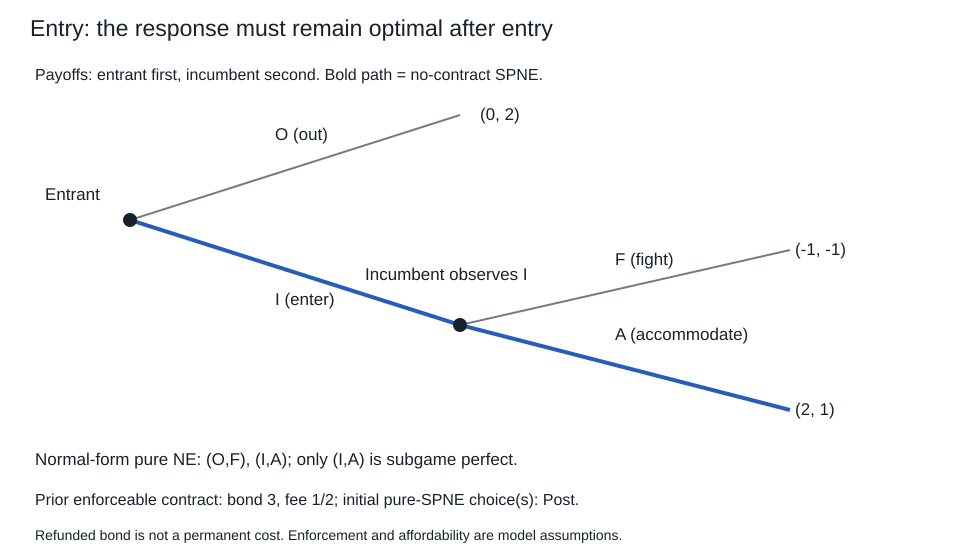

# 博弈树、信息集与可信威胁

“你若进入，我就争夺到底。”这句话可能改变听者选择，也可能在真正进入后被说话者自己放弃。正常式Nash问在**整个应对计划不变**时谁愿意偏离；动态可信性还要问：走到那一段时，计划中的动作是否仍是最优回应？本课从树的对象走到这个多出来的检验，不把“先宣布”直接算成有约束力的承诺。

先修01维护收益尺度、混合与最优回应。这里使用已给定的期望效用；保证金例额外假设支付的效用是线性的、资金可承担、零利息/机会成本，以便逐笔扣除。所有参与者和数字都是教学构造，没有估计真实企业偏好。

## 树记录顺序，信息集限制能按什么分支应对

有限扩展式可用历史集合 $H$ 表示：含空历史，某历史在树内则其全部前缀也在。终端历史 $Z\subset H$ 没有后续动作；每个非终端历史指定行动者 $P(h)$、有限非空动作集 $A(h)$，每个动作通往一个后续历史。自然节点另给外生概率；终端向量 $u(z)$ 给每位参与者有限实值收益。树有有限节点，不允许循环重返同一节点；无限重复后面另定义。

同一人的决策节点再划分为**信息集**：到达时知道自己在该集合中，却分不清其中哪一节点；同集必须轮到同一个人且可用动作标签相同。一个信息集不能含自身的前后继节点。本课保留完美回忆：人不遗忘已经得到的信息和自己采取的动作；同集内自己的既往信息集/动作序列须一致。完美信息更强：每个决策信息集都是单点。完全知道收益规则不等于看见他人行动。

纯策略 $s_i\in\prod_{I\in\mathcal I_i}A(I)$ 是在**每个信息集**写动作的完整计划，包含均衡路径之外的分支。行为策略 $b_i(\cdot\mid I)$ 在每个信息集给动作分布；混合策略则在开始时随机抽一个完整计划。两者不能在任意遗忘模型中互换；本课只在完美回忆下使用其实现分布等价性，Kuhn定理及准确范围见 [Manea2016动态讲义PDF10–12页](https://ocw.mit.edu/courses/14-126-game-theory-spring-2016/ecc1948438ed71a5e77eb29f123a4eef_MIT14_126S16_Extensive.pdf#page=10)。下面主要构造纯计划，隐藏硬币例再用混合，不以这个定理代替逐分支偏离。

先行动且被看见，与先行动却隐藏是两种信息结构。在匹配硬币中，若列方看到行方H/T，列方计划为HH/HT/TH/TT；若看不见，两节点同属一信息集，只能统一写H或T。不能在未知分支分别“选最优”以后再把两个动作拼成策略。01已完整计算两种结果，本课用这个差异规定何处可以逆推。

## 子博弈从哪里开始，为什么不能切断信息集

一个子博弈以单点信息集中的节点为根，包含它及所有后继，并且任何与它相交的信息集必须完整包含于内；动作、自然概率和终端收益从原树继承。整棵树也是子博弈，除此之外称真子博弈。若切断一个信息集，就额外告诉行动者原来不知道的分支，解出的已是另一游戏。

策略组合在**每一个子博弈**的限制都为该子博弈Nash，称子博弈精炼均衡（SPNE/SPE）。因此SPNE一定是Nash；反向不成立。它要求无论原计划是否会走到某分支，该分支自己的参与者都无有利单方偏离。这里不是凭空假设该分支会以正概率发生，也不是在零概率事件上胡乱套Bayes。

有限完美信息树可逐层逆向归纳。终端值已给；在最后一个决策节点，行动者选最大续值的动作，记该动作所到达的**整个收益向量**；自然节点按给定概率取向量期望。再向前重复直到根，并把所有未走到节点的选择也保留。有限非空动作保证每次最大值取到，有限树保证递推终止。若并列，保留所有最大动作的可行选择，不假装自然给了唯一答案。

为什么得到的是SPNE而不只根处最优？对剩余树深归纳：末层任何偏离都不能改善。假定各子树内已无有利完整偏离；在上一节点，行动者即使先换当前动作、再改变自己在该子树中的所有后续计划，也不能超过该子树已计算的最优回应续值；当前选择又最大化这些续值。其他人的偏离同样由子树归纳排除。自然期望保持不等式。于是每个节点开始的限制都为Nash，即SPNE。反过来，一个纯SPNE在每层都必须对已给定的续局选最大动作，否则该节点单方改进；因此它可以由这种逐层最大选择产生。

本构造保证至少一个纯SPNE，允许机会节点；只在**所有相关比较严格**时才据此断言纯计划唯一。它不许把跨信息集的有限不完全观察树也逐节点独立取最大。一般有限博弈混合存在沿用01；部分可观察树中SPNE有时根本无足够真子博弈来排除不合理离轨行为，后续信念/序贯均衡仍有任务，不能把本课当成全部动态信息理论。

## 一棵进入树：威胁是Nash，也可以不可信

进入者先选退出O或进入I；若I，既有方看见后选争夺F或容纳A。O收益 $(0,2)$，IF收益 $(-1,-1)$，IA收益 $(2,1)$。第一项属于进入者；退出之后既有方不用再行动，但策略仍须说明若进入会做什么。

|进入者＼既有方计划|F|A|
|---|---|---|
|O|(0,2)|(0,2)|
|I|(−1,−1)|(2,1)|

纯Nash为 $(O,F)$ 和 $(I,A)$。前者中，进入者若独自进来会得−1，既有方若单独改A也不会改变已经退出的结果；因此它满足正常式的整体偏离检验。但在I后的真子博弈，既有方A得1、F得−1，会改A。所以唯一SPNE是 $(I,A)$。

把独立混合也查全。令 $p=P(I)$、$q=P(F)$，进入者I相对O收益 $2-3q$；既有方F减A收益 $-2p$。若 $p>0$，既有方只能A，继而进入者必I；若 $p=0$，既有方任意混合都无差异，而进入者不进要求 $q\ge2/3$。故全部Nash为

$$\{(p,q)=(0,q):q\in[2/3,1]\}\ \cup\ \{(1,0)\}.\tag{1}$$

SPNE只留下 $(1,0)$，因为在进入后的子博弈F严格较差。有限程序能核纯计划和若干偏离，却不靠概率网格宣称已穷尽(1)的连续区间；完整区间由上述两种情况推导。

只看到退出O，既看不到真正进入后的F，也不能反推出人们接受了哪种威胁。收益、进入成本、信息或类型改变都可能得到退出；图和均衡是给定模型内的条件结果。

## 承诺不是说得更狠，而是改变后续可行集或收益

保持基础树，增加公开的前置选择：既有方可不签合同，或先付外部执行费 $k=1/2$，存保证金 $b=3$。若O或F，保证金全退；若I后A，保证金被外部执行者收走。资金可承担，没有利息或流动性机会成本。费无论分支如何都已付，不退。

签后各终端为：O $(0,2-k)$；IF $(-1,-1-k)$；IA $(2,1-b-k)$。I后的F相对A要求 $-1-k\ge1-b-k$，即 $b\ge2$；严格 $b>2$ 才给唯一F。在 $b=2$ 的无差异边界，F与A都可，不能把“可支持”偷换成“必发生”。默认 $b=3$ 时进入者预见F而O，既有方得3/2；不签时由原SPNE得1，所以初始选择签。完整计划必须同时保留：签后F/进入者O，不签后A/进入者I，即使不签分支在均衡中没有发生。

这不是凭同一个NPV公式给声明增加力量，而是明确改变I后的真实得失；沉没执行费在后续比较中抵消，但在最初是否签约时不能漏掉。若执行费改为2，签后的退出收益0低于不签1，初始不签；若保证金无法实际没收，b从后续收益消失，仍会A，付费宣布不会神奇地使F最优。退还本金不是永久支付；外部收款和执行能力是模型的一部分，不能只画参与者彼此的口号。

## 回到先修与现实：这里多出来的是他人的应对

[[数学/40-微积分与优化/08-凸优化对偶与最优性证书#L≤OPT≤U 的两端从哪里来|优化证书]]在固定可行集/目标下检验全体可行偏离；这里也检验偏离，但每个决策者有自己的目标，对方给的是策略而非受自己控制的变量。不能把双方利润直接放进一个优化器便说已经求了非合作均衡。

[[社会科学/20-经济流动与宏观/30-微观经济学/01-价格变化普通需求与补偿需求#先把偏好和可行集分开|消费者预算选择]]将价格和预算作为给定约束；本课前置保证金则改变另一个人以后看到的支付结构，需要再算其回应。价格、行动顺序或执行内容若内生变化，旧最优点不是自动成立的新均衡。

[[AI/13-搜索推理与规划/20-部分可观测决策/01-有限模型belief与决策状态#为什么belief足以递推|POMDP决策状态]]要求保留影响未来的模型、观察与剩余时域。本课同样不能删除信息约束；但对手有目标和策略，外生转移/信道通常不能无条件固定。哪些动作看得见、谁能承诺、谁控制记录，都要在游戏之前写清。

[[社会科学/20-经济流动与宏观/50-博弈与机制/03-重复合作监测与折现|下一课]]在不增加外部保证金时，改由未来合作与惩罚改变本期偏离得失。[[社会科学/20-经济流动与宏观/50-博弈与机制/80-实践/02-可信威胁与重复合作/迁移题|撤提示题]]再改收益、执行费、可见性及期限；模型不保证真实组织照此行动。
