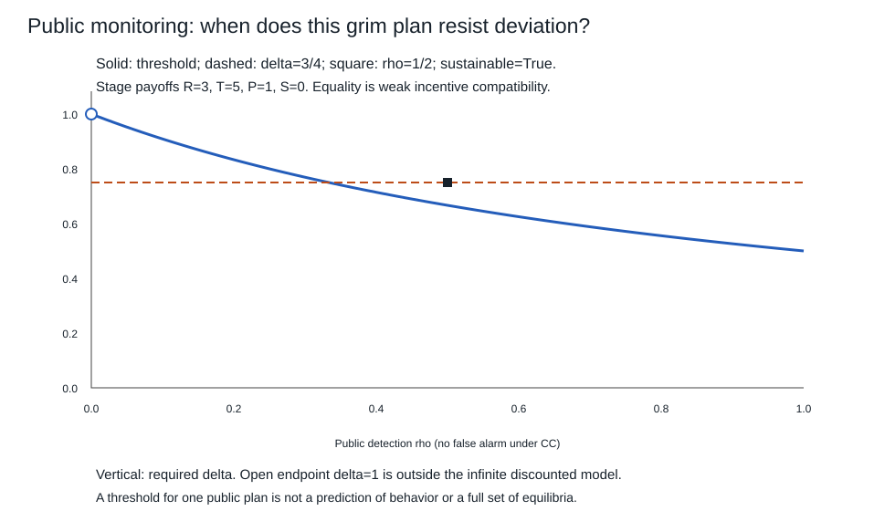

# 重复合作、监测与折现

一次博弈里，每人都想单独背离；重复之后，背离可能换来未来损失。关键不是把“声誉”加到句尾，而是写清谁看得到偏离、什么时候反应、未来到底有多重，以及惩罚者到时候是否愿意执行。先处理完整公开动作，再改变监测规则，不把两种均衡的名字混在一起。

## 同一阶段收益，改的是未来

继续01的两人囚徒困境：CC各得 $R=3$，单方D得 $T=5$、对方得 $S=0$，DD各得 $P=1$。一般推导固定 $T>R>P>S$，两个动作C/D，每期同时独立选择；表中数字是期望效用，未校准真实家庭/企业。两人记得自身历史，有共同已知的规则，先无私人类型、谈判或侧支付。

在完美公开监测中，第t期开始双方看见完整过去动作历史 $h_t=(a^0,\ldots,a^{t-1})$，**看不见对方本期尚未选的动作**。策略给每个历史一份动作分布，包括未发生的历史。每期同时选择可用信息集表达，不等于02的全树完美信息；但每个公开的期初历史之后保留全部本期信息集，构成一个续局子博弈。

有限期先固定共同 $0<\delta<1$，总效用为 $U_i^N=(1-\delta)E[\sum_{t=0}^{N-1}\delta^tu_i(a^t)]$。每期权重严格正；在第t期续局比较中，过去收益为常数、未来共同的正因子 $\delta^t$ 可除去，因此按本期为起点使用同一归一化尺度。若余下各期都DD，续值为 $P(1-\delta^{N-t})$，与实践输出一致。

若已知恰好重复 $N<\infty$ 期，无期后资产、惩罚或新互动：最后一期每个历史后D严格占优，所以唯一续局DD。倒数第二期无论本期结果如何，下期都是同样的DD，未来没有可改变的奖惩，仍选DD；向前归纳，全部历史、全部时期都DD。这是唯一SPNE，不是“人类一定不会在有终点的关系中合作”。收益、终点知识、类型、外部执行或续存概率任何一项改变，都须另建模。若每期独立以概率 $\alpha$ 续存、存活时贴现 $\beta$，在无终期残值且停止独立于动作/历史时，有效折现为 $\delta=\alpha\beta$；这与事先公布固定最后一期不同。

## 无限期与grim：连惩罚本身也要最优

令 $0<\delta<1$，归一化收益

$$U_i=(1-\delta)E\!\left[\sum_{t=0}^{\infty}\delta^tu_i(a^t)\right].\tag{1}$$

阶段收益有界，级数绝对收敛；归一化使永远CC的值为R、永远DD为P。不能把该尺度与未归一的 $R/(1-\delta)$ 混算。$\delta=0$ 或1不在此平稳续局合同内：0使首期后全局效用权重为零，不能照搬每段续局的严格唯一性；1须另定义平均收益等准则。

公共状态G表示此前全为CC，B表示曾出现非CC。grim策略是G选C；只要出现任一D，下期转B；B永远选D，不因之后道歉或合作而重置。这是完整计划，不只“沿路径一直C”。

在B，对手永远D，自己D得P、C得S且不能恢复合作，$P>S$使任何多期改动都不获益。惩罚可执行的原因是它本身是阶段Nash，不是无代价的惩罚口号。

在G，守约值R。一次D、以后恢复grim给

$$(1-\delta)T+\delta P.$$

因此必要条件为

$$R\ge(1-\delta)T+\delta P
\quad\Longleftrightarrow\quad
\delta\ge\frac{T-R}{T-P}.\tag{2}$$

还须说明为什么查一次足够挡住全部策略偏离。给定对手grim，在G保持C就继续得到R；第一次D若发生于第 $\tau$ 期，其后对手永久D，自己即使任意调整，续局至多P。相对永久C的归一化增益至多

$$\delta^\tau\big[(1-\delta)T+\delta P-R\big].$$

(2)使它非正；一直不D的收益就是R。随机化及按历史选择首次D时点，只是对这些非正条件增益取期望。B已单独查过，所以每个期初公开历史后所有完整单方策略偏离均不改善，grim为SPNE；反之若(2)不成立，从初始G当期D即改善。默认阈值是1/2，等号时不背离只是弱最优，没有唯一行为保证。DD永远也是SPNE，因此“合作能持续”不等于“合作必然被选择”。本课不主张已列出所有重复均衡。

## 单次偏离原理的许可证：为什么不能用它跳过未来

对一般有可观察动作的多阶段游戏，一次偏离后回原计划的检查，要在所有历史后做；无限期还需远期连续性。这里有界阶段收益 $|u_i|\le M$ 与 $\delta<1$ 使从第H期开始任意两条尾路径的归一化差最多 $2M\delta^H\to0$。

若某完整策略真提高至少 $\epsilon>0$，取H使尾差小于 $\epsilon/2$，把策略H以后改回原计划，仍提高。剩下只有有限期改动，从最后一期往前逐次撤销：若每个历史后一次偏离均不改善，撤销最后一次不会降低所得收益；重复撤到原策略，得到原策略也严格好于自己，矛盾。这就是单次偏离推向全部策略的截断/末次偏离理由。缺远期连续性的准则、忘记历史或改变可观察性时，不能只拿一行不等式宣布同一定理适用。上一节给了本grim的直接首偏离证明，下一节则用两状态势函数自行证明，不偷套可观察动作版。

## 只公开报警：检测率改变的是激励，不是道德

现在**改换信息结构**。每人记得自己的动作；关于对方过去动作，双方只观察共同的报警 $y_t\in\{0,1\}$。CC时 $P(y=1)=0$；只要本期至少一人D，$P(y=1)=\rho$，其中 $0\le\rho\le1$，给定当期动作后各期独立。报警在本期动作以后、下期选择以前到达。阶段收益仍按原行动表计总效用，下一次选择前没有会另行泄露对手动作的私有收益/结算读数；若真实支付会泄露动作，必须把该观察加入，不能一边使用一边声称只有公共信号。

公共策略只依赖公共报警史：未报过警的G选C，报警后B永远D。隐藏个人行动的私人历史通常不能像完美监测的完整公开历史那样直接切为子博弈；这里检验的是**完美公共均衡（PPE）**：在每个公共历史后，公共续局策略构成Nash，偏离者仍允许用自己的全部私人历史，不能只准他在公共策略类里竞争。

对手采用此公共策略时，无论自己私下曾做什么，给定公共G/B，对方下一步都已确定；未来信号由本期动作和已给定的无记忆核生成，私人过去不额外改变未来。于是用 $V(G)=R,V(B)=P$ 可直接挡住全部私有历史偏离。

在G选C，本期R且下期仍G，$V(G)=(1-\delta)R+\delta R$。G选D的当期加续局势值为

$$(1-\delta)T+\delta[(1-\rho)R+\rho P].$$

在B，无论信号如何，继续B；D得P，C得S，所以两动作都满足守约势值不等式，当期D最优。因此所有状态与动作都满足

$$V(s)\ge(1-\delta)E[u\mid s,a]+\delta E[V(s')\mid s,a]\tag{3}$$

的充要条件是

$$\boxed{\delta\ge\delta_*(\rho)=
\frac{T-R}{T-R+\rho(R-P)}}.\tag{4}$$

证明全策略充分性：对任意依私人历史和随机化的策略，在每一期条件于其全部可见历史，(3)仍成立。乘 $\delta^t$ 后取期望并从0加到H−1，中间势项抵消，得到

$$E\left[(1-\delta)\sum_{t=0}^{H-1}\delta^tu_t+\delta^HV(s_H)\right]\le V(s_0).$$

V有界，令 $H\to\infty$，尾项趋零；守约在每期取得等号，故任何完整偏离都不能改善。这从每个公共历史及任意私人过去都成立，给PPE。若(4)失败，G中一次D再回原公共计划已严格改善，必要性成立。证明没有假装两状态是所有博弈策略的穷尽表示；它是**对固定对手公共计划的充分决策状态**。

默认R3/T5/P1时，$\delta_*(\rho)=1/(1+\rho)$：完美检测为1/2，半检测为2/3，零检测为1。由于δ严格小于1，ρ0不可能支持此合作；对方收不到偏离信息时，未来损失没有作用。边界δ等阈值时G中的D与C无差异，只能说该公共计划为均衡，不能说无人会背离。

这不是识别真实检测概率的图。ρ由教学模型给定，信息渠道和承诺执行的现实测量另有接口；程序不会从一条合作记录反推出ρ或δ。若CC也有误报概率q>0，守约G值就应满足 $V_G=(1-\delta)R+\delta[(1-q)V_G+qP]$，一般已不等于R；此时不能照搬(4)。处罚后能重新谈判、赔偿、退出或更换对手，也会改变续值。更重的惩罚若自己不愿执行，根本不在已证合同里。

## 有限数值如何核无限对象，又在哪里停下

实践以有理数核进入树完整计划、保证金所有分支、阈值与一次偏离差；另一条计算路线固定对手公共grim，对任意长度H的偏离策略进行有限动态规划。状态G/B、动作C/D、报警随机性都显式保留，末端可取守约续值V或零。取守约续值时，(3)成立应每个H都无改进；失败时一个有限H就可见改进。零终值截断的最优偏离值与无限最优值相差至多 $M\delta^H$，但有限数值本身不证明(4)。正文的望远镜不等式才覆盖全部H和所有策略。

在完美监测G状态，还可直接枚举“首次D发生于第τ期”的收益；已证明之后最优D，故这不是省略了有利多期偏离。两条路线应给同一最优值。代码另枚举H=3的所有G/B时点计划，与递推交叉；它没有枚举全部一般无限博弈均衡。

## 合作记录相同，机制可以不同

世界A用默认PD与δ3/4、完美监测grim；世界B改阶段收益为CC各3、单方D得2/对方0、DD各1，双方每个历史都C。A的合作靠未来惩罚，B中对手C时C本来就比D好，恒C自身就是每个续局的均衡。两世界都生成“连续20期CC且无报警”。只凭这段同观察记录，不能决定人们在害怕惩罚、偏爱合作，还是有另一套没写出的收益。

区分需独立的收益/外部选项、终点知识、监测和执行证据，以及预先给定的条件变化设计；不是把均衡故事再讲一遍。对真实组织，还要核受影响第三方、退出成本和规范判断。此处的“合作”只是矩阵动作名称，合谋也可能损害外部人，不由参与者均衡自动获得正当性。

## 带着信息与期限返回相邻主解释

[[AI/13-搜索推理与规划/20-部分可观测决策/01-有限模型belief与决策状态#为什么belief足以递推|belief充分决策状态]]的固定核/损失与剩余时域，帮助检查本课对固定对手grim的G/B状态为何足够；若对手也学习或有私人类型，须扩状态/信念与策略。[[AI/13-搜索推理与规划/20-部分可观测决策/03-信息价值科学取证与行动#为什么min必须留在信号分支里面|外生信息价值]]则把信号后最优行动保留在分支里，本课另增加了被监测者可选C/D及信号概率因其动作变化；这仍是给定监测技术的博弈，未建发送者私人类型和信号成本，不能宣告已完成信号博弈。

[[AI/10-机器学习与深度学习基础/19-强化学习MDP价值函数与策略梯度#动态规划、Monte Carlo 与 TD 的差别在“目标从哪里来”|单智能体更新]]可以在**对手策略固定**时求最佳偏离；均衡还要让每个参与者同时无利可图。对手更新时，固定环境的Bellman最优性不能自动成为多智能体学习收敛定理。这里没有新建或声称实现#167算法。

回到 [[社会科学/40-公共政策与社会学/03-外部性公共品公地与集体行动#集体行动为什么不只由人数决定|集体行动的观察、执行与退出]]，把“会重复”“能监测”“有惩罚”分别换成可查的续存、信道和后续最优回应，而不是抽象标签。[[社会科学/20-经济流动与宏观/50-博弈与机制/80-实践/02-可信威胁与重复合作/迁移题|四个条件迁移题]]与[[社会科学/20-经济流动与宏观/50-博弈与机制/80-实践/02-可信威胁与重复合作/README|完整答案/来源/复算与现实接口]]承接本课。

本包完成原#194有限树/逆推/SPNE与重复合作、监测和折现这一主线；一般Bayesian博弈、信号/筛选、IC/IR机制、拍卖/委托代理及相应完整迁移仍待后续。既有争夺与议价应用复用其自身条件，均衡不是现实行为或制度效果证据。
