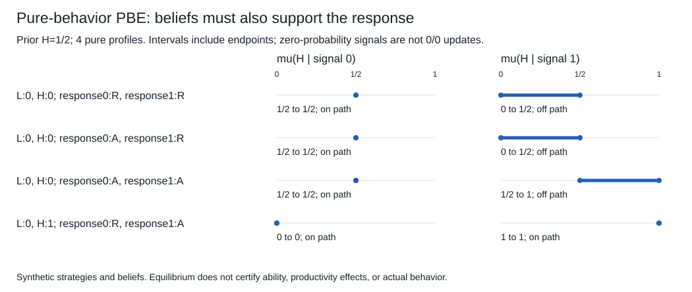

# 私人类型、信号与一致信念

看到同一个信号，接收者该相信什么？先问信号是仪器按固定规律产生，还是有人知道自己的类型后主动挑选。若发送者也在算得失，信号的似然本身就取决于策略；只套Bayes公式，尚未说明谁愿意生成那组概率。

本课从有限Bayesian博弈走到一个完整两类型信号模型。收益为给定期望效用，例中支付采用线性效用；类型、先验、行动与成本都是合成设定，不从均衡反推真实人的能力或诚信。

## 类型条件下的最优回应

有限参与者i有有限类型集 $T_i$、有限行动集 $A_i$，共同先验 $\pi$定义在 $T=\prod_iT_i$；人知道自己的类型 $t_i$，不知道他人的实际类型。$u_i(a,t)$可依行动与类型组合，行动/收益规则与先验共同已知。这里假设每个保留类型的边际概率 $\pi_i(t_i)>0$，以便

$$\pi(t_{-i}\mid t_i)=\frac{\pi(t_i,t_{-i})}{\pi_i(t_i)}$$

有定义；联合先验不必独立，也不必每个类型组合都正概率。零边际类型若要讨论，须另给其信念/解概念要求，不能按0/0造条件分布。

行为策略 $\sigma_i(\cdot\mid t_i)\in\Delta(A_i)$ 在每个类型下给行动分布。给定他人策略，类型 $t_i$ 的纯行动a期望值为

$$v_i(a\mid t_i;\sigma_{-i})=
\sum_{t_{-i}}\pi(t_{-i}\mid t_i)
\sum_{a_{-i}}\left[\prod_{j\ne i}\sigma_j(a_j\mid t_j)\right]
u_i(a,a_{-i};t_i,t_{-i}).\tag{1}$$

每个类型的正支持动作都达到该式最大值，才是Bayesian Nash均衡（BNE）。这是**条件于本人类型**的最佳回应，不是用整体平均收益允许一类人的严格损失被另一类抵消。类型相关通过条件先验保留；“各自独立掷币”也不表示类型本身独立。

在有限且每个边际类型正概率时，类型逐一最优与事前完整计划最优等价：若某类型能严格改善，单改该类型对应动作即以正概率权重改善事前期望；反之，对每个类型都不改善，平均后也不改善。存在性可复用01的有限Nash：把每个“参与者—类型”视为一个选择行动的代理，收益定义为(1)，得到有限正常式；其混合Nash逐类型给一组BNE。没有证明一定有纯BNE，也没有新造学习收敛结论。[Manea2016 Bayesian讲义PDF8–11](https://ocw.mit.edu/courses/14-126-game-theory-spring-2016/6c5872fe3409e4c0c10343b695347b4a_MIT14_126S16_bayesian.pdf#page=8)明确区分interim与ex-ante。

## 内生信号把似然变成策略的一部分

自然先以 $p=1/2$ 抽H、以 $1-p$ 抽L。发送者知道类型，接收者不知道。发送者选 $s\in\{0,1\}$；接收者只看s再选接纳A或拒绝R。接收者接纳H得1、接纳L得−1，拒绝得0。发送者被接纳得 $B=2$、拒绝得0，再扣信号成本：s0为0，s1成本 $c_H=1,c_L=3$，无论是否被接纳都扣。没有其他信号或类型验证，双方完美回忆，全部规则共同已知。

完整策略要给 $\sigma_H(s),\sigma_L(s)$ 和接收者在两个信号后的接纳概率 $a_s$。信念 $\mu_s=P(H\mid s)$ 在该信号发生概率正时必须满足

$$\mu_s=\frac{p\sigma_H(s)}{p\sigma_H(s)+(1-p)\sigma_L(s)}.\tag{2}$$

接收者A的条件期望为 $2\mu_s-1$，R为0；故 $\mu_s>1/2$ 时A，$<1/2$ 时R，等号可混合。发送者类型θ选s的收益为 $Ba_s-c_\theta s$，必须对两个信号都检查，不能只算“发信号以后工资较高”。

本课采用明确的PBE合同：每个信息集策略序贯最优，所有正概率信息集按Bayes更新；零概率信号后的信念为声明的 $[0,1]$ 值并须使接收者最优。这常称弱PBE；一般更强的序贯均衡还要求完全混合扰动下的信念一致极限，不能把这个简版当成所有精炼概念的通用定义。[Manea2016 Refinements PDF5–6、15](https://ocw.mit.edu/courses/14-126-game-theory-spring-2016/43872460b5a6668f0e0706ec6061ce65_MIT14_126S16_equilib.pdf#page=15)给出该区别。以下具体树直接给策略/信念和全部偏离，不借一般存在性来挑选结果。

## 分离、混同与离轨：同一模型确有多个解

**分离候选**：L发0、H发1，接收者0后R、1后A。两个信号都正概率，(2)给 $\mu_0=0,\mu_1=1$，接收者严格最优。H发1得2−1=1，改0得0；L发0得0，改1得2−3=−1。因此这是PBE。一般同类分离要求 $c_H\le B\le c_L$，严格不等给这两个发送偏离的严格激励；等号只是弱最优。

**混同候选一**：两类都发0，接收者0后A，1后R，声明 $\mu_1=0$。正概率0后 $\mu_0=p=1/2$，接收者接纳是弱最优；离轨1后拒绝由信念0支持。发送者两类都得2，改1后得−cθ，不改。因此也是PBE。

**混同候选二**：两类都发0，两个信号后均R，仍用 $\mu_0=1/2,\mu_1=0$。接收者0后拒绝也是弱最优，类型各得0；改1付成本且仍被拒，故仍是PBE。混同若0后R、1后A，H会从0升到1，不能算均衡。离轨信念的自由并不取消发送者的偏离检验。

图和程序列的是此有限模型**所有纯行为策略PBE及其允许信念区间**，并非所有混合PBE；信念通过区间约束精确求交，不是只试几个网格点。默认还包括混同0后A、1后A的纯计划，因发1成本为正仍无改进。两个正概率信号的分离信念是点；未出现信号的后验是一段可支持范围。只写“0/0时回先验”会漏掉这些解，且没有Bayes依据。

若高类型成本升到4>B，原分离中H发1得−2，不如改0得0，分离失败；原混同中某些离轨接纳也不再引诱发1。改变的是信号生成激励，不能仍使用原来的 $P(s\mid\theta)$ 并宣称同一个后验已预测新行为。多均衡不使所有故事都正确，只使模型预测需说明所选均衡和可反驳的实施/信念证据。

## 相同观察分布，不告诉你证书是否创造产出

令类型指标 $h=1[\theta=H]$，保留默认成本与分离策略 $s=h$、接收者 $A=s$。世界甲的可记录产出为 $Y=h$，信号只有成本，不改变生产；接纳方收益为A时 $2Y-1$。世界乙改为 $Y=s$，信号本身使产出变为该值，成本仍按类型不同。两世界中上述策略都序贯最优：发送者激励相同，接收者在两条在途分支也都是0后R/1后A。观察到的完整 $(s,A,Y)$ 逐类型一致。

但对L强制改为s1时，甲的Y仍为0，乙的Y变1。这是两个合成结构模型的反事实差异，不是用分离均衡已经识别了教育/证书的真实产出效应；关于接收者如何获知干预还会影响其接纳反应，不能把Y的差异自动改写成就业政策收益。证书从筛选标签晋升为生产函数，仍需新的证据；名称不负责替我们求反事实。

## 三种信息问题，按时点和选择权分开

单纯不完全信息：有人不知道状态或别人的行动/收益，未必有私人信息者主动选择进入或报告。逆向选择/筛选：签约或交易前已有与结果相关的私人信息，合同和参与因类型而不同；不一定只是抽象“坏类型进来了”。道德风险：合同后产生不可验证行动或私人信息，行动激励影响结果；坏结果本身不证明偷懒。若隐藏行动发生在签约前并已成为私人差异，应按实际时点重建，不能靠“行动”一词自动归道德风险。06用两个明确时序直接对照。

从 [[AI/10-机器学习与深度学习基础/20-贝叶斯学习概率图模型与近似推断#似然、先验、证据与后验各有不同职责|Bayes职责]] 带来先验/似然/正分母；从 [[AI/13-搜索推理与规划/20-部分可观测决策/03-信息价值科学取证与行动#为什么min必须留在信号分支里面|外生信号后的最优行动]] 带来观察后再行动。本课新增的正是 $\sigma_\theta(s)$ 的发送者最优性和接收者回应，不能把外生检测准确率直接当战略信号均衡。

[[社会科学/30-金融市场与风险/07-银行期限转换流动性与挤兑#4. 为什么同一银行可能有正常均衡与挤兑均衡|银行挤兑]]已有私人流动性需求与多均衡机制；坏资产消息、信息生成和提款策略须另定，不能把这里两类型接纳表贴成真实挤兑估计。回 [[社会科学/20-经济流动与宏观/50-博弈与机制/05-直接机制激励相容与拍卖|下一课机制设计]]，问题从“给定规则下选什么”变为“哪套规则允许想要的选择被实施”。完整题答/来源/未验层在本实践README。
