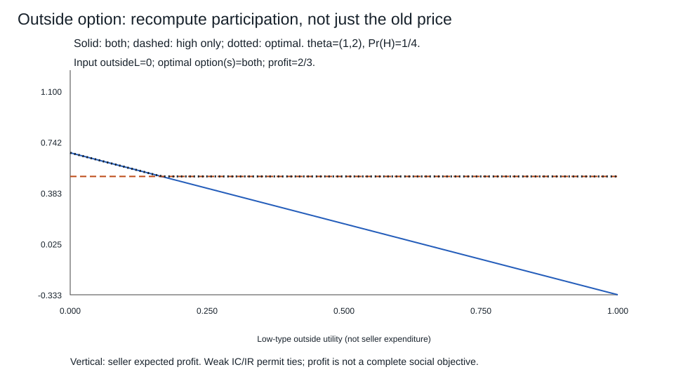

# 筛选合同、隐藏行动与议价

私人信息在签约前已有，合同要让类型自己选择；行动在签约后发生且不能验证，合同要让人愿意采取建议行动。两种问题都写IC/IR，但偏离对象不同。本课各解一个完整小模型，再把现有争夺和Nash议价放回各自的理论位置，不用“激励”一个词覆盖所有解释。

本课支付采用货币准线性效用、风险中性、可承诺执行；真实主体、可验证内容、资金与退出要另核。数量/成本/概率均为合成设定，无真实工资或采购建议。一般优化的全局界和定义域沿用数学主解释；这里补的是私人类型与行动所多出来的约束。

## 签约前的类型：两个数量价格项要互相检查

一个垄断供给者遇到一名买方，类型 $0<\theta_L<\theta_H$ 已由买方知道，卖方仅知高类型概率 $p\in(0,1)$。卖方先承诺**确定数量/支付菜单**，无随机准入或再谈判；买方可选任意项或退出。数量 $q\in[0,Q]$ 可验证，$Q\ge\theta_H$，成本 $C(q)=q^2/2$；转移t可为实数，效用 $\theta q-t$、卖方收益 $t-C(q)$。先取两类型退出效用0；菜单服务双方时记 $(q_L,t_L),(q_H,t_H)$ 和 $U_\theta=\theta q_\theta-t_\theta$。

四项限制为

$$U_L\ge0,\quad U_H\ge0,\qquad
U_H\ge U_L+\Delta\theta q_L,\quad
U_L\ge U_H-\Delta\theta q_H,\tag{1}$$

其中 $\Delta\theta=\theta_H-\theta_L>0$。后二者相加给 $q_H\ge q_L$：若高类型数量比低类型更小，两个类型总有一个想冒充对方。反之，给定单调数量，取

$$U_L=0,\quad U_H=\Delta\theta q_L,\quad
t_L=\theta_Lq_L,\quad t_H=\theta_Hq_H-\Delta\theta q_L\tag{2}$$

同时满足全部约束。弱IC允许高类型对低项无差异；诚实选高项是支持该利润的均衡选择，不保证唯一。

为什么(2)给全局上界而不是猜绑定约束？任何可行菜单都有 $U_L\ge0$、$U_H\ge U_L+\Delta\theta q_L$，故期望利润

$$\Pi=(1-p)[\theta_Lq_L-C(q_L)]+p[\theta_Hq_H-C(q_H)]
-(1-p)U_L-pU_H$$

不超过

$$F(q_L,q_H)=(1-p)[\theta_Lq_L-q_L^2/2]
+p[\theta_Hq_H-q_H^2/2-\Delta\theta q_L].\tag{3}$$

(2)实现这个界。F对两个数量严格凹；其无约束顶点/非负边界给

$$q_H^*=\theta_H,\qquad
q_L^*=\max\{0,\theta_L-\tfrac p{1-p}\Delta\theta\}.\tag{4}$$

$0\le q_L^*<\theta_H\le Q$，所以单调与上限均满足。配方或负定对角Hessian给全域最大，不由局部驻点独自认证。菜单中有更多项时，每个类型在其选择处的效用仍须满足(1)，可保留其实际选择项；单一买方的报告IC与这里的自选相同，05的启示构造提供归约。结论覆盖本课全部确定菜单，不宣称求解了所有带随机准入/重新谈判的合同。

默认 $\theta_L=1,\theta_H=2,p=1/4,Q=3$：

$$q_L=2/3,\ t_L=2/3;\qquad q_H=2,\ t_H=10/3;\quad U_L=0,U_H=2/3,\Pi=2/3.$$

高类型冒充低型也得 $2(2/3)-2/3=2/3$，不严格改善；低型冒充高型得 $2-10/3=-4/3<0$。完全信息下可分别选 $q_\theta=\theta$、收 $t_\theta=\theta^2$，利润7/8。信息租金期望1/6加低数量扭曲损失1/24，合为差额5/24。不是“所有低类型都应该少得到”：这是指定卖方利润目标与信息/退出条件下的结果，福利或公平目标要另写。

## 退出收益改变时，必须重新比较谁参加

只把低类型退出效用改为 $r_L\ge0$，高类型仍0。若两类都服务，(1)变成 $U_L\ge r_L$，上界/实现改为 $U_L=r_L,U_H=r_L+\Delta\theta q_L$；数量(4)不变，两类价格都减rL，利润为 $\Pi_{both}(0)-r_L$。

这还没解完参与选择。仅服务高型，令 $q_H=\theta_H,t_H=\theta_H^2$，高型效用0、利润 $p\theta_H^2/2$；低型买此项效用 $-\Delta\theta\theta_H<0\le r_L$，会退出。只服务低型且有正利润不可能：低型可接受的非负数量项，对高型给至少一样高的效用，而高型退出0；零数量/零租金的退化项不能带来正利润。再加谁都不服务的0利润，得到本课确定菜单的全局比较

$$\Pi^*=\max\{\Pi_{both}(0)-r_L,\ p\theta_H^2/2,\ 0\}.\tag{5}$$

平局保留多个最优方案。默认外部收益0时双方菜单优于高型单独服务；rL升高可能改成排除，不能只调旧价格后宣布完成。此处“退出”是买方拥有的外部结果，不能把它当作卖方无条件赠送给所有报告人的补贴。

图比较给定参数下两类服务/高型服务的利润上包络，不是现实政策效果。可比较数量、价款与退出分配，但不从利润最大自动推出应实施。若q不可验证，原菜单可能不能执行；仅让买方说自己想要q，不会替卖方创造交付/证明能力。[Stole1999印49–50](https://ocw.mit.edu/courses/14-124-microeconomic-theory-iv-spring-2017/8e0c2484aed6906405ffe7d9ba73375e_MIT14_124S17_LecNote3.pdf#page=5)给两类型筛选主线，本课进一步明确全部参与子集与退出变化。

## 签约后的努力：对行动而非类型报告写IC

新模型中签约时无私人类型；双方知道技术。代理人签后选L/H，成功概率 $p_L=1/4,p_H=3/4$，努力成本0/c，默认c1。成功给委托人毛收入 $V=4$，失败0。努力不可验证，结果可验证，委托人能承诺成功/失败工资 $(w_S,w_F)\ge0$；非负是本课有限责任，不是关于所有法律制度的主张。双方风险中性，代理人退出0。

实施H的IC与IR为

$$(p_H-p_L)(w_S-w_F)\ge c,\qquad
p_Hw_S+(1-p_H)w_F-c\ge0.\tag{6}$$

IC来自把H与L的**完整期望效用相减**，不是把成功一次当作努力证明。记D=wS−wF，则D≥c/Δp>0，期望工资 $w_F+p_HD\ge p_Hc/\Delta p$；取 $w_F=0,w_S=c/\Delta p$ 实现下界。此时IR净值 $cp_L/\Delta p\ge0$，故这是实施H的最低期望工资和信息租金。

默认 $w_S=2,w_F=0$，期望工资3/2，代理人净1/2，委托人 $3-3/2=3/2$。实施L用零工资，H会因成本而不选，委托人得 $p_LV=1$，所以在建议H且代理人在无差异时选H的均衡中，H更有利。**弱IC不强迫H**：该工资下L也给代理人1/2。若要求严格实施，须wS稍高于2，工资成本的下确界仍3/2但不取到；不能把零松弛写成抗任意误差的唯一行为。参与IR的等号也需记录接受而非退出的选择。

若c升至3/2，最低高工资为wS3，期望9/4，委托人仅3/4，低努力1更好。若努力可验证并可承诺要求H，风险中性下以确定工资c满足IR，委托人得pHV−c；若放松有限责任且负工资可真正收回，默认H合同可取 $w_F=-1/2,w_S=3/2$，IC绑定、期望工资1、代理人净0，委托人得2。这个改进依赖能收回失败时的钱，不是把一个负号写在纸上便有执行能力。若结果也不可验证，成功/失败工资的可行性失效；仅常数工资无法给正成本H提供激励。

[Stole1999印2–5](https://ocw.mit.edu/courses/14-124-microeconomic-theory-iv-spring-2017/be21e9cc762231c50ab42bbf35ead5db_MIT14_124S17_LecNote1_2.pdf#page=2)区分可验证结果、承诺、IR与隐藏行动IC。本课只用有限两行动直接比较，不借连续努力的局部一阶法替代全局激励，也不把坏结果视作道德过错。

## 已有争夺为何不是筛选，也不能随意改顺序

[[社会科学/40-公共政策与社会学/13-拒错内卷与组织纠错#从最优回应到对称均衡|比例争夺]]是给定n/V/c、完整信息、同时连续投入的非合作Nash模型：$u_i=Vx_i/\sum x-cx_i$，投入确定，获奖概率由规则生成。它没有私人类型、合同菜单或隐瞒技术；x的优化和概率不是本课信号策略混合。其正对称解靠本身凹性与逐人偏离，有限Nash存在性不能覆盖它的零点分支。

仅将两人改成第一人先投、第二人观察后投，保留同一连续行动域与零总投入平分规则：在第一人选0后的真子博弈，第二人选0得V/2，任意正x得V−cx；总能选更小正x提高收益，又可用足够小正x胜过0，因此该子博弈没有最优选择。**整个顺序博弈没有SPNE**，无论你在正分支算出多漂亮的候选。这直接复用旧课已证的S0边界，说明改顺序后不能只把原同时均衡改个名字。

若另把行动域改为{0,1}、V100/c1，最后一人面对0选1得99>50，面对1选1得49>0；第一人预见两分支都1，选1得49>选0得0，所以有限树SPNE为双方1。此为另加离散行动后的游戏，不是连续模型的数值近似已证明收敛。可行域本身改变了取到与执行结果。

## 已有Nash议价：先有原则，还是先有报价协议

[[社会科学/20-经济流动与宏观/01-生产交换分配与制度约束#第四步：产出怎样变成“谁拿到多少”|原劳动议价例]]给合作总收入R100、退出(dW,dF)=(20,10)，对称分额外剩余得到(55,45)。这是给定可转移收益/退出点/议价原则的合作解，不是尚未写行动的某个非合作Nash。

一般给定权重 $0<\alpha<1$、R>dW+dF，选劳动者收入w最大化

$$(w-d_W)^\alpha(R-w-d_F)^{1-\alpha},\quad d_W\le w\le R-d_F.$$

令可分增益S=R−dW−dF>0、x=w−dW。内点对数目标导数 $\alpha/x-(1-\alpha)/(S-x)$ 在x=αS为零，二阶导严格负；端点乘积0，内点正，所以唯一全局解 $w=d_W+\alpha S$。S0只有无增益分配，S<0没有同时满足退出的合作分配，不硬分“负剩余”。这证明给定原则下的选择，未证明权重来自生产率。

改成劳动者先一次整数报价：在总额100内给企业y，企业在y≥10时接受（等号明确接受），否则退出双方(20,10)。劳动者接受后得100−y，报价y10可得90>退出20，且所有更高可接受报价更差；SPNE分配(90,10)，不是(55,45)。若劳动者退出升40，对称Nash议价变(65,35)，同一劳动者先报价仍得90（90>40）；若反由企业先报、劳动者在不少于其退出时接受，则分别(20,80)/(40,60)。同一可行收入与外部选项，报价顺序/接受边界已经改变分配；无差异时若拒绝、整数网格或连续报价也需重判。

这些例子把合作原则、策略均衡、可实施机制和分配正当性分开。真实合同要回 [[社会科学/63-法学/02-主体事实解释与证据程序#程序与救济不能只列名称|程序与实际履行]] 核权力/验证/执行，再回 [[社会科学/40-公共政策与社会学/13-拒错内卷与组织纠错#纠错有四种结果，它们可以分离|纠错结果分离]] 看激励改善是否真的转为补救与学习。模型给了可反驳条件，没有替任何组织签署效果证明。

完整五题改变信号、先验、外部选项、付款和努力成本，见 [[社会科学/20-经济流动与宏观/50-博弈与机制/80-实践/03-私人信息与可实施合同/迁移题|撤提示题]]；[[社会科学/20-经济流动与宏观/50-博弈与机制/80-实践/03-私人信息与可实施合同/README|实践说明]]保留全解、源码、来源版本和外层证据接口。本课与01—05合起来对应#194原核心目标；更广泛的机制/契约研究不作为新增门槛，真实行为与客户端仍如实未验。
