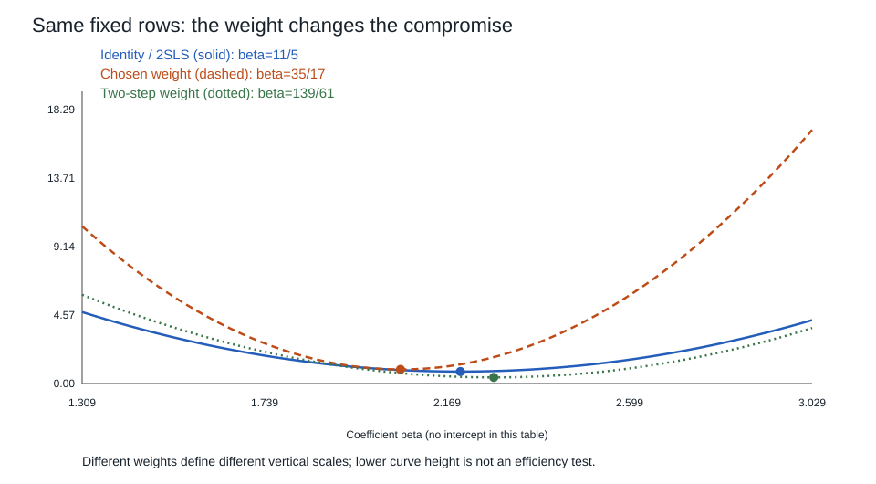

# 工具变量、矩条件与两阶段最小二乘

解释变量和结构误差相关时，增加样本会把错误的目标估得更精确。上一课分清样本残差、总体投影和结构误差；这里问：能否找到另一组变化，只推动解释变量而不携带结果方程里遗漏的变化？这句话包含两项承诺：数据有足够相关变化，以及制度或机制允许把这种变化解释为所需的干预。计算能检查第一项的一部分，不能代办第二项。

本课对象是标量结果和线性结构参数；例中变量均为无量纲合成量。一般式可含截距、已接受为外生的控制，但“控制”一词不自动授予外生性。非线性、异质处理效应和依赖数据各有额外条件。

## 先写矩条件，再问它识别谁

令一行 $x_i\in\mathbb R^k$，$z_i\in\mathbb R^\ell$ 都是列向量，

$$Y_i=x_i'\beta_0+\varepsilon_i,\qquad E[z_i\varepsilon_i]=0.\tag{1}$$

$\beta_0$ 的结构或干预含义须另外说明。假设这些期望存在，记 $\Gamma=E[z_ix_i']\in\mathbb R^{\ell\times k}$，$q=E[z_iY_i]$，则

$$g(\beta)=q-\Gamma\beta=0.\tag{2}$$

若 $\operatorname{rank}\Gamma=k$，(1)成立就有唯一解：两个解之差满足 $\Gamma(\beta_1-\beta_2)=0$，满列秩迫使差为零。反之，若非满列秩，任一非零核向量 $v$ 使 $\beta_0+tv$ 都满足同样的矩，参数未被这些矩识别。工具个数 $\ell\ge k$ 只是必要计数，不能替代秩。比如 $\Gamma=\begin{pmatrix}1&2\\0&0\end{pmatrix}$ 只识别 $\beta_1+2\beta_2$。

相关性是 $\Gamma$ 的条件；有效性是给定真实参数时的 $E[z\varepsilon]=0$。条件均值零 $E[\varepsilon\mid z]=0$ 蕴含矩零；在另有 $E[\varepsilon]=0$ 时，$\varepsilon$ 与 $z$ 独立才蕴含这个条件均值零。独立本身不保证均值零，反向关系也不能随意推。因果排除是工具不经其他路径改变结果的机制限制，既不是矩阵的秩，也不是一次检验的输出。随机分配工具仍可能直接改变结果。

## 一份完整总体：OLS 与 IV 为什么不同

$Z_1,Z_2,V,U$ 相互独立，各等概率取 $\pm1$，共16个等概率状态。设

$$X=Z_1+2Z_2+V,\quad\varepsilon=V+U,\quad Y=2X+\varepsilon.\tag{3}$$

全部变量均值零。$E[X^2]=6$、$E[X\varepsilon]=1$，所以含截距的总体 OLS 斜率为 $2+1/6=13/6$。工具 $z=(Z_1,Z_2)'$ 则满足

$$\Gamma=(1,2)',\quad q=(2,4)',\quad E[z\varepsilon]=0,$$

两条矩都给 $\beta=2$。这里答案来自完整指定的生成模型；不能把现实样本回归系数命名为“2”便获得同等证据。程序枚举16态只是检查代数，不是观察了16位受试者，也不把均衡枚举误作随机样本必有的平衡。

更难的是：观察甚至可以无法区分完全不同的因果机制。固定同一 $X$，对 $\theta\in[0,2]$ 构造

$$Y_\theta=\theta X+(2-\theta)(Z_1+2Z_2+V)+V+U.\tag{4}$$

观察时 $X=Z_1+2Z_2+V$，所以每个状态逐个化为(3)的同一个 $Y$，完整联合分布相同。若干预替换 $X$ 的方程，同时保持 $Z,V,U$ 分布不变，结果每增加一单位 $X$ 改变 $\theta$。在 $\theta=0$ 世界，工具直接进入结果；在 $\theta=2$ 世界没有该直接项。工具仍然随机、相关；在统计系数2处的全部工具矩仍为零。因而任何只看此观察分布的拟合或过度识别检验都不能挑出真实干预效应。去现场核工具的制度路径，比替“第一阶段显著”加粗更有用。

## 从矩的距离推到 2SLS

把行堆成 $X\in\mathbb R^{n\times k}$、$Z\in\mathbb R^{n\times\ell}$。定义 $\Gamma_n=Z'X/n$、$q_n=Z'y/n$、$g_n=q_n-\Gamma_n\beta$。给一个对称正定、在这次最小化中不随 $\beta$ 变化的权重 $W$：

$$\hat\beta_W=\arg\min_\beta g_n(\beta)'Wg_n(\beta)
=(\Gamma_n'W\Gamma_n)^{-1}\Gamma_n'Wq_n.\tag{5}$$

推导是梯度 $-2\Gamma_n'W(q_n-\Gamma_n\beta)=0$；样本 $\Gamma_n$ 满列秩时 Hessian 正定，解唯一。过度识别时一般只有 $\Gamma_n'Wg_n(\hat\beta)=0$，不是每条样本矩都为零。

取 $Q_{zz,n}=Z'Z/n$ 正定，$W=Q_{zz,n}^{-1}$，令 $P_Z=Z(Z'Z)^{-1}Z'$，则

$$\hat\beta_{2SLS}=(X'P_ZX)^{-1}X'P_Zy.\tag{6}$$

第一阶段把 **每列** $X$ 投影到 $Z$ 得 $\hat X=P_ZX$；第二阶段回归 $y$ 到 $\hat X$，因为 $P_Z'=P_Z=P_Z^2$，得到同一个(6)。已接受的外生控制须同时进入解释量与工具列，不能只在第二阶段临时加回。

两阶段计算不是两套结构误差。用于矩协方差的是 $\hat\varepsilon=y-X\hat\beta$，不是 $y-\hat X\hat\beta$。后者多了 $(X-\hat X)\hat\beta$，会改变所估计的 $E[zz'\varepsilon^2]$。第二阶段普通 OLS 的标准误不能原封不动拿来作 IV 推断；正确方差由下一课的矩线性化给出。

## 四行固定材料，逐个数对得上

以下不加截距；是固定算术材料，不是对现实独立抽样的主张。

|行|$Z_1$|$Z_2$|$X$|$Y$|
|---|---:|---:|---:|---:|
|1|−1|−1|−2|−4|
|2|−1|1|0|−2|
|3|1|−1|−2|−4|
|4|1|1|4|10|

$Q_{zz,n}=I$，$\Gamma_n=(1,2)'$，$q_n=(3,4)'$。OLS为 $7/3$；2SLS/单位权重 GMM 为 $11/5$，其结构残差是 $(2/5,-2,2/5,6/5)'$，样本矩为 $(4/5,-2/5)'$，确有 $(1,2)g=0$。改 $W=\operatorname{diag}(1,4)$ 得 $35/17$，不是“工具多了一个，真值就换了”，而是有限样本里矛盾矩的折中方式变了。

用先导 $11/5$ 算

$$\hat S_1=\frac14\sum z_iz_i'\hat\varepsilon_i^2
=\frac1{25}\begin{pmatrix}36&-16\\-16&36\end{pmatrix},$$

冻结 $W_2=\hat S_1^{-1}$ 再解(5)，得 $139/61$，$g_n=(44/61,-34/61)'$，$n g_n'W_2g_n=100/61$。这是完整的二步算法；四行不足以许诺卡方近似准确，更不能据这个数认证因果排除。一般大样本有效性需要下一课条件。

图中纵轴是各自权重定义的距离；各曲线最小点可比较，**不同纵轴标尺的绝对高度没有共同优劣含义**。单把 $W$ 乘4，估计不变而目标值乘4。

工具换单位也不能偷换权重。若 $\tilde z=Az$、$A$ 可逆，则 $\tilde g=Ag$，匹配 $\tilde W=A^{-T}WA^{-1}$ 才保同一目标。2SLS 自动通过 $Q_{zz}$ 调整而不变；固定单位权重则未必。把本表 $Z_2$ 乘10，单位权重解为 $803/401$，2SLS仍为 $11/5$。量纲变化被当成证据加权，软件并不会主动替使用者抗议。

## LATE 是一种特别解释，不是所有矩模型的总前提

二元随机鼓励 $Z$、二元处理 $D$ 时，Wald比率为 $\Delta E[Y]/\Delta E[D]$。若鼓励独立于潜在结果和潜在处理、无干扰且只经处理影响结果，则分母是顺从者比例减反向者比例；分子是两类各自效应的对应带符号加权。再加 $D(1)\ge D(0)$ 的单调性、第一阶段非零，反向者消失，比率才成为顺从者平均效应。这个条件是此处 LATE 解释的门槛；(1)的线性同质结构矩不需要先把所有变量二元化，也不以潜在处理单调性为统一前提。

去 [[社会科学/40-公共政策与社会学/07-政策评估RCT与准实验#IV：工具只通过处理影响结果，条件非常强|政策 IV 主解释]] 核邀请、参与和效应目标；用 [[社会科学/20-经济流动与宏观/60-计量经济学/80-实践/02-工具变量与GMM/迁移题#四、鼓励随机，为什么还不是所有人的效应|有反向者的完整题]] 检查零 Wald 是否等于无人受益。不能靠删除现实中不可观察的潜在类型来“修好”识别。

## 下一步：哪一种权重更有效，何时它也救不了识别

[[社会科学/20-经济流动与宏观/60-计量经济学/03-GMM权重效率与弱识别|GMM、效率与弱识别]]推导大样本方差、最优权重和 J 检验，并用始终有效的工具展示通常正态近似为何仍会失效。原文定位、完整输入、复算及真实设计接口在 [[社会科学/20-经济流动与宏观/60-计量经济学/80-实践/02-工具变量与GMM/README|实践说明]]。面板、时间序列、一般依赖和选择/非线性完整课程仍待后续。
