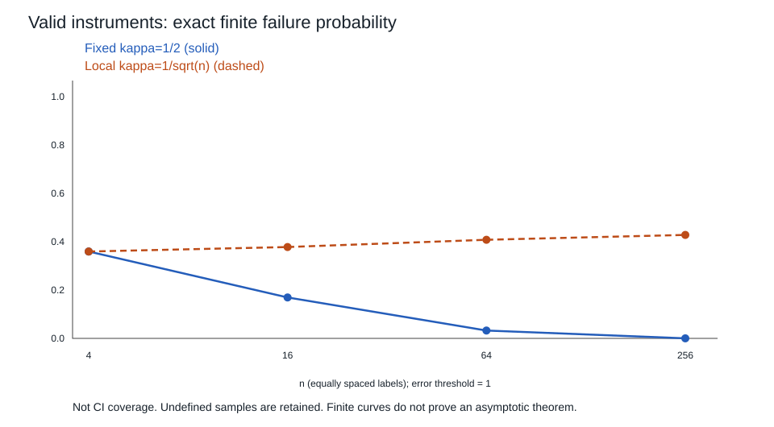

# GMM、权重效率与弱识别

两条带噪矩可能指向不同系数：该相信哪条，样本增加后折中是否收敛，检验究竟检验什么？上一课已从线性矩推到2SLS；这里先给一般 GMM 的一致性和局部推断，再拆开“有效”与“足够强”。数值材料检查公式，不代替识别或极限证明。

## 一般矩目标：局部满秩不等于全球识别

设独立同分布观测 $W_i$，参数 $\theta\in\Theta\subset\mathbb R^k$，矩函数 $h(W_i,\theta)\in\mathbb R^\ell$。令 $g(\theta)=E[h(W_i,\theta)]$、$g_n=n^{-1}\sum h(W_i,\theta)$。本节讨论正确设定 $g(\theta_0)=0$；错设下的最小距离伪真值是另一对象。

给定每次最小化中固定的正定权重 $W_n$，最小化

$$Q_n(\theta)=g_n(\theta)'W_ng_n(\theta).\tag{1}$$

一套足够的一致性条件：$\Theta$紧，$g$连续；$\sup_\Theta\|g_n-g\|\to_p0$；$W_n\to_p W>0$；$\theta_0$是唯一总体零点；估计达到全局最小值加 $o_p(1)$。紧集连续性使 $g$有界，故 $Q_n$一致收敛到 $Q=g'Wg$。任一离 $\theta_0$ 至少 $\eta$ 的闭集上，$Q$最小值严格正；否则紧性给另一个零点。以此正间隔与一致收敛比较估计处和 $\theta_0$ 处，得到 $\hat\theta\to_p\theta_0$。这说明为什么优化器返回局部驻点不等于完成统计识别。

$D=\partial g(\theta_0)/\partial\theta'$满列秩是下面的局部线性化条件，并不单独保证全球唯一。例 $g(\theta)=1-\theta^2$、$\Theta=[-2,2]$，在1和−1的导数都非零，却有两个零点。限制 $\theta\ge0$ 可排除一个，但那是增添模型先验，不是换个初值就发现了事实。线性模型则因 $g=q-\Gamma\beta$ 的全局线性，满列秩本身给唯一零点。

## 从一阶条件到 sandwich

再假设真值在内点，$h$局部可微，样本导数在真值邻域一致收敛到连续总体导数；$D$满列秩，$W_n\to_p W>0$；

$$\sqrt n g_n(\theta_0)\Rightarrow N(0,S),\qquad S>0.\tag{2}$$

iid情形有限二阶矩下 $S=E[h_ih_i']$，因为真值处均值为零；数据依赖时一般是长期协方差，不能照抄这个式子。所用多元 CLT、连续映射和 Slutsky 是统计先修，不把每次软件输出都视作已经满足它们。

一致的内点极小值满足 $D_n(\hat\theta)'W_ng_n(\hat\theta)=0$。沿真值到估计值的线段积分导数，结合导数一致收敛，展开为

$$\sqrt n(\hat\theta-\theta_0)
=-(D'WD)^{-1}D'W\sqrt n g_n(\theta_0)+o_p(1).\tag{3}$$

更具体地，令 $\bar D_n$ 为线段上的导数积分，精确一阶式给 $[D_n(\hat\theta)'W_n\bar D_n]\sqrt n(\hat\theta-\theta_0)=-D_n(\hat\theta)'W_n\sqrt n g_n(\theta_0)$。左侧矩阵趋于可逆的 $D'WD$，故先得 $O_p(1)$ 再得(3)，不预先假定收敛速率；也没有把各分量的均值定理硬写成同一个中间点。因此渐近协方差（$\sqrt n$尺度）是

$$V_W=(D'WD)^{-1}D'WSWD(D'WD)^{-1};\quad
\operatorname{Var}(\hat\theta)\approx V_W/n.\tag{4}$$

线性 IV 的 $D=-\Gamma$；符号不改变(4)。iid结构矩 $h=z(Y-x'\beta)$ 的 $\hat S=n^{-1}\sum z_iz_i'\hat\varepsilon_i^2$ 必须用结构残差。均值非零的有限样本中本包使用此**未中心化**估计，不能在表间悄悄切成中心化版本。

独立簇、时间依赖及簇数不增长如何破坏推断，回 [[社会科学/20-经济流动与宏观/60-计量经济学/01-样本正交外生性与独立信息|独立信息主解释]]：要为同一矩得分另建相应 CLT 和协方差，不是把“robust”写在结果上便自动完成。

## 最优权重的代价比较：证明在什么类里最优

取 $W_*=S^{-1}$ 得 $V_*=(D'S^{-1}D)^{-1}$。为证任意正定 $W$ 的 $V_W-V_*$半正定，记

$$A_W=(D'WD)^{-1}D'W,\quad A_*=(D'S^{-1}D)^{-1}D'S^{-1},\quad H=A_W-A_*.$$

$A_WD=A_*D=I$，故 $HD=0$；又 $SA_*'=D(D'S^{-1}D)^{-1}$，交叉项 $HSA_*'=0$。于是

$$V_W-V_*=HSH'\succeq0.\tag{5}$$

这是相同正确矩、强秩、所述正则近似下的 GMM 渐近效率比较；不承诺四行样本的偏差或方差一定更小，不证明对所有估计器或所有矩选择都最优。

对iid协方差的可行估计还需矩乘积 $h(W,\theta)h(W,\theta)'$ 在真值邻域的一致大数定律和期望连续性（例如连续且有可积的局部平方包络）；仅参数一致不自动保证平方矩收敛。在这些条件下，用一致先导估计算 $\hat S_1$，再冻结 $W_2=\hat S_1^{-1}$ 重新最小化；正定和一致性给 $W_2\to_pS^{-1}$。最终方差可用最终结构残差另算 $\hat S_2$ 代(4)，同时保留实际用过的 $W_2$；两者有限样本未必一样，极限在这些条件下相同。若 $E[\varepsilon^2\mid z]=\sigma^2$，$S=\sigma^2E[zz']$，故2SLS权重与最优权重成比例。异方差下通常不成比例，二步算法才有改善空间。权重依参数变化的连续更新法须重写目标导数，本课不把它与冻结二步混称。

## J 是剩余矩的检验，不是排除限制认证

固定 $\ell,k$，正确矩、强秩、(2)及一致最优权重条件下，令 $B=S^{-1/2}D$，$P_B=B(B'B)^{-1}B'$。将(3)代回矩，得

$$\sqrt n S^{-1/2}g_n(\hat\theta)=(I-P_B)Z_n+o_p(1),\quad Z_n\Rightarrow N(0,I_\ell).$$

$P_B$为秩 $k$ 的正交投影，故

$$J=n g_n(\hat\theta)'\hat S^{-1}g_n(\hat\theta)
\Rightarrow\chi^2_{\ell-k}.\tag{6}$$

$\hat S$可为上述一致先导协方差；本包四行算法的 J 按实际二步权重计算。若把最优权重乘常数 $c$，估计不变，但目标值也乘 $c$，不能再把未归一的 $nQ$ 当同一个卡方量。恰好识别时解可使所有矩为零，剩余自由度为零，没有可用的过度识别检验。弱识别、多工具增长或小样本均不由(6)担保。

拒绝表示这一组矩/同质模型/其他维持假设不相容，不指出究竟哪条工具坏了；不拒绝也不证明因果排除。在上一课(4)的两个世界，统计参数2处所有总体矩都为零，任一观察分布检验都分不开因果斜率0与2。原假设若一开始写错成“因果模型是真的”，检验再精密也不会替换它。

## 有效但弱：分母的随机性不能忽略

另设iid合成模型，观测内 $Z,V,U$ 独立等概率 $\pm1$：

$$X=\kappa Z+V,\quad Y=2X+V+U.\tag{7}$$

$E[Z(V+U)]=0$ 对所有 $\kappa$ 都成立；$\Gamma=\kappa$。令 $a_n=n^{-1}\sum Z_iV_i$、$b_n=n^{-1}\sum Z_iU_i$，则在分母非零的样本上

$$\hat\beta_{IV}-2=\frac{a_n+b_n}{\kappa+a_n}.\tag{8}$$

固定 $\kappa\ne0$ 时，大数定律给一致性，独立有界变量的 CLT 给

$$\sqrt n(\hat\beta-2)\Rightarrow N(0,2/\kappa^2).\tag{9}$$

这是点态渐近，不给有限样本无偏性，也不保证对趋近零的 $\kappa$ 一致有效。取三角阵 $\kappa_n=c/\sqrt n$，其中固定 $c\ne0$；$ZV,ZU$ 彼此独立且均为Rademacher，联合 CLT 给 $(\sqrt na_n,\sqrt nb_n)\Rightarrow(A,B)$，$A,B$独立标准正态。除分母零概率为零的极限集合外连续映射给

$$\hat\beta-2\Rightarrow\frac{A+B}{c+A}.\tag{10}$$

右侧非退化，不趋零；通常的 $\sqrt n$ 正态区间失去该依据。每个有限 $n$ 仍有总体秩，但相关信号与分母噪声同阶。$\kappa=0$ 则总体矩对所有 $\beta$ 都为零，是完全未识别；这与小而非零不同。

图用独立二项计数精确加权，不是抽几条幸运样本：$ZV$与$ZU$的正号数各服从 $\mathrm{Bin}(n,1/2)$。对所有 $(n+1)^2$ 对计数，分别保留分母为零及已定义但 $|\hat\beta-2|>1$ 的概率；加总作为图中失败指标。它不是置信区间覆盖率，也不替代(9)–(10)的证明。不能先丢掉除零样本，再宣布算法稳定。

若另加直接项 $\gamma Z$，总体矩比率变为 $2+\gamma/\kappa$。这是排除失效，弱相关会放大它；但(10)没有直接项、工具始终有效。第一阶段显著性、一个经验阈值或J不拒绝都不是统一有效证书；本课也不以某个固定F阈值冒充异方差/多工具/不同目标下的普适界。

## 把计算带回真实设计

先给目标总体、单位、处理版本和工具发生时点，列出工具到结果的所有合理通路；再说明哪条外生变化、排除证据和秩支撑目标量。预先写工具选择、样本/缺失、矩、协方差依赖单位和弱识别时的报告规则。数据可以检验相关、矩相容和部分设计后果；不可观察反事实仍靠设计和可反驳机制，不由优化器制造。

[[社会科学/20-经济流动与宏观/60-计量经济学/80-实践/02-工具变量与GMM/迁移题|四个撤提示题]]改变相关方向、权重/单位、工具强度和顺从类型；[[社会科学/20-经济流动与宏观/60-计量经济学/80-实践/02-工具变量与GMM/README|实践说明]]给答案、失败标准、真实识别接口和原文读取范围。此处完成线性IV/2SLS与一般GMM这段；一般依赖、面板、时间序列、非线性/选择等整课余项仍开放。
