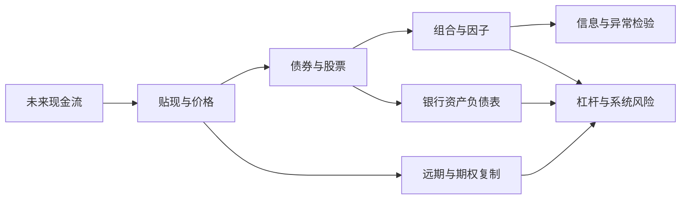

# 金融市场与风险：从现金流到系统脆弱性

金融的共同语言不是股票代码，而是**谁在什么时点、什么状态下，向谁支付多少现金流**。价格把这些未来现金流折回今天；风险来自金额、时点、交易能力与合约履行的不确定性。八讲从单笔现金流出发，一直追到“每家机构都在自保，为什么系统反而更危险”。

> [!info] 用途边界
> 本课程使用小额合成数据解释机制，不提供实时价格、产品推荐、交易信号、个性化投资或税务建议。历史关系不自动成为未来收益预测。

## 主路线

1. [[社会科学/30-金融市场与风险/01-现金流复利贴现与实际收益|现金流、复利、贴现与实际收益]]：固定计息期间、现金流时点和购买力口径。
2. [[社会科学/30-金融市场与风险/02-债券价格利率期限结构与信用利差|债券、利率、期限结构与信用利差]]：从确定现金流推到利率敏感度，再拆开期限与信用风险。
3. [[社会科学/30-金融市场与风险/03-股票所有权现金流与估值|股票所有权、现金流与估值]]：区分账面权益、市场价值、股东现金流和条件估值。
4. [[社会科学/30-金融市场与风险/04-组合分散风险因子与CAPM边界|组合分散、风险因子与 CAPM 边界]]：用协方差解释为什么“数量多”不等于“分散”。
5. [[社会科学/30-金融市场与风险/05-有效市场信息价格与异常|有效市场、信息、价格与异常]]：把信息集、预期收益模型、检验和可交易利润分开。
6. [[社会科学/30-金融市场与风险/06-远期衍生品无套利与期权|远期、衍生品、无套利与期权]]：用复制组合给状态现金流定价。
7. [[社会科学/30-金融市场与风险/07-银行期限转换流动性与挤兑|银行期限转换、流动性与挤兑]]：区分流动性、偿付能力和存款创造。
8. [[社会科学/30-金融市场与风险/08-杠杆保证金传染与系统性风险|杠杆、保证金、传染与系统性风险]]：追踪价格、融资和资产负债表之间的反馈环。

## 三次停下来检查

| 学到这里 | 应该能做的事 | 常见误读 |
| --- | --- | --- |
| 01—03 | 把合约或所有权写成带时点的现金流，说明估值条件 | 把 YTM、账面利润或模型价值当成必然实现的回报 |
| 04—06 | 算协方差贡献、写无套利复制，并陈述模型假设 | 把 beta、异常或风险中性概率当作自然常数和真实预测 |
| 07—08 | 在资产负债表上分辨资本缺口、现金缺口与反馈外部性 | 把单家机构的风险指标相加成“系统风险” |

## 与共同工具的关系

- [[社会科学/10-共同工具/02-指标分布与存量流量核算|指标、分布与存量流量核算]] 是资产、负债、净值、存量和流量的主解释；本课程只在具体市场问题中应用。
- [[数学/30-概率与统计/00-概率与统计-MOC|概率与统计]] 提供随机变量、期望、方差和估计工具；金融模型的输入仍需单独处理抽样误差、制度变化与尾部风险。
- [[社会科学/10-共同工具/04-比较研究偏差与证据审计|比较研究、偏差与证据审计]] 可在读完第 5 讲后继续，用于检查回看偏差、多重检验和外推边界。

## 一张总图

箭头表示学习依赖和机制连接，不表示经验因果已被识别；例如“信息进入价格”多快，需要明确市场、信息集、成本和检验模型。
