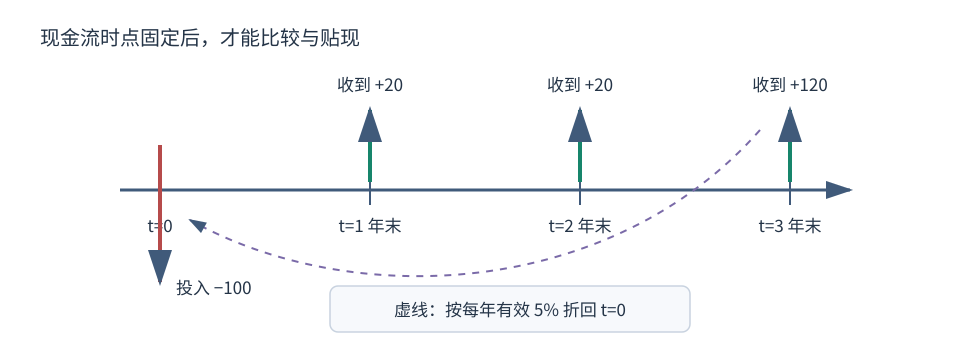

# 现金流、复利、贴现与实际收益

“赚了 10%”至少缺四项信息：以什么货币计价、经历多长期间、中途是否追加或取出资金、物价和费用怎样变化。先把时点写清楚，收益率才有意义。

## 1. 对象、符号与期间

- $t=0,1,\ldots,T$ 是明确的计息时点；若一期是一年，年利率才可直接代入。月利率、名义年利率和有效年利率不能混用。
- $CF_t$ 是时点 $t$ 的现金流。站在投资者一侧，投入为负、收到为正。
- $r_t$ 是从 $t-1$ 到 $t$ 的有效期间收益率，量纲为“每期”。
- $V_t$ 是时点 $t$ 的账户价值；外部追加/取出现金必须与资产收益分开。

图中箭头只表示现金流发生的时点与方向；它不说明这些现金流是否确定，也不替你选择风险调整贴现率。

## 2. 复利是跨期连乘

本金 $P$ 每期按有效利率 $r$ 增长，经过 $n$ 期：

$$FV_n=P(1+r)^n.$$

若年内复利 $m$ 次、报价为名义年率 $j$，且每个子期间按 $j/m$ 计息，则一年有效利率为

$$r_{\mathrm{eff}}=\left(1+\frac{j}{m}\right)^m-1.$$

例如名义年率 12%、按月复利，月利率严格取 $1\%$，一年有效率为 $1.01^{12}-1\approx12.6825\%$。不能把 12% 同时当作月率或有效年率。

收益逐期变化时，累计财富因子是 $\prod_{t=1}^T(1+r_t)$。两年先涨 10%、再跌 10%，$1000\times1.1\times0.9=990$。算术平均收益为 0%，几何平均为

$$\sqrt{1.1\times0.9}-1\approx-0.5013\%.$$

这解释了为什么对称百分比涨跌不会相互抵消：第二年的 10% 作用在不同本金上。

## 2.1 同一个100期账户，为什么有三个答案

给定路径的复利已经会算，接下来把每期因子变成随机变量。令 $W_n=V_n/V_0$ 为账户相对初始本金的财富因子，$W_0=1$，所以 $W$ 无量纲。每一期长度相同，但不指定为一年。每期 $G_t>0$ 独立同分布（iid），以各 $1/2$ 的概率取 $1.5$ 或 $0.6$，对应收益 $+50\%$ 或 $-40\%$。假设全程没有申赎、杠杆、费用、税、违约或制度变化；这组概率是教学设定的真实过程概率 $P$，不是市场估计或风险中性定价权重。

于是 $W_n=\prod_{t=1}^nG_t$。每期平均因子为 $E_P[G_t]=(1.5+0.6)/2=1.05$；**独立性**才允许把乘积期望拆开：

$$E_P[W_n]=\prod_{t=1}^nE_P[G_t]=1.05^n.$$

但同一账户重复经历的增长要看连乘：令 $K_n$ 为前 $n$ 期取到 $1.5$ 的次数，则

$$W_n=1.5^{K_n}0.6^{n-K_n},\qquad
\frac1n\log W_n=\frac{K_n}{n}\log1.5+\left(1-\frac{K_n}{n}\right)\log0.6.$$

每期对数因子有界且 iid，均值为

$$\mu=E_P[\log G_t]=\tfrac12\log0.9\approx-0.0526803.$$

沿 [[数学/30-概率与统计/07-概率不等式大数定律与收敛方式#2. 弱大数定律：从均值方差到概率极限|有限方差弱大数的证明]]，并在 [[数学/30-概率与统计/07-概率不等式大数定律与收敛方式#2.1 从对数平均返回账户财富|对数平均返回财富]] 核对最后一步，可得到 $n^{-1}\log W_n\xrightarrow P\mu$ 和 $W_n\xrightarrow P0$。对应的每期几何因子为 $\sqrt{0.9}\approx0.948683$，几何收益约 $-5.13167\%$。每期简单收益的期望 $+5\%$ 与这个量回答不同问题。

100期时，直接用 $K=K_{100}\sim\mathrm{Bin}(100,1/2)$ 求有限期答案，不需要把渐近结论当作100期保证：

| 读者所问的对象 | 精确表达式 | 数值 |
| --- | --- | ---: |
| 全部随机结果按概率加权的平均终值 | $E_P[W_{100}]=1.05^{100}$ | $131.501258$ |
| 恰有50涨、50跌的次数路径终值 | $1.5^{50}0.6^{50}=0.9^{50}$ | $0.005153775$ |
| 100期终值低于初始本金的概率 | $P(W_{100}<1)=2^{-100}\sum_{k=0}^{55}\binom{100}{k}$ | $0.864373488$ |

第二行是接近平均计数的代表性结果，**不是每条路径都恰有50次上涨**。本题无外部现金流，且标量因子连乘，所以同样计数的不同顺序有相同终值。第三行严格阈值来自

$$W_{100}<1
\iff K\log2.5+100\log0.6<0
\iff K<\frac{-100\log0.6}{\log2.5}\approx55.749295.$$

$K$ 是整数，故事件恰为 $K\le55$，而不是 $K\le56$。期望也可以用同一计数分布复算：$2^{-100}\sum_{k=0}^{100}\binom{100}{k}1.5^k0.6^{100-k}=1.05^{100}$。少数很大的终值足以强烈拉高平均；亏损概率、平均终值和某个次数路径因此可以同时成立。

## 2.2 把条件带回金融，再改变一个因子

$W_n\xrightarrow P0$ 与 $E_P[W_n]=1.05^n\to\infty$ 同时成立；不能直接把极限移入期望。回访 [[数学/30-概率与统计/07-概率不等式大数定律与收敛方式#5. 收敛不保证期望交换|尾部与期望交换的条件]]，解释为什么越来越罕见的大值仍能主导平均；再到 [[数学/46-数理方程/30-非线性动力系统/04-确定衰减与随机乘法增长#先固定模型、单位与两种增长率|随机乘法的两个平均]] 比较一般结构。该页倍率2与1/2的例子另有完整强收敛证明；本题上面的弱大数路线只签收依概率结论，不把别例的 a.s. 证明挪作本题证明。

期望财富与单账户对数增长率都是有意义的目标量；模型本身没有指定人的效用、风险承受力或最优策略，不能推出一般投资建议、唯一的对数效用或社会分配判断。也无需把 iid 对数收益笼统称为“不遍历”：本题直接核对所平均的对象和使用的定理。

若只把下跌因子改为 $0.8$、其余条件不变，先独立回答：期望增长、对数增长与财富的概率极限各怎样改变？为什么这能检验“凡波动都长期亏”的说法？

> [!question]- 迁移答案
> $E_P[G]=(1.5+0.8)/2=1.15$，故 $E_P[W_n]=1.15^n$。平均对数因子 $\mu'=\tfrac12\log1.2>0$，几何因子 $\sqrt{1.2}>1$。弱大数给 $n^{-1}\log W_n\xrightarrow P\mu'$；对任何固定 $M>0$，足够大 $n$ 时 $\log M/n<\mu'/2$，所以 $P(W_n\le M)\le P(n^{-1}\log W_n\le\mu'/2)\to0$，即 $W_n\to+\infty$ 依概率。改变的是因子分布，原例的负对数均值并非所有波动的必然后果。

若有期末外部净投入 $C_t$，账户递推改为 $V_t=G_tV_{t-1}+C_t$；若在期初投入则是 $V_t=G_t(V_{t-1}+C_t)$。此处 $C_t$ 对账户投入取正，和本页投资者现金流 $CF_t$ 的投入负号不同。收费时点、融资、损失上限和相关性也会改变递推或概率律，不能继续沿用无现金流的乘积。回到 [[社会科学/30-金融市场与风险/01-现金流复利贴现与实际收益#5. 费用、税和外部现金流要逐层扣|费用与现金流时点]] 先重建对象。

iid 条件若失效，可到 [[数学/30-概率与统计/20-随机过程/03-Markov链与长期平均#为什么有周期也可以有时间平均|有限不可约Markov链的时间平均]] 检查那里的状态空间、不可约性与可积报酬条件；那不是任意相关收益序列的保证。真实概率下的 $E_P[W_n]$ 增长也不能直接判定套利。[[社会科学/30-金融市场与风险/06-远期衍生品无套利与期权#路径 B：风险中性权重|一期复制的风险中性权重]] 回答另一个问题：在可交易、可融资、无摩擦等条件下，构造 $Q$ 的权重使贴现价格满足定价关系；多期贴现鞅还涉及条件期望和信息。该页的一期树既不把 $P$ 等同 $Q$，也没有由此认证连续时间换测度。

回到原题条件，遮住上表与推导，分别求“100期平均终值”“恰有50涨50跌的终值”“100期亏损概率”，并指出哪一步用独立性。

> [!question]- 三个答案
> 答案分别为 $1.05^{100}\approx131.501258$、$0.9^{50}\approx0.005153775$、$2^{-100}\sum_{k=0}^{55}\binom{100}{k}\approx0.864373488$。乘积期望的分解和 $K$ 的二项分布都用了独立性；只知道每期边际概率各半还不够。

## 3. 贴现是把不同时间的金额换到同一时点

若每期贴现率固定为 $r>-1$，单笔未来现金流的现值为

$$PV(CF_t)=\frac{CF_t}{(1+r)^t},$$

多笔现金流可在同一计价单位和同一估值时点相加：

$$PV=\sum_{t=0}^{T}\frac{CF_t}{(1+r)^t}.$$

教学构造：今天付出 100，未来三年末分别收到 20、20、120；以每年有效 5% 贴现：

$$PV=-100+\frac{20}{1.05}+\frac{20}{1.05^2}+\frac{120}{1.05^3}\approx40.85.$$

这个正数是**给定现金流和 5% 贴现率**下的净现值，不是保证利润。若现金流有风险，贴现率和状态概率都需要模型；把风险一股脑塞进更高贴现率只是常见简化，不是会计恒等式。

## 4. 名义收益与购买力收益

设名义财富因子为 $1+r_n$，同期价格水平从 $P_0$ 变为 $P_1=P_0(1+\pi)$，则精确实际收益率是

$$1+r_{real}=\frac{1+r_n}{1+\pi},\qquad r_{real}=\frac{1+r_n}{1+\pi}-1.$$

名义收益 10%、同期通胀 3% 时，实际收益为 $1.10/1.03-1\approx6.7961\%$，不是简单相减得到的 7%；$r_n-\pi$ 只是在利率不大时的近似。Fisher 1930 将货币利率与购买力稳定假设下的实际利率明确区分，本页把该区分写成可复算的财富因子关系。

## 5. 费用、税和外部现金流要逐层扣

假设 $1000$ 连续两年每年先取得 8% 毛收益，再按期末价值收取 1% 费用，则净因子每年是 $1.08\times0.99=1.0692$，两年后为约 $1143.19$；不收费时为 $1166.40$。费用计算基数、收取时点不同，结果也不同。

税后收益取决于辖区、账户、所得类型、成本基础与实现时点，本页不设一个“通用税率”。含中途现金流时，时间加权收益用于隔离申赎影响，资金加权收益（IRR）反映资金实际进入时点；二者回答不同问题。

| 指标 | 固定的对象 | 不能单独回答 |
| --- | --- | --- |
| 期间收益率 | 两个估值时点之间的价值变化与分派 | 多期财富增长、通胀与费用 |
| 几何平均 | 多期复合财富因子 | 投资者中途资金规模 |
| IRR | 令全部带时点现金流净现值为零的率 | 是否存在多个解、再投资条件、风险大小 |
| 实际收益 | 相对价格指数的购买力变化 | 个体消费篮子与税后可支配金额 |

## 失效边界与反例

- 贴现率为负时公式仍可工作到 $r>-1$，但直觉“越远越不值钱”可能失效。
- IRR 对非典型现金流可能有多个解或无经济意义；应同时看现金流时点和 NPV 曲线。
- 历史实现收益不是未来期望收益；用过去均值作预测还要处理样本选择、制度变化和估计误差。
- 货币通胀指数是统计篮子，未必等于个人面对的物价变化。

## 练习与检查点

1. 年率 6%、半年复利的名义报价，半年率是多少？两年有效累计因子是多少？
2. 写出“今天投入 80，一年末追加 20，两年末收到 115”的带符号现金流；说明为何不能用账户总涨幅直接当资产收益率。
3. 若名义收益 -5%、通胀 -2%，精确实际收益是多少？先写财富因子再计算。
4. 读下一页 [[社会科学/30-金融市场与风险/02-债券价格利率期限结构与信用利差|债券价格与利率]]，检查每一笔息票和本金究竟落在哪个时点。

## 来源定位

- Irving Fisher, *The Theory of Interest* (1930)，FRASER 全书 PDF；本页使用其“不同日期收入的交换”与货币/实际利率区分，尤其第一部分关于收入与利息的讨论。来源：https://fraser.stlouisfed.org/files/docs/publications/books/theoryofinterest_fisher.pdf
- Scott Sheffield, MIT 18.600 Fall 2019，[Lecture 27](https://ocw.mit.edu/courses/18-600-probability-and-random-variables-fall-2019/c23341155f6563814bbdd0cdfd37a18d_MIT18_600F19_lec27.pdf) PDF页18–22用于iid有限方差弱大数条件；[Lecture 35](https://ocw.mit.edu/courses/18-600-probability-and-random-variables-fall-2019/resources/mit18_600f19_lec35/)PDF页43、49–57用于贴现鞅、定价权重与普通概率的对象区分。1.5/0.6及1.5/0.8为本页教学构造，不是来源中的市场参数。
- 本页全部数字为教学构造，由财富因子与贴现公式独立复算；未引用市场价格或历史回报。
