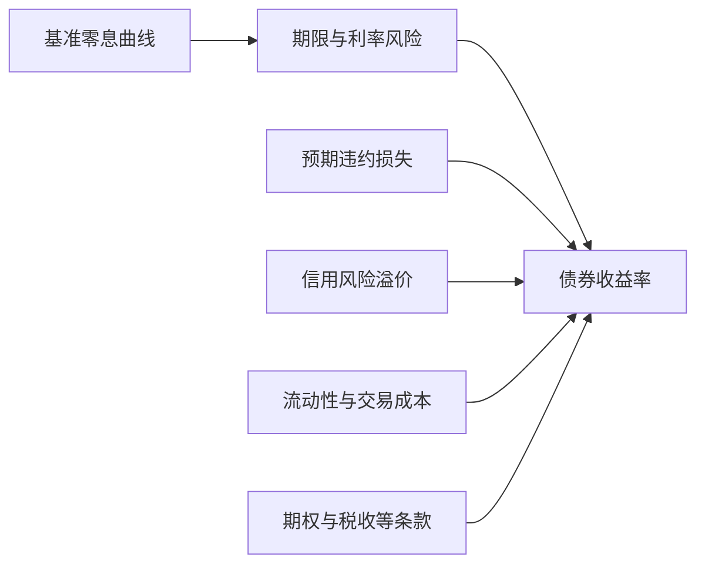

# 债券价格、利率、期限结构与信用利差

债券把未来支付写进合约，但“合约现金流已知”不等于“持有回报已知”：违约、提前出售、再投资利率、通胀和流动性都会改变结果。

## 1. 先固定合约现金流

面值 $F$、每期息票 $C$、剩余 $n$ 期、每期到期收益率 $y$ 的固定利率债，在单一收益率简化下：

$$P(y)=\sum_{t=1}^{n}\frac{C}{(1+y)^t}+\frac{F}{(1+y)^n}.$$

这里 $y$ 必须与息票期间一致。若债券半年付息，年化报价怎样换成半年率，要按市场约定处理；不能直接把年率塞进每半年一期的分母。

两年期、每年末付息 5、到期还 100 的教学债券，在 $y=5\%$ 时价格正好为 100；若同一确定现金流按 6% 贴现：

$$P=\frac{5}{1.06}+\frac{105}{1.06^2}\approx98.17.$$

利率上升时旧债价格通常下降，因为分子未变而贴现因子变大。美国财政部的市场化国债定价说明也明确区分息票利率与 YTM，并列出 YTM 高于息票率时价格低于面值的关系；这是一种合约与报价说明，不可外推到有信用风险的所有债券。

## 2. 久期是局部敏感度，不是到期年数的同义词

Macaulay 久期把各期现金流时点按现值权重求平均：

$$D_M=\frac{\sum_{t=1}^{n}t\,PV(CF_t)}{P}.$$

若每期收益率为 $y$，修正久期 $D_{mod}=D_M/(1+y)$ 给出一阶近似：

$$\frac{\Delta P}{P}\approx-D_{mod}\Delta y.$$

两年 5% 息票、价格 100 的债券，$D_M=(1\times5/1.05+2\times105/1.05^2)/100\approx1.9524$ 年，$D_{mod}\approx1.8594$。收益率从 5% 升到 6%，久期近似价格跌 1.859%，得到 98.14；精确重估为 98.17。差异来自曲率（凸性）。变动更大、有嵌入期权或曲线非平行移动时，一阶近似更差。

## 3. YTM 是内部收益率摘要，不是无条件实现回报

YTM 是让承诺现金流现值等于当前价格的单一折现率。在以下标准情景下，按终值口径计算的年化复合回报与初始 YTM 一致：

- 发行人按约支付；
- 持有到期；
- 中间息票按初始 YTM 再投资；
- 费用、税、通胀和汇率按所选口径处理。

若一年后卖出两年债，实际持有期回报是 $(C_1+P_1-P_0)/P_0$；$P_1$ 取决于当时曲线与信用状况，起初的 YTM 不能锁定它。

这些是标准保证情景，不是每一次恰好相等的必要条件。两年面值100、年息票5、初始YTM为5%的债券价格100；一年付息后，若剩余一年YTM仍为5%，除息售价为 $105/1.05=100$，一年HPR为 $(5+100-100)/100=5\%$。提前出售也可能恰好相等；这不意味着初始YTM锁定未来售价。

## 4. 收益率曲线不是一条确定预言

零息利率 $z_n$ 把时点 $n$ 的单笔现金流贴现。以年度复利为例，两年零息率和一年零息率可推出隐含的一年远期率 $f_{1,2}$：

$$(1+z_2)^2=(1+z_1)(1+f_{1,2}).$$

若 $z_1=3\%$、$z_2=4\%$，则 $f_{1,2}=1.04^2/1.03-1\approx5.01\%$。这是由**当前价格无套利关系**推出的远期报价，不是下一年短率的物理预测。期限结构模型（如 Cox–Ingersoll–Ross 1985）把短率动态、风险价格与债券价格连接起来；由此也提醒我们，预期未来短率和期限风险溢价不能从一条曲线无模型地分开。

图中是定价成分清单，不声称每一项可从观察到的单个利差唯一识别。

## 5. 信用利差不是“违约概率”的另一个名字

信用债相对某基准曲线的利差，可能同时补偿预期违约损失、回收率不确定性、系统性风险暴露、流动性、税收、嵌入期权和供需。把 200 个基点直接翻译为 2% 违约概率，通常缺少回收率、期限和风险溢价模型。

| 观察 | 可能机制 | 不能立即推出 |
| --- | --- | --- |
| 长端收益率高于短端 | 预期短率上升、正期限溢价或二者组合 | 短率必然按远期率实现 |
| 曲线倒挂 | 预期短率下降、期限溢价变化、避险需求等 | 某日必然发生衰退 |
| 公司债利差扩大 | 违约风险、流动性、风险厌恶或条款变化 | 发行人已经资不抵债 |
| 价格低于面值 | YTM 高于息票率等 | 该债券“便宜”或一定赚钱 |

## 6. 中国案例与国际口径怎样比较

财政部—中国国债收益率曲线编制说明把对象限定为中国大陆发行的人民币国债，以发行和二级市场价格等输入，使用 Hermite 插值形成 3 个月至 30 年的标准期限。美国 TreasuryDirect 的教育页则从具体票据、附息票据和债券的合约定价解释价格、息票与 YTM。两者回答不同问题：前者是**曲线怎样由市场输入编制**，后者是**单只证券现金流怎样报价**。

因此比较中美“十年期收益率”前要固定币种、市场、到期收益/即期收益口径、日计数、发布时间与曲线方法。观察两条曲线数值不同，不能单独识别货币政策预期、通胀、期限溢价或信用差异；需要额外模型和数据。本页不使用任何当日数值，避免把随时点变化的市场快照写成长期知识。

## 边界与检查点

- 主权债的信用、货币和制度安排随法域而异；“无风险利率”是模型基准，不是所有状态下绝对无风险。
- 浮息债、通胀保值债、可赎回债和抵押支持证券的现金流会随状态改变，不能直接套固定现金流公式。
- 练习：把上述两年债的收益率改为 4%，精确算价格；再用久期估计，并解释误差方向。
- 练习：写出“持有一年后出售”的回报公式，列出至少三项起初 YTM 没有锁定的量。

继续 [[社会科学/30-金融市场与风险/03-股票所有权现金流与估值|股票所有权与估值]]，比较契约性债权现金流与剩余股权现金流；需要看利率冲击怎样进入银行账本，可转 [[社会科学/30-金融市场与风险/07-银行期限转换流动性与挤兑|银行期限转换]]。

## 来源定位

- U.S. Treasury, “Understanding Pricing and Interest Rates”，已打开“Bonds and Notes”部分；用于息票、面值、价格与 YTM 的官方合约说明：https://www.treasurydirect.gov/marketable-securities/understanding-pricing/
- Cox, Ingersoll & Ross, “A Theory of the Term Structure of Interest Rates” (1985), *Econometrica*；已打开全文 PDF，本页仅使用其“预期、风险厌恶、投资机会与跨期偏好共同进入债券价格”的理论边界，没有把模型参数当现实估计：https://roycheng.cn/files/papers/interestRate/paper_Cox%26Ingersoll%26Ross_1985.pdf
- 财政部—中国国债收益率曲线编制说明；已打开 2 页官方说明，定位对象、输入、Hermite 插值、期限与发布时间：https://indices.chinabond.com.cn/cbweb-czb-web/czb/bzcxsmDown?locale=
