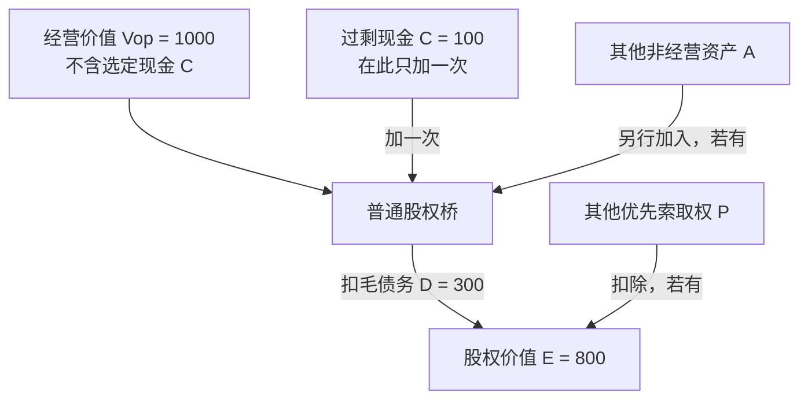

# 股票所有权、现金流与估值

一股股票同时是剩余索取权、治理权安排和可交易合约。价格可以受未来股东现金流、贴现率、信息与交易需求共同影响；“买公司”“买现金流”和“以后卖给别人”描述的是同一资产的不同层面，不能挑一个当完整答案。

## 1. 先分清四个量

| 量 | 含义 | 为什么不等同 |
| --- | --- | --- |
| 会计利润 | 某报告期按会计确认与计量规则形成的收入减费用 | 有应计、非现金项目和会计判断 |
| 经营/自由现金流 | 现金流量与再投资、融资约束下的资金口径 | 不一定全部可分给普通股东 |
| 股东分派 | 股息与回购等实际向股东转移价值的方式 | 受董事会、契约、法律和融资需要约束 |
| 股价回报 | 价格变化加分派，相对买入价格 | 受估值倍数与交易时点影响 |

IFRS 2018 概念框架把总权益的账面金额写成已确认资产账面额减负债账面额，并明确总账面权益通常不等于股权市场价值。财务报表提供估值输入，不直接给出企业“正确股价”。

## 2. 从企业价值桥到每股权利

先把集合划开，才能在一条桥中只计入一次现金。令 $V_{op}$ 为**经营资产价值**：它只对应经营资产未来现金流，已排除选定要单独处理的现金 $C$，也排除其他非经营资产 $A$。令 $D$ 为毛债务，$P$ 为其他优先于普通股的索取权；本桥中 $C$ 与 $A$ 互斥，$D$ 与 $P$ 互斥，且同一项目不能同时作为资产加项与债务或优先索取权扣项。这些量都必须在同一估值时点、同一市场价值口径下计量。则普通股权价值为两种代数上等价的写法：

$$E=V_{op}+C+A-D-P=V_{op}+A-(D-C)-P.$$

第二式把 $D-C$ 写成净债务，但不创建一笔新的现金：$C$ 已从 $D$ 中扣除，因而不能又在 $V_{op}+A$ 之外另加一次。经营所必需的现金若已经留在 $V_{op}$ 的经营现金流预测中，就不属于这里的 $C$；只有从 $V_{op}$ 排除的过剩现金才可单列。两种口径混用会重复或遗漏现金。

小账桥：若 $V_{op}=1000$、$C=100$、$D=300$，且 $A=P=0$，则 $E=1000+100-300=800$，也等于 $1000-(300-100)=800$。错误地写成 $1000+100-(300-100)=900$，把同一 $C=100$ 计了两次。

每股条件价值还要求分子 $E$ 与完全摊薄后股份数采用**同一情景**。若把期权行权计入新增股份，行权所得现金也须按所选估值方法同步进入 $C$（或已反映于相同情景的资产价值）；若把可转债转换为普通股，则须同时从 $D$ 或 $P$ 移除该已转换索取权，并加入相应股份。若不假定转换，则保留该索取权的扣项，也不加入其新增股份。不能只换分母，更不能在 $E$ 已扣除某索取权后又把该索取权转换产生的新股计入分母。

实际桥接仍需逐项检查现金、租赁、养老金、少数股东、优先股和或有负债口径；上式不是统一会计标准。CFA Institute 的 2026 EV 倍数课程页也将 EV 概括为债务、普通股和优先股的市场价值减去现金与投资；这里的 $V_{op}$ 是为教学桥专门声明的经营价值，使用前须确认与所选 EV 定义及资产集合一致。

## 3. 股息贴现模型从一期递推开始

若持有一股至下一期，把下一期股息 $D_1$ 与售价 $P_1$ 视为随机变量，并在一个**单一风险调整折现率** $r$ 的简化设定下，条件定价关系为

$$P_0=\frac{E_0[D_1+P_1]}{1+r},$$

其中 $E_0[\cdot]$ 是使用时点 0 信息形成的条件期望。若后文把 $D_t$、$P_t$ 直接写进公式，它们指相应的条件期望量；这不等于未来现金流已经确定。不断向前代入，在同一折现约定适用、终值项满足适当收敛条件时：

$$P_0=\sum_{t=1}^{\infty}\frac{E_0[D_t]}{(1+r)^t}.$$

若条件期望股息从 $E_0[D_1]$ 起永远按常数 $g$ 增长，且 **$r>g$**，几何级数得到 Gordon 增长式：

$$P_0=\frac{E_0[D_1]}{r-g}.$$

教学构造：时点 0 预期下一期股息 $E_0[D_1]=4$，要求回报 $r=10\%$，永续增长 $g=3\%$，则 $P_0=4/(0.10-0.03)=57.14$。若只把 $r$ 改成 9%，估值变为 66.67。这里 $r$、$g$ 都是同一计价口径下的**每年有效名义率**，股息在每年末支付；若改用实际量或其他期频，现金流、$r$ 与 $g$ 必须一起换口径。这个敏感度提醒我们：远期增长和贴现率相差很小时，微小假设变化会造成巨大估值变化。

当 $r\le g$ 时，常增长永续式不收敛，不能把公式照按。即使 $r>g$，永久增长也必须与经济规模、竞争和再投资回报相容。Gordon 与 Shapiro 1956 的资本设备分析展示了增长、再投资与要求回报之间的关系；本页使用的是其后广泛采用的稳定增长简化，不把它当成市场真值。

## 4. 增发、回购与“每股”口径

教学公司原有 100 股、整体股权价值 1000，每股 10。若以每股 10 公允增发 25 股并取得现金 250，忽略发行成本与新项目价值变化，增发后股权价值 1250、股份 125，每股仍为 10；但原来持 1 股者的所有权从 1% 降为 0.8%。

若以每股 8 增发 25 股，只取得 200，其他条件不变，理论上合计价值 1200、每股 9.60；价值从旧股东转向以折价认购者。现实中发行信号、用途、控制权、费用和需求会改变这个静态结果。

回购在“按公允价值、无税费、投资政策不变”时不会凭空创造整体价值；它减少现金与股份数。是否改善每股指标取决于价格、融资、机会成本与会计口径，不能只看 EPS 上升。

从价值桥进入 [[社会科学/30-金融市场与风险/50-公司金融/01-项目现金流融资现金流与资本预算#同一项目，四张不许混写的现金表|项目与融资的逐期现金表]]：借款改变谁先出资、谁先获偿，不会自行增加经营支付；发行费另列外部收款人。继续核股权市场价值与实际出资的区别，并在有风险两态例中重新匹配股权资本成本，不能只换每股分母。

## 5. 条件估值不是价格标签

状态表帮助定位不确定性：

| 状态 | 下一期股东现金流 | 概率/权重从哪里来 | 主要失效点 |
| --- | ---: | --- | --- |
| 需求强 | 8 | 预测模型或情景权重 | 竞争吸引进入、利润率回落 |
| 基准 | 4 | 同上 | 资本开支与营运资金偏差 |
| 需求弱 | 0 | 同上 | 融资约束、稀释或破产顺位 |

“期望现金流”需要概率和状态定义；“折现率”需要时间价值与风险定价模型。用一个数字概括二者很方便，也容易掩盖模型风险。市场价格与条件估值不同，不自动说明市场错或模型错。

## 边界、练习与下一步

- 普通股权利受公司法、章程、股类和上市规则影响；不同法域不能直接互换。
- 会计确认、税和资本结构复杂时，应回到具体披露原文。本页不评价任何证券。
- 练习：若 $D_1=3,r=8\%,g=2\%$，算稳定增长价值；把 $g$ 提到 7.5%，解释敏感性和长期合理性。
- 练习：构造一个“总利润上升但每股现金流下降”的增发例子。
- 下一步读 [[社会科学/30-金融市场与风险/04-组合分散风险因子与CAPM边界|组合分散与 CAPM]]，把单一股票的不确定性放进组合；读 [[社会科学/30-金融市场与风险/05-有效市场信息价格与异常|有效市场与异常]]，检查价格偏离模型值能否被识别和交易。

## 来源定位

- IFRS Foundation, *Conceptual Framework for Financial Reporting* (2018, 2021 issued compilation), §§5.2、6.87–6.89；用于资产负债表联结、账面权益与市场价值边界：https://www.ifrs.org/content/dam/ifrs/publications/pdf-standards/english/2021/issued/part-a/conceptual-framework-for-financial-reporting.pdf
- Gordon & Shapiro, “Capital Equipment Analysis: The Required Rate of Profit” (1956), *Management Science*, DOI 全文入口已打开：https://doi.org/10.1287/mnsc.3.1.102 。本页推导和数字为原创教学展开。
- CFA Institute, “Market-Based Valuation: Price and Enterprise Value Multiples” (2026 Curriculum, Level II Equity Valuation)：课程页将 EV 概括为债务、普通股和优先股的市场价值减去现金与投资；用于本节的现金一次计入与市场价值时点边界，非具体公司的估值结论：https://www.cfainstitute.org/insights/professional-learning/refresher-readings/2026/market-based-valuation-price-enterprise-value-multiples
