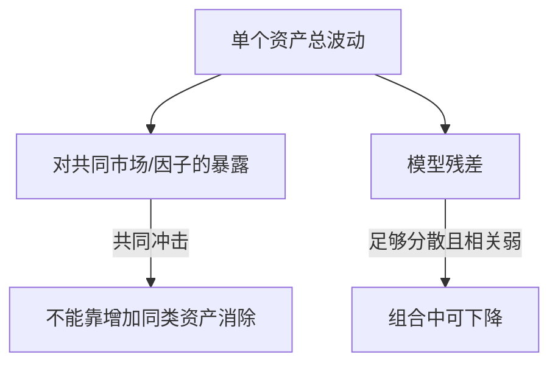

# 组合分散、风险因子与 CAPM 边界

持有很多资产只是在数名字。真正的分散取决于它们在同一状态下怎样一起涨跌；共同冲击越强，数量增加越难消掉风险。

## 1. 回报是随机变量，权重是决策量

设资产回报向量 $R=(R_1,\ldots,R_n)^\top$，组合权重 $w$ 满足 $\sum_iw_i=1$。若允许卖空，某些 $w_i$ 可为负；若不允许，则另加 $w_i\ge0$。

组合回报：

$$R_p=w^\top R,\qquad E[R_p]=w^\top\mu,$$

其中 $\mu=E[R]$。若协方差矩阵为 $\Sigma$，则

$$\operatorname{Var}(R_p)=w^\top\Sigma w.$$

两资产展开为

$$\sigma_p^2=w_A^2\sigma_A^2+w_B^2\sigma_B^2+2w_Aw_B\rho_{AB}\sigma_A\sigma_B.$$

最后一项说明，分散的关键是协方差，不是资产个数。Markowitz 1952 原文先给加权回报的期望与方差，并明确指出证券回报彼此相关，分散无法消除全部方差；同一行业的许多证券也可能高度共同波动。

## 2. 一个可复算的两资产例子

教学构造：$w_A=w_B=0.5$，$\sigma_A=20\%$，$\sigma_B=10\%$，相关系数 $\rho=0.2$。

$$\sigma_p^2=0.25(0.20^2)+0.25(0.10^2)+2(0.5)(0.5)(0.2)(0.20)(0.10)=0.0145,$$

所以 $\sigma_p\approx12.04\%$。若 $\rho=1$，标准差为 15%；若 $\rho=-1$，标准差为 5%。

| $\rho_{AB}$ | 50/50 组合标准差 | 含义 |
| ---: | ---: | --- |
| 1 | 15.00% | 完全同向，只有加权平均，没有协方差收益 |
| 0.2 | 12.04% | 不完全同向，风险下降 |
| -1 | 5.00% | 此权重下部分抵消；特定权重才可能完全对冲 |

相关系数是样本与时期的估计，不是资产的永久属性。危机时波动、相关性、流动性和跳跃可能同时改变。

要把这些总体参数换成样本输入，先回读 [[数学/30-概率与统计/02-期望方差协方差与抽样#协方差|协方差主解释]]，核对共同变化、单位和独立性；推断条件见 [[数学/30-概率与统计/08-中心极限定理与抽样分布#5. 一组教学收益样本：完整区间计算|五个教学收益观察的区间算例]]，它明确假设独立正态抽样。真实收益序列若有时间相关、波动聚类或分布变化，就不能直接按数据行数套iid标准误、CLT或机器学习的iid泛化界；需要另建抽样模型，本页不展开完整时间序列理论。这里的方差风险是回报波动，机器学习中的总体风险是指定损失的期望，二者不因都叫“风险”而成为同一指标。

## 3. “系统性”与“特质性”取决于模型和组合

在单因子写法中：

$$R_i=\alpha_i+\beta_iR_m+\varepsilon_i,$$

$\beta_i=\operatorname{Cov}(R_i,R_m)/\operatorname{Var}(R_m)$ 衡量对所选市场因子的线性敏感度，$\varepsilon_i$ 是该模型未解释部分。把许多残差近似独立的资产放在一起，特质波动可能下降；共同因子风险不会靠重复持有同类暴露消失。

这个分解依赖样本期、市场代理、频率和线性设定。残差不等于“没有风险”，高 $R^2$ 也不等于因果机制已识别。

## 4. CAPM 是带强假设的均衡基准

Sharpe 1964 从均值—方差选择、一个风险资产机会集和无风险借贷出发讨论资本市场均衡。常见 CAPM 表达为

$$E[R_i]=r_f+\beta_i\big(E[R_m]-r_f\big).$$

教学构造：$r_f=2\%$，市场期望回报 8%，$\beta_i=1.2$，则模型要求回报为 $2\%+1.2(8\%-2\%)=9.2\%$。这是**模型条件期望**，不是该资产下一期会赚 9.2%。

常见推导还需要单期或可协调的期间、投资者以均值和方差描述选择、共同信息与预期、无税费和交易摩擦、可按同一无风险利率借贷、资产可交易，以及选定的“市场组合”覆盖相关财富。现实中借贷利率不同、人力资本和非上市资产难纳入、预期不一致、卖空受限。

箭头表示模型分解；它不是“市场因素造成全部回报”的经验因果图。

## 5. 因子扩展与联合检验

多因子模型可写为 $R_i-r_f=\alpha_i+\beta_i^\top F+\varepsilon_i$。因子可能是可交易组合，也可能是宏观或统计因子。观察到某个因子暴露与平均回报相关，至少有三类解释：承担不可分散风险的补偿、行为/制度导致的错价、数据挖掘或样本偶然。

任何“alpha 不为零”的检验都同时检验：定价模型、因子和市场代理、beta 估计、样本与市场效率。Fama 1991 对这种联合假设问题作了明确讨论。因此，拒绝 CAPM 可以说明 CAPM 或其实现不充分，却不能单独证明可持续套利。

## 边界与练习

- 方差把上行和下行偏离都计为风险，无法完整描述偏度、尾部损失、流动性或路径依赖。
- 优化对均值和协方差输入高度敏感；样本内最优权重常把估计误差放大。
- 练习：令 $w_A=0.25,w_B=0.75$，保持例子中的波动与相关，重算组合标准差。
- 练习：一个组合持有 50 只同一行业股票，另一个持有 10 个不同现金流驱动的资产。写出你还需要哪些协方差与尾部信息，不能只凭数量下结论。
- 下一步读 [[社会科学/30-金融市场与风险/05-有效市场信息价格与异常|有效市场与异常]]，理解 alpha 为什么离不开基准；读 [[社会科学/30-金融市场与风险/08-杠杆保证金传染与系统性风险|系统性风险]]，看危机中相关与融资约束怎样共同变化。

## 来源定位

- Markowitz, “Portfolio Selection” (1952), *Journal of Finance*, pp. 77–91；已打开全文，重点为加权组合方差、协方差和“资产数多不等于充分分散”：https://traders.berkeley.edu/papers/Markowitz.pdf
- Sharpe, “Capital Asset Prices” (1964), *Journal of Finance*, DOI 全文页；已打开模型、无风险资产与资本市场均衡部分：https://doi.org/10.1111/j.1540-6261.1964.tb02865.x
- Fama, “Efficient Capital Markets: II” (1991)，已打开联合假设与回报可预测性部分：https://doi.org/10.1111/j.1540-6261.1991.tb04636.x

