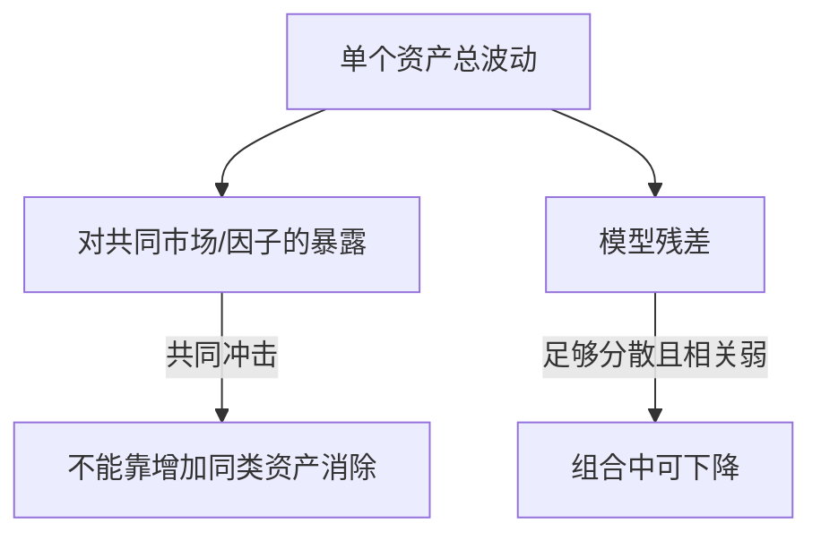

# 组合分散、风险因子与 CAPM 边界

持有很多资产只是在数名字。真正的分散取决于它们在同一状态下怎样一起涨跌；共同冲击越强，数量增加越难消掉风险。

## 1. 回报是随机变量，权重是决策量

设资产回报向量 $R=(R_1,\ldots,R_n)^\top$，组合权重 $w$ 满足 $\sum_iw_i=1$。若允许卖空，某些 $w_i$ 可为负；若不允许，则另加 $w_i\ge0$。

组合回报：

$$R_p=w^\top R,\qquad E[R_p]=w^\top\mu,$$

其中 $\mu=E[R]$。若协方差矩阵为 $\Sigma$，则

$$\operatorname{Var}(R_p)=w^\top\Sigma w.$$

两资产展开为

$$\sigma_p^2=w_A^2\sigma_A^2+w_B^2\sigma_B^2+2w_Aw_B\rho_{AB}\sigma_A\sigma_B.$$

最后一项说明，分散的关键是协方差，不是资产个数。Markowitz 1952 原文先给加权回报的期望与方差，并明确指出证券回报彼此相关，分散无法消除全部方差；同一行业的许多证券也可能高度共同波动。

## 2. 一个可复算的两资产例子

教学构造：$w_A=w_B=0.5$，$\sigma_A=20\%$，$\sigma_B=10\%$，相关系数 $\rho=0.2$。

$$\sigma_p^2=0.25(0.20^2)+0.25(0.10^2)+2(0.5)(0.5)(0.2)(0.20)(0.10)=0.0145,$$

所以 $\sigma_p\approx12.04\%$。若 $\rho=1$，标准差为 15%；若 $\rho=-1$，标准差为 5%。

| $\rho_{AB}$ | 50/50 组合标准差 | 含义 |
| ---: | ---: | --- |
| 1 | 15.00% | 完全同向，只有加权平均，没有协方差收益 |
| 0.2 | 12.04% | 不完全同向，风险下降 |
| -1 | 5.00% | 此权重下部分抵消；特定权重才可能完全对冲 |

相关系数是样本与时期的估计，不是资产的永久属性。危机时波动、相关性、流动性和跳跃可能同时改变。

要把这些总体参数换成样本输入，先回读 [[数学/30-概率与统计/02-期望方差协方差与抽样#协方差|协方差主解释]]，核对共同变化、单位和独立性；推断条件见 [[数学/30-概率与统计/08-中心极限定理与抽样分布#5. 一组教学收益样本：完整区间计算|五个教学收益观察的区间算例]]，它明确假设独立正态抽样。真实收益序列若有时间相关、波动聚类或分布变化，就不能直接按数据行数套iid标准误、CLT或机器学习的iid泛化界；需要另建抽样模型，本页不展开完整时间序列理论。这里的方差风险是回报波动，机器学习中的总体风险是指定损失的期望，二者不因都叫“风险”而成为同一指标。

## 3. “系统性”与“特质性”取决于模型和组合

在单因子写法中：

$$R_i=\alpha_i+\beta_iR_m+\varepsilon_i,$$

$\beta_i=\operatorname{Cov}(R_i,R_m)/\operatorname{Var}(R_m)$ 衡量对所选市场因子的线性敏感度，$\varepsilon_i$ 是该模型未解释部分。把许多残差近似独立的资产放在一起，特质波动可能下降；共同因子风险不会靠重复持有同类暴露消失。

把它用作带截距的总体线性投影时，须有有限二阶矩且 $\operatorname{Var}(R_m)>0$；此时取 $\alpha_i=E[R_i]-\beta_iE[R_m]$，残差满足 $E[\varepsilon_i]=0$、$\operatorname{Cov}(\varepsilon_i,R_m)=0$。这是对共同变化的统计描述，尚未规定资产的期望回报应是多少；尤其不能仅凭这个分解断言 $\alpha_i=(1-\beta_i)r_f$。这里的原回报截距也不是超额回报回归中用来检验定价模型的 alpha。

这个分解依赖样本期、市场代理、频率和线性设定。残差不等于“没有风险”，高 $R^2$ 也不等于因果机制已识别。

## 4. CAPM 是带强假设的均衡基准

分散解释了风险怎样随组合改变，但还没解释：为什么有人愿意以当前价格接下剩余风险，资产的期望回报如何与它相配？新增一项持仓时，投资者关心的是它给**整个组合**增加多少风险和收益，而不只是这项资产独自有多波动。

先沿用前面的50/50组合 $p$。$\operatorname{Cov}(R_A,R_B)=0.2(0.20)(0.10)=0.004$，所以

$$\operatorname{Cov}(R_A,R_p)=0.5(0.04)+0.5(0.004)=0.022,\qquad
\operatorname{Cov}(R_B,R_p)=0.5(0.004)+0.5(0.01)=0.007.$$

若用无风险资金小幅增持A，组合方差的一阶变化为 $2(0.022)\delta$；增持B则为 $2(0.007)\delta$，$\delta$ 是相对期初总财富增加的持仓比例。两项协方差把“和已有组合一起波动”变成可比较的边际风险。这个教学组合尚未被证明是市场组合，也没有给出A、B的均值，因而不能只凭这两数推定均衡收益。

Sharpe 1964 从均值—方差选择、风险资产机会集和无风险借贷出发讨论资本市场均衡。下面采用同一单期、投资者偏好更高均值与更低方差、共同预期均值和协方差、无税费和交易摩擦、价格接受、资产可交易且可分割、可按同一无风险利率借贷、卖空不受限的标准版本。还须有市场出清：所有资产的期末支付给定时，价格须使投资者想持有的数量与供给相合；不能让不受欢迎的风险资产在总账中凭空消失。

在切点风险组合唯一的非退化情形，共同机会集和共同信念使投资者选择同一风险资产配比，风险厌恶程度主要改变它与无风险资产的搭配比例。把各人的风险持仓加总，市场出清要求这个配比等于按市场价值加权的风险资产供给组合，才得到这里的 $R_m$。如果某资产在给定风险贡献下提供过高期望收益，投资者会增加需求；在未来支付预期不变时，价格上涨会降低它按现价计算的期望收益。**风险—收益权衡加市场出清**是新增的经济解释，前节回归没有这些内容。[Sharpe 1964，第III–IV节](https://doi.org/10.1111/j.1540-6261.1964.tb02865.x)讨论这一步；切点与市场组合的接续也见[MIT 15.433讲义第4–5页](https://ocw.mit.edu/courses/15-433-investments-spring-2003/df52f7f91f5a13fbfa988a0becb6334a_154336capm1.pdf#page=4)。

把该有效组合上的边际权衡写出来，就能看出为何进入公式的是协方差。用 $E[R]-\frac{\gamma}{2}\operatorname{Var}(R)$、$\gamma>0$ 表示一个均值—方差投资者的选择，并取使市场组合成为其最优持仓的风险厌恶系数。让资产 $i$ 的财富比例增加 $\delta$，同时把无风险头寸减少 $\delta$，其余风险持仓不动；负的无风险头寸表示借款。新回报为 $R_m+\delta(R_i-r_f)$，于是

$$
\begin{aligned}
\Delta E[R]&=\delta\big(E[R_i]-r_f\big),\\
\Delta\operatorname{Var}(R)&=2\delta\operatorname{Cov}(R_i,R_m)+\delta^2\operatorname{Var}(R_i).
\end{aligned}
$$

在可向两侧微调的最优点，一阶收益与一阶方差代价相等，故 $E[R_i]-r_f=\gamma\operatorname{Cov}(R_i,R_m)$。对市场组合自身作同样比较，得 $E[R_m]-r_f=\gamma\operatorname{Var}(R_m)$。在 $\operatorname{Var}(R_m)>0$ 时消去 $\gamma$，便得到

$$E[R_i]=r_f+\beta_i\big(E[R_m]-r_f\big).$$

这是在上述最优选择与均衡条件下的 CAPM 关系：与市场不相关的残差风险仍在单个持仓的总方差中，但在这次小幅增持中只进入二阶项，不能仅凭它要求更高的一阶均衡补偿。该边际推导见[MIT讲义第7–8页](https://ocw.mit.edu/courses/15-433-investments-spring-2003/df52f7f91f5a13fbfa988a0becb6334a_154336capm1.pdf#page=7)；这里给出的是标准单期均值—方差模型的局部推导，没有从样本回归证明真实市场必满足它。

教学构造：$r_f=2\%$，市场期望回报 8%，$\beta_i=1.2$，则模型要求回报为 $2\%+1.2(8\%-2\%)=9.2\%$。这是**模型条件期望**，不是该资产下一期会赚 9.2%。作一个条件对照：只把资产的残差方差增大，并仍给定同一 $\beta_i$、市场期望回报和无风险率，CAPM公式给出的期望回报仍是9.2%，单个资产的总波动却会变大。真实市场重新出清时，这些输入也可能改变；分散能力、信念或交易约束改变后，不能用这项对照保证现实收益不变。

原回报回归的截距在这个模型下为 $(1-\beta_i)r_f$；把回报都减去同一期无风险率再回归，模型才要求其总体截距为0。有限样本中的估计值与不确定性还要另查，不能混用两种alpha。

选定的“市场组合”还须覆盖模型中的相关财富。现实中借贷利率不同、人力资本和非上市资产难纳入、预期不一致、卖空受限；约束阻止双向微调时，上面的驻点等式可能要改为不等式。这一页完成分散到单期均衡补偿的桥；若转向逐状态复制，已建入口是 [[社会科学/30-金融市场与风险/06-远期衍生品无套利与期权#路径 A：复制组合|一期复制]]，它使用每个状态的支付相等来定价，不能把本页期望收益关系当作复制条件。多期自融资与连续复制仍需相应金融理论，不能由这座单期桥直接推出。

箭头表示模型分解；它不是“市场因素造成全部回报”的经验因果图。

## 5. 因子扩展与联合检验

多因子模型可写为 $R_i-r_f=\alpha_i+\beta_i^\top F+\varepsilon_i$。因子可能是可交易组合，也可能是宏观或统计因子。观察到某个因子暴露与平均回报相关，至少有三类解释：承担不可分散风险的补偿、行为/制度导致的错价、数据挖掘或样本偶然。

任何“alpha 不为零”的检验都同时检验：定价模型、因子和市场代理、beta 估计、样本与市场效率。Fama 1991 对这种联合假设问题作了明确讨论。因此，拒绝 CAPM 可以说明 CAPM 或其实现不充分，却不能单独证明可持续套利。

## 边界与练习

- 方差把上行和下行偏离都计为风险，无法完整描述偏度、尾部损失、流动性或路径依赖。
- 优化对均值和协方差输入高度敏感；样本内最优权重常把估计误差放大。
- 练习：令 $w_A=0.25,w_B=0.75$，保持例子中的波动与相关，重算组合标准差。
- 练习：一个组合持有 50 只同一行业股票，另一个持有 10 个不同现金流驱动的资产。写出你还需要哪些协方差与尾部信息，不能只凭数量下结论。
- 下一步读 [[社会科学/30-金融市场与风险/05-有效市场信息价格与异常|有效市场与异常]]，理解 alpha 为什么离不开基准；读 [[社会科学/30-金融市场与风险/08-杠杆保证金传染与系统性风险|系统性风险]]，看危机中相关与融资约束怎样共同变化。

## 来源定位

- Markowitz, “Portfolio Selection” (1952), *Journal of Finance*, pp. 77–91；已打开全文，重点为加权组合方差、协方差和“资产数多不等于充分分散”：https://traders.berkeley.edu/papers/Markowitz.pdf
- Sharpe, “Capital Asset Prices” (1964), *Journal of Finance*, DOI 全文页；第III节的共同无风险利率、同质预期与价格调整，第IV节的有效组合切线及收益—系统风险关系；本页据此区分统计分解与均衡条件：https://doi.org/10.1111/j.1540-6261.1964.tb02865.x
- MIT OpenCourseWare, Reto Gallati, *15.433 Investments*, Spring 2003, Classes 6 “The CAPM and APT, Part 1: Theory”，PDF第4–8页：标准市场假设、切点组合的市场出清及边际持仓推导。新增50/50组合协方差为本页原参数的复算，不是现实风险溢价估计：https://ocw.mit.edu/courses/15-433-investments-spring-2003/df52f7f91f5a13fbfa988a0becb6334a_154336capm1.pdf
- Fama, “Efficient Capital Markets: II” (1991)，已打开联合假设与回报可预测性部分：https://doi.org/10.1111/j.1540-6261.1991.tb04636.x

