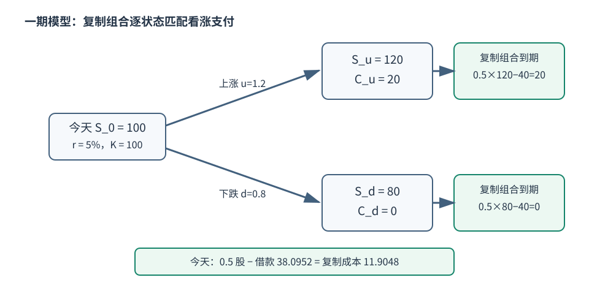

# 远期、衍生品、无套利与期权

衍生品把某个未来状态下的现金流拆出来交易。它可以转移价格风险，也能用较少初始资金取得较大状态暴露；“对冲”和“投机”取决于它与原有风险怎样组合，不取决于合约名字。

## 1. 无套利先比较同状态现金流

无套利的核心判断是：若两个组合在每个相关状态、每个时点都支付相同现金流，那么在可交易、可融资且没有阻碍复制的模型里，它们今天应同价；否则可买便宜、卖昂贵并锁定差额。

这比“长期平均回报相同”强得多。现实中的买卖价差、融资/借券限制、违约、税、保证金、交易时点和合约细节会形成套利区间或阻止交易。

## 2. 无收益资产的远期复制

设现货价 $S_0$，到期 $T$，每期有效无风险融资率 $r$，标的在期间无现金收益且可持有、可卖空，忽略储存成本。今天借入 $S_0$ 买入标的，到期持有一单位标的并欠 $S_0(1+r)^T$。这复制了多头远期“到期付 $K$ 换一单位标的”，因此公平交割价为

$$K=F_{0,T}=S_0(1+r)^T.$$

若标的支付可预测收入、需要储存或提供便利收益，必须把这些现金流加入复制；外汇远期还同时涉及两种货币利率。模型公式不能忽略合约交割、日计数和信用支持条款。

## 3. 一期二叉树：逐状态复制欧式看涨

教学模型条件：今天 $S_0=100$；一年后只有上涨 $S_u=120$ 或下跌 $S_d=80$；欧式看涨执行价 $K=100$；标的不分红；无风险年有效率 5%；可按同一利率借贷并交易任意份额；无税费、无违约。

到期看涨支付 $C_T=\max(S_T-K,0)$，所以 $C_u=20,C_d=0$。

### 路径 A：复制组合

持有 $\Delta$ 单位股票，加一笔今天价值为 $B$ 的无风险头寸。要求两状态都匹配：

$$\Delta(120)+1.05B=20,$$
$$\Delta(80)+1.05B=0.$$

两式相减得到 $40\Delta=20$，所以 $\Delta=0.5$；代回下态式得 $B=-80(0.5)/1.05=-38.0952$。今天复制成本为

$$C_0=\Delta S_0+B=0.5(100)-38.0952=11.9048.$$

逐状态核验：上涨时 $0.5(120)-38.0952(1.05)=20$；下跌时 $0.5(80)-38.0952(1.05)=0$。

### 路径 B：风险中性权重

令 $u=1.2,d=0.8$。满足股票贴现价格关系的权重

$$q=\frac{(1+r)-d}{u-d}=\frac{1.05-0.8}{1.2-0.8}=0.625.$$

则

$$C_0=\frac{qC_u+(1-q)C_d}{1.05}=\frac{0.625(20)}{1.05}=11.9048.$$

两条路径相同。$q=0.625$ 是为无套利定价构造的**风险中性权重**，不是上涨的物理概率预测；实际上涨概率没有参与这个完全市场的一期复制。若 $d<1+r<u$ 不成立，$q$ 可能不在 $[0,1]$，模型中的股票与无风险资产自身就暴露套利或设定矛盾。

保留这组复制价格，去 [[社会科学/30-金融市场与风险/40-金融理论/01-有限状态支付空间与定价#从原二态返回，先把P与定价权重分开|状态价与P-Q-m表示]] 改真实上涨概率，再进入该课明确另设的三态市场：新支付未被原资产张成时，无套利可只给一组扩展报价；不能继续把二态的价格唯一性当作所有市场的保证。

## 4. 看涨—看跌平价

对同一无分红标的、相同执行价和到期日的**欧式**期权：

$$C_0-P_0=S_0-\frac{K}{(1+r)^T}.$$

理由是“看涨 + 到期支付 $K$ 的无风险债券”和“看跌 + 股票”在到期的每个 $S_T$ 状态都支付 $\max(S_T,K)$。在二叉树例子中，右侧为 $100-100/1.05=4.7619$；既然 $C_0=11.9048$，则 $P_0=7.1429$。

美式期权可以提前行权，有股息时股票现金流改变，因此上面的等式不能原样套用。Options Industry Council 的平价说明也明确把公式放在无分红证券下，并列出借款、借券和交易成本假设。

提前行权具体怎样改变定价，进入 [[社会科学/30-金融市场与风险/40-金融理论/02-有限树自融资复制与美式停止#美式：先定合法停止，再比较续持与行权|有限树的美式停止]]：同一两期put先算欧式，再比较当日行权与续持，并检查卖方怎样用现有财富应付所有合法行权；这一步仍是离散无摩擦模型，不把一期q或连续公式直接当答案。

## 5. 连续模型与局部敏感度的边界

Black 与 Scholes 1973 通过动态复制建立连续时间期权定价。常见欧式无分红公式还假定价格过程、波动率、连续交易、融资和市场摩擦等条件。Delta、Gamma、Vega、Theta 是模型价格对输入的局部敏感度，不是长期损益保证；跳跃、波动率曲面、离散对冲和流动性会产生对冲误差。

| 说法 | 更准确的版本 |
| --- | --- |
| “期权最大亏损就是权利金” | 对无其他头寸的多头到期损失有界；卖方、组合、保证金和提前平仓不同 |
| “模型价是正确成交价” | 模型给定假设下的复制或风险中性价值；市场有价差、参数与模型风险 |
| “Delta 0.5 就是 50% 上涨概率” | Delta 是局部价格敏感度；只在特定模型下与某些概率表达有联系 |
| “对冲消除了风险” | 对冲针对指定状态与变动；基差、跳跃、流动性和再平衡风险仍在 |

连续轨迹的数学入口是 [[数学/30-概率与统计/20-随机过程/04-Brownian二次变差与Ito公式|二次变差与Itô公式]]：Brownian平方增量累积留下时间项，所以动态价格函数不能只套普通链式法则。读完应能指出哪一项来自二次变差，并用OU例区分同一路径的离散误差与分布矩误差。回到定价时，还必须说明概率律、可交易标的、自融资、复制与市场条件；本页的一期风险中性权重不能直接认证连续时间换测度，也不能把真实回报律与定价测度默认视为同一对象。

## 练习与链接

1. 把二叉树执行价改为 90，分别用复制与 $q$ 复算看涨价值。
2. 若标的在到期前确定支付 3 的现金收益，说明远期复制中的哪笔现金流必须改变。
3. 写出平价两边到期时在 $S_T<K$ 与 $S_T\ge K$ 的现金流，逐状态检查。
4. 下一步读 [[社会科学/30-金融市场与风险/08-杠杆保证金传染与系统性风险|杠杆与保证金]]，理解正确的模型定价为什么仍可能在融资约束下导致强平和反馈。

## 来源定位

- Black & Scholes, “The Pricing of Options and Corporate Liabilities” (1973)，已打开 Princeton 托管全文；用于动态复制、连续模型与假设边界：https://www.cs.princeton.edu/courses/archive/fall2000/cs323/resources/blackscholes.pdf
- Options Industry Council, “Put/Call Parity”，已打开公式与借款、借券、交易成本说明；用于合约条件核对：https://prd-web.optionseducation.org/advancedconcepts/put-call-parity
- 本页二叉树为原创教学构造；复制组合与风险中性权重两路独立计算已一致到四位小数。

