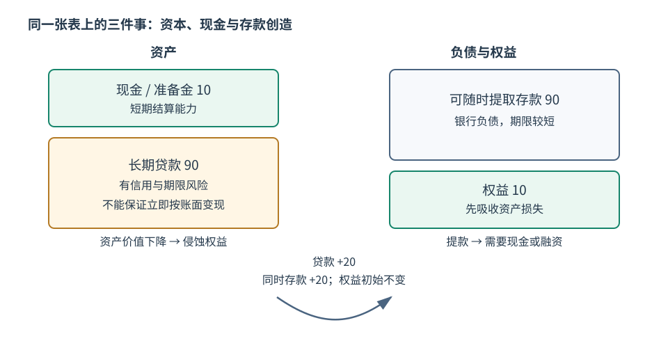

# 银行期限转换、流动性与挤兑

银行把许多可随时提取或短期到期的负债，与较长期、难立即出售的贷款和证券放在同一张资产负债表上。这种期限与流动性转换让存款人获得支付便利、借款人获得长期融资，也让“大家同时要现金”成为结构性脆弱点。

## 1. 三个维度必须分开

设资产 $A$、负债 $L$、权益 $E=A-L$。共享页 [[社会科学/10-共同工具/02-指标分布与存量流量核算|指标、分布与存量流量核算]] 完整解释存量、流量和净值；本页只用它读银行账本。

- **偿付能力**：按适当估值，资产能否覆盖负债，核心是 $E$ 是否有足够损失吸收能力。
- **流动性**：到期付款时能否取得现金或可立即变现资产，即使长期资产总价值足够也可能短缺。
- **存款创造**：银行发放贷款时同时记录贷款资产与客户存款负债，是记账和信用决策机制；不等于银行已经获得更多资本或更多央行现金。

## 2. 一张小额合成资产负债表

| 资产 | 金额 | 负债与权益 | 金额 |
| --- | ---: | --- | ---: |
| 现金/准备金 | 10 | 可随时提取存款 | 90 |
| 长期贷款 | 90 | 权益 | 10 |
| 合计 | 100 | 合计 | 100 |

### 流动性短缺但可能仍有偿付能力

若存款人今天要求提取 20，而银行只有 10 现金，按账面长期贷款仍值 90，则资产仍可能覆盖负债，但现金时点不匹配。银行需要出售/抵押资产、借款或延迟付款。若急售折价大，流动性问题会侵蚀权益并转成偿付能力问题。

### 资产损失造成资不抵债

若贷款预期损失使其价值从 90 降到 78，资产合计 88，负债仍 90，则权益变为 -2。即使央行借给银行 20 现金，同时增加 20 债务，也只改变流动性结构，不会自动填补 2 的净值缺口。

## 3. 发放贷款怎样同时创造存款

银行批准一笔 20 的贷款并把款项记入借款人账户时，初始分录是：

| 银行资产变化 | 银行负债变化 | 权益立即变化 |
| ---: | ---: | ---: |
| 贷款 +20 | 存款 +20 | 0 |

这不是从另一个储户账户搬来 20，也不是“凭空没有约束”：资本要求、信用风险、融资成本、流动性、准备金结算、监管和借款需求都会约束扩张。当借款人付款给另一家银行客户时，银行间需要转移结算资产；存款可能流出本行。存款创造、准备金结算和银行利润是不同步骤。

## 4. 为什么同一银行可能有正常均衡与挤兑均衡

Diamond–Dybvig 1983 模型中，储户未来何时需要消费是私人信息；银行把长期投资与可提前支取存款结合，能改善风险分担，但即期兑付承诺也可能支持多个均衡。若每个人相信别人会提前提取，自己晚到可能拿不到，于是提前提取成为理性反应，预期自我实现并迫使长期资产过早清算。

这张图是协调机制，不表示现实中所有挤兑都与资产质量无关。坏资产信息、利率损失、支付系统中断和社交传播都可能触发提款；模型中的“太阳黑子”挤兑只是一个清晰反例。

## 5. 存保、最后贷款人和流动性标准解决不同问题

- 存款保险可以削弱储户抢先提款动机，但保障范围、可信财政后盾与处置制度很关键；也可能减少储户监督并产生道德风险。
- 最后贷款人用合格抵押品提供流动性，可缓解被迫急售；对资不抵债机构持续放贷可能把信用损失转移出去。
- 资本要求吸收损失，主要针对偿付能力；它不能保证每个时点都有现金。
- BCBS 2013 的流动性覆盖率（LCR）要求正常时期拥有足够未设押高质量流动资产覆盖 30 个日历日压力情景净现金流出：

$$LCR=\frac{\text{高质量流动资产}}{\text{未来 30 日压力净现金流出}}\ge100\%.$$

教学构造：HQLA 为 30，压力流出 45、流入按规则可计 20，则净流出 25，LCR=120%。这个比率不证明资本充足，也不说明压力超过 30 天后安全。BCBS 文本还明确说明压力期可以动用缓冲并暂时低于正常期最低要求。

## 6. 中国与美国存款保险：同一机制，不同合同

中国国务院令第 660 号《存款保险条例》于 2015 年公布并自 2015 年 5 月 1 日起施行，条文明确投保机构范围、被保险存款、基金与偿付制度。美国 FDIC 的 2024 年官方说明按“每名存款人、每家受保银行、每种账户所有权类别”说明标准保险上限。它们都能削弱受保储户的抢先动机，但覆盖对象、账户归集、限额、处置权和财政/基金安排必须回到各自有效文本。

这个比较不用于判断哪个制度“更安全”，也不把名义限额直接比较成保障强弱：币种、收入与存款分布、银行结构、处置速度和法律可执行性都不同。制度年份和页面更新时间是结论的一部分；现实使用前需重新核验有效状态。

## 7. 边界、练习与下一步

- 影子银行、货币基金、稳定币和证券融资也可能发生类似赎回/挤兑，但负债承诺、抵押品、存保与处置法律不同。
- “贷款创造存款”是合并或单行资产负债表命题；现金最终流向哪家银行与准备金怎样结算需要继续追踪。
- 练习：把表中贷款价值降 5，再发生 15 提款。分别列出权益和现金缺口，说明先后次序为何重要。
- 练习：提出一个“资本充足但流动性不足”和一个“现金很多但资不抵债”的数值反例。
- 继续 [[社会科学/30-金融市场与风险/08-杠杆保证金传染与系统性风险|杠杆、保证金与系统风险]]，看急售怎样把单家现金压力传给共同持有资产和其他机构。

## 来源定位

- Diamond & Dybvig, “Bank Runs, Deposit Insurance, and Liquidity” (1983)，University of Chicago 开放原文记录及全文；用于期限转换收益、多重均衡与存保条件：https://doi.org/10.6082/3sa4m-hvw53
- Basel Committee, *Basel III: The Liquidity Coverage Ratio and liquidity risk monitoring tools* (2013)，已打开官方标准页第 546–553 行对应的 30 日压力、HQLA、100% 正常期要求与压力期使用缓冲边界：https://www.bis.org/publications/201301-standards-basel-iii-liquidity-coverage-ratio-and-liquidity-risk-monitoring-tools
- 中国国务院令第 660 号《存款保险条例》（2015）；已打开司法部官方文本入口，用于投保机构、保险基金与生效日期，不延伸为当前覆盖咨询：https://www.moj.gov.cn/pub/sfbgw/flfggz/flfggzfgjd/201504/t20150401_151758.html
- U.S. FDIC, “Understanding Deposit Insurance”（页面标注 2024-04-01 更新）；已打开官方说明，用于美国账户所有权类别与标准限额的比较边界：https://www.fdic.gov/resources/deposit-insurance/understanding-deposit-insurance
