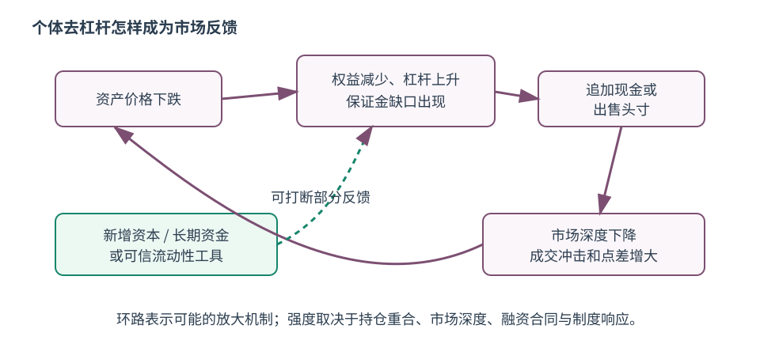
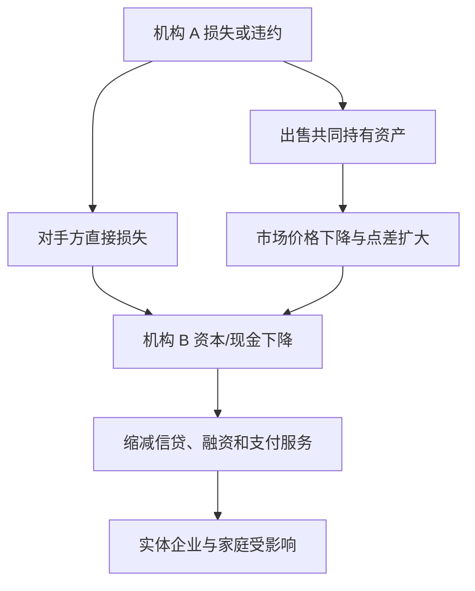

# 杠杆、保证金、传染与系统性风险

杠杆让同一笔权益支撑更多资产，因此收益和损失都相对权益放大。价格下跌后，单家机构为恢复自身安全而卖出资产；若许多机构持有相同资产、使用相同风控阈值或彼此融资，卖出会压低价格，反过来迫使更多机构卖出。个体理性的动作由此形成系统外部性。

## 1. 杠杆如何放大权益损失

定义资产 $A$、债务 $D$、权益 $E=A-D$，资产对权益杠杆

$$\lambda=\frac{A}{E}.$$

教学机构持有 100 资产，以 90 债务和 10 权益融资，$\lambda=10$。若资产价格跌 5%、债务账面不变，$A=95,E=5$，杠杆升到 19；资产只跌 5%，权益跌 50%。

若机构必须把杠杆恢复到 10，在权益仍为 5 且无新增资本时，目标资产仅为 50，因此要出售 45 并偿债。若急售使价格继续下降，权益和目标资产还会再变。Adrian 与 Shin 2010 的研究把按市值计价中介的顺周期杠杆与资产负债表调整连接起来；这是一套理论与经验机制，不意味着所有机构始终维持固定杠杆。

## 2. 保证金把价格变化转成现金时点压力

一笔价值 100 的头寸由 20 自有资金和 80 借款支持，权益保证金率为 20%。价格跌到 90、债务仍 80，权益为 10，保证金率降到 11.11%。若维持保证金要求是 15%，所需权益为 13.5，投资者需追加 3.5 或减少头寸。

追加保证金是流动性要求：即使投资者相信长期价格会恢复，也必须在规定时间交付合格现金/抵押品。衍生品每日盯市、回购 haircut 和中央清算规则的具体算法各异；本例只展示共同机制。

## 3. 两条传染路线

直接路线经过合同敞口；间接路线经过共同持仓、价格、保证金和市场流动性。网络连接既能分散单一冲击，也能传播损失；方向取决于净额结算、抵押品、资本、替代机构和市场深度。

## 4. 市场流动性与融资流动性相互强化

市场流动性指能否以较小价格冲击迅速交易；融资流动性指交易者能否取得资金。融资收紧会迫使卖出，交易冲击加大；资产更难变现又让贷款人提高 haircut 或保证金，进一步收紧融资。这就是流动性螺旋的核心。

触发器可能是信用损失、政策变化、操作故障或谣言；保证金、共同持仓和短期融资是放大器；停市、流动性工具、资本补充和处置制度是响应。把触发器和放大器混在一起，会误判“最初损失不大，为什么后果很大”。

## 5. VaR 看阈值，ES 看阈值外平均

以损失随机变量 $L$ 表示，置信水平 $\alpha$ 的 VaR 是损失分布的 $\alpha$ 分位数；Expected Shortfall（ES）关注越过该阈值时的平均尾部损失（连续分布下直观如此，离散分布需更精确定义）。

教学构造的 100 个等概率情景中，两种头寸前 95 个排序损失完全相同，第 95 个为 5，所以 $VaR_{95}=5$：

| 尾部情景（最后 5 个） | $VaR_{95}$ | 最坏 5 个平均损失 |
| --- | ---: | ---: |
| A：6, 6, 6, 6, 6 | 5 | 6 |
| B：6, 6, 6, 6, 100 | 5 | 24.8 |

同一个 VaR 隐藏了完全不同的尾部。BCBS 市场风险框架采用压力期 ES，并对不可建模风险因子另设资本要求，正是因为单一 VaR 与稳定流动性假设不能充分抓住尾部；监管资本公式仍不等于一家机构全部风险的自然测量。

## 6. 系统性风险不是个体风险之和

FSB 2009 指南强调，系统重要性评估需要判断，会随时间、状态和评估目的变化。一个规模不大的机构也可能因不可替代服务或高度互联而重要；一家风险很高但容易替代、隔离处置的机构未必造成系统中断。

本课程的最小风险区分在此汇总：

| 风险 | 直接问题 | 系统层怎样变化 |
| --- | --- | --- |
| 市场风险 | 价格/波动变化造成多少损失 | 共同持仓与急售让价格内生变化 |
| 信用风险 | 对手方会不会不履约、回收多少 | 合同网络和信心把损失传播 |
| 流动性风险 | 到期时能否付款或交易 | 同时取款/卖出使市场深度消失 |
| 操作风险 | 人、流程、系统或外部事件是否中断 | 关键基础设施不可替代时外溢 |
| 系统性风险 | 金融服务中断是否严重伤及实体经济 | 由互联、共同暴露、顺周期与替代性共同形成 |

## 边界、练习与完成检查

- 相关性在压力期可能变化；用平静期协方差矩阵不能证明危机分散有效。
- 中央清算可净额化并提高透明度，也会集中关键节点与保证金需求；效果取决于规则和资源。
- 练习：对资产 200、债务 180 的机构，计算 2%、5%、8% 资产跌幅后的权益和杠杆；找出何时权益为负。
- 练习：在保证金例中，若不追加现金而通过卖出恢复 15% 权益率，设卖出所得全部偿债，解需要卖出的头寸价值。
- 练习：为一次金融事件分别列“触发器、直接传染、间接急售、制度响应”，并标出哪些是事实、哪些只是机制假设。
- 回到 [[社会科学/30-金融市场与风险/00-金融市场与风险-MOC|金融市场与风险 MOC]]，用三个停点检查自己能否从现金流一路追到系统反馈。

## 来源定位

- Adrian & Shin, “Liquidity and Leverage”, Federal Reserve Bank of New York Staff Report 328（2008，2010 修订）；已打开摘要和 PDF 入口，用于按市值计价、顺周期杠杆与资产负债表调整机制：https://www.newyorkfed.org/research/staff_reports/sr328.html
- Basel Committee, *Minimum capital requirements for market risk* (2019)；已打开官方页，核对 ES、不可建模风险因子及标准法边界：https://www.bis.org/publications/201901-standards-minimum-capital-requirements-market-risk
- IMF/BIS/FSB, *Guidance to Assess the Systemic Importance of Financial Institutions, Markets and Instruments* (2009)；已打开判断、时变/状态依赖与政策用途边界：https://www.fsb.org/2009/11/r_091107c/

