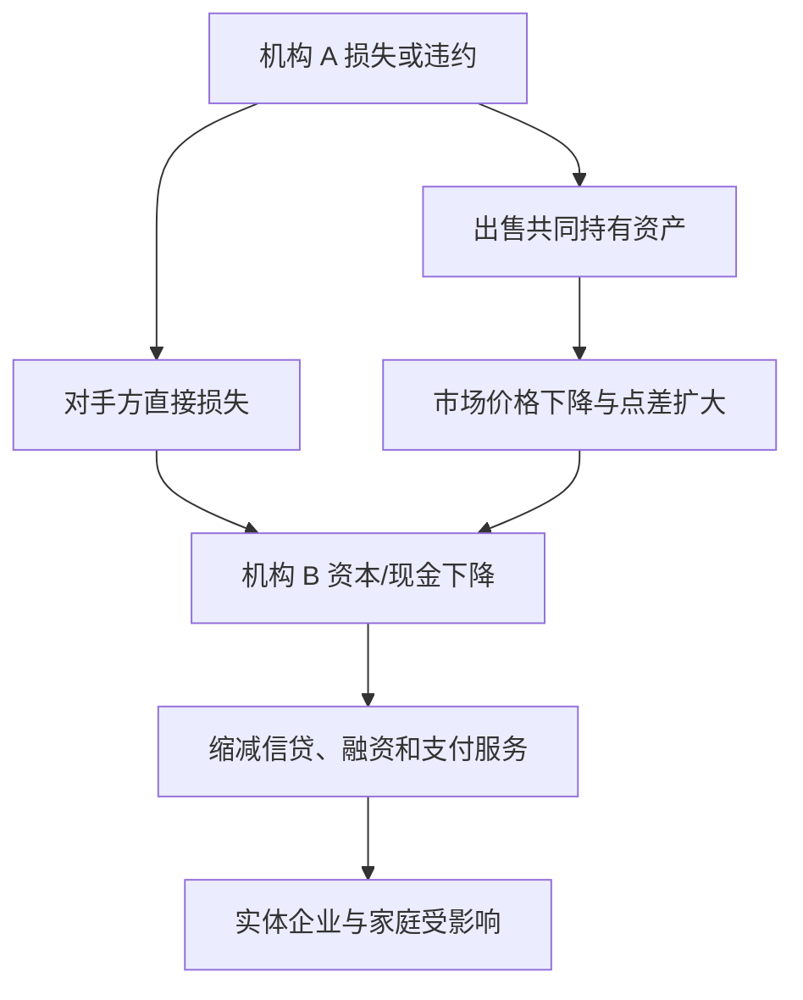

# 杠杆、保证金、传染与系统性风险

杠杆让同一笔权益支撑更多资产，因此收益和损失都相对权益放大。价格下跌后，单家机构为恢复自身安全而卖出资产；若许多机构持有相同资产、使用相同风控阈值或彼此融资，卖出会压低价格，反过来迫使更多机构卖出。个体理性的动作由此形成系统外部性。

## 1. 杠杆如何放大权益损失

定义资产 $A$、债务 $D$、权益 $E=A-D$，资产对权益杠杆

$$\lambda=\frac{A}{E}.$$

教学机构持有 100 资产，以 90 债务和 10 权益融资，$\lambda=10$。若资产价格跌 5%、债务账面不变，$A=95,E=5$，杠杆升到 19；资产只跌 5%，权益跌 50%。

若机构必须把杠杆恢复到 10，在权益仍为 5 且无新增资本时，目标资产仅为 50，因此要出售 45 并偿债。若急售使价格继续下降，权益和目标资产还会再变。Adrian 与 Shin 2010 的研究把按市值计价中介的顺周期杠杆与资产负债表调整连接起来；这是一套理论与经验机制，不意味着所有机构始终维持固定杠杆。

## 2. 保证金把价格变化转成现金时点压力

一笔价值 100 的头寸由 20 自有资金和 80 借款支持，权益保证金率为 20%。价格跌到 90、债务仍为 80 时，权益为 10，保证金率降到 $10/90=11.11\%$。

先固定本教学例的账户约定：追加现金 $x$ 后立即用它偿还贷款，保证金率的分母仍是市值为 90 的证券头寸。此时债务变为 $80-x$，权益变为 $10+x$，所以

$$
\frac{10+x}{90}=0.15,
$$

得到 $x=3.5$。这个数依赖上述现金处理方式，并不是脱离账户规则的唯一答案。

若现金不偿债而留在账户，并作为账户资产计入分母，资产和权益分别变为 $90+x$ 与 $10+x$，于是

$$
\frac{10+x}{90+x}=0.15,
\qquad
x=\frac{70}{17}\approx 4.117647.
$$

若不注资，而在无交易成本、价格不变的简化模型中卖出价值 $x$ 的证券并将所得全部偿债，资产与债务都减少 $x$、权益仍为 10：

$$
\frac{10}{90-x}=0.15,
\qquad
x=\frac{70}{3}\approx 23.333333.
$$

三个结果分别回答“现金偿债”“现金留在账户”和“卖出偿债”，对应不同的契约或模型。

追加保证金是流动性要求：即使投资者相信长期价格会恢复，也必须在规定时间交付合格现金/抵押品。衍生品每日盯市、回购 haircut 和中央清算规则的具体算法各异；本例只展示共同机制。

## 3. 两条传染路线

直接路线经过合同敞口；间接路线经过共同持仓、价格、保证金和市场流动性。网络连接既能分散单一冲击，也能传播损失；方向取决于净额结算、抵押品、资本、替代机构和市场深度。

## 4. 市场流动性与融资流动性相互强化

市场流动性指能否以较小价格冲击迅速交易；融资流动性指交易者能否取得资金。融资收紧会迫使卖出，交易冲击加大；资产更难变现又让贷款人提高 haircut 或保证金，进一步收紧融资。这就是流动性螺旋的核心。

触发器可能是信用损失、政策变化、操作故障或谣言；保证金、共同持仓和短期融资是放大器；停市、流动性工具、资本补充和处置制度是响应。把触发器和放大器混在一起，会误判“最初损失不大，为什么后果很大”。

## 4.1 局部调整、联合放大与累计损失

每家机构单独恢复杠杆都能完成，为什么联动后仍可能越调损失越大？先保持第1节的交易约定：初始 $A=\lambda E$；发生市值损失 $\delta$ 时债务不变，随后卖出价值s并将所得全部偿债，无交易费且暂不计这次卖出的新增冲击。恢复原杠杆要求

$$
A-\delta-s=\lambda(E-\delta),\qquad s=(\lambda-1)\delta.
$$

因此销售响应系数 $\kappa=\lambda-1$；$\lambda=10$ 时 $\kappa=9$，$\delta=5$ 对应原例的卖出45。该线性响应只在权益为正、可出售资产足够且仍执行同一目标杠杆规则的范围有效。

再明确增加一项**局部、一阶、合成**的行为模型：两家机构共同持有同一种资产，每家出售一单位货币价值，使每家机构的固定基准敞口产生 $\eta$ 单位新增市值损失。$\eta$ 的单位是“损失货币／出售货币”，在同一币种尺度下数值无量纲；这里暂时冻结价格冲击系数和敞口，不代表真实机构始终维持常数。

令 $\ell^{(k)}$ 为第k轮**新增**损失，外生冲击只注入一次，$\ell^{(0)}=(1,0)^T$；例如它来自第一家的一项特有敞口，之后的急售才涉及共同资产。单位1可取足够小的货币尺度。传播轮次不是日历日期，不能自动年化。

$$
\ell^{(k+1)}=W\ell^{(k)},\qquad
W=\eta\kappa\begin{pmatrix}1&1\\1&1\end{pmatrix}.
$$

$W_{ij}$ 表示第j家本轮损失经其出售行为，在第i家造成的下一轮损失；对角线也保留卖出对自己的重估影响。W不是概率转移矩阵，不要求列和1，也不是守恒的实物损失分配表。它描述市值重估和行为反馈，不能直接当作实际资源或福利损耗。

写 $a=\eta\kappa$，共同模式 $(1,1)^T$ 的特征值为 $2a$，差模式 $(1,-1)^T$ 的特征值为0；$\ell^{(0)}$ 恰各含一半。对 $k\ge1$，

$$
\ell^{(k)}=a(2a)^{k-1}(1,1)^T.
$$

| 合成参数 | 孤立自身反馈 | 联合谱半径 | 含共同模式的扰动 |
| --- | ---: | ---: | --- |
| $\eta=2/45,\kappa=9$，$a=0.4$ | 0.4 | 0.8 | 各轮新增量衰减，累计可大 |
| $\eta=1/15,\kappa=9$，$a=0.6$ | 0.6 | 1.2 | 共同模式增长，局部固定模型失稳 |

一般有限维固定矩阵若 $\rho(W)<1$，则 $W^k\to0$ 且 Neumann 级数 $\sum_{k\ge0}W^k=(I-W)^{-1}$ 收敛；这个代数结论本身不要求元素非负。本例另有 $W\ge0,\ell^{(0)}\ge0$，才能把每个分量解释为非负新增损失、把部分和解释为逐轮累积损失，不靠正负抵消制造“损失变小”。非负矩阵的增长方向也不等于任意初值必增长；本例明确包含共同模式。

第一种的前三轮为 $(1,0),(0.4,0.4),(0.32,0.32)$。因为 $2a<1$，几何级数收敛，

$$
\sum_{k=0}^\infty\ell^{(k)}
=(I-W)^{-1}\ell^{(0)}
=\binom10+\frac{a}{1-2a}\binom11
=\binom32.
$$

两家累计合计5，为初始冲击1的五倍。有限和也可直接核对：$\sum_{k=0}^NW^k=(I-W)^{-1}(I-W^{N+1})$，余项因 $\rho(W)<1$ 趋零。这里是每轮**增量相加**，不能把已经累计的损失再作为下一轮新增冲击，否则重复记账。若第二家可吸收缓冲仅1.5个相同损失单位，累计2仍超缓冲；真实规则此时会改变，固定W对后续轮次的预测已出适用域。渐近稳定没有证明偿付能力、按时付款能力或损失可承受。

第二种的无权网络拓扑完全相同，各家断开交叉反馈后的0.6都小于1，联合共同模式却每轮乘1.2。$\rho(W)>1$ 表示存在增长模式；本例初值含它，所以在该线性模型内增长。它不证明现实损失无限增长或某次危机的概率；持仓耗尽、补资、交易暂停、违约和目标杠杆调整都会改变方程。边界 $a=1/2$ 时，第一轮后新增量恒为 $(1/2,1/2)$，不衰减且累计发散，也不能算进严格稳定。

### 三种结果分别查看：累计、峰值与渐近

本例W对称；在固定欧氏范数下，$a=0.4$ 时每轮范数不增，但累计仍放大五倍。另一个确定矩阵即使有同样小于1的谱半径，也可能有很大短时峰值；去 [[数学/20-线性代数与几何/12-特征结构对角化与动力系统#反例：特征值不控制所有短时行为|非正规矩阵的第4步16倍反例]] 从幂零展开核对。该非对称矩阵没有自动获得这里的共同持仓机制；若要用于金融，必须重新写方向、行为响应与变量单位。

再去 [[电子电路/36-反馈稳定与振荡/06-多环路延迟与鲁棒性#两个局部稳定环节可以联合不稳定|真实电容互连的共同模式]]：两个单独RC的局部根均为 $-1\,\mathrm{s}^{-1}$，完整连续矩阵却有 $+1,-3\,\mathrm{s}^{-1}$。电路能量来自受控源供电，本例放大来自价格重估和规则响应。连续时间检查特征值实部，离散传播检查谱半径；$+1\,\mathrm{s}^{-1}$ 与无量纲每轮倍率1.2不能互换。读完可沿该页链接返回本节的模型边界。

### 数字尺度变小，累计损失和真实峰值变了吗

在本节固定损失单位与初始冲击的前提下，作可逆正对角坐标变换 $\ell=Dv$（各机构可采用不同记数尺度），则

$$v^{(k+1)}=D^{-1}WDv^{(k)},\qquad
Dv^{(0)}=\ell^{(0)}.$$

矩阵 $D^{-1}WD$ 与W相似，所以特征值/谱半径相同；只换单位不能把共同模式1.2变为小于1。数值矩阵范数和条件数可以变，但对应的真实损失仍是 $\ell^{(k)}=Dv^{(k)}$。对上面的稳定例取 $D=\operatorname{diag}(1,100)$，新矩阵为 $[[.4,40],[.004,.4]]$，累计坐标为 $(3,.02)$；映回仍为原 $(3,2)$，第二家的真实累计没有降低100倍。这个算式只说明表示，不改冲击、行为或市场深度。

若原峰值按欧氏范数 $\|\ell\|_2$ 比较，新坐标必须用 $\|Dv\|_2=\sqrt{v^\top D^\top Dv}$；逐家货币缓冲 $b$ 也应变成 $D^{-1}b$ 后再比较。直接比较 $\|v\|_2$ 或沿用同一字面缓冲，改变了风险度量/约束。由小裸条件数推出物理风险更低的错误，与 [[电子电路/05-数学与物理桥梁/06-两节点矩阵尺度与数组复算#从单位存储返回正则目标与真实误差|电子单位和实际误差]] 的误判共享同一机制。

带W、轮次、损失单位和缓冲去 [[数学/20-线性代数与几何/17-矩阵范数条件数与数值稳定性#换坐标时，预测、惩罚与误差度量要一起带走|坐标与度量表]]，再回本段分别核累计、有限轮峰值与渐近行为。它们的原数值和机制限定仍按上一节；坐标变换不是现实政策或仪器精度变化，也没有改动本页既有固定W论证及执行证据。

### 迁移题与答案

保持连接不变、$\kappa=9$，把 $\eta$ 改为 $1/18$ 或 $1/30$，共同模式与累计结果如何？

**答：** $1/18$ 给 $a=1/2$、共同倍率1，新增量不衰减，累计不收敛；$1/30$ 给 $a=3/10$、共同倍率3/5，累计 $\ell^{(0)}+\frac{a}{1-2a}(1,1)=(7/4,3/4)$，合计 $5/2$。也可固定η、改变κ得到同类比较，但κ源于目标杠杆，须保持卖出偿债约定。以上只判断声明的局部固定模型，不是概率矩阵、现实预测或政策阈值；每次改变敞口、资本和行为规则，必须重估模型而非只替换谱半径。

## 5. VaR 看阈值，ES 平均固定的上尾概率质量

设可积损失随机变量 $L$ 的值越大越坏。对上尾置信水平 $\alpha\in(0,1)$，先对 $u\in(0,1)$ 定义分位数

$$
q_u=\inf\{\ell:\Pr(L\le \ell)\ge u\}.
$$

于是

$$
\begin{aligned}
\operatorname{VaR}_{\alpha}&=q_{\alpha},\\
\operatorname{ES}_{\alpha}
&=\frac{1}{1-\alpha}\int_{\alpha}^{1}q_u\,du.
\end{aligned}
$$

积分区间的长度恰为 $1-\alpha$，因此它平均的是分位轴上固定数量的上尾概率质量。若 $\operatorname{VaR}_{\alpha}$ 处有原子，只取该原子中补足这段概率质量所需的部分；此时 ES 一般既不等于 $\mathbb E[L\mid L>\operatorname{VaR}_{\alpha}]$，也不等于 $\mathbb E[L\mid L\ge \operatorname{VaR}_{\alpha}]$。

教学构造的 100 个等概率情景中，两种头寸前 95 个排序损失完全相同，第 95 个为 5，所以 $\operatorname{VaR}_{0.95}=5$：

| 尾部情景（最后 5 个） | $\operatorname{VaR}_{0.95}$ | $\operatorname{ES}_{0.95}$ |
| --- | ---: | ---: |
| A：6, 6, 6, 6, 6 | 5 | 6 |
| B：6, 6, 6, 6, 100 | 5 | 24.8 |

原子质量会使“条件在阈值之外”与“固定尾部概率质量”明显分开。设

$$
\Pr(L=0)=0.96,\qquad \Pr(L=10)=0.04.
$$

此时 $\operatorname{VaR}_{0.95}=0$。在分位区间 $[0.95,1]$ 中，$0.95$ 到 $0.96$ 的 1 个百分点取值为 0，余下 4 个百分点取值为 10，因此

$$
\operatorname{ES}_{0.95}
=\frac{0.01\times 0+0.04\times 10}{0.05}
=8.
$$

相比之下，$\mathbb E[L\mid L>\operatorname{VaR}_{0.95}]=10$，而 $\mathbb E[L\mid L\ge\operatorname{VaR}_{0.95}]=\mathbb E[L]=0.4$；两者都不是这里的 ES。

回到 [[社会科学/30-金融市场与风险/09-金融工具保险与家庭风险#同一保单：先固定成本分布|同一保单的成本分布]]，把这里的损失变量代入家庭净成本 $C_a$：95%尾部只取10%事故原子的一半，严格超过VaR的事件却为空；完整表与分位边界由保险页维护。带着“阈值、尾部质量、货币单位”继续到 [[AI/10-机器学习与深度学习基础/20-贝叶斯学习概率图模型与近似推断#学习与决策之间还差一个效用函数|条件期望损失]]，再沿其链接返回保单，指出这次更换的是后果、损失函数还是评价泛函。

同一个 VaR 隐藏了完全不同的尾部。BCBS 市场风险框架采用压力期 ES，并对不可建模风险因子另设资本要求，正是因为单一 VaR 与稳定流动性假设不能充分抓住尾部；监管资本公式仍不等于一家机构全部风险的自然测量。

## 6. 系统性风险不是个体风险之和

FSB 2009 指南强调，系统重要性评估需要判断，会随时间、状态和评估目的变化。一个规模不大的机构也可能因不可替代服务或高度互联而重要；一家风险很高但容易替代、隔离处置的机构未必造成系统中断。

本课程的最小风险区分在此汇总：

| 风险 | 直接问题 | 系统层怎样变化 |
| --- | --- | --- |
| 市场风险 | 价格/波动变化造成多少损失 | 共同持仓与急售让价格内生变化 |
| 信用风险 | 对手方会不会不履约、回收多少 | 合同网络和信心把损失传播 |
| 流动性风险 | 到期时能否付款或交易 | 同时取款/卖出使市场深度消失 |
| 操作风险 | 人、流程、系统或外部事件是否中断 | 关键基础设施不可替代时外溢 |
| 系统性风险 | 金融服务中断是否严重伤及实体经济 | 由互联、共同暴露、顺周期与替代性共同形成 |

## 边界、练习与完成检查

- 相关性在压力期可能变化；用平静期协方差矩阵不能证明危机分散有效。
- 中央清算可净额化并提高透明度，也会集中关键节点与保证金需求；效果取决于规则和资源。
- 练习：对资产 200、债务 180 的机构，计算 2%、5%、8% 资产跌幅后的权益和杠杆；找出何时权益为负。
- 练习：不看上文结果，分别为“现金偿债”“现金留在账户”“卖出偿债”列出资产、债务和权益，并复算 15% 阈值。
- 练习：为一次金融事件分别列“触发器、直接传染、间接急售、制度响应”，并标出哪些是事实、哪些只是机制假设。
- 回到 [[社会科学/30-金融市场与风险/00-金融市场与风险-MOC|金融市场与风险 MOC]]，用三个停点检查自己能否从现金流一路追到系统反馈。

## 来源定位

- Adrian & Shin, “Liquidity and Leverage”, Federal Reserve Bank of New York Staff Report 328（2008，2010 修订）；已打开摘要和 PDF 入口，用于按市值计价、顺周期杠杆与资产负债表调整机制：https://www.newyorkfed.org/research/staff_reports/sr328.html
- Basel Committee, *Minimum capital requirements for market risk* (2019)；已打开官方页，核对 ES、不可建模风险因子及标准法边界：https://www.bis.org/publications/201901-standards-minimum-capital-requirements-market-risk
- IMF/BIS/FSB, *Guidance to Assess the Systemic Importance of Financial Institutions, Markets and Instruments* (2009)；已打开判断、时变/状态依赖与政策用途边界：https://www.fsb.org/2009/11/r_091107c/
- Acerbi & Tasche, “On the coherence of Expected Shortfall”, *Journal of Banking & Finance* 26 (2002), Definition 2.6、Proposition 3.2 与式 (3.3)；原文以损益变量的下尾概率为水平，本页改写为损失变量和上尾置信水平，用于核对原子质量及分位积分定义：https://arxiv.org/abs/cond-mat/0104295
