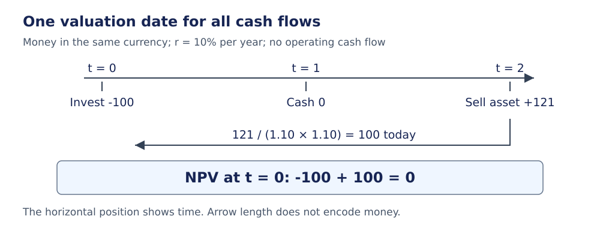
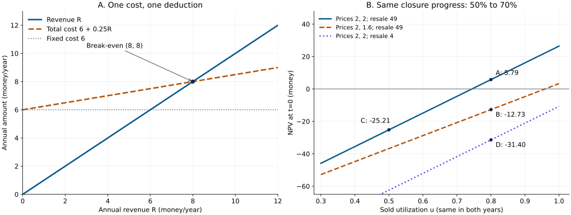
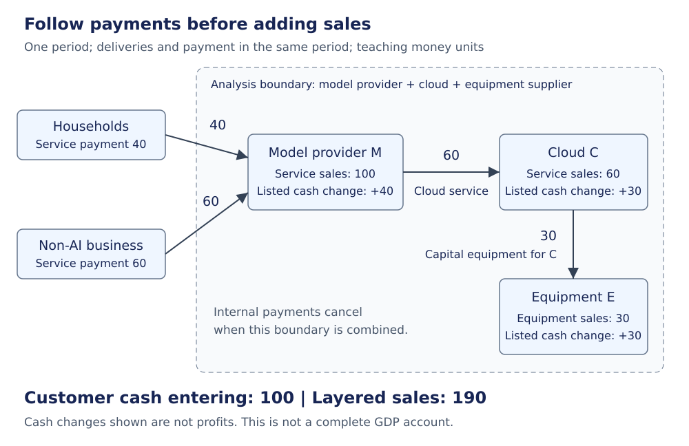

# AI 投资现金流与需求口径校注

模型能做更多工作，为什么投资回报仍可能下降？先追踪四件事：**能力转成了多少合格服务、谁愿意付多少钱、这些钱何时到账、为取得它们付出了哪些成本。** 技术指标只有进入这张账本，才成为经济模型的输入。

本页是 [[Clippings/WorkWithLLM/原稿索引|WorkWithLLM 历史对话]] 的伴随校注，处理时点、成本、需求集合和可比较条件。原稿保留；末尾给出定位。原对话后段已经主动区分能力与价值、讨论检测恢复与共同错误，阅读时应保留这些自我修正。

所有小额数字均为教学假设。8.514 billion USD 一段只复核原材料中的单位链与成本口径，不估计任何公司的合理价格，也不把情景结果当作投资预测。若还不熟悉贴现，先读 [[社会科学/30-金融市场与风险/01-现金流复利贴现与实际收益#3. 贴现是把不同时间的金额换到同一时点|现金流主解释]]；资产、负债、储蓄与宏观账户的完整定义仍在 [[社会科学/10-共同工具/02-指标分布与存量流量核算|指标与账户主解释]]。

## 1. 先固定时点，再把能力接到现金流

设决策时点为 $t=0$，一年为一期，$t=1,\ldots,T$ 均为年末。金额用同一货币的名义值；$r>-1$ 为与这组现金流风险相匹配的年有效折现率。在本页确定性教学情景中，采用融资前的项目现金流：

$$
NPV_0=-I_0+\sum_{t=1}^{T}\frac{FCF_t}{(1+r)^t}
       +\frac{S_T}{(1+r)^T}.
$$

$I_0$ 是初始净投入，$FCF_t$ 是年末融资前净现金，$S_T$ 是年末 $T$ 才收到、且未计入 $FCF_T$ 的终止处置净现金。若终值表示继续经营价值而非出售残值，也必须说明它代表哪些后续现金流，不能再把那些现金另加一次。企业/股东现金流与折现率的匹配，以及终值仍须折现的原则，见 Damodaran 的估值讲义。[1]

这里的 $FCF_t$ 已扣本期付现经营成本、税、追加资本支出和营运资金增量。最简算例将后三项设为零；需要完整税后增量预算时，转到 [[社会科学/30-金融市场与风险/50-公司金融/01-项目现金流融资现金流与资本预算#从工作流到增量税后现金：完整两年例|非考试公司金融的两年现金桥]]，核折旧/税、营运资金、机会/沉没成本与终值，再单列融资。该页教学税制不反向改掉本页既有无税情景。

### 终值 121 不等于今天的 121

今天投入 100，两年没有经营现金，两年末卖出资产取得 121，$r=10\%$：

| 现金项 | 实际发生时点 | 当时金额 | 折到 $t=0$ |
| --- | --- | ---: | ---: |
| 初始投资 | $t=0$ | $-100$ | $-100$ |
| 经营净现金 | $t=1,2$ | $0,0$ | $0$ |
| 处置资产 | $t=2$ | $121$ | $121/1.1^2=100$ |
| 合计净现值 | $t=0$ | 不跨时点直接相加 | **$0$** |

$$NPV_0=-100+\frac{121}{1.1^2}=0.$$

直接写 $-100+121=21$ 忽略了两年的时间价值。若确实希望在公式末尾直接加残值的现值，应改名为 $PV_0(S_T)$，不要仍把它称作期末残值 $S_T$。



图的横轴是时点，箭头长度不是金额比例。上方是实际现金发生，下方是折到今天的比较；本题年末 121 恰好补偿初始 100 在 10% 年要求回报下的两年占用。

### 利用率只能乘在容量上一次

先选一种定义，再写收入：

| 符号口径 | 定义与单位 | 收入公式 |
| --- | --- | --- |
| $q_t$ 是可供容量 | 本年度在固定质量、延迟和任务结构下可提供的服务量；任务/年 | 实际售出 $n_t=u_tq_t$，收入 $R_t=p_tu_tq_t$ |
| $q_t$ 是实际完成并收费的服务量 | 任务/年，已经体现闲置和销售限制 | $R_t=p_tq_t$，不再乘一次 $u_t$ |

$u_t\in[0,1]$ 是所定义容量中实际售出的比例，$p_t$ 是货币/任务。容量 100、利用率 60%、单价 2 时，实际售出 60、收入 120；若账本已给“实际完成 60”，再乘 60% 会误得 72。

扩展任务难度或降低质量门槛会改变“一个任务”的含义；吞吐提高也可能来自任务变简单。因此从硬件、调度、模型准确率到收入，应保留一条可核对的链：固定任务与验收 → 合格容量 → 实际售出 → 单价 → 收款时点。每一环都要有输入，不能用更高排行榜分数直接替代销售量。

### 战略期权也有时点和机会成本

等待、分期扩建、保留市场入口等选择，可以改变项目价值。但只有尚未计入既有情景现金流的**增量**选择权价值，才可另记为 $O_0^{\mathrm{inc}}$，并说明它已经在 $t=0$ 估值。若已经把“保护现有客户利润”写进 $FCF_t$，再加同一收益的战略价值就是重复计算。没有状态、行动、概率或估值方法时，把它列为待分析的选择，不能随意填一个正数把负 NPV 改为正。

具体算[[社会科学/30-金融市场与风险/50-公司金融/03-融资信息治理激励与实物期权#等待、信息和放弃：选择必须活在当时的信息里|50投资、100/0收入的等待/放弃]]：免费揭示且不失收入值25，等待使好态收入降40则最优不投、值0；收费且可不买时还须保留不买。新增信息不等于等待本身有正经济价值，未来状态不能提前塞进今天的动作。

## 2. 一份成本只能扣一次

会计利润按收入与费用的确认规则计算，现金流按实际收付及相应调整计算；二者可以互相调节，但不能互换。现金流表区分经营、投资和融资活动，非付现折旧在从利润调节现金时需要处理。[2]

| 项目 | 本页融资前现金流模型 | 会计利润视角 | 换成年化成本时的注意点 |
| --- | --- | --- | --- |
| 初始资本支出 $I_0$ | 在 $t=0$ 扣一次 | 形成资产，再按规则确认费用 | 若已经转成年度资本回收额，不再另扣同一初始支出 |
| 会计折旧 $D_t$ | 不是当期付款；本页无税模型不另扣 | 分期费用；列在销售成本还是其他费用取决于实际政策 | 不与已经含资本回收的年度资本成本重复相加 |
| 随销量变化的成本 | 每年按实际服务量或收入关系扣 | 按政策计入相应费用 | 若已在贡献利润率中扣过，不能再放进需覆盖的固定成本 |
| 固定付现运营成本 $F_t$ | 每年扣一次 | 本期费用 | 说明是否含人员、维护、租金、固定电力等 |
| 借款、还本与股东出资 | 单列融资，不放进本页融资前 $FCF_t$ | 借款或出资本身不是销售收入 | 不把借来的现金当经营回报；利息与折现率须口径一致 |

经济折旧指资产未来可创造现金的能力或转售价格变化，会影响预测。**仅改会计折旧年限，在无税且其他现金不变的本页模型里，不会改变 NPV。** 若存在税效应，应重新列税款时点；不能把会计费用直接当作设备又付了一次钱。

### 固定成本 6、变动成本率 25%，收入 8 就收支相抵

将某一年度的收入记为 $R$，固定成本为 $F=6$，随收入变化的付现成本率为 $v=0.25$。在这个明确的线性模型内：

$$C(R)=F+vR=6+0.25R,$$
$$\Pi(R)=R-C(R)=(1-v)R-F=0.75R-6,$$
$$R_{\mathrm{BE}}=\frac{F}{1-v}=\frac{6}{0.75}=8.$$

这里 $1-v=75\%$ 是**扣除所定义变动成本后、尚未覆盖固定成本的贡献利润率**，不是从财报随便找来的毛利率。收入 8 时，变动成本 2、固定成本 6、总成本 8、利润 0。把总成本 8 再除 0.75 得到 $10.\overline6$，会重复为那份变动成本预留空间；代回原式，利润已是 2，显然不是同一个盈亏平衡点。

本例的 6 是年度固定经营成本，盈亏平衡只表示该年度经营收支相抵，尚不证明初始投资已回收。若 6 改为包括资本回收额的等价年度固定成本，必须另列寿命、折现率、残值和适用的稳定经营假设。$v=1$ 且 $F>0$ 时没有有限盈亏平衡收入；$v>1$ 时扩大收入在该模型内反而扩大亏损。

### 8.514 billion 的问题是单位与分母，换算本身成立

原材料引用的 Epoch 1 GW 数据中心模型，把年化资本成本和年度运营成本合计为约 8.5 billion USD；详细表的 7,607 与 907（百万美元/年）合为 8,514。它是带资产寿命、利用率等假设的设施模型，不是实测公司财报。[3]

将原稿的 8.514 billion USD/年作为给定数，单位链应写全：

$$
\frac{8.514\ \mathrm{billion\ USD/年}}{0.5}
=17.028\ \mathrm{billion\ USD/年}
=170.28\ \text{亿美元/年}.
$$

所以“约 170.3 亿美元”按一位小数取整没有算错。问题是：**0.5 已经扣了什么？8.514 又包含什么？**

只有额外假设“8.514 是尚须由贡献利润覆盖、与 50% 已扣项目不重叠的年度成本”时，这个除法才是该另设模型的收入阈值。Epoch 的 TCO 已包含电力、维护、人工等运营成本，不能同时把这些项目扣进 50% 利润率后又全额覆盖一次。没有成本拆分时，保留上述单位换算，暂停把它解释成必要营业收入。

同理，原稿“增量毛利 /（折旧＋能源＋网络＋研发＋融资成本）大于 1”的表述需要逐项桥接。若毛利已扣折旧或能源，分母再叠同项，就不再是收支比；即使各项不重叠，一个期间的比值也不能代替全周期 NPV、到期现金与融资约束。



左图横轴为年度收入 $R$，纵轴为同一年度货币金额；收入线与 $6+0.25R$ 在 $(8,8)$ 相交。右图将在第 5 节复算：横轴为两个年度共同的售出利用率 $u$，纵轴为 $t=0$ 的 NPV；每条线的闭环率进步相同，价格和残值条件不同。线型、文字与颜色共同区分情景。

## 3. 采购动机是标签，需求总量要去重

一家公司买 30 份 AI 服务，既用于本期处理客户工单，又想学习技术、防止将来落后。“终端用途”描述**用来干什么**，“战略动机”描述**为何购买**；两者可以同时成立。“囤货”描述使用时点，“靠融资支付”描述资金来源，也不是与用途互斥的类别。

先固定需求的单位。本例使用同一期、同种服务的订单数量，每份订单只有一个唯一编号。设 $A$ 是有终端用途的订单，$B$ 是有战略动机的订单：

$$|A|=70,\quad |B|=50,\quad |A\cap B|=30,$$
$$|A\cup B|=|A|+|B|-|A\cap B|=70+50-30=90.$$

| 互斥格子 | 订单数 | 是否计入总量 |
| --- | ---: | --- |
| 只有终端用途 $A\setminus B$ | 40 | 计一次 |
| 两种标签都有 $A\cap B$ | 30 | 仍只计一次 |
| 只有战略动机 $B\setminus A$ | 20 | 计一次 |
| 两者都没有 | 题设为 0 | 若存在，要另列，不能遗漏 |
| 合计 | **90** | 不能把两列标签总数相加成 120 |

若要统计金额，改为对去重后的订单金额求和；不能把不同大小订单的“笔数占比”称作“收入占比”。这张交叉表保留了采购原因，又给总量一个明确的可加口径。是否由新增融资支撑，要另看融资账本。

## 4. 同一笔最终支付，可以成为多家公司的收入

选择一个**教学分析边界**：模型商 M、云商 C、设备商 E 三家合在一起看。它们不假定受同一母公司控制，因此这里不是法定合并财报。家庭与非 AI 企业在边界外。固定一个年度，忽略税和汇率；下表服务均在该年交付并收现，新设备也在该年交付付款，暂不列其他交易。

| 付款方 → 收款方 | 金额 | 付款方类别 | 收款方类别 |
| --- | ---: | --- | --- |
| 家庭 → M | 40 | 购买使用服务 | 本期服务收入 40、经营收现 40 |
| 非 AI 企业 → M | 60 | 本期业务使用的服务支出 | 本期服务收入 60、经营收现 60 |
| M → C | 60 | 购买本期云服务，经营付款 | 本期云服务收入 60、经营收现 60 |
| C → E | 30 | 购买跨期使用的新设备，**投资付款、形成资产** | 本期设备销售收入 30、经营收现 30 |



箭头表示上述同期间现金支付。三个内部公司的现金净变化分别为 $100-60=40$、$60-30=30$、$30$；合计 100。这里只是所列交易造成的现金增量，**不是利润**，因为工资、设备生产成本等没有列全。

分层销售收入加总为 $100+60+30=190$；从边界外使用客户取得的现金是 100。190 回答三层各做了多少销售，100 回答边界吸收了多少客户现金，两者没有矛盾。把 M 与 C 看成一个内部单元，内部云交易就不再算外部销售；客户没有多付一分钱，营业收入加总却会随组织边界改变。

这里“最终客户”仅指这条 AI 供应链的使用方。非 AI 企业支付 60，可能仍是其自身生产的中间投入；云商买设备 30 则可能是固定资本形成。**100 不是自动得到的 GDP 或最终消费，190 也不是 GDP。** BEA 的行业账户说明，跨行业总产出加总会包含中间交易；与增加值或最终支出比较，必须按相应账户分类。[4]

### 收款、确认收入和融资要能分列

下面是独立的改动情景，不叠加到上方 100/190 基准账本：

| 额外事件 | 本期收现 | 本期收入 | 资产负债表/现金类别 |
| --- | ---: | ---: | --- |
| 本年交付价值 100 的服务，只收款 80 | 80 | 100 | 经营收现 80；在简化确认假设下增加应收款 20 |
| 收到下年才交付服务的预付款 20 | 20 | 0 | 经营收现 20，增加预收/合同负债 20；本期服务尚未完成 |
| 银行向模型商新发放贷款 20 | 20 | 0 | 现金与借款负债各增 20，属融资流入 |
| 投资者向模型商增资 20 | 20 | 0 | 现金与权益各增 20，属融资流入 |

本例采用“本期交付的服务在本期确认收入、暂不考虑其他调整”的简化；实际合同需要核对履约、退款与收入确认政策。经营预算也不能证明资金最终来自经营盈余，企业仍可能用贷款或增资补足总现金缺口。

### 如果保留 $\rho$，它只能回答定义过的那个问题

可把原稿的比值明确定义为自选诊断量：

$$
\rho_{\mathrm{cash/gross}}=
\frac{\text{本期边界外使用客户的服务付款}}
     {\text{本期三层公司未抵销的销售收入合计}}.
$$

在基准账本里，它是 $100/190\approx52.63\%$。它不是标准宏观指标，也不是“52.63% 的需求真实”或“低于某数就无法生存”。增加一层转售、改变公司边界、推迟收款，都会改变它。

例如把三层交易的每笔款都延后到下一期收取，本期仍在上述简化履约规则下确认合计收入 190，分子为 0；此时 $\rho=0$，却不能仅凭该值否认已经交付的服务。它揭示了现金时点，需要连同应收款和到期付款继续分析。分母为零时比值未定义，不应写成 0。

如果目的只是看资金是否足以支撑项目，直接列客户收款、经营付款、资本支出、税、债务到期额、期初现金和融资来源，分别检查项目 NPV 与每期现金余额。去重后的金额账本比没有口径的一个百分比更能定位风险。

## 5. 相同技术进步，可以对应相反的投资结果

原稿将“闭环化速度”与“资本侵蚀速度”相比较，但后者混合了折旧、价格、竞争和组织阻力。即使都写成“每年”，一个是任务占比变化，另一个可能是价格增长率或货币损失率，仍不具有同一分母和价值权重。一个每年变化 20 个百分点的占比，也不能和每年变化 20% 的价格直接比较。

把它们放回同一模型，可以问更明确的问题：**同样的闭环能力进步，经由服务量、价格和残值，最终带来多少 NPV？**

固定同种合格任务，技术上存在 $Q=100$ 任务/年的参考容量。第 1、2 年可以闭环完成的比例为 $a_1=0.5,a_2=0.7$，所以可售容量 $q_t=a_tQ$ 分别为 50、70。每个情景的技术进步都是一年提高 20 个百分点。售出率 $u$ 表示这些合格容量中实际被客户购买的比例，实际服务量 $n_t=u a_tQ$；不再另乘其他利用率。

再设初始投入 $I_0=100$，年折现率 $r=10\%$，每个实际服务的付现成本 $c=1$，固定运营付款 $F=10$/年。无税、无营运资金变动、无追加资本支出、无融资现金流。期末净残值按独立的经济贬值情景 $S_2=100(1-\delta)^2$ 给出，$\delta$ 是假设的年转售价值下降率，**不是会计折旧费用率**。于是：

$$FCF_t=(p_t-c)u a_tQ-F,$$
$$NPV_0=-100+\frac{FCF_1}{1.1}+\frac{FCF_2+S_2}{1.1^2}.$$

| 情景 | $p_1,p_2$（货币/任务） | 两年相同的 $u$ | $\delta$ | $FCF_1,FCF_2$ | $S_2$ | $NPV_0$（约） |
| --- | --- | ---: | ---: | --- | ---: | ---: |
| A：基准 | 2，2 | 80% | 30% | 30，46 | 49 | **5.7851** |
| B：仅次年售价下降 | 2，1.6 | 80% | 30% | 30，23.6 | 49 | **−12.7273** |
| C：仅售出利用率较低 | 2，2 | 50% | 30% | 15，25 | 49 | **−25.2066** |
| D：仅转售价值降得更快 | 2，2 | 80% | 80% | 30，46 | 4 | **−31.4050** |

以 A 为例，第 1 年卖出 $100\times0.5\times0.8=40$ 个任务，收入 80、变动成本 40、固定成本 10，净现金 30；第 2 年卖出 56 个，净现金 46，另收残值 49。因此 $-100+30/1.1+95/1.21=5.7851\ldots$。

B 的闭环进步完全一样，只因第 2 年售价从 2 降到 1.6，第二年现金少 $56\times0.4=22.4$，NPV 少 $22.4/1.21=18.5124\ldots$，就由正转负。这比比较两个未定义速率更精确地说明了“技术进步、用户受益与旧投资亏损可以同时发生”的机制。

这些是有限期反例，不是对价格、利用率或残值的经验预测。真正建模还要让容量、可服务任务范围、需求与售价相互约束，检验竞争反应、质量、风险和流动性；不能无限外推本题 $q_t=a_tQ$ 的线性关系。单一速度不构成充分投资判据。

原A情景的有目的返回在 [[社会科学/30-金融市场与风险/50-公司金融/01-项目现金流融资现金流与资本预算#返回原AI例：只改利用率，别顺便改分母|只改利用率的资本预算]]：保持Q/闭环比例、价格、任务成本、固定成本、无税/无NWC、残值49与时点，仅把u从4/5改3/5，逐期收费与现金重算。技术比例没有变，融资也没有被当成更多客户付款；本页原A仍按原口径保留。

保持原A全部分母/时点，到[[社会科学/30-金融市场与风险/50-公司金融/03-融资信息治理激励与实物期权#回到原AI/创业项目：项目、融资、权利与风险分开交接|项目—融资—权利—风险]]只新增债40/20/0与自有30/新股30，核30/95如何分成债24/22、股6/73和公平股份；费3需要额外3现金。残值49仍只在2期收到，不自动赋予1期随时退出的放弃权。

## 6. 说“效率提高”，先说明分子分母

若 $e$ 是完成同一合格任务的能耗（焦耳/任务），能效为 $\eta=1/e$（任务/焦耳），改善意味着 $e$ 下降、$\eta$ 上升。$e$ 从 10 降到 8，是单位能耗下降 20%；$\eta$ 从 0.1 升到 0.125，是能效提高 25%。这两个百分比不能直接互换。

同理，“单位计算成本下降”与“效率下降”方向相反。原稿三份“分析大模型算力极限”在构造乐观论证时，应理解为：**在任务与质量固定的条件下，单位任务能耗或成本下降，或者每单位资源完成的合格任务数提高。** 这只是校正变量方向，不证明其中任一历史降速在未来持续。

总量还取决于任务数量：同种任务下 $E_{\mathrm{total}}=ne$。单位能耗从 10 降到 8，而完成量从 100 增至 150，总能耗就从 1000 增至 1200。技术进步解决了单位资源约束，却会通过价格和需求引出新的总量与分配问题；为什么要进步、谁得到收益，需要同时观察这些层次。

## 7. 自己复算与改变一个条件

配套 [精确分数复算源码](../80-实践/assets/ai_investment_examples.py) 使用 Python 标准库；图由 [绘图源码](../80-实践/assets/generate_ai_investment_figures.py) 从同一模型生成。计算不需要下载数据。从库根运行：

```bash
python3 -B 社会科学/80-实践/assets/ai_investment_examples.py
```

程序输出 NPV、盈亏平衡、需求去重、分层账本和四种情景；分数是精确值，小数只作显示。重新绘图另需本库绘图环境已有的 Matplotlib，执行 `generate_ai_investment_figures.py`；没有该依赖时仍可复算并阅读已保存的 SVG。

1. **终值改为 110，其他条件与第 1 节相同，NPV 是多少？** 答：$-100+110/1.21=-9.0909\ldots$。别把晚两年的 110 当作今天的 110。
2. **固定成本仍为 6，变动成本率升至 40%，盈亏平衡收入如何变？** 答：$6/(1-0.4)=10$；改变的是贡献率，不能复用旧总成本 8。
3. **采购已按唯一订单号去重为 90，新增“靠贷款支付”标签有 20 笔，总需求是否变为 110？** 答：若它们都是原有订单，仅多了资金来源标签，总需求仍为 90。
4. **同一服务收入本期确认 100，下期才收现，是否自动是虚假需求？** 答：不是；先核交付、合同与可收回性，再检查本期现金缺口和融资。收入、现金、可信度不能用一个标签代替。
5. **在情景 A 里，若只把会计折旧年限由 5 年改为 3 年，实际收付款与期末售价全不变，NPV 会否变化？** 答：本页无税模型中不变。情景 D 改的是实际预期转售现金，性质不同。

## 原稿定位与本页的校订范围

以下定位对应 Git 基线 `4089714364ac9fd479cd27b046439690669b108c`，同时给搜索词以便在 Obsidian 内定位。原稿版本之间存在继承与摘录关系，不是独立支持同一观点的多份证据。

| 原稿位置 | 查找文本或公式 | 本页如何处理 |
| --- | --- | --- |
| [[Clippings/WorkWithLLM/对话原稿/Obsidian_兼容版 (1) 1\|兼容版追加稿]] 与 [[Clippings/WorkWithLLM/对话原稿/Obsidian_兼容版 (1)\|兼容版]] L1990–2006；[[Clippings/WorkWithLLM/教学收件箱/Untitled\|收件箱稿]] L1795–1809 | `NPV`、`S_T`、`q_t` | 第 1 节统一时点、容量、实际服务量与增量期权 |
| 收件箱稿 L651–653；两份兼容版 L736–742 | `AI 增量毛利`、`AI 折旧` | 第 2 节成本归类，防止毛利和分母重复扣项 |
| 收件箱稿 L2427–2448；兼容版 L2383–2404；兼容版追加稿 L2672–2693 | `D_`、`rho` 或 `ρ` | 第 3、4 节把采购标签、唯一订单、现金和销售分开 |
| 收件箱稿 L2496–2504；兼容版追加稿 L2747–2759 | `8.514`、`170.3` | 第 2 节保留正确换算，补单位和适用成本假设 |
| 两份兼容版 L2266–2288；收件箱稿 L2062–2076 | `v_`、`closure`、`erosion` | 第 5 节用完整现金流情景替代未定义的充分判据 |
| [[Clippings/WorkWithLLM/对话原稿/分析大模型算力极限\|算力极限原稿]] L241；[[Clippings/WorkWithLLM/对话原稿/分析大模型算力极限 1\|算力极限 1]] L742；[[Clippings/WorkWithLLM/对话原稿/分析大模型算力极限 2\|算力极限 2]] L1310 | `只要效率下降速度足够快` | 三处派生稿同一校注：第 6 节改为单位成本/能耗下降或效率提高；原文不覆写 |

兼容版两稿 L1709 和收件箱稿 L1531 也继承了最后一行的方向笔误，同样按第 6 节阅读。上表只处理本页已解释的口径，不据此把原对话后来已撤回的悲观可靠性论证重新判作当前结论。

## 来源与适用范围

本页于 2026-10-08 打开以下原始网页的指定部分，来源支持的范围与自建算例分开：

- [1] Aswath Damodaran，[*Valuation*](https://pages.stern.nyu.edu/~adamodar/New_Home_Page/lectures/val.html)，“Equity Valuation versus Firm Valuation”“FIRST LAW OF VALUATION”“The Two-stage Model”：现金流/折现率匹配，以及终值折回估值时点。未采用网页中的旧市场参数；本页数字独立构造。
- [2] SEC，[*Beginners' Guide to Financial Statement*](https://www.sec.gov/investor/pubs/begfinstmtguide.htm)，“Income Statements”“Cash Flow Statements”，页面注明 2007-02-05 更新：利润、现金流、非付现项目及经营/投资/融资分类的入门解释。本页不把该简化介绍当作所有公司的费用列报政策。
- [3] Amelia Michael、Ben Cottier，[*Servers account for 60% of the total cost of ownership of a one-gigawatt AI data center*](https://epoch.ai/data-insights/ai-datacenter-cost-breakdown)，2026-05-14，年化成本表、“Analysis”“Assumptions and limitations”：TCO 包含年化资本与运营成本，资本年化采用寿命和资本成本假设。本页没有把设施模型外推为具体公司阈值。
- [4] BEA，[*Guide to the Interactive GDP-by-Industry Accounts Tables*](https://www.bea.gov/resources/guide-interactive-gdp-industry-accounts-tables)，“Gross Output by Industry”“Intermediate Inputs by Industry”：总产出加总、中间投入与增加值口径。100/60/30 账本是本页原创交易假设，未声称它构成完整国民账户。
