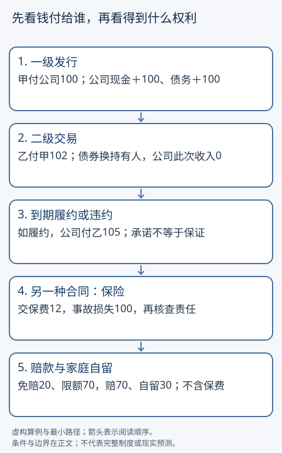

# 金融工具、保险与家庭风险

家里把钱借出去、买股票、买基金或买保险，究竟得到什么？都可能先付钱，随后取得的权利却不同。本篇从「钱给了谁、将来凭什么收到钱、急用时怎么办」展开。金额与收益率均为虚构教学参数，不构成产品选择或投资建议。

## 两个入口，共用现金流

基础入口：读「四种权利」并跟随一笔发行、一笔转手和一次保险事故。

快进入口：先算现值、实际收益和免赔，再检查权利、付款路径与风险条件。两条路线都读尾部风险及练习；不要求学过CFA。

## 四种权利并不互换

|工具|你取得的权利|付款与风险|
|---|---|---|
|债券、贷款等债权|按合同要求本金、利息或其他约定付款|债务人可能违约；优先顺序、抵押和执行条件须看合同法律|
|股票等股权|对公司剩余收益与资产的权利，以及依规则行使的治理权利|分红未必发生，价格会变，清偿顺序在相关债权之后|
|基金份额|通过基金结构持有组合权益|基金不是保证收益；费用、底层风险、申赎与交易规则影响结果|
|保险合同|在约定事故和条件下获得保险给付或赔偿|付保费购买保障；免赔、限额、除外责任与保险人履约能力很关键|

债权股权的深入定价分别回到[[社会科学/30-金融市场与风险/02-债券价格利率期限结构与信用利差|债券主解释]]和[[社会科学/30-金融市场与风险/03-股票所有权现金流与估值|股权主解释]]。基金把资金集合起来取得一组资产；持有多个名字但风险来源相同，分散仍可能不足。基金结构例据[SEC的共同基金说明](https://www.investor.gov/introduction-investing/investing-basics/investment-products/mutual-funds-and-exchange-traded-funds-etfs/mutual-funds)，此页介绍美国共同基金，不能直接规定中国或德国所有基金的法律形式。

## 一次发行，一次转手：公司收到的不是每笔成交额

设公司向家庭甲新发行一张债券，价格100，一年后约定付105。甲付公司100，公司现金加100、债务加100；甲现金减100、债券资产加100。这里先按交易价记录，不意味着最终一定收回105。

半年后甲以102卖给家庭乙。乙付甲102，债券权利换持有人；公司在这次普通二级交易没有收到102。到期如履约，公司付乙105。甲的持有期现金收入是102减100=2，未计费用；乙付102再收105，回报3/102≈2.94%，发生在半年，不能直接称一年收益率。[SEC术语表的一级、二级市场](https://www.investor.gov/introduction-investing/investing-basics/glossary)支持这个发行与转手区别。

股权也可新发和转手。二级市场为持有人提供退出和价格信息，可能间接影响公司的以后融资，但这种间接作用不等于公司收到每笔交易现金。实际交易还有中介、费用、税与结算时差，本图是权利和款项的最小路径。

## 时间和购买力：105比100多，不一定多买5%的东西

一年后确定能收到105，教学贴现率5%，今天的等价金额为105/1.05=100。贴现率是比较不同时点现金的条件，包含机会成本等考虑；本例暂不处理风险。风险债券不能仅因为「承诺105」就当成确定105。

如今天存100一年变105，而同一消费篮价格上涨3%，实际购买力倍数是1.05/1.03≈1.019417，实际收益约1.94%，不是精确的2%。所有名义金额和物价指数必须用同一期间，费用税收应放在现金流中。完整复利与贴现推导读[[社会科学/30-金融市场与风险/01-现金流复利贴现与实际收益|时间价值主解释]]。

家庭可能有价值150的长期资产，却需要明天现金80，只能迅速卖到60。这是流动性问题，未必等于最终资产没有价值；反过来，能立即卖掉也不证明没有损失。应把到期承诺、账面或市值、可及时出售的净现金分列。

## 保险怎样转移损失

设一年保费12，承保某一种财产事故，发生承保损失100时，免赔20，赔款上限70。若满足理赔条件，赔款=min(100−20,70)=70；家庭自留损失30，另已付保费12。如果没有事故，赔款0，保费仍支付；如果损失来自除外事故，也不能凭「损失100」推出赔70。这是教学财产险，不把人身定额给付保险都套成损失报销。[加州保险监管机构说明](https://www.insurance.ca.gov/01-consumers/105-type/95-guides/01-auto/auto101.cfm)实际读取了保单、保费、免赔与保障范围部分，用作概念例据，不采用其当地法定责任限额。

假设同类承保事故每个家庭一年发生概率10%，无保险预期损失10；本保单预期赔款7，预期自留损失3，家庭保费加预期自留为15。保险不是靠增加平均钱数证明有用：在这个例子里，它用确定支付12换掉部分罕见大损失，是否值得取决于家庭承受损失的能力、偏好和其他保障。保险人还要付管理成本、持有准备金并承担赔款不确定性；很多损失同时发生时，风险不能简单靠多签保单消失。

买保险的投保人、风险所涉被保险人、领取给付的受益人可以不同。应分别问谁交保费、什么事故触发、谁领钱、责任到多少、怎样申诉。没有这些信息，「保额100」不是一定收到100。

社会保险通过法律与公共制度安排参保、筹资和待遇，商业保险主要通过保险合同购买特定保障，二者可以并存但不能互相替代解释。中国2018年修正《社会保险法》第2—5条列出社会风险与依法缴费、待遇权益和政府支持；这是中国制度依据，不是三个国家同费率同待遇的证明。[上海税务局法律转载](https://shanghai.chinatax.gov.cn/tax/zcfw/zcfgk/sbf/202202/t462174.html)；社会保险预算归[[社会科学/40-公共政策与社会学/11-税制公共预算与中央地方关系|税制与预算]]负责。本篇没有核验美国、德国全部社会保险条款，因此不填它们的资格、缴费比例和退休年龄。

## 平均收益之外，还有尾部和共同暴露

设某项投入100：99%概率年底收到104，1%概率收到0。预期终值102.96，预期收益2.96%，但最坏损失100，不能从「平均赚」推断家庭能承担。需要明年学费的家庭，坏情形可能比均值更重要。十项资产若都依赖同一雇主、地区房价或融资来源，困难时可能一起下跌。分散、保险和现金缓冲处理的风险不完全相同；详见[[社会科学/30-金融市场与风险/04-组合分散风险因子与CAPM边界|分散与风险边界]]。

两个国家的三个来源中，本文使用中国社会保险法律、美国SEC金融概念和加州商业保险指南；它们回答不同的局部问题，不能组成国家优劣比较。对同一个家庭保障问题做跨国比较，还须分别补齐各国资格、合同、监管和申诉证据，现有材料不足的部分保留未知。

## 迁移练习与答案

1. 乙后来以103卖给丙，公司这次融资多少？**答：**普通二级转手为0，公司到期义务仍按合同；交易费用另算。
2. 一年后收110，贴现率10%，现值多少？**答：**100，前提是现金流确定且单期模型合适。若有违约风险，单凭此数不能定价。
3. 名义收益0，物价涨5%，实际收益？**答：**1/1.05−1≈−4.76%，不是精确−5%。
4. 同保单承保损失50和200，各赔多少？**答：**30和70；自留20和130。除外事故即使损失200也可能赔0，需合同信息。
5. 预期收益为正、家里一年后必用钱，能说可放心购买吗？**答：**不能。要看尾部损失、时点、流动性和家庭其他资源；有依据地列出缺信息也合格。
6. 基金有100只股票，是不是风险必然很小？**答：**不必然；共同风险暴露、权重和费用仍重要。可给同一行业或同一信用冲击的反例。

本组[[社会科学/20-经济流动与宏观/code/everyday_economy.py|经济算例源码]]复算现值、实际收益和教学理赔，不认证现实合同。继续[[社会科学/20-经济流动与宏观/10-汇率跨境支付与国际收支|跨境支付]]可看外币资产和汇率风险。
