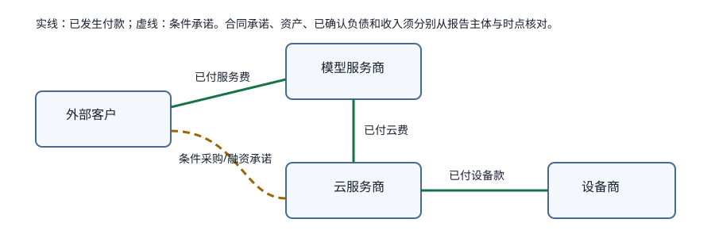

# 科技公司融资与 AI 资本循环校注

这页给历史剪藏加分类和时点，不把原文改写成当前事实，也不提供投资建议。

| 事项 | 报告主体与时点 | 能确认的分类 | 不能推出什么 |
| --- | --- | --- | --- |
| “不在流动负债” | 需逐份报表和准则确认 | 流动/非流动与表内/表外是两条不同分类；已确认租赁、尚未起租租赁和采购承诺另列 | 不能仅凭“不流动”叫表外。 |
| Microsoft 17.8B 应收、11.5B 受限投资 | Microsoft 视角；本轮指定 10-Q 未成功读取 | 它们被原剪藏作为资产数字引用 | 不能从资产金额反推供应商已向 Microsoft 放款；交易先后与现金方向待核。 |
| Alphabet 232.7B | Alphabet 2026-03-31 10-Q | 供应、能源与内容合同的未来固定或最低承诺 | 不等同当期已确认租赁债。 |
| Alphabet 40.7B | 同一 10-Q | future funding commitments，含 10.0B capital commitment 和满足里程碑前的 30.0B；后者按 equity derivative 核算 | 40.7 内含 30，不能重复相加或把名义额当现金支付。 |

## 财年校正

NVIDIA FY2026 Q2 的官方公告日期为 2025-08-27，季度截至 2025-07-27，Data Center revenue 为 **41.1B USD**。FY2027 Q2 的公告日期为 2026-08-26，季度截至 2026-07-26，才是 **89.0B USD**。因此原稿各处“FY2026 Q2/890 亿”应读为两种可选校正：保留 FY2026 则改 411 亿；保留 890 亿则改 FY2027，并写截止日。

原稿中的七个派生位置（两份 Obsidian 兼容稿、三份“分析大模型算力极限”、`Untitled.md`、`Untitled 1.md`、`Untitled 2.md`）均由本节统一校注；原文不覆写。

图中实线只是教学示意的已发生付款，虚线表示条件承诺；它不证明特定公司之间的实际融资先后。没有对应发行人原始披露时，Moody's/BCA 汇总与具体循环叙事保持“待核”，不能猜测补全。
