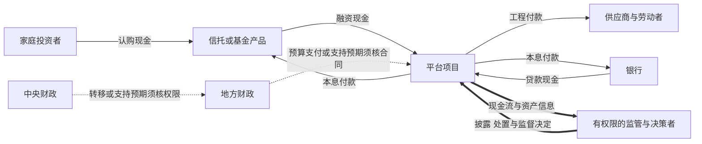

# 影子银行、财政承诺与损失归宿：救助以后，风险去了哪里

一个项目借钱建成道路，债权人持有城投债，理财产品又持有债权。道路可能有公共价值，项目却未必有收费现金；理财投资者能退出，也不表示项目资产能立即出售。后来政府支持偿债，债券价格上升，这能说明谁现在更可能拿到钱，却不能独自证明项目回报提高、财政负担下降或家庭保障改善。

本页从一笔融资追踪五个问题：**钱到哪里、谁承诺偿还、支持者靠什么支付、损失怎样确认、最终由谁承担。** 银行记账和挤兑的主解释在先修页；中国地方债口径、置换安排和吸收能力见应用页 [[社会科学/40-公共政策与社会学/14-地方债房地产与损失吸收|地方债、房地产与损失吸收]]，这里补足中介结构与承诺机制。

## 1. 影子银行是一种中介功能，不能按名称相加

“影子银行”通常用来研究全部或部分经银行体系外安排完成的信用中介，以及其中的期限转换、流动性转换和杠杆。它不等于非法融资。纽约联储 Staff Report 458 的历史分类着重没有显式央行流动性和公共信用后盾的中介；不同监管口径不完全相同，研究前先指定边界。[纽约联储2012修订页](https://www.newyorkfed.org/research/staff_reports/sr458.html)

辨认对象时，至少分清三种分类：

| 分类 | 问的是什么 | 示例及限制 |
| --- | --- | --- |
| 借款主体 | 谁承担合同债务 | 地方融资平台、开发商、制造企业；平台不是一种债券 |
| 工具 | 债权怎样安排 | 贷款、城投债、信托受益权、回购；城投债并非全属影子银行 |
| 中介链 | 储蓄怎样变成最终融资 | 家庭→理财→信托/资管→企业债权；需看契约及实际资产 |

**教学构造：** 家庭投入100亿元购买理财受益权，理财通过信托持有100亿元平台债权，平台将100亿元用于项目。三层账上各有100，但最终借款人只获得100，不是300。若后来某一层另借20扩大头寸，新增借款、抵押和追索关系要另记，不能用“都可抵销”抹掉它。

信托资产管理规模（AUM）、产品余额、平台债务和社会融资流量因覆盖、时期和层级不同，不能堆成一个总风险金额。指定合并组的内部债权债务可抵销；家庭对理财的权利和项目对外付款不会因此消失。合并方法见 [[社会科学/40-公共政策与社会学/10-财政货币与分配/02-财政支出税收发债与合并边界|财政账本的合并边界]]。

银行的表内/表外与政府预算内/预算外还是两条不同边界。一笔普通银行贷款可以是银行表内资产，同时属于政府预算边界以外的平台融资。BIS工作论文701对2013—2016年的结构图发现，银行在中国影子链中居核心位置；该历史图不能直接代表今天每种产品。[BIS原研究页](https://www.bis.org/publications/working-paper-701-mapping-shadow-banking-china-structure-and-dynamics)

FSB于2025-12发布的报告以2024年为基础，广义NBFI资产占所覆盖全球金融资产的51.0%，监测29个法域，随后才缩小到可能产生脆弱性的活动。**广义非银部门包括保险、养老金等，51.0%不是高风险影子银行比例，更不是损失率。** [FSB监测报告](https://www.fsb.org/2025/12/global-monitoring-report-on-nonbank-financial-intermediation-2025/)

## 2. 为什么会形成：约束迁移与融资需求都要解释

银行资本、流动性和贷款规则各有目的。若相似风险移到约束较弱的产品，中介可以换一种法律形式继续融资；这叫监管套利。另一方面，借款人可能需要长期资金，投资者却希望短期退出，中介便用滚动短期负债维持长期项目。两者可同时存在。

不能把融资困难压成同一个原因。缺少抵押但有经营回报的企业、尚未收费却有公共效益的道路、没有持续价值只求还旧债的项目，各需不同工具。取消贷款标准可能帮助第一类，也可能加大第三类损失；公共项目则需要透明且可信的预算支付安排。

两项原始研究提供互补的历史机制：

- Chen、Ren、Zha（AER，2018）在2009—2015年的数据与模型中研究到，货币收紧下传统贷款与影子贷款出现相反调整。它支持检查融资渠道迁移，不支持“所有审慎规则都应取消”。本轮读取出版方摘要，未复现模型。[AER论文](https://www.aeaweb.org/articles?id=10.1257/aer.20170133)
- Acharya、Qian、Su、Yang（2024-10在线、2025年卷期）研究金融危机后财政刺激与存款竞争：与特定大行分支重叠更多的中小银行，更依赖短期表外理财，并面临滚动风险。这使“更多竞争必然消除影子风险”的推论站不住；它没有统一估计民营、外资准入的效果。本轮读取出版方摘要和书目。[Management Science论文](https://pubsonline.informs.org/doi/10.1287/mnsc.2023.04233)

“开放”须具体指民营/外资准入、产品准入、利率市场化、贷款标准或资本账户。竞争改善服务与短钱增加脆弱性可以同时成立，净效果要看融资用途、后盾、契约与监管，而非一个开放指数。

## 3. 同一组主体上的三张网络

观察某虚构地方的中央支持、地方财政、平台、银行、信托/基金、供应商和家庭时，先画**合同现金流**，再叠加**支持预期**，最后查**信息和行政责任**。

实线仅表示标明的现金支付；虚线提示须进一步核对的支持关系；粗线表示信息和决定。箭头方向不把融资现金与债权方向混为一谈：家庭付出认购款后获得对产品的权利，项目收到借款后承担对债权人的付款责任。图中不声明任何政府承担无限连带保证，也不推定所有报告都真实或得到处理。

| 网络 | 应找的原始证据 | 不能被另一层替代的部分 |
| --- | --- | --- |
| 合同与现金 | 到期表、币种、抵押、顺位、追索范围、实际到账 | 宣布支持不等于已经支付 |
| 支持与担保 | 保证合同、授权、预算来源、条件、历史履行 | 政府背景不等于法定担保；市场预期不等于可执行请求权 |
| 信息与责任 | 谁掌握资产状态，谁有报告、重组和纠错权限，谁承担误判 | 公司报表多不保证穿透；报出了问题不保证有权处理 |

公益项目的回款须再拆：自主经营现金、稳定且有依据的公共拨款、临时救助、借新还旧。不能把所有财政支付都删去，再宣布免费道路毫无价值；也不能把尚未安排预算的“可能支持”当成已签长期收入合同。几个平台共同依赖同一地方土地和税源时，公司数量增加不产生同等数量的独立后盾。

## 4. 两个账本：识损与换债改变了什么

以下全部为教学构造，金额单位统一为亿元，无费用和其他资产负债变化。估值均在同一时点、相同折现与成本边界下比较；不是中国全国损失估计。

### 账本A：100资产、95债务、5权益

| 状态 | 可回收资产价值 | 债务 | 权益/缺口 | 解释 |
| --- | ---: | ---: | ---: | --- |
| 初始账面 | 100 | 95 | 权益5 | 资产=债务+权益 |
| 继续经营价值降至90 | 90 | 95 | 净值−5 | 原权益5耗尽，仍缺5 |
| 再借现金5 | 95 | 100 | 净值−5 | 现金与负债同步增加，没补资本 |
| 独立方案：注入权益现金5 | 95 | 95 | 权益0 | 填平净值缺口，但未建立额外资本缓冲 |

“再借”与“注资”是从90/95/−5出发的两个替代方案，不能沿表逐行累计。注资者要付出现金，也可能获得有价值的权益；财政净成本不能只看注入额而忽略可回收权益，亦不能把名义面值当回收价值。要恢复正资本缓冲，还需更大注资、债务减记或改善真实经营价值。

如果停工破坏产品、客户和组织，使真实可回收价值从90降至70，及时流动性与重组可能保全20。但若只是急售成交价降为70而买方得到同一资产，卖方20财富损失不能直接全部计作社会真实损失；还要查买方收益、融资与实际资源配置。

进一步区分五栏：已经耗费不可恢复的资源、未来可保全产出、资产市场重估、部门间转移、处置新增损害。一笔损失经债权减记20，再由政府补偿20，是**承担者转移**，不自动变成40真实损失；筹资扭曲或长期错配需另有证据。住房贬值对业主与未购房者的方向也可能不同，家庭行为见 [[社会科学/20-经济流动与宏观/02-收入消费财富与生命周期|收入、消费与生命周期]]。

### 账本B：新发债120不等于新增需求120

某期新债现金120：80清偿到期本金，20清偿已确认拖欠，20投入新项目。为隔离融资效果，假定新项目款在该期立即支出，不再产生其他应付款。

| 现金用途 | 金额 | 原有负债的处理 |
| --- | ---: | --- |
| 到期债再融资 | 80 | 旧债本金核销80 |
| 清偿已确认拖欠 | 20 | 原应付款核销20 |
| 新项目付款 | 20 | 本例无被替代旧负债 |
| 合计 | 120 | 原债券和应付款共减少100 |

债券余额增加120−80=40；**若原20拖欠已计入同一广义公共负债边界，包含应付款的总负债只增加120−80−20=20。** 若从未计入该统计，报告数会呈另一变化；不能据统计显性化直接断言经济负担同步新增。

再融资占新发债现金用途为80/120=66.7%；80/40=200%混了总用途与净发债，不能解释为浪费率。“置换”和“再融资”若描述同一80，更不能各算一次。清偿拖欠可能恢复供应商付款与投资；新项目也可能低回报，不能按“新/旧”名称决定价值。现金支付、权责发生负债和GDP生产各有自己的时点。

## 5. 救助把谁变安全，也会改变支持者自身

假定支持者确有付款能力，担保可以降低受助者的风险。但救助融资、担保履行和预期负担会改变支持者的财政与信用；银行持有支持者债券、又依赖其担保时，支持者恶化可能反过来伤银行。**后盾不是外生无限资源。**

Acharya、Drechsler、Schnabl的原论文以2007—2011欧洲主权和银行CDS研究双向反馈；导论以2008-09-30爱尔兰银行保证为例，银行与主权风险最初朝相反方向变化。它提供救助可以转移和反馈风险的比较案例，不提供中国当前系数。本轮读取作者稿摘要及导论（PDF物理第1—4页），未重跑事件研究。[作者公开稿](https://pages.stern.nyu.edu/~pschnabl/research/AcharyaDrechslerSchnabl_final.pdf)

中国本币融资、境内持有与财政金融协调可以改变急性风险的形式和时间；中央、地方、银行及企业的权限和资源仍不同。全国资金没出境也可从小银行转大银行、从理财转存款、从弱地区转强地区。央行贷款能解决合格融资的时点问题，不能由此推出地方财政有独立货币发行权，或银行权益已恢复。

要判断救助效果，分别观察项目经营回款、支持者实际偿付资源、银行损失和公共服务。债券利差与评级如果都计入同一支持预期，不能当成两份完全独立的现金流证据；利差变窄也可能同时由利率、流动性和风险偏好变化造成。

## 6. 软预算约束：保服务与保全部债权是两种承诺

事前“不救”可以约束冒险；事后面对停工、服务中断、就业和传染损害，执行“不救”未必可信。被救助者若预期这一点，事前便可能承担更多风险。Kornai、Maskin、Roland（JEL，2003）的软预算约束综述提供动态承诺框架；它不限于中国，也不能用“曾救一次”定义所有主体软预算。[论文及正确DOI](https://www.aeaweb.org/articles?id=10.1257/002205103771799999)；本轮实际可读的[IAS公开前稿](https://www.ias.edu/sites/default/files/sss/papers/econpaper19.pdf)第2.4节（PDF物理第12页）明确强调救助预期须影响事前行为，不把前稿的所有细节冒充正式版已逐项核对。

一个可研究的制度组合是：**必要服务连续性有可信安排，融资主体和全部债权人不保证毫发无损。** 例如支持道路继续维护，需知道运营权限、经费和服务底线；对旧债则可依法识损、重组、要求股东承担和治理调整。这是规范性设计方向，不是已证明无成本的方案；还依赖处置法律、预算、资产信息和可执行损失顺位。

否则“保民生”容易被解释为保所有债，“控融资”又被解释为必须砍服务。救助必须说明具体被保护的支付与受益者、未保护部分、融资来源、条件和退出方式。居民权益也不能只用总产出判断，见 [[社会科学/40-公共政策与社会学/15-公共可纠错性的制度条件|公共可纠错性]]；补贴是否实际送达见 [[社会科学/40-公共政策与社会学/02-税收转移公共服务与归宿#预算承诺到实际到账：权利与行政负担|预算到到账的兑现链]]。

## 7. 损失归宿怎样进入家庭与总需求

居民存款是银行负债，不能再与银行贷款资产、国有资产和财政收入相加成免费救助能力。成本可能经减记、财政筹资、银行利润、分红、利率、服务或拖欠传递，但**每条渠道都须分别举证**。名义存款利率下降也不自动等于实际回报下降：消费价格变动为π、名义回报为i时，实际回报为(1+i)/(1+π)−1，π必须对应同期间与适当消费篮子。

同一时期把金额T从群体s转给b，令其边际消费倾向分别为c_s、c_b，在暂不考虑投资、价格、进口、信贷和预期反馈的一阶教学模型中：

$$\Delta C=(c_b-c_s)T.$$

T=100亿元、c_s=0.2、c_b=0.8时，消费净增60亿元；反向转移为−60。它不是财政乘数，也不是中国各群体的估计。储户、纳税人与受益者可能是同一人，实际应用需按家庭净头寸和流动性约束分组，避免重复归属。

若承担者本就经营融资紧、消费倾向高，处置负担可能压低需求与税基；相反，避免破产链保全的收入和信用可能更大。看到一条不利路径不等于净结果为负；判断需比较**避免的损害、新增负担及其分布**。

## 8. 比较危机的放大机制，而不复制国家命运

| 案例或研究 | 起点与放大机制 | 可迁移的问题 | 外推边界 |
| --- | --- | --- | --- |
| 美国2007—2010住房危机 | 高风险房贷、房价和证券化融资相互作用，信用损失收紧融资 | 底层回款与融资能否同时恶化 | 中国工具、契约、资本流动和处置制度不同 |
| 英国2022 LDI | 国债收益率急升，保证金/补资本时点与卖债形成反馈 | 看似低信用风险资产是否仍有杠杆和现金风险 | 不是次贷违约；不能据此推中国银行损失率 |
| 英国2024 SWES | 部分非银预期增加回购融资，而银行压力下不愿充分提供 | 单家融资预案在全系统是否相容 | 为英国机构的情景演练，非中国实际压力测量 |
| 日本僵尸贷款研究（2008发表） | 对无偿付能力企业续贷可能压低健康企业投资与就业 | 展期是否保全可恢复价值，或延续低效占用 | 特定日本样本，不把所有展期叫僵尸 |

美国段据[联储历史说明](https://www.federalreservehistory.org/essays/subprime-mortgage-crisis)。英国两段据[英格兰银行SWES正文2.2—2.3及Annex 4](https://www.bankofengland.co.uk/financial-stability/boe-system-wide-exploratory-scenario-exercise/boe-swes-exercise-final-report)，其报告同时指出参与者缓冲改善、多数能应对该情景，不能只摘不利路径。日本段据[Caballero、Hoshi、Kashyap的AER原研究摘要](https://www.aeaweb.org/articles?id=10.1257/aer.98.5.1943)，本轮未复现数据。

监管工具对应不同缺口：中国2018资管指导意见针对刚兑、资金池、嵌套和披露；[FSB/IOSCO2023开放式基金建议](https://www.fsb.org/2023/12/revised-policy-recommendations-to-address-structural-vulnerabilities-from-liquidity-mismatch-in-open-ended-funds/)强调资产流动性与赎回条件匹配及反稀释；[FSB2025非银杠杆建议](https://www.fsb.org/2025/07/leverage-in-nonbank-financial-intermediation-final-report/)关注总杠杆、交易对手和监管差异。条文与国际建议不是全球统一法律，历史出台也不认证今天执行效果。[中国2018原文本](https://www.safe.gov.cn/safe/2018/0427/8876.html)

[美国SEC2023改革说明](https://www.sec.gov/newsroom/press-releases/2023-129)提供一个成本归属案例：某些机构型货基在单日净赎回超过5%时原则上收费（微小流动性成本例外），目的让赎回者承担变现成本，减轻留下者被稀释。此处仅解释2023文本，不作为当前产品操作规则。增加流动资产、减少赎回便利和控制杠杆都有融资与收益代价；净值化能改信用损失承担，却不消除赎回错配。

## 9. 什么证据会让结论改变

| 待检验假说 | 竞争解释 | 能削弱假说的观察 |
| --- | --- | --- |
| 主要靠担保维持信用 | 项目真实回报改善 | 支持变化受控后，独立经营回款与回收率足以解释信用改善 |
| 展期长期占用资源 | 展期避免停工并恢复经营 | 重组后不依赖持续借新还旧，企业回款、就业和新投资改善 |
| 财政压力借拖欠转给企业 | 验收、合同争议或会计时间差 | 逐笔核后财政性逾期很小，或不足解释企业现金恶化 |
| 稳定靠牺牲家庭与服务 | 全国风险池改善地区保险 | 弱地区支付和可及性改善，家庭净资源未降，负担披露清楚 |

实证接口应同时保存日期、覆盖主体、合同金额/到期、实际付款、自主收入、稳定拨款、一次支持、融资用途、减记及家庭/服务结果。再融资与置换按同笔身份去重，区分期初余额、当期现金和期末债务；缺少微观数据时只做描述性或机制相容分析，不把“支持前后改变”直接当因果效应。

本页教学复算接口是两张账本：改变可回收价值、借款/权益资金方式、原拖欠是否纳入统计，预期分别改变净值与净负债结果；证据应记录到所用账本的独立复核记录。**计算器/脚本、实证回归、压力模拟、客户端及同步均为not_run。** 读者可先手工回答：借5现金为何没填5缺口？清偿20拖欠为何可能不新增20负担？若展期后经营回款持续改善，哪一条悲观假说应收缩？

## 来源读取边界

2026-10-09重新读取纽约联储分类页、BIS研究页、AER与Management Science上述摘要/书目、FSB官方发布与建议全文网页、SAFE2018指导意见、英格兰银行SWES相关正文及Annex 4、SEC2023说明和联储危机历史页。救助循环读取作者公开稿摘要及导论，未审全篇实证；软预算确认JEL书目/DOI并阅读IAS公开前稿第2节概念与动机、特别是2.4节预期；Harvard作者页正式版PDF打开后没有可提取文本，未逐页审正式版。重要会计、因果与数量新增仍需非作者独立核对；来源打开与手工代数不等于模型复现或现实风险评估。
