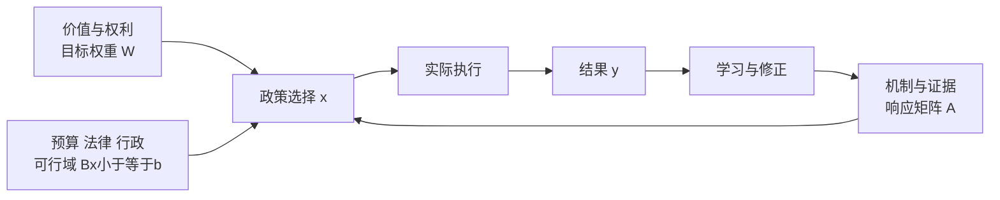

# 政策目标、工具、约束与矛盾：为什么“都要”不是方案

## 要解决的问题

一项产业政策希望同时提高产量、压低价格、增加就业、减少排放、控制财政支出。列出五个目标很容易；困难在于工具的作用常相互关联，行为主体会响应，预算、法律与执行能力又限制可选动作。政策分析先问：**目标是否可度量，工具是否真的独立，结构关系是否可信，哪些取舍属于价值判断？**

## 目标、工具和约束不是同一种东西

把政策结果写成向量 $y\in\mathbb R^m$，例如通胀、就业和排放；可选择工具写成 $x\in\mathbb R^n$，例如税率、补贴强度和配额。局部线性近似为

$$
\Delta y=A\Delta x+u,
$$

其中 $A_{ij}$ 表示在模型与时间窗内，工具 $j$ 改变一个单位时目标 $i$ 的响应；$u$ 是政策之外的冲击。$A$ 是模型对象，不是会计恒等式，更不是凭文件意图得出的经验事实。

Tinbergen 的量化政策框架提醒我们：要独立固定多个目标，通常需要足够多且方向独立的工具。真正关键的是响应矩阵的**秩** $\operatorname{rank}(A)$，而不是政策文件里按钮的机械数量。两个名称不同、实际都只降低融资成本的工具，可能是近乎同一列。

### 一个可检查的不可达目标

教学构造中，两项工具对三个目标的响应为

$$
A=\begin{bmatrix}1&0\\0&1\\1&1\end{bmatrix},\qquad
\Delta y^*=\begin{bmatrix}1\\1\\3\end{bmatrix}.
$$

前两行要求 $\Delta x_1=1,\Delta x_2=1$，第三行随后只能得到 2，而目标要求 3，所以没有精确解。这里 $\operatorname{rank}(A)=2<3$；多写一条目标不会产生第三个可控方向。若把第三个目标从 3 改成 2，目标就落在 $A$ 的列空间中，可以同时达到。

更现实的政策不会只有精确等式。可把问题写成带约束优化：

$$
\min_x (Ax-y^*)^T W(Ax-y^*)+C(x)
\quad\text{s.t.}\quad Bx\le b.
$$

$W$ 是社会对目标偏离的权重，$C(x)$ 是财政、行政或权利成本，$Bx\le b$ 表示预算、法律、容量等约束。$A$ 可由模型和证据争论；$W$ 含规范判断，不能伪装成技术人员从数据中“发现”的唯一答案。

图中“政策选择→结果”只是候选机制；执行偏差、主体反应和外部冲击都可能改变箭头。评价实际因果效果要进入 [[社会科学/40-公共政策与社会学/07-政策评估RCT与准实验|政策评估]]。

## 四类常被混成一种的矛盾

**技术或模型约束**：降低某种排放的工艺短期可能提高成本；这是关于生产可能集的经验/模型命题。**分配冲突**：同样的总收益落到不同人身上；总量净收益不能决定补偿是否充分。**执行约束**：基层无法核验资格、预算不能按时到位、信息系统不互通；纸面工具因此不等于有效工具。**价值与权利冲突**：效率、平等、程序正义、隐私和自由可能给出不同排序，这需要公共理由与制度选择，不能由成本收益比自动消除。

短期和长期也可能反向。补贴短期提高采用率，长期却诱使企业围绕补贴资格设计行为；临时承诺在行动者投资之后可能变得不可信。Kydland 与 Prescott 的时间不一致论证以理性预期模型说明：即使社会目标固定、政策者知道响应，逐期重新选择当下最优动作也可能破坏先前承诺。它揭示一种机制，不等于“规则永远优于裁量”；未知冲击、错误规则和需要救济的例外都会提高裁量的价值。

## 中国案例：碳交易文件只证明制度设计，不证明净效果

生态环境部第 19 号令于 2020 年 12 月 31 日公布，写明《碳排放权交易管理办法（试行）》自 2021 年 2 月 1 日施行，适用范围包括配额分配和清缴、登记、交易、结算、排放报告与核查。这个官方原文可支持“当时建立了哪些制度环节、适用什么活动”。它不能单独支持“减排了多少”“成本由谁承担”或“比碳税更优”。

分析这类政策可把减排、产业成本、财政影响、创新和地区分配列成目标；把配额总量、分配方式、核查、罚则和信息披露列成可能工具。严格代数上，响应矩阵只有列精确线性相关时才降秩；近共线或很小的奇异值表示某方向虽非零却极难稳定控制；共享的薄弱核查能力则是可行域或执行容量约束，不应冒充代数降秩。三者都会让名义工具数夸大实际控制力，但诊断和修复不同。与欧盟等法域比较时，还要逐项核对覆盖行业、配额分配、价格稳定机制、执法和时期，不能只比较“都有碳市场”。

## 一个政策论证的最小审计表

| 层次 | 必答问题 | 常见偷换 |
| --- | --- | --- |
| 目标 | 指标、单位、期间、目标人群是什么？ | 把口号当可测目标 |
| 工具 | 谁能实际改变它，方向是否独立？ | 把部门数量当工具秩 |
| 机制 | $A$ 的符号、滞后和异质性凭什么？ | 把理论箭头当已识别因果 |
| 约束 | 预算、法律、权利、行政容量是什么？ | 只算财政支出 |
| 分配 | 谁受益、承担、被排除？ | 用平均净收益代替分配 |
| 评估 | 目标量和反事实对照是什么？ | 政策后改善即归因政策 |

## 反例与边界

- 一个工具可以影响多个目标；“一目标一工具”是局部可控性的提醒，不是行政分工定律。
- 工具数不少于目标数也不保证可控：列可能共线、方向太弱、受约束或估计错误。
- 目标冲突不表示所有选择等价；支配关系、最低权利线和稳健性仍能排除劣策。
- 政策文本陈述目标与权限，不证明执行强度、遵从、机制或福利结果。
- 总效应为正不保证每个群体受益，也不保证程序合法或权利损失可接受。

## 下一步与来源

税费和支出的真实承担见 [[社会科学/40-公共政策与社会学/02-税收转移公共服务与归宿|税收、转移、公共服务与归宿]]；资源困境见 [[社会科学/40-公共政策与社会学/03-外部性公共品公地与集体行动|外部性与集体行动]]。

来源定位：Tinbergen, *On the Theory of Economic Policy* (1952)，第 3—5 章的目标变量、工具变量、结构方程与最简量化政策问题；Erasmus 大学作者文库分章全文。Kydland & Prescott, “Rules Rather than Discretion” (1977)，第 I—II 节关于逐期最优计划的时间不一致；明尼阿波利斯联储作者论文全文。生态环境部令第 19 号仅用于上文注明日期的制度事实。
