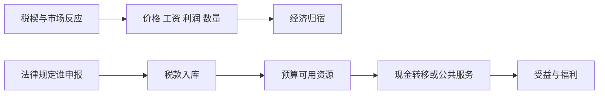

# 税收、转移、公共服务与归宿：谁缴、谁承担、谁受益

## 要解决的问题

法律要求商家申报一项税，是否等于商家承担全部成本？给家庭发 1000 元现金，与提供标价 1000 元的公共服务，福利是否相同？答案都取决于行为反应、价格、资格、服务质量和目标人群。政策账本至少要分开：**法定责任、经济归宿、财政流量和福利变化**。

## 一笔税有四个不同问题

1. **法定纳税人/扣缴义务人**：法律规定谁申报、开票、代扣和缴库。
2. **现金流归宿**：价格、工资、利润或资产价值变化后，谁少了多少钱。
3. **经济福利归宿**：除现金外，消费数量、时间、风险和服务质量怎样变化。
4. **跨期与一般均衡归宿**：资本迁移、企业进入退出、工资和公共预算在更长时期怎样调整。

法定责任可以改变合规成本和执法路径，却不能单独决定经济归宿。在竞争性局部均衡的小变动近似中，从量税 $t$ 的消费者负担份额可写成

$$
s_c=\frac{\varepsilon_s}{\varepsilon_s+|\varepsilon_d|},
\qquad
s_p=\frac{|\varepsilon_d|}{\varepsilon_s+|\varepsilon_d|},
$$

其中 $\varepsilon_s>0$ 是供给弹性，$\varepsilon_d<0$ 是需求弹性。更缺乏弹性的一侧更难逃离交易，通常承担更多。此式依赖竞争、局部变动和弹性定义；市场势力、搜索、避税、跨境与长期资本调整会改变结果。

### 线性供需手算

教学构造：需求 $Q_d=100-2P_b$，供给 $Q_s=20+2P_s$，数量单位为件/月、价格单位为元/件。无税时 $P=20,Q=60$。征收每件 12 元的从量税后，买方价 $P_b=P_s+12$：

$$
100-2(P_s+12)=20+2P_s \Rightarrow P_s=14,
$$

所以 $P_b=26,Q=48$。买方每件多付 6 元，卖方每件少收 6 元，各承担税楔的一半；政府收入为 $12\times48=576$ 元/月。交易量减少 12 件，因此还存在未发生交易的效率损失。把法律缴款人从卖方改为买方，在这个无合规差异的模型里不改变 $P_b-P_s=12$ 和实质归宿。

图的两条路径不能合并：左上是行政法律关系，右侧是行为与预算机制。税收筹资与支出受益必须分别核算后再综合。

## 平均税率、边际税率与“多赚反而更少”

平均税率是总税额/税基，边际税率是新增一单位税基带来的新增税额。超额累进税率只对落入更高档的增量适用；仅因跨档通常不会使税后所得机械下降。但若多个福利资格在同一阈值骤减，税、社保缴费与福利退出合成的**有效边际税率**可能很高，甚至超过 100%。因此分析劳动激励要画完整家庭预算线，不能只看名义最高税率。

例如教学构造中，收入从 2990 增到 3010 元，本应多 20 元，但一项 200 元补助在 3000 元处全部退出，则可支配资源减少 180 元。这不是累进税必然造成，而是资格 cliff 的设计结果。平滑退出可降低 cliff，却扩大覆盖成本；选择哪种方案涉及预算与分配权衡。

## 现金转移与公共服务不能按标价直接等同

现金允许家庭按自身需要组合消费，常有更高选择自由；公共服务可以处理信息不对称、外部性、保险缺口、儿童权利和供给不足，也可能通过集体采购降低成本。比较时至少记录：

| 项目 | 现金转移 | 公共服务/实物给付 |
| --- | --- | --- |
| 预算成本 | 发放额＋管理成本 | 采购、人员、设施与管理成本 |
| 家庭价值 | 取决于边际用途 | 取决于可及性、质量与实际需求 |
| 资格摩擦 | 申领、核验、污名 | 地点、排队、时间、配额 |
| 外部影响 | 由消费用途决定 | 可能直接改善公共卫生/教育等 |
| 分配检查 | 谁领取、谁未申领 | 谁可进入、谁得到较好质量 |

同为“人均投入 1000 元”，不能推断家庭福利增加 1000 元；也不能因现金可自由支配就推断它总优于服务。目标若包含儿童最低保障或传染病控制，权利和外部性会进入评价。

## 中国制度例：增值税法的日期与证据边界

中国人大网原文记载：《中华人民共和国增值税法》于 2024 年 12 月 25 日通过，自 2026 年 1 月 1 日施行；第三条规定境内应税交易和进口货物的单位、个人为纳税人，第七条规定增值税为价外税，第十四条规定一般计税下应纳税额为当期销项税额抵扣当期进项税额后的余额。以上只说明截至该法文本的法律责任与计税结构。

“单位是纳税人”不能推出股东承担税；“价外税”也不能推出消费者承担 100%。经济归宿要观察价格、工资、利润、贸易和行业竞争。美国 CBO 2022 年间接税说明同样明确把法律/预算处理与工资、利润等要素收入变化连接起来，并指出消费端传导可低于或高于 100%；这提供一个国际机构怎样处理归宿不确定性的对照，不代表可把美国估计直接移植到中国。

## 反例与边界

- 极短期供给固定时供给者可能承担更多；长期资本可迁移后归宿可能转向劳动或消费者。
- 补贴与税的符号相反不等于福利效果完全对称；进入、质量、寻租与预算融资不同。
- “政府收入 576”是财政流量，不是社会净收益；税收支持的服务收益和筹资扭曲都还未计。
- 总转移额提高不保证目标家庭实际收到；资格误排、未申领、地方服务容量会改变结果。
- 本页是机制课程，不是个人税务建议；实际义务须查适用法域、交易、身份和当期配套规则。

## 下一步与来源定位

为何要筹资、哪些物品可能需要集体供给，见 [[社会科学/40-公共政策与社会学/03-外部性公共品公地与集体行动|外部性、公共品与公地]]；怎样估计政策后果见 [[社会科学/40-公共政策与社会学/07-政策评估RCT与准实验|政策评估]]。

来源定位：中国人大网《中华人民共和国增值税法》第一、三、七、八、十四及三十八条支持上文注明日期的法律事实；CBO, *Use of the Income and Payroll Tax Offset* (2022) 的说明和注释支持间接税会改变要素收入、传导并非由法定缴款人唯一决定。公式与两组预算例均为本页教学推导。

