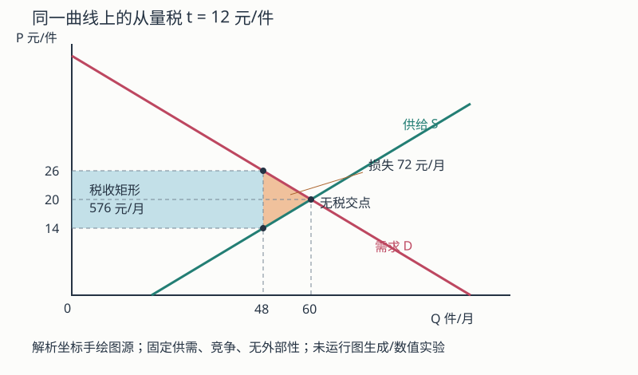
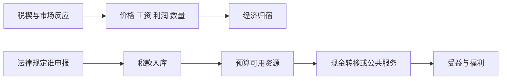

# 税收、转移、公共服务与归宿：谁缴、谁承担、谁受益

## 要解决的问题

法律要求商家申报一项税，是否等于商家承担全部成本？给家庭发 1000 元现金，与提供标价 1000 元的公共服务，福利是否相同？答案都取决于行为反应、价格、资格、服务质量和目标人群。政策账本至少要分开：**法定责任、经济归宿、财政流量和福利变化**。

## 基础与快进入口：从工资单认识扣缴

初次阅读，从法定责任、供需算例与公共服务顺读；已有税收基础，可快进线性供需和福利退出阈值，再改条件检验结论。两条路线汇入相同账本与答案。

工资单上雇主代扣一笔所得税，至少有三件不同的事：劳动者的税前收入、支付者履行扣缴、税款入库。2018年修正《个人所得税法》第9条区分所得人纳税和支付者扣缴，第10—11条规定信息提供及预扣、年度处理。[税务总局官方全文](https://www.chinatax.gov.cn/n810219/n810744/n3752930/n3752974/c3970366/content.html)（文本2018-08-31修正；实际读取2026-10-07）。本次只以此支持角色和期间区分，不认证全部现行配套细则。

[[社会科学/20-经济流动与宏观/08-工资劳动关系税费与生活成本|工资账本]]用明确虚构的税制解释税前、到手、家庭现金与生活资源。本页继续负责价格与行为变化之后谁实际承担以及谁受益。劳动者在工资单缴了税，不能因此推断长期全部经济负担必由劳动者承担；长期工资、利润、就业和价格变化还需证据。

## 一笔税有四个不同问题

1. **法定纳税人/扣缴义务人**：法律规定谁申报、开票、代扣和缴库。
2. **现金流归宿**：价格、工资、利润或资产价值变化后，谁少了多少钱。
3. **经济福利归宿**：除现金外，消费数量、时间、风险和服务质量怎样变化。
4. **跨期与一般均衡归宿**：资本迁移、企业进入退出、工资和公共预算在更长时期怎样调整。

税单寄给谁，不等于最后谁买单。法定责任可以改变合规成本和执法路径，却不能单独决定经济归宿。从无税共同价格 $P>0$、共同数量 $Q>0$ 出发，在竞争性局部均衡的小变动近似中，从量税 $t$ 的消费者负担份额可写成

$$
s_c=\frac{\varepsilon_s}{\varepsilon_s+|\varepsilon_d|},
\qquad
s_p=\frac{|\varepsilon_d|}{\varepsilon_s+|\varepsilon_d|},
$$

其中 $\varepsilon_s>0$ 是供给弹性，$\varepsilon_d<0$ 是需求弹性，两者须在同一无税 $(P,Q)$ 评价；已有税楔时的价格校正见末节。更缺乏弹性的一侧更难逃离交易，通常承担更多。此式依赖竞争、局部变动和弹性定义；市场势力、搜索、避税、跨境与长期资本调整会改变结果。

### 线性供需手算

图的横轴件/月、纵轴元/件，无税交点(60,20)，税后买价26/卖价14/数量48；矩形税收12×48=576元/月，三角损失12×(60−48)/2=72元/月。SVG为按这些解析坐标手工排版的图源；未运行数值生成器或真实客户端渲染。仅解释固定供需、竞争、无外部性的局部模型，不推出总体税收好坏。

教学构造：需求 $Q_d=100-2P_b$，供给 $Q_s=20+2P_s$，数量单位为件/月、价格单位为元/件。无税时 $P=20,Q=60$。征收每件 12 元的从量税后，买方价 $P_b=P_s+12$：

$$
100-2(P_s+12)=20+2P_s \Rightarrow P_s=14,
$$

所以 $P_b=26,Q=48$。买方每件多付 6 元，卖方每件少收 6 元，各承担税楔的一半；政府收入为 $12\times48=576$ 元/月。交易量减少 12 件，因此还存在未发生交易的效率损失。把法律缴款人从卖方改为买方，在这个无合规差异的模型里不改变 $P_b-P_s=12$ 和实质归宿。

图的两条路径不能合并：左上是行政法律关系，右侧是行为与预算机制。税收筹资与支出受益必须分别核算后再综合。

## 平均税率、边际税率与“多赚反而更少”

平均税率是总税额/税基，边际税率是新增一单位税基带来的新增税额。超额累进税率只对落入更高档的增量适用；仅因跨档通常不会使税后所得机械下降。但若多个福利资格在同一阈值骤减，税、社保缴费与福利退出合成的**有效边际税率**可能很高，甚至超过 100%。因此分析劳动激励要画完整家庭预算线，不能只看名义最高税率。

例如教学构造中，收入从 2990 增到 3010 元，本应多 20 元，但一项 200 元补助在 3000 元处全部退出，则可支配资源减少 180 元。这不是累进税必然造成，而是资格 cliff 的设计结果。平滑退出可降低 cliff，却扩大覆盖成本；选择哪种方案涉及预算与分配权衡。

## 现金转移与公共服务不能按标价直接等同

现金允许家庭按自身需要组合消费，常有更高选择自由；公共服务可以处理信息不对称、外部性、保险缺口、儿童权利和供给不足，也可能通过集体采购降低成本。比较时至少记录：

| 项目 | 现金转移 | 公共服务/实物给付 |
| --- | --- | --- |
| 预算成本 | 发放额＋管理成本 | 采购、人员、设施与管理成本 |
| 家庭价值 | 取决于边际用途 | 取决于可及性、质量与实际需求 |
| 资格摩擦 | 申领、核验、污名 | 地点、排队、时间、配额 |
| 外部影响 | 由消费用途决定 | 可能直接改善公共卫生/教育等 |
| 分配检查 | 谁领取、谁未申领 | 谁可进入、谁得到较好质量 |

同为“人均投入 1000 元”，不能推断家庭福利增加 1000 元；也不能因现金可自由支配就推断它总优于服务。目标若包含儿童最低保障或传染病控制，权利和外部性会进入评价。

## 预算承诺到实际到账：权利与行政负担

预算有钱、家庭具备资格、机关批准与家庭实际收到，是四个不同事实。可沿以下实施链找卡点：政策与权限→预算下达→知情或自动识别→申请受理→审核与理由→资金到账/服务可用→可负担的复核与执行。资金没有下达与材料反复补交，需要不同改进；审批通过而未付款也不能计为实际受益。

Moynihan、Herd、Harvey（2015，在线2014）把行政负担区分为**学习成本**（找到并理解规则）、**合规成本**（材料、交通和误工）与**心理成本**（污名、压力和失去自主感）。这是源于美国Medicaid案例的研究框架，不是中国各地负担大小的现成估计；本轮读取作者机构摘要，出版方DOI入口访问失败。[作者机构记录](https://scholars.uky.edu/en/publications/administrative-burden-learning-psychological-and-compliance-costs/)

### 同样100万元承诺，为什么实际到账可以只有51.3万元

**教学构造，不是真实低保发放率：** 已满足资格的1000人，每人本期给付1000元。设知情率0.8、知情后申请率0.75、申请后批准率0.9、批准后到账率0.95，则预期到账人数为

$$N_{\mathrm{到账}}=1000\times0.8\times0.75\times0.9\times0.95=513.$$

| 在同一符合资格总体中的阶段 | 人数/预期人数 | 该环条件比例 |
| --- | ---: | ---: |
| 符合资格 | 1000 | 作为总分母 |
| 知情 | 800 | 800/1000=80% |
| 申请 | 600 | 600/800=75% |
| 获批 | 540 | 540/600=90% |
| 本期到账 | 513 | 513/540=95% |

所以实际期望到账为513×1000=51.3万元。90%的申请批准率与51.3%的合格人群实际到账率都可成立：仅看申请者会漏掉未申请者。链式相乘是条件概率分解，**不假定各环独立**；本例固定所有申请者均属于已满足资格者，不能拿它估计错误纳入。自动发放或绕过申请时应改变链的节点，不强套漏斗。

同一家庭净现金还要扣交通、误工和合规费用，核对其他给付是否被抵减；未到账未必永久失去，要记录延迟与后续补发。服务给付另查排队、地点、质量和实际使用。健康、尊严和权利不能靠任意“货币化系数”塞入一个总分。

### 低保文本提供了什么权利，仍缺什么执行证据

民政部2021《最低生活保障审核确认办法》提供一个具体接口：第10条要求材料一次告知补齐并避免重复提交可查询材料；第21—22条区分同意、拒绝理由与办理期限；第25条规定按月经金融机构支付；第38条设复议/诉讼入口；第39条同时规定追责和及时纠正的善意失误免责。[上海市政府同源官方转载](https://www.shanghai.gov.cn/lnshjz/20230420/d856013703f44b3a920e10794cb078ab.html)（2021文本，2026-10-09读取；中国政府网原入口403）。

这支持识别**有据可查的程序承诺**，不证明所有地方已兑现，也不认证2026各地全部现行细则。实际应分别取得匿名汇总的受理日期、补件次数、拒绝依据、复核改判、批准与到账日期，以及能够覆盖未申请合格者的调查。仅有热线或胜诉记录也不证明纠正已经到账；外部复核的权限与执行条件见 [[社会科学/40-公共政策与社会学/15-公共可纠错性的制度条件|公共可纠错性]]。

### 错纳与漏保，都有人承担代价

审核有两种错误：给不合格者发放（FP），不给合格者发放（FN）。一份教学损失表可写为 $L=c_{FP}n_{FP}+c_{FN}n_{FN}+K$，其中n为同期间人数，c为每名错误的代价，K为管理成本；只有代价已用同一单位合理量化时才可相加，不能拿任意系数牺牲最低权利。

若组织只惩罚FP而不记录FN，过度拒绝可能对经办者最安全，却把错误成本留给家庭。这是可检验的机制假说，不是从领取人数减少推断漏保率。清退原来不合格者、人口与收入变化、标准变化都能改变人数。研究须同时观察资格、申请、误判和纠正，福利审核与组织监督的对象、错误和激励不能压成“监督总好/总坏”。监督与组织避责的机制比较见 [[社会科学/40-公共政策与社会学/13-拒错内卷与组织纠错|组织纠错]]。

手续简化和可信复核可能提高实际到达率；反例是瓶颈在真实供给或财源，此时只减材料不能增加病床、教师或已下达资金。是否改善须比较管理成本、双侧错误、等待、净资源及服务结果。以上手算没有运行程序；调查、回归、模拟、客户端与真人理解均为not_run。

金融救助也有同样的归宿问题：保护债权人的支付可能改变未来税负、服务和家庭现金，须逐条找证据，并把财富转移与真实资源损害分开。完整账本应用见 [[社会科学/30-金融市场与风险/11-影子银行财政承诺与损失归宿|影子信用、财政承诺与损失归宿]]。

## 中国制度例：增值税法的日期与证据边界

中国人大网原文记载：《中华人民共和国增值税法》于 2024 年 12 月 25 日通过，自 2026 年 1 月 1 日施行；第三条规定境内应税交易和进口货物的单位、个人为纳税人，第七条规定增值税为价外税，第十四条规定一般计税下应纳税额为当期销项税额抵扣当期进项税额后的余额。以上只说明截至该法文本的法律责任与计税结构。

“单位是纳税人”不能推出股东承担税；“价外税”也不能推出消费者承担 100%。经济归宿要观察价格、工资、利润、贸易和行业竞争。美国 CBO 2022 年间接税说明同样明确把法律/预算处理与工资、利润等要素收入变化连接起来，并指出消费端传导可低于或高于 100%；这提供一个国际机构怎样处理归宿不确定性的对照，不代表可把美国估计直接移植到中国。

## 反例与边界

- 极短期供给固定时供给者可能承担更多；长期资本可迁移后归宿可能转向劳动或消费者。
- 补贴与税的符号相反不等于福利效果完全对称；进入、质量、寻租与预算融资不同。
- “政府收入 576”是财政流量，不是社会净收益；税收支持的服务收益和筹资扭曲都还未计。
- 总转移额提高不保证目标家庭实际收到；资格误排、未申领、地方服务容量会改变结果。
- 本页是机制课程，不是个人税务建议；实际义务须查适用法域、交易、身份和当期配套规则。

## 下一步与来源定位

为何要筹资、哪些物品可能需要集体供给，见 [[社会科学/40-公共政策与社会学/03-外部性公共品公地与集体行动|外部性、公共品与公地]]；怎样估计政策后果见 [[社会科学/40-公共政策与社会学/07-政策评估RCT与准实验|政策评估]]。

来源定位：中国人大网《中华人民共和国增值税法》第一、三、七、八、十四及三十八条支持上文注明日期的法律事实；CBO, *Use of the Income and Payroll Tax Offset* (2022) 的说明和注释支持间接税会改变要素收入、传导并非由法定缴款人唯一决定。公式与两组预算例均为本页教学推导。

## 通识迁移练习与答案

1. **本页从量税谁依法缴，谁经济承担？** 模型的法定缴款身份可改变，买方卖方各承担每件6元税楔；这个等分依赖本例供需条件。
2. **税后交易48件，每件税12，财政收入多少？** 576元/月；它不是社会净收益。
3. **2990到3010的工资变化遇到200元补助全部退出，资源怎样变？** 减180元；是资格阈值的教学结果，不是所有累进税结果。
4. **政府服务成本1000等于家庭受益1000吗？** 未知。需质量、可及性、需求及替代支出；拒绝成本直接等于福利。
5. **供给更容易迁移时，能否坚持原等分税负？** 不能沿用不变假设。重新估计供需、时期和市场边界后再判归宿。
6. **只看平均受益为正能否决定实施？** 不充分。给出预算、群体分配、权利、替代方案或风险中两项，并解释；等价论证可接受。

## 税楔的局部基准与迁移（#18、#26）

前面的弹性简式只用于从**无税共同价格** $P>0$、数量 $Q>0$ 出发的微小从量税；供需弹性须在同一 $(P,Q)$ 评价。已有税楔时先对均衡微分：$D'dP_b=S'dP_s$ 与 $dP_b-dP_s=dt$，故 $dP_b/dt=S'/(S'-D')$。若改写为税后弹性，须保留各自价格：$({\varepsilon_s}/{P_s})/({\varepsilon_s}/{P_s}+|\varepsilon_d|/{P_b})$。本例 $S'=2,D'=-2$，所以为 $1/2$；把税后 $\varepsilon_s=7/12,|\varepsilon_d|=13/12$ 直接代无税简式得 $7/20$，错误地混了价格基准。

熟悉者可直接做本节迁移题；首次阅读先保留前文 t=12 的完整示范。

> [!question] 渐撤补全与迁移
> 1. 原曲线只提示 $Q_d=100-2P_b,Q_s=20+2P_s,P_b-P_s=12$，省略最后一步，填 $P_b=\square,P_s=\square,Q=\square$；说明共用微分为何要有可微局部均衡。
> 2. 改供给为 $Q_s=20+P_s$，仍 t=12；先求新的无税均衡，再求税后价格/数量和买卖方负担，不能沿用 P=20 的旧基准。
> 下次先答的回忆题：依法缴款人为何不能独自决定经济归宿？

> [!answer]- 参考答案与错误前提
> 1. 26、14、48；曲线可微且局部均衡可随税变动，价格校正不能漏。2. 无税 $P=80/3,Q=140/3$；税后 $P_b=92/3,P_s=56/3,Q=116/3$，买方+4、卖方净价−8。若答各6，是把旧曲线斜率/均衡偷偷带进新题；负担还取决于市场反应而非法定身份。允许等价代数推导。题材/答案已给，真人理解与客户端未验收。
