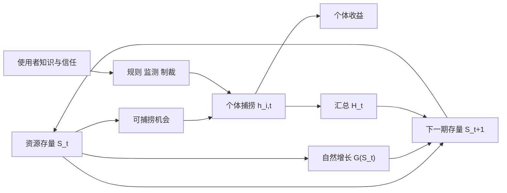

# 外部性、公共品、公地与集体行动：先辨认困境，再谈治理

## 要解决的问题

污染、路灯、拥挤渔场、开源软件和社区消防都涉及多人，却不是同一种问题。若只贴上“市场失灵”标签就直接开药，会漏掉排他成本、拥挤、信息、权力和执行。第一步应问两件事：一个人的使用会不会减少别人可用的数量？能不能以合理成本把未付费者排除？

| | 易排他 | 难排他 |
| --- | --- | --- |
| **使用有竞争性** | 私人物品：一份餐食 | 共同池资源：开放渔场、拥挤含水层 |
| **使用低竞争性** | 俱乐部品：未拥挤订阅服务 | 公共品：防洪信息、基础国防 |

这是连续维度的分析表，不是自然界永久分类。道路在空闲时接近低竞争，拥堵时高度竞争；技术、收费系统和法律会改变排他性。公共品与公地尤其不能互换：公共品常因难收费而供给不足，公地常因可进入且竞争而提取过度。

## 外部性：决策者没有面对全部社会边际代价

若企业产量为 $q$，私人成本 $C(q)$，污染损害 $D(q)$，社会成本为 $C(q)+D(q)$。竞争性模型中有效产量满足

$$
MB(q)=MC(q)+MD(q),
$$

而企业若只面对 $MC$，会在 $MB=MC$ 处停下，通常产量更高。庇古税尝试让每单位税等于边际外部损害；总量管制直接约束 $q$；可交易配额把总量约束与交易结合。三者都要求监测对象、基线、执法和对分配的处理。

教学构造：某额外排放单位给企业带来 8 元收益，却让四户居民各损失 3 元。企业私人净收益为 +8，社会净变化为 $8-4\times3=-4$。若每户分别谈判都需 4 元协调成本，总交易成本 16 元，超过避免排放的社会收益 4 元，简单“让双方自行协商”不一定发生。数字只展示外部性与交易成本机制，不代表真实污染估值。

## 公共品：每个人看到同一数量，边际意愿相加

Samuelson 1954 把集体消费品写成每个人同时消费同一公共品数量。简单内部解的有效供给条件为

$$
\sum_i MRS_i=MRT,
$$

即每个人对新增一单位公共品的边际愿付相加，等于它对私人物品的边际转化成本。私人物品则是各自消费量相加。难点不只在生产，还在真实偏好不易揭示：若无法排除未付款者，个人可能少报愿付并搭便车。

例如两户对一盏额外路灯分别愿付 6 元与 5 元，成本 9 元；合计愿付 11 元说明在这个静态完整信息算例中供给有 2 元净剩余。若要求任何一户单独购买，两户都可能拒绝。反过来，合计愿付低于成本也不因“公共”二字就应供给。

## 公地：个体收益集中，拥挤损害分散

共同池资源的关键是存量和流量。鱼群存量 $S_t$ 在时间中按

$$
S_{t+1}=S_t+G(S_t)-H_t
$$

变化，$G$ 是自然增长流量，$H$ 是总捕捞流量。每个捕捞者得到自己的收益，却只承担资源存量下降的一部分损害，开放进入会使私人成本低于社会成本。静态减少一次捕捞和长期维持再生能力不是同一目标。

图中 $H_t=\sum_i h_{i,t}$；$S_t$、自然增长 $G(S_t)$ 与总捕捞 $H_t$ 一起决定 $S_{t+1}$，箭头只表示机制方向。图展示一个反馈模型；它没有证明自治、私有化或国家管理哪一个必胜。Ostrom 的研究反对“使用者必然无力走出困境”和市场/国家二分，强调多中心安排、规则与情境匹配。她的案例不是把若干设计原则抄成万能清单：边界、监测、冲突解决、嵌套层级能否工作仍取决于资源尺度、权力和执行。

## 集体行动为什么不只由人数决定

个人是否贡献取决于收益是否可排他、贡献能否观察、群体是否重复互动、惩罚和声誉是否可信、退出是否可行，以及大参与者能否先承担启动成本。小群体也会被权力不平等和搭便车困住；大群体也可能通过选择性激励、代表组织和数字基础设施协调。

将其中“重复、观察和可信惩罚”拆成可核条件，见 [[社会科学/20-经济流动与宏观/50-博弈与机制/03-重复合作监测与折现#只公开报警：检测率改变的是激励，不是道德|公共检测与合作阈值]]：同一阶段收益下，已知有限终点、无限未来和漏检对应不同偏离激励；惩罚本身也要由后续最优回应支撑。这个有限合成模型说明机制，不认证真实组织会合作，也不把合谋自动算社会改进。

Coase 1960 的核心启发不是“无条件私下谈判即可解决污染”，而是比较不同社会安排的总效果，并把交易成本、权利初始配置与制度运行纳入分析。即使零交易成本模型给出有效配置，初始权利仍影响财富分配；现实中谈判、测量、执行和策略行为更不能略去。

## 中国案例与国际对照的正确证据范围

生态环境部第 19 号令于 2020 年 12 月 31 日公布，并写明自 2021 年 2 月 1 日施行；其适用活动包括配额分配与清缴、登记交易、排放报告与核查。它是“以总量/配额、监测核查和交易构成治理结构”的中国制度实例。原文能证明规则设计及日期，不能证明真实边际减排成本、价格传导或净减排效果。

国际比较不应只问“碳税还是碳市场”。应比较覆盖气体和行业、总量如何确定、配额怎样分配、监测误差、价格波动、收入用途、边境泄漏和弱势群体补偿。相同工具名在这些维度上可能对应不同机制。

## 反例与选择框架

| 条件 | 可能偏好的工具 | 主要失败点 |
| --- | --- | --- |
| 损害可按量测、来源多 | 税或统一标准 | 损害估值错、规避、分配冲击 |
| 总量上限关键、成本异质 | 可交易配额 | 初始分配、市场势力、价格波动 |
| 当事人少、权利清楚、交易成本低 | 协商 | 权力差距、策略拖延、受害者遗漏 |
| 本地共同池、使用者有知识且重复互动 | 共同治理 | 边界不清、俘获、外部冲击 |
| 跨域公共品与强溢出 | 多层政府/国际协调 | 搭便车、执行和主权冲突 |

“市场失灵”只说明无干预基准有问题，不能自动推出某一政府方案；政府也面对信息、激励、寻租和执行成本。治理比较应把不行动、税、数量、产权、公共供给、共同治理及混合方案放在同一目标与证据框架中。

## 下一步与来源定位

目标与工具秩见 [[社会科学/40-公共政策与社会学/01-政策目标工具约束与矛盾|政策目标与工具]]；关系网络怎样支持或排除合作，见 [[社会科学/40-公共政策与社会学/05-网络社会资本制度与文化|网络与社会资本]]。

来源定位：Samuelson, “The Pure Theory of Public Expenditure” (1954), pp. 387–389，支持集体消费品定义与边际替代率求和条件；Coase, “The Problem of Social Cost” (1960)，尤其开头案例与后半关于社会安排选择，支持交易成本和互惠损害视角；Ostrom, “Beyond Markets and States” 诺奖演讲 (2009)，支持多中心治理与超越国家/市场二分。中国制度事实仅据生态环境部第 19 号令。
