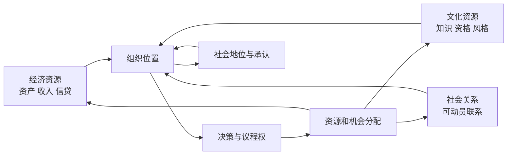

# 阶层、地位、权力与组织：收入相同为何机会仍不同

## 要解决的问题

甲和乙年收入相同。甲拥有能产生租金的资产和稳定职业资格，乙靠不稳定工时获得同样收入；丙收入不高，却能决定组织预算和人员；丁有很高社会声望，却没有行政权。把四人压成一个“收入档”会漏掉不同的机会机制。社会分层分析要问：**控制什么资源、处在什么关系、得到何种承认、能让谁服从、这些优势怎样跨期转换？**

## 四个框架各自解释什么

| 框架 | 主要单位 | 核心机制 | 不能被它单独替代的东西 |
| --- | --- | --- | --- |
| Marx 的阶级关系 | 对生产资料与劳动过程的关系 | 劳动力成为商品、剩余与控制在生产关系中形成 | 声望差异、组织内具体权威、所有非资本主义分层 |
| Weber 的阶级/地位/政党 | 市场处境、社会荣誉、组织化权力 | 经济机会、生活方式与承认、定向影响集体行动 | 三者不能压成同一梯子 |
| Bourdieu 的资本形式 | 经济、文化、社会资本及其场域转换 | 积累、制度认证、关系动员、象征承认 | “资本”不是所有好处的随意同义词 |
| 组织理论的职位权力 | 规则化职位与资源依赖 | 决策权、信息门槛、奖惩、议程设置 | 正式组织图不等于实际影响网络 |

这些框架可以对同一案例提出不同问题，但不能把概念拼成一条未经论证的因果链。Marx《资本论》卷一的劳动过程、劳动力买卖与剩余价值分析关注生产关系；Weber 明确区分由市场处境形成的 class situation、由社会荣誉形成的 status order，以及以影响集体行动为目标的 party；Bourdieu 讨论经济、文化与社会资本的积累和转换。它们的研究对象、历史范围与规范立场并不相同。

## 权力不是一个人“拥有的气场”

本页用一个综合分析框架把权力看成关系：在给定场域和替代选项下，行动者 A 能否让 B 做原本不会做的事、阻止议题进入决策、或塑造什么被视为合理。三种问法来自不同权力理论传统，本页不把它们归成 Marx、Weber 或 Bourdieu 任一人的单一原命题；这里只用来检查组织如何把影响稳定成职位、流程和资源控制。

箭头是一组候选反馈：资格可能提高入职机会，职位可能反过来积累关系和声望。图没有说明每条边在所有社会都成立，也没有识别净因果。要检验其中一条，应定义时间、单位、对照与替代机制。

## “同收入”最小人物卡

以下为教学构造，金额单位万元/年：

| 人物 | 当年收入 | 资产/负债 | 工作与组织位置 | 被承认的资格/地位 | 一次冲击后的脆弱性 |
| --- | ---: | --- | --- | --- | --- |
| 甲 | 20 | 净资产 200 | 自雇，无正式下属 | 行业资格证 | 客户减少但有资产缓冲 |
| 乙 | 20 | 净负债 20 | 平台接单，可替代性高 | 技能未获正式认证 | 停工即失去主要现金流 |
| 丙 | 20 | 净资产 20 | 负责 500 万预算和招聘 | 组织内地位高 | 离开组织后权力可能消失 |
| 丁 | 20 | 净资产 20 | 无正式管理权 | 社群声望高 | 可动员支持但不能签批预算 |

这张表不产生“谁更高阶层”的唯一答案；它迫使分析者说明结果变量。问消费能力，当前收入重要；问抵御失业，资产与保险重要；问政策执行，组织职位重要；问号召力，社会承认和网络重要。

## 代际表要分绝对流动与相对流动

教学构造的父代—子代职业位置转移人数如下，每行 100 人：

| 父代位置 \ 子代位置 | 低 | 中 | 高 |
| --- | ---: | ---: | ---: |
| 低 | 50 | 40 | 10 |
| 中 | 20 | 60 | 20 |
| 高 | 10 | 30 | 60 |

低位父代子女中 50% 向上，是**绝对流动**描述；但高位父代子女进入高位的概率 60%，低位父代只有 10%，说明相对机会仍强烈相关。若经济扩张使“高位”岗位总数增加，绝对向上流动可提高而相对排序关联仍强。类别边界、年龄、家庭单位和权重改变都会影响比较，不能只报一个“流动率”。

## 中国案例：行政身份是一条制度通道，不是人的本质

国发〔2014〕25 号《国务院关于进一步推进户籍制度改革的意见》成文于 2014 年 7 月 24 日，提出调整落户政策并推进城镇基本公共服务覆盖，也明确不同规模城市和地方实施条件。它说明在该文件的制度设计中，户籍与公共服务、迁移规则存在行政连接。

这不能推出“户籍决定一个人的阶级”，更不能把 2014 年中央意见当作所有地区、所有年份完全相同的现行实施。研究现实机会时，应把户籍状态、地区细则、教育与社保可及性、职业、收入资产和组织位置分别测量，再说明数据年份。国际对照中的种族、种姓、移民身份或职业资格也各有不同法律机制，不能找到一个标签就宣称等价。

## 生态谬误与分类的边界

若某地区平均收入高、某职业群体平均声望高，不能推出该地区或职业中的每个人都更有资源。群体平均关系还可能由年龄、城市规模、选择进入或测量造成。阶层分类是为解释机会与关系而建的分析构造，不是给个人贴道德等级。

反例也能检查理论边界：暴发户可能经济资源高而既有地位承认低；名望很高的学者可能没有预算权；高层管理者离职后组织权力骤降；文化资本在一个场域有效，在另一个场域可能不被承认。这些情况不是“异常噪声”，而是多维框架要解释的核心。

## 下一步与来源定位

资源如何沿联系流动，见 [[社会科学/40-公共政策与社会学/05-网络社会资本制度与文化|网络与社会资本]]；分类怎样进入差别对待，见 [[社会科学/40-公共政策与社会学/06-规范身份歧视与自我实现|规范、身份与歧视]]。

来源定位：Marx, *Capital* Vol. I，第 6、7、10、16—17 章用于劳动力、劳动过程与剩余关系；Weber, “Class, Status, Party” 对应 *Economy and Society* 中市场处境、地位荣誉与政党的区分；Bourdieu, “The Forms of Capital” (1986), pp. 241–258 用于资本的积累、制度化和转换。国发〔2014〕25 号只支持上文注明日期的制度文本事实。
