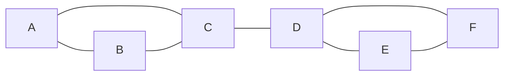
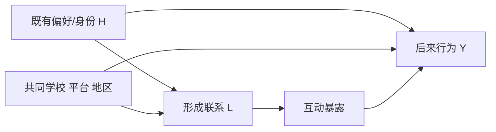

# 网络、社会资本、制度与文化：相似的人为何连在一起

## 要解决的问题

“认识很多人”“朋友很铁”“能跨群体获得新信息”“有人愿意替你担保”是四种不同能力。联系人数量是结构描述，关系强度是边的属性，桥接位置说明连接了哪些原本分离的群体，社会资本则还要问这些关系中有什么资源、谁能动员、谁因此被排除。

## 从图开始，但别把图当结论

把人或组织记作节点 $V$，关系记作边 $E$，网络为 $G=(V,E)$。下面的教学网络中，A 与 B、C 紧密相连，D 连接两个小团体：

节点度数是直接邻居数：$deg(C)=3,deg(D)=3$。若删去 C—D，网络分成两个分量，所以这条边是桥；C、D 位于跨群体路径上。D 的度没有比 C 更大，却可能在信息跨群体流动中关键。Granovetter 1973 的论证把微观联系强度与网络重叠、桥接及宏观扩散连接起来；“弱联系有力量”不等于任何泛泛之交都比亲密关系有用，结构位置和传递的资源才是机制。

## 联系、结构和资本分三层

| 层次 | 可观察对象 | 问题例子 | 不能直接推出 |
| --- | --- | --- | --- |
| 联系 | 是否相识、频率、互惠、情感强度 | 谁与谁互动？ | 有资源可动员 |
| 结构 | 度、聚类、桥、中心性、社群 | 谁连接了分离群体？ | 这人必然有权力或受益 |
| 社会资本 | 信任、义务、信息、规范、可调用帮助 | 关系为谁促成行动？ | 对所有人都有公共收益 |

Coleman 1988 把社会资本理解为社会结构中便利行动的某些方面，并讨论义务与期待、信息渠道、规范等形式。关键是“功能对谁成立”：一个封闭网络可帮助成员互保，也可排斥外人、压制异议或强化串谋。Bourdieu 路线还会追问成员资格与资源不平等；因此社会资本既不是联系人总数，也不是天然善。

常见的 bonding/bridging/linking 可作实用区分：纽带型联系支持群体内部互助；桥接型联系跨越不同社群；纵向连接把普通成员接到掌握制度资源的组织位置。它们可重叠，且价值依赖任务。紧急照护可能靠强纽带，求职新信息可能从桥接关系来，获得正式许可则可能需要制度化纵向通道。

## 相似来自选择、影响还是共同环境

朋友都喜欢某种内容，至少有三种机制：

第一条是**同质选择**：相似者更可能结交；第二条是**共同环境**：同校或算法同时塑造联系与行为；第三条才是**社会影响**。Shalizi 与 Thomas 证明，在有潜在同质性时，纯观察网络数据中的选择与影响一般会混杂，需要强参数假设、充分协变量或实验/自然实验才可能区分。看见朋友行为相关，甚至看见时间上的先后，都不足以单独识别传染。

若把观察网络交给模型预测行为，先到 [[AI/16-图表示学习/04-训练拆分无图基线与泄漏#数据先生成，再限制学习器能看到什么|边从哪里来、学习器能看到什么]]，再按 [[AI/16-图表示学习/04-训练拆分无图基线与泄漏#整图拆分：节点是预测单位，图是抽样单位|实体与图的拆分合同]] 核对特征、边与标签的取得时点。那里的同配/异配合成对照检验可评测信息，不为本段的社会影响提供因果识别；现实预测也不能把未来连边带回过去充当已知输入。

### 一个阈值扩散算例

采用如下教学规则：第 $r+1$ 轮的非采用者只读取第 $r$ 轮的状态，若上一轮采用邻居所占比例达到自己的阈值，就在下一轮采用；采用后不退出。也就是说，这是**同步、不可逆**更新，不能从一轮内部刚新增的节点继续连锁更新。

先令所有节点阈值都是“至少 $1/2$”，初始状态为 $S_0=\{C\}$：

| 轮次 | 上一轮满足阈值而新增的节点 | 本轮采用集合 |
| ---: | --- | --- |
| 0 | — | $\{C\}$ |
| 1 | $A,B$：各有邻居 C，在两个邻居中占 $1/2$ | $\{A,B,C\}$ |
| 2 | 无：D 仍只有 C 一个采用邻居，在 C、E、F 三个邻居中占 $1/3$ | $\{A,B,C\}$ |

此后状态不变，扩散停在左侧三角形。现在只把 D 的阈值改为“至少 $1/3$”，其余阈值仍为 $1/2$：

| 轮次 | 上一轮满足阈值而新增的节点 | 本轮采用集合 |
| ---: | --- | --- |
| 0 | — | $\{C\}$ |
| 1 | $A,B$ 各达到 $1/2$；D 达到其新的 $1/3$ | $\{A,B,C,D\}$ |
| 2 | $E,F$：各有邻居 D，在两个邻居中占 $1/2$ | $\{A,B,C,D,E,F\}$ |

这个例子展示的是模型规则下的扩散路径；它不从观察到的网络相关性推出社会影响，更不证明真实人的采用规则是确定阈值或干预 C 必然优于干预 D。异步更新、允许退出、多个竞争行为或随时间变化的网络都会构成另一模型，并可能给出不同轨迹。

## 制度与文化不是网络外部的固定背景

法律决定哪些组织可登记和持产，平台排序决定哪些联系可见，学校与单位安排相遇机会，语言和仪式影响信任与边界。网络也反过来传播规范、筛选领导者并改变制度执行。文化在这里是共享分类、意义与实践如何进入关系形成和行动，不是“某民族天生重关系”的万能解释。

研究中国的宗族、方言、会馆或单位网络时，应回链 [[哲学与文化/10-主题/01-文化政治与组织结构/06-宗族语言与纽带桥接|宗族、语言与纽带—桥接]] 的历史语境，并保持时期与地区差异。本页只提供通用网络机制，不把原专题的历史论证复制或升级为已识别因果。

## 中国调查与国际比较：先看抽样和问卷

CGSS 官方说明其不同周期采用多阶段分层 PPS 抽样，但抽样框、阶段和样本量发生过变化；2017 年数据发布说明还列出“社会网络和网络社会”模块及与 EASS 的比较模块。这些文件证明调查设计和模块存在，不能单独证明任何网络效应。

若用 CGSS 或其他国际调查比较“社会信任”“联系人数量”，必须核对波次、题目措辞、提名上限、关系定义、抽样权重和缺失。一个问卷最多让受访者提名 5 人，另一个不限数量，平均度数就不可直接比较；不同平台的好友关系也不等于面对面互助关系。

## 反例与边界

- 高中心性可能带来信息，也可能带来过载、监督和脆弱性。
- 封闭网络可执行规范，也可维持排斥与错误信息；“信任高”不自动等于公共福利高。
- 桥接者可能控制信息获益，也可能被两边视为不可靠。
- 网络是处理后的变量时，按它控制可能阻断中介或打开碰撞路径。
- 个体随机处理可有同伴溢出，普通 SUTVA 失效；需定义暴露映射和集群设计。

## 下一步与来源定位

社会资本怎样与经济、文化资源转换，见 [[社会科学/40-公共政策与社会学/04-阶层地位权力与组织|阶层与组织]]；分类和预期如何反馈，见 [[社会科学/40-公共政策与社会学/06-规范身份歧视与自我实现|规范、身份与歧视]]；选择/影响的 DAG 真源见 [[社会科学/10-共同工具/03-因果图反事实与识别|因果图与反事实]]。

来源定位：Granovetter (1973), pp. 1360–1380 支持联系强度、重叠与桥接论证；Coleman (1988), pp. S95–S120 支持社会资本的功能性定义与义务、信息、规范机制；Shalizi & Thomas (2011), §§2–4 支持潜在同质性下选择和影响的一般混杂。CGSS 官方抽样页与 2017 发布页只支持所述设计事实。
