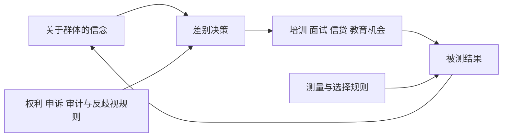

# 规范、身份、歧视与自我实现：差距怎样被制度反馈放大

## 要解决的问题

雇主认为某类申请者“平均更不稳定”，于是更少面试、培训和晋升；该群体随后积累的经验更少，统计差距又被用来强化原判断。要分析这个循环，不能说“都是偏见”，也不能说“统计上有差异所以合理”。必须区分分类、信念、决策规则、机会、结果测量和反馈。

## 规范与身份如何进入行动

规范是群体中关于“应当怎样”的期待，并常伴随认可或制裁。身份是人在特定场景中被自己或他人归入的类别及其意义。类别本身不必产生不平等；关键在于类别是否连接到资源、权利、风险判断和组织规则。

Tajfel 等 1971 的最小群体实验刻意削弱既有冲突和个人利益，仅用无关紧要的分类把参与者分组，仍观察到奖励分配中的内群体偏向。这个结果支持“分类在特定实验条件下足以触发差别分配”，不支持“所有人、所有文化、所有真实群际冲突都有固定强度的天生敌意”。实验效应、现实制度和稳定人格是三种不同主张。

## 四种机制不要互相冒名

| 机制 | 决策者依据 | 差别从哪里来 | 关键检验 |
| --- | --- | --- | --- |
| 偏好歧视 | 对群体本身的厌恶/偏爱 | 效用或规范偏好 | 信息相同后差别是否仍在 |
| 统计歧视 | 用群体信号预测难观察的个体特征 | 信息成本、信号精度与先验 | 更可靠个体信息能否缩小差别 |
| 制度/规则歧视 | 表面统一规则与既有结构相互作用 | 资格、地点、时间、网络和执行 | 规则在不同群体的通过率与机制 |
| 测量偏差 | 指标对群体测量不等价 | 标签、抽样、评分阈值 | 等值性、误差率和目标构念 |

Phelps 1972 给出统计歧视的一种信息模型：雇主无法无成本观察个人生产率，便把不完全个体信号与群体信息结合。解释机制不等于正当化。群体先验可能来自历史上受限的机会，使用它会把旧差距写进新决策；法律权利、个体公平、准确率与社会反馈仍需独立评价。

## 自我实现是可追踪反馈，不是神秘标签

Merton 1948 用银行挤兑和群际偏见说明：起初错误的情境定义可以引发行动，使原判断看似成真。应用这个概念要逐边找证据。若信念没有改变决策，或机会不影响结果，反馈会断开；若第三个共同原因同时导致信念与结果，则“自我实现”可能只是事后故事。

### 一个教学复算

两组各 100 人，初始能力分布完全相同。决策者给 A 组 60 人、B 组 30 人培训；受训者通过率 80%，未受训者 50%。则 A 组期望通过数为 $60\times0.8+40\times0.5=68$，B 组为 $30\times0.8+70\times0.5=59$。最终出现 9 个百分点差距，尽管初始能力相同。若下一轮把 68% 与 59% 当作固定群体本质，制度制造的差距就会变成新的先验。

该算例证明给定机制能生成差距，不证明现实中的任何群体差距都由这条路径造成。真实分析要测初始能力、培训分配、处理效应、选择和误差。

## 审计实验能识别哪一小段

Bertrand 与 Mullainathan 在美国劳动力市场履历审计实验中，向波士顿和芝加哥招聘广告发送构造履历，以随机化的名字信号操纵被感知的种族，同时控制履历内容。其 NBER 工作论文报告：带白人指示性名字的履历约收到 9.65% 回电，带非裔指示性名字的约 6.45%，前者约高 50%。

随机化支持在该广告、城市、时期和履历设计中，名字信号对回电的平均因果效应。它没有观察雇主内心动机，因此不能仅凭结果区分偏好歧视与统计歧视；也不能直接外推到录用、工资、其他国家、线上平台或今天。名字还可能传递阶层等复合信号，研究者需说明处理究竟是什么。

## 中国案例：行政分类要按文件和地方实施拆开

国发〔2014〕25 号于 2014 年 7 月 24 日成文，提出户籍迁移规则调整和基本公共服务覆盖方向，并给不同规模城市留下差异化条件。这是身份分类与制度资格相连的日期化实例。它不能证明所有地方执行一致，也不能把户籍身份化约为个人能力或性格，更不能自动证明某一结果差距的因果来源。

国际比较时，“户籍”“移民身份”“种族”“种姓”可能都关联机会，但法律来源、可变性、代际传递、可见性和救济程序不同。比较机制维度比把标签一一等同更可靠。

## 规范判断与事实判断分开

一个决策规则预测准确，是经验命题；它是否允许使用群体类别，是权利和规范命题；禁用类别后是否出现代理变量，是机制与审计命题；改变规则后总福利和群体分配如何，是因果评估命题。四者不能由一个 AUC 或平均差决定。

干预也要对准机制：提高信息质量可能减少统计歧视，却不一定改变偏好歧视；匿名化可能减少某些身份线索，也可能遮住需要合理便利的需求；配额可改变结果分配，也会触发策略反应；申诉与可解释程序处理的是权力和纠错，不只预测误差。

## 反例与边界

- 群体均值不能用于断言某个个体；这是生态与个体层次混淆。
- 观察到差距不等于识别歧视，未观察到均值差也不等于过程公平。
- 认知偏差标签不能替代激励、信息、组织权力和历史机会分析。
- 反事实公平定义依赖因果图；把身份后果全部删除可能同时删去补偿历史不利所需的信息。
- 群体内部异质性可能很大，群体均值不足以判定个体；课程中的群体标签是研究变量，不是本质属性。

## 下一步与来源定位

组织与资源维度见 [[社会科学/40-公共政策与社会学/04-阶层地位权力与组织|阶层、地位、权力与组织]]；网络选择与影响见 [[社会科学/40-公共政策与社会学/05-网络社会资本制度与文化|网络与社会资本]]；如何评估规则改革见 [[社会科学/40-公共政策与社会学/07-政策评估RCT与准实验|政策评估]]。

来源定位：Merton (1948), pp. 193–210 用于自我实现定义与反馈案例；Tajfel et al. (1971), pp. 149–178 用于最小群体实验条件与分配结果；Phelps (1972), pp. 659–661 用于信息不完全下统计歧视模型；Bertrand & Mullainathan, NBER WP 9873 (2003，后发表于 2004 AER)，摘要、研究设计与 Table 1 用于回电率和识别范围。国发〔2014〕25 号只支持注明日期的制度文本。
