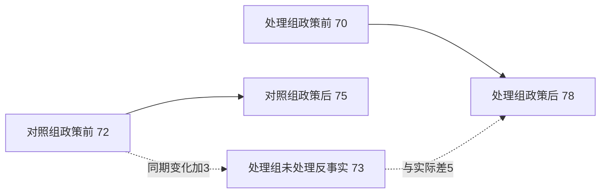

# 政策评估：RCT 与准实验各自识别什么

## 要解决的问题

政策实施后就业率从 70% 升到 76%，不能直接说政策提高了 6 个百分点：即使没有政策，经济周期、人口结构或测量也可能改变。评估要先写目标量，再说明用什么变化近似未观察到的 $Y(0)$。RCT、DID、RD、IV 和合成控制不是五种“回归按钮”，而是五种不同的对照构造和识别论证。

一般反事实、ATE/ATT、一致性、可交换性、正值性、碰撞与干扰的主解释在 [[社会科学/10-共同工具/03-因果图反事实与识别|因果图、反事实与识别]]。本页只比较政策设计怎样取得这些条件。

## 一张设计地图

| 设计 | 用什么构造反事实 | 典型估计对象 | 核心识别条件 | 首要失败方式 |
| --- | --- | --- | --- | --- |
| RCT | 随机分配组 | 分配的 ITT；完全遵从时 ATE | 随机化、失访不破坏比较、一致性/干扰被定义 | 不遵从、差异失访、溢出、实施版本漂移 |
| DID | 对照组同期变化 | 处理组/处理时点的 ATT | 未处理潜在结果的平行趋势、无预期、组构成稳定 | 预趋势、同期差异冲击、错配时点、异质效应加权 |
| RD | 阈值两侧极邻近单位 | 截点处局部处理效应 | 潜在结果在运行变量阈值连续、阈值规则明确、不能精确操纵 | 排序操纵、其他政策同阈值、带宽/函数形式敏感 |
| IV | 工具诱发的处理差异 | 单调性下顺从者 LATE | 相关性、独立性、排除限制、单调性 | 弱工具、工具直接影响结果、反向遵从者 |
| 合成控制 | 加权未处理单位重建路径 | 某处理单位处理后的效应路径 | 干预前拟合可信、供体未受处理/溢出、无独有同期冲击 | 凸包外推、供体污染、预拟合差、推断单位少 |

“目标量”列很重要：RD 的截点局部效应不是全体 ATE；IV 的 LATE 不是所有人的处理效应；合成控制通常回答一个地区在一段时间的路径，不自动给跨地区平均。

## RCT：随机化的是分配，不一定是实际接受

设随机分配 $Z$ 为是否获培训邀请，实际参与为 $T$。最稳健的主结果常是意向处理效应

$$
ITT=E[Y\mid Z=1]-E[Y\mid Z=0],
$$

它回答“提供/分配这项政策”的效果。若所有人按分配接受且无失访、干扰和版本混乱，ITT 也对应处理 ATE。若邀请组只有一半参加，直接比较参加者与未参加者会破坏随机化；在额外 IV 条件下，可用分配作为工具估计顺从者效应。

Fisher《实验设计》第 II 章用“尝茶女士”例子说明随机分配怎样给零假设建立可计算的随机化分布；现代政策评估还要在潜在结果框架中区分 ITT、ATE 和不遵从。集群随机化把学校、村或医院作为分配单位，分析的标准误和有效样本数也必须尊重集群。中国农村学校的一项计算机辅助英语学习研究随机了 120 所小学至政府实施、NGO 实施或纯对照，涉及 5574 名四年级学生；研究报告相同项目在不同实施主体下效果不同，并追踪替代正常教学与监测等执行机制。它说明“政策版本和实施主体”是处理定义的一部分；该地区、学年和项目的结果不能自动外推到全国所有数字教育。

## DID：扣掉共同趋势，不是扣掉一切差异

两组两期的 DID 为

$$
\widehat\tau_{DID}=(\bar Y_{T,post}-\bar Y_{T,pre})-(\bar Y_{C,post}-\bar Y_{C,pre}).
$$

教学构造：处理地区就业率 70→78，对照地区 72→75。处理组变化 8，对照组变化 3，DID 为 5 个百分点。识别要求若没有政策，处理组也会增加约 3 个百分点，即未处理潜在结果平行趋势；它不要求两组水平相等。

实线是观测变化，虚线中的 73 是平行趋势假设构造的反事实。多期事件研究的政策前系数可以发现明显预趋势，却不能证明未来必然平行。若政策按不同时点分期实施，效应又随首次处理批次或日历时间变化，传统双向固定效应的单一系数可能混合多个目标不同的比较。Callaway–Sant’Anna 的做法是先定义“首次处理批次 $g$ 在时点 $t$”的 $ATT(g,t)$，在未处理潜在结果的条件平行趋势、有限预期及合适对照组等条件下识别，再按研究问题明示聚合。这不是把一种回归一律换成另一种：如果从未处理组或尚未处理组的平行趋势不成立，分组估计同样没有因果解释。

Card 与 Krueger 1994 比较新泽西最低工资变化前后与宾夕法尼亚邻近快餐店，是经典 DID 应用。其结果属于特定行业、地区、时期和调查；后续数据与方法争论本身提醒我们，单篇经典研究不是永久政策定律。 若要从410行公开归档手算不同样本口径，并追踪电话调查、工资单与标准误争论，进入 [[社会科学/40-公共政策与社会学/20-最低工资与就业证据/00-最低工资与就业证据-MOC|最低工资与就业证据真实数据案例]]；本页继续承担DID通用定义。

## RD：只在阈值附近借到“近似随机”

运行变量 $R$ 达到阈值 $c$ 才获得政策，sharp RD 的局部效应为

$$
\tau_{RD}=\lim_{r\downarrow c}E[Y\mid R=r]-\lim_{r\uparrow c}E[Y\mid R=r].
$$

关键假设是没有处理时的潜在结果在 $c$ 连续；若考试分数 79.99 与 80.01 的人很相似，而 80 分触发奖学金，结果跳跃可归因于资格。但若家庭能精确操纵分数、80 分还同时触发另一项目，或样本在阈值处构成跳变，解释会失败。

Thistlethwaite 与 Campbell 1960 用奖学金荣誉阈值提出 RD。现代应用必须报告带宽、阈值两侧观测、函数形式、排序密度和其他协变量连续性。估计的是阈值附近单位的局部效应；离阈值很远者可能反应不同。若要从定义推进到Lee（2008）美国众议院真实数据，手算局部线性、带宽敏感性、密度/协变量诊断，并区分普通HC1与RBC推断，进入 [[社会科学/40-公共政策与社会学/30-断点设计与制度阈值/00-断点设计与制度阈值-MOC|断点设计与制度阈值真实数据案例]]；本页继续承担设计总地图。

## IV：工具只通过处理影响结果，条件非常强

令 $Z$ 是工具、$T$ 是处理。二元工具的 Wald 比率为

$$
\tau_{IV}=\frac{E[Y\mid Z=1]-E[Y\mid Z=0]}{E[T\mid Z=1]-E[T\mid Z=0]}.
$$

教学构造：邀请使参与率从 20% 升到 50%，结果均值提高 3 分，则比率为 $3/0.30=10$ 分。根据 Imbens–Angrist 1994 的局部平均处理效应结果，把它解释为 LATE 需要：邀请确实改变参与（相关性）；邀请近似随机（独立性）；邀请不通过鼓励、信息或污名直接影响结果（排除限制）；没人因收到邀请反而从参加变成不参加（单调性）。10 分是被邀请推动参与的顺从者效应，不是全体 ATE。这些条件中，相关性可以用数据直接显示，独立性、排除限制和单调性则主要靠设计与制度知识辩护。

Angrist 与 Krueger 1991 用出生季度与义务教育规则形成的在校年限差异研究教育收益，是经典 IV 案例。工具是否只经受教育年限影响收入、对谁改变教育，都需要制度论证；“第一阶段显著”不证明排除限制，弱第一阶段会放大偏误和不确定性。

把此处LATE的设计条件接到 [[社会科学/20-经济流动与宏观/60-计量经济学/02-工具变量矩条件与两阶段最小二乘#LATE 是一种特别解释，不是所有矩模型的总前提|线性矩与顺从类型的区别]]，再用反向者迁移题核“零Wald”等于什么；单调性支撑这一特殊效应解释，不是所有线性IV/GMM的共同前提。完整计算与弱识别边界由计量两课维护，政策页继续维护真实设计与外部效度。

## 合成控制：为一个处理单位拼出未处理路径

当只有一个地区在时点 $T_0$ 受政策，可从未受处理的供体单位选非负权重 $w_j$，$\sum_jw_j=1$，使处理前结果和预测变量尽量拟合：

$$
\widehat Y_{1t}(0)=\sum_{j=2}^{J+1}w_jY_{jt},\qquad
\widehat\tau_{1t}=Y_{1t}-\widehat Y_{1t}(0),\quad t>T_0.
$$

Abadie、Diamond 与 Hainmueller 2010 用加权对照地区构造“合成加州”评估烟草控制项目。可信度来自干预前路径拟合、供体合理与安慰剂比较，而不是算法自动发现真正平行世界。若处理单位的前期特征在供体凸包之外、供体被政策溢出、或处理后发生该单位独有灾害，差距不能单独归因政策。

## 五种设计共同要做的检查

1. 先写单位、处理版本、结果、时间窗和目标量，后选方法。
2. 画出谁决定处理、何时测量变量、哪些溢出存在；一般 DAG 回到共同工具页。
3. 把识别诊断与识别假设分开：平衡、预趋势、密度、第一阶段、预拟合只能检查一部分。
4. 报告效应量和不确定性，按真实随机化/政策变动层级聚类；少数处理组不能靠大量个体伪造精度。
5. 区分统计显著、机制成立、福利改善与可迁移。一个结果可显著却很小，平均有效却分配不公，局部成立却扩容失败。

### 取证价值的计算仍要返回识别条件

完成上述检查后，可把已经论证的决策相关不确定性接到 [[AI/13-搜索推理与规划/20-部分可观测决策/03-信息价值科学取证与行动#固定后果与行动时点后再算|信息价值的合成监测例]]，提问“哪种证据可能改变当前决定，改善能否抵消取证成本”。先验、信号似然、行动后果及取证先于实施的时点必须明确；那里完整表格和参考解是教学给定，不是从预测准确率识别政策效应。未证明干预能改变后果时，精确Bayes计算不能替缺失的识别证据。

跟算后在同例只改预防成本20到60，沿 [[AI/13-搜索推理与规划/20-部分可观测决策/03-信息价值科学取证与行动#只把预防成本20改60|后验改变而一条信号EVSI为0]] 返回本节：零值限这组行动、目标与时间窗，不能推出研究对未来政策无价值；收费净收益也不同于免费信息价值。用于真实政策时，应补回行动后果的因果依据、目标人群与处理版本、识别和外推条件、执行容量，以及损失权重的分配和规范理由，不能把给定表格当成实际福利。

## 中国政策试点的额外外推边界

“试点”不是随机试验的同义词。试点地区可能因基础较好被选择，地方还会投入全国推广时不可复制的额外资源。评估需记录选择规则、实施忠实度、溢出和扩容容量。国际比较同理：把一个法域的 RD、DID 或 RCT 数字搬到另一法域，需要重新论证人口、制度、价格和执行机制。

## 来源定位

Fisher, *The Design of Experiments* (1935；所核为 1971 重印版) 第 II 章支持随机化检验的实验设计原理；Hernán & Robins, *What If* 第 2—3 章支持随机化、标准化与识别基础；Thistlethwaite & Campbell (1960), pp. 309–317 支持奖学金 RD 原始设计；Imbens & Angrist (1994), pp. 467–475 支持工具变量、单调性和顺从者 LATE 的识别解释；Angrist & Krueger (1991) 原文支持出生季度 IV 的制度构造；Callaway & Sant’Anna (2021), 尤其 §§2–3，支持分期实施中 $ATT(g,t)$ 的识别、对照组和聚合选择，并明确处理异质性下传统 TWFE 的解释问题；Card & Krueger (1994) 原文支持最低工资 DID 案例及其样本范围；Abadie, Diamond & Hainmueller (2010), pp. 493–505 支持合成控制权重、加州案例和安慰剂思路；农村中国 CAL 论文的摘要、设计与结果页只支持上文注明的 120 校集群随机设计及实施差异。
