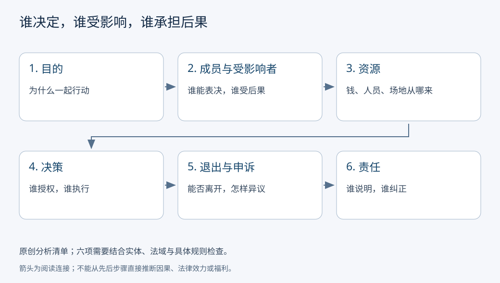

# 社会组织、公司、协会与公共机关：谁能作决定，谁承担后果

社区要开一间阅览室。几位居民可以临时轮流看管，也可以成立会员协会、向一家公司购买管理服务，或要求公共机关提供服务。书架一样，组织安排不同，谁付钱、谁发工资、谁能改开放时间、谁有权提出异议就会不同。**组织是把共同活动稳定为角色、资源和决策规则的安排；理解组织，要沿着一次行动追踪权利与责任。**

## 基础与快进入口

初次阅读，从下面阅览室的一次采购开始。已经熟悉组织理论，可直接比较“会员”和“受影响者”，再做条件改变题。两条入口使用同一案例、同一证据范围：本课不把所有名叫协会的团体视为同一种法律实体，也不把“组织有效”当作正当性的证明。

临时活动也有协调，但未必有持续成员、独立财产或法定签约资格。“法人”是法律赋予组织以自身名义享有权利、承担义务的地位，不能从有群聊、有负责人推定。现实分析先查它究竟是什么实体、适用哪里和哪版规则。

## 一次买书，读出整套组织

原创教学情境：100名会员每年各缴120元，会费共12000元。协会规定会员大会批准年度预算，理事执行；全年买书8000、场地与水电2000、保险及维护1000、保留1000。所有金额是元/年，不是当地设立协会的法定要求。

1. 会员提出增加儿童图书，理事询价并提出8000元采购方案。
2. 按章程规定通知、讨论和表决；批准预算不等于授权任何人以个人名义借无限额贷款。
3. 有权代表该实体的人员签约，供应商交货，验收后从组织账户付款。
4. 会计保存发票和收支，会员可依规则查账；缺书时先查采购、验收和保管哪一环发生问题。
5. 年末报告实际结果。若实际买书8500而其他支出不变，结余只有500；是否能超预算、谁批准和谁解释，要回到授权规则。
6. 会员可依规则退会；附近的非会员儿童却可能没有别的阅览室。退出选项与受影响范围因此不是同一件事。

图是原创检查顺序，箭头表示提问的连接，不表示这些维度存在唯一因果顺序。它提醒我们：只有“目的很好”不足以回答“谁能花钱”，只有“投过票”也不足以回答“谁能申诉”。

## 用同一组问题比较三种安排

| 追问 | 会员协会（教学设定） | 公司承包管理 | 公共机关负责 |
| --- | --- | --- | --- |
| 目的 | 共同阅读，按章程确定 | 提供服务并维持经营，具体目标看合同与治理 | 履行法定公共职能，须查权限 |
| 成员与受影响者 | 会员；还影响非会员与邻居 | 股东、职工并非同一身份；还影响客户和社区 | 工作人员不是全体公民的同义词；影响服务对象 |
| 资源 | 会费、捐赠等，资格与用途需查 | 公司财产、经营收入、融资 | 预算、人员与公共设施；不能任意处置 |
| 决策 | 会员会议、理事依章程分工 | 股东与管理层依适用法律、章程、合同分工 | 由有权机关按法定程序作决定 |
| 退出与申诉 | 退会、内部复议，仍需查权利救济 | 离职、换供应商、依法主张合同或劳动权利 | 适用的投诉、复议、诉讼等须分别查资格与程序 |
| 责任 | 谁能签约、是否有法人资格不能凭名字判定 | 公司承担公司债务；个人违法、保证等另看 | 公共职权、履职责任与具体救济有不同制度依据 |

这里“社会组织”先作一般分析用语，覆盖共同活动的多种组织；中国行政管理中的“社会组织”有具体登记分类，不等于本表的全部对象。协会、基金会、学校、医院、合作社等各有规则，本课不靠一个名称替读者判定法律身份。

## 公司不是老板个人的钱袋

2023年修订《公司法》在税务总局官方法规库的全文中，第2—4条规定适用公司类型、公司财产与股东责任；第58—66条给出有限责任公司股东会与表决框架。由此可以支持一个有限的制度事实：**公司、股东和管理职位需要分别识别，有限责任也有适用边界**。第23条还规定滥用法人独立地位与股东有限责任的责任例外。[原文及版本](https://fgk.chinatax.gov.cn/zcfgk/c100009/c5233383/content.html)

教学例：甲乙投入60和40，公司账户有100；公司借20后账面现金120，并负债20。甲不能因为拥有60%就把72当个人生活现金取走。表决权、公司资产和可依法分配的利润是不同对象；贷款人、职工和消费者虽未必是股东，也可能受决定影响。公司能否分配、谁批准、是否有担保与偿债约束，须看实际法律与账户。

有限责任没有使经营风险消失。公司亏损会损害股权价值，债权人可能受损，个人保证可能增加本人责任。依法履行与实际执行也须区分：法律写有保护，并不证明每次争议都获得及时救济。

[[社会科学/20-经济流动与宏观/01-生产交换分配与制度约束|生产交换与制度约束]]解释为何把活动放进企业会改变协调成本与分配；本页负责解释组织内身份、权限和追责。[[社会科学/40-公共政策与社会学/04-阶层地位权力与组织|阶层与组织位置]]进一步说明为何有预算权、声望和收入是不同优势。

## 公共机关也需要分工

2024年修订《国务院组织法》第2、4、7—8、14、17条分别规定国务院性质、报告与监督、会议、部门权限及监督制度。这里实际读取的是北京市人大网站注明新华社来源的全文转载，不能写成直接读到全国人大页面。[版本与原文转载](https://www.bjrd.gov.cn/zyfb/zt/14jqgrd02chybjdbthdztbd/wjbg/202403/t20240312_3586913.html)

公共服务有预算不等于任意科室都有立规或筹税权限。遇到“政府决定”时，继续问哪个层级、哪个机关、哪项权限、怎样公开、谁执行、谁监督。具体国家机构与跨国比较转向[[社会科学/40-公共政策与社会学/10-政治制度公共决策与问责|公共决策与问责]]；多数决定为什么仍须向少数辩护，转向[[哲学与文化/20-论证知识与规范/02-伦理与政治正当性|伦理与政治正当性]]。后者提供规范论证，不证明现代组织的法律权限。

## 条件改变，结论如何变

协会全票通过，仍可能把噪音成本转给没有表决权的邻居；程序内部一致与外部影响要分开。若退会会失去唯一可及的公共阅读资源，“可以走”不等于退出无代价。公司承包可能提高专业化，也可能因合同难写全而降低服务质量；比较需有质量、成本和替代方案证据。公共机关依法设立，也不能只凭存续推断效率、效果或正当性。

## 六题练习与答案

1. **会费12000、采购8500、其他支出3000，结余多少？** 500元/年；是否允许超预算须另查，算术不能授权。
2. **谁是阅览室的受影响者？** 至少会员、工作人员、非会员使用者、供应商和邻居。只列付费者遗漏外部影响；能说明相关关系的等价名单可接受。
3. **60%股东能否把公司60%现金直接拿回家？** 不能由比例直接推出。需区分公司财产、依法分配、工资、借款和其他交易，查权限与账户。
4. **公司设有申诉邮箱，能否证明职工能有效申诉？** 不能。还需看可及性、处理时限、独立性、报复风险与实际处理记录。
5. **“会员能退会，所以规则正当”漏了什么？** 退出成本、替代机会、非会员影响和权利边界；更完整的规范论证允许不同结论。
6. **某团体称协会，是否一定是法人？** 信息不足。可给有依据的未知：须查登记、适用法律、章程和代表权限。

## 来源与进一步阅读的边界

上述法律事实实际访问于2026-10-07；公司法是2023-12-29修订、2024-07-01施行的文本，国务院组织法是2024-03-11修订并施行的文本。均未核验一项具体争议的执行结果。教学账本与图为本课构造。

CFA的[[社会科学/50-CFA课程/10-公司与收入分析/01-组织形式所有权与融资边界|组织形式与融资]]仍为draft。本课只把其“形式、所有权、交易状态分开”的提问当受限参照，并以上述公司法支持本课中国事实；不认证该职业页，不维护考试要求。
