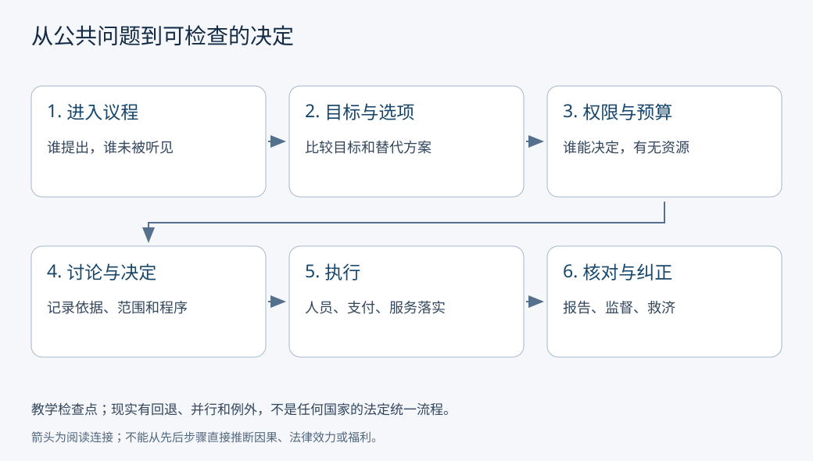

# 政治制度、公共决策与问责：一项公共规则怎样走到生活里

有人提议用公共预算延长阅览室开放时间。提议、作决定、付钱、雇人和处理投诉，可能分别由不同人完成。规则写下来了，钱未到位或管理员不足，服务仍可能没有改善。**政治制度在本课指公共权力怎样被分配、行使和约束的规则；读懂它，先跟踪一个问题如何成为有权限、有资源、可执行和可追责的决定。**

## 基础与快进入口

初次阅读，先沿阅览室案例走一遍全过程；已经熟悉国家机构，可从中国、美国和德国的同问题比较入手。两条入口汇入同一框架。我们只比较有限的正式规则和分析问题，不从一张流程图推断整个制度，也不给国家打单一优劣分。

## 先分清新闻里的四个主语

| 名词 | 本课的工作定义 | 看新闻时追问 |
| --- | --- | --- |
| 国家 | 具有持续公共权力及领土、人口等要素的政治共同体；具体定义依研究问题 | 说的是国家整体，还是某个机关？ |
| 政府 | 日常中文常指行政机关；英文government有时涵盖立法、行政、司法 | 原文的词指什么范围？ |
| 政党 | 组织政治主张、参与政治权力活动的组织，法律地位与作用因制度不同 | 党内决定与国家法律程序怎样连接？ |
| 公共机关 | 获得特定公共职能和权限的组织 | 哪个层级、哪种权限、受谁监督？ |

本表是分析用定义，不代替各国法条。国家可以经历政府人员更替而延续；政府部门、立法机关与政党也不能互称。在中国制度文本中，中国共产党的领导、人大与行政机关各有规定；分清对象有助于解释它们的连接，不意味这些关系相互隔绝。

## 跟踪一次延长开放时间

原创情境：已有阅览室每天开放6小时，居民提出延长到8小时。此例不假定某国具体法律赋予哪位官员权限。

1. **发现问题并进入议程。** 晚班劳动者说明6小时覆盖不到自己。记录谁提出、谁未被听见，不能把最常发言者当全体。
2. **界定目标与选项。** 比较延时、调整时段、预约和移动服务。目标是可及性，不只是统计上的总开放小时。
3. **查权限和预算。** 工作人员可否调整排班？增员是否需预算批准？是否涉及现行劳动规则？法律、预算和行政安排可能有不同程序。
4. **调查、讨论并形成决定。** 估算人力、听取服务者和职工意见，记录决定、依据、适用范围及公开方式。提出者不自动拥有决定权。
5. **实施。** 招聘、采购、培训、安排安全与费用支付；执行者需要真实资源。正式批准不等于钱和人已经到位。
6. **报告、核对与纠正。** 看实际开放、不同群体使用、成本及投诉；追问谁解释结果、谁能修改、谁能调查失职、谁能提供救济。

图是观察清单，不是中国、美国或德国的法定统一流程。现实可能回退、并行、遇到紧急程序或跨层级争议；行政措施也不必每次经过制定法律的流程。它覆盖的是本课的六个检查点，未覆盖所有政治活动。

## 对同一问题比较：如果需要改变全国法律

如果本来只是地方设施排班，不应直接套用全国立法。为了可比，现在固定另一个问题：**一项全国性服务规则需要改变法律，哪个机构正式参与？** 是否属于全国权限、是否需要另批预算，仍须查具体法案。

| 同一个追问 | 中国文本 | 美国联邦文本 | 德国联邦文本 |
| --- | --- | --- | --- |
| 谁正式参与立法 | 宪法第57—58、62、67条区分全国人大及其常委会的国家立法权和职权 | 众议院官方说明区分众议院与参议院的审议；法律案还进入总统阶段 | 基本法第76—78条与联邦议院说明区分联邦政府、联邦议院和联邦参议院的参与 |
| 行政机关是什么角色 | 宪法第85、89、92条及国务院组织法规定国务院性质、职权、报告关系 | 官方三部门说明把执行法律与总统、部门及机构连接起来 | 议院流程说明中联邦政府可以提出法案，但议院审议及各州参与仍有程序 |
| 途中可能停在哪里 | 谁能提案、哪种审议及权限须查该案适用规则，本课不填统一步骤 | 官方流程包括委员会与院会阶段；一院通过不能等同法律已生效 | 是否需要联邦参议院同意与可提出异议的情形不同，不能一概称其有相同否决权 |
| 能否从结构推出服务改善 | 不能；还需预算、执行与结果证据 | 同左 | 同左 |

中国宪法采用2018-03-11修正文本，本次实际读到的是商务部注明人民日报来源的2018-03-22转载；国务院组织法采用2024-03-11修订文本，实际读取北京市人大注明新华社来源的转载。中国文本规定人大立法、国务院行政职权与报告监督关系，并在宪法第1条及国务院组织法第3条规定党的领导。[宪法同版转载](https://www.mofcom.gov.cn/xxgcxjpxsdzgtsshzysx/zywj/art/2018/art_45c1e16fe351469090d53e63178268c8.html)、[组织法同版转载](https://www.bjrd.gov.cn/zyfb/zt/14jqgrd02chybjdbthdztbd/wjbg/202403/t20240312_3586913.html)。这些定位支持正式权责，不测量实际议程形成与监督效果。

美国众议院官方科普页给出法案提出、委员会、院会、另一院及总统的教学路线。这里不照抄其简化票数为所有程序的门槛，也不把协商委员会写成所有法案的必经步骤；具体院会规则、特殊程序与两院协调方式超出本次范围。[立法流程](https://www.house.gov/the-house-explained/the-legislative-process)、[部门分工](https://www.house.gov/the-house-explained/branches-of-government)。Congress.gov与其CRS原文接口本次未能读取，因此不声称由其全文完成复核。

德国联邦议院页面实际读取了通常三读、委员会与联邦参议院参与的说明；其官方发布基本法英文版注明最后修订于2025-03-22，第76—78条区分提案、协调与法律通过的路径，第82条处理公布与生效。本次能支持这些限定环节。[议院流程](https://www.bundestag.de/en/parliament/function/legislation/passage-245704)、[基本法官方英文版](https://www.btg-bestellservice.de/pdf/80201000.pdf)。联邦参议院代表各州参与联邦制度，不能仅因中文同叫“参议院”就认为与美国参议院组织性质相同。

## 问责要有后续动作

问责不只是“有人负责”。本课把它分成三个可观察问题：是否需要说明并提供信息；谁能质询、审查或调查；发现问题后能否要求纠正、追究或给予救济。报告、审计、法院、监督机关、公众表达及组织内部程序各有对象和权限，不能假定每种渠道都处理同一争议。

中国宪法第41条规定公民批评建议及对违法失职的申诉控告检举等权利；国务院组织法第17条规定监督制度。德国基本法第17、45c条规定请愿及联邦议院请愿委员会。这里说明**文本存在相应权利或机构**，不保证每次投诉必胜或自动改变政策。美国本课只读取部门分工与立法流程，不扩写未经读取的具体救济程序。

公民面对某项排班争议，可以先找实际决定机关、书面依据、受理渠道和期限；不能从国家制度概括直接推出具体诉讼资格。正式规则是否在现实中可用，还要观察等待时间、信息成本、处理记录与报复风险。

继续追问“普通人能否启动、等到并保有纠正”，读[[社会科学/40-公共政策与社会学/15-公共可纠错性的制度条件|公共可纠错性的制度条件]]。该页把上级审计确实有效的反例，与举证、等待保护、实际履行和监督者约束放在同一框架中；不把一次有效纠正直接推广为所有人可稳定使用的制度能力。

## 效果与正当性分别需要什么

公开记录使追踪更容易，是一个机制假说；“公开后投诉少了”仍可能由门槛提高、群众退出或其他改善造成。估计因果转[[社会科学/40-公共政策与社会学/07-政策评估RCT与准实验|政策评估]]。相同总成本下，延时可能方便晚班者却增加管理员照护负担，目标冲突转[[社会科学/40-公共政策与社会学/01-政策目标工具约束与矛盾|政策目标与约束]]。

即使有效且按程序通过，是否可以要求所有人承受代价仍须权利、分配和公共理由。[[哲学与文化/20-论证知识与规范/02-伦理与政治正当性|伦理与政治正当性]]提供这种规范论证，不证明某国制度事实。组织内身份与退出渠道转[[社会科学/40-公共政策与社会学/09-社会组织公司协会与公共机关|组织与责任]]。

## 真实案例：保留领导职位怎样改变公共品配置

Chattopadhyay–Duflo（2004）的处理是既有制度内某个村议会GP的领导职位是否按规则保留给女性，不是将全地区随机改为“有配额/无配额”。随机规则在GP层，以下结果在村层观察；西孟加拉Birbhum问1998—2000年的投资，拉贾斯坦Udaipur问2000—2002年。核原刊§4、§5.3与表V（p.1432），不要把一村当独立GP。[原刊PDF，J-PAL托管](https://www.povertyactionlab.org/sites/default/files/research-paper/65_Duflo_Women_as_Policy_Makers.pdf)

|表V村级结果|地区与期间|保留GP均值|未保留GP均值|均值差|
|---|---|---:|---:|---:|
|新建或维修饮水设施数量（项）|西孟加拉1998—2000|23.83|14.74|9.09项|
|新建或维修饮水设施数量（项）|拉贾斯坦2000—2002|7.31|4.69|2.62项|
|道路状况良好（0/1指标的均值）|西孟加拉，同期|0.41|0.23|+0.18，即18个百分点|
|道路状况良好（0/1指标的均值）|拉贾斯坦，同期|0.90|0.98|−0.08，即−8个百分点|

道路是状况指标，不是新建道路项数；饮水数量增加与道路方向在两地不同，提醒我们“效果好”必须指明对象。均值差不等于每村都增加同样项数；原文处理了GP内相关，实际估计与不确定度应读原表，而不是仅由这里减法认定显著性。作者的理论命题1(i)存在错误，Duflo–Meager于2013-08-06给出[修正与完整证明](https://economics.mit.edu/sites/default/files/inline-files/new%20proof%20of%20proposition%201%20i.pdf)；本课不复述该模型证明，勘误也不是撤回经验表V。

> [!question] 数量、因果与正当性三次判断
> 1. 先算饮水差额，再问能否断言取消整个制度会分别少9.09/2.62项。
> 2. 写一个经验前提、一个价值理由，以及会改变自己判断的一条缺失证据。

> [!answer]- 参考答案与可接受边界
> 1. 差9.09/2.62项；识别对象是既有规则内的保留状态，不识别取消全制度后的均衡、溢出或全国福利。2. 经验前提可用本样本饮水设施数量差，价值理由可用平等参与或基本服务权；若增加设施不耐用、边缘群体无法使用、替代服务机会成本很高，可能改变规范判断。质量、受益者和权利代价须再取证。也可依据不同公开价值标准给有理由的反对意见，不能从设施数量直接得唯一正当性结论。

因果识别进一步读[[社会科学/40-公共政策与社会学/07-政策评估RCT与准实验|处理单位、反事实与外推]]；经验与价值的桥回[[哲学与文化/20-论证知识与规范/02-伦理与政治正当性|规范前提与最强反对意见]]。一手表/勘误于2026-10-08读取；程序实验、真实客户端和真人试读均未执行。

## 六题练习与答案

1. **部长宣布方案，是国家、政府、政党还是机关的行动？** 至少先识别具体行政职务与机关；还需公告内容和授权。仅据一张照片不能判定具有法律效力。
2. **阅览室多开放2小时，能否推出可及性提高？** 不能必然推出。查时段、交通、人员、群体使用与替代解释；有这些依据可支持有限结论。
3. **一院通过法案，是否全国法律已经生效？** 不能。美国官方路线还有另一院与总统等阶段；德国需查联邦参议院参与和公布；国家与法案不同，不能套一条。
4. **中美德均有议事机构，能否认为制度等价？** 不能。比较权限、产生方式、层级、参与及执行，而非翻译名称。
5. **某机关必须报告，是否证明它被有效问责？** 不充分。报告可读性、审查权限、纠正后果和实际记录还未给出。
6. **全体使用者赞成，能否证明延时规则正当？** 还需考虑未使用者、职工与财政承担者，权利及替代方案。允许依据明确的不同规范判断与有理由的未知。

## 版本与证据边界

上述实际可读来源均访问于2026-10-07。官方流程是规则说明，不是制度效果实验；本课未估计三国现实民主、服务绩效或问责水平。全国人大部分网页与美国Congress.gov本次访问失败，采用已说明的官方来源或政府转载并收窄断言，不把检索摘录当整部法律核验。
