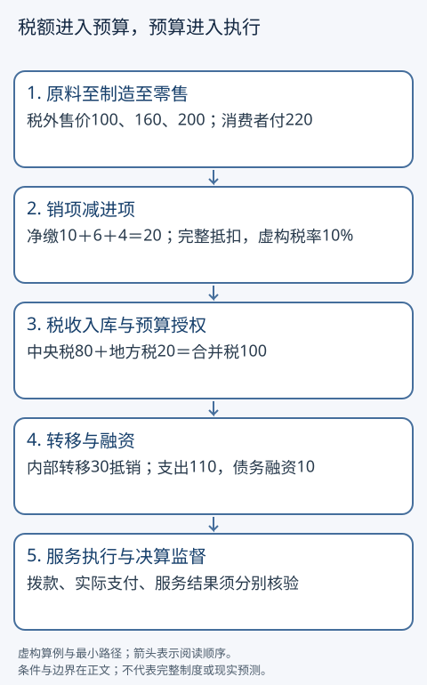

# 税制、公共预算与中央地方关系

买一件东西交过税，为什么工资还可能交税？中央拨给地方的钱，是又创造了一份收入吗？本篇用一条生产链和一张两级预算表回答：先确定征什么、按什么计算，再追踪钱归谁管理、用于什么、由谁承担责任。

## 两个入口，同一条账本

基础入口：从下节三种税的区别开始，跟着金额走。只需会乘法、加减和百分比。

快进入口：直接复算「三环抵扣」与「两级预算」，然后返回检查税基、归宿和合并口径。两条路线都读「现实规则和模型的边界」及练习；快进没有另一套定义。

## 征税先问对象、税基、税率和责任

税基是法律规定的计算对象或金额，税率是作用在税基上的比例或分段规则。交易含税价格、企业利润、家庭收入、资产价值是不同对象，不能把同一数字轮流乘几种税率就称为现实税单。免税、扣除、抵扣、税收优惠和发生时间也会改变计算。

|问题|教学解释|需要再查的现实条件|
|---|---|---|
|交易环节的增值税|一般抵扣模型中，当期销项税减可抵扣进项税|纳税资格、凭证、用途、适用计税方法、免税与退税|
|个人所得税|对按规则确定的个人应税所得计算，可采用累进税率|所得类型、居民身份、扣除、预缴与汇算|
|企业所得税|对应纳税所得额计税|会计利润须按税法调整，不一定等于税基|
|财产或特定消费等税|对各自规定的财产、交易或消费计税|法域、时点、估值与豁免|

比如企业销售收入200、会计成本150，会计利润50。如果教学税法不允许其中10费用扣除，应税所得额便是60；虚构税率20%得税12，而非50×20%=10。它不是增值税的销项税。这里的20%及下文所有税率都为教学虚构参数，没有现行申报用途。

谁依法申报、扣缴与缴款是法定责任；谁最终因价格、工资和收益变化承受损失是经济归宿。商店缴税不证明商店承担全部损失。后者的主解释和供需弹性反例在[[社会科学/40-公共政策与社会学/02-税收转移公共服务与归宿|税收归宿页]]，本篇只负责计税和预算链。

## 三环抵扣：税没有在每一环重复征同一笔价值

设一批原料→制成品→零售商品，税外售价分别100、160、200。统一虚构VAT率10%；各企业都是可完整抵扣的同类纳税人，原料商没有可抵扣购入，所有交易同一期、凭证有效，无免税、库存变化、坏账或其他购入。

|销售者|税外销售额|向买方收取销项税|抵扣上一环进项税|向政府净缴税|本环增加值|
|---|---:|---:|---:|---:|---:|
|原料商|100|10|0|10|100|
|制造商|160|16|10|6|60|
|零售商|200|20|16|4|40|
|合计|不能用460作最终消费税基|46|26|20|200|

制造商收到176，购入付110，缴税6，留下60支付本环工资和其他增加值收入。零售商收到220，购入付176，缴税4，留下40。消费者付220且不抵扣；政府收到10+6+4=20，等于最终税外200的10%。这是现金核算，未给企业工资、折旧与利润细分；本环增加值也不是净利润。

这一望远镜式抵消依赖完整抵扣链。若制造商购入中的税不能抵扣，不能照抄本表；若消费价格与工资随政策改变，本表也不能决定经济归宿。跨期留抵、免税与零税率并非同义，本例不处理它们。

## 累进税率：跨过一档不会让全部收入重算最高税率

设年应税所得前100免税，接下来100按10%，超过200的部分按20%。这不是任何国家的现行税表。

应税所得250的税是0+100×10%+50×20%=20，平均税率20/250=8%；最高一段的边际税率20%。所得从250增加到260，税变22，税后所得从230变238，增加8。不能拿250×20%=50。若福利补助同步退出，家庭可用资源的边际变化还要计入补助减少；本表没有这些规则。

## 从收入到服务：两级预算怎样合并

税收进国库后，预算把资源配置和授权联系起来。编制草案、审查批准、征收入库与拨付、部门执行、决算审计与下一年修正，是不同环节。批准100的预算不证明已经付100，也不证明得到100价值的服务。学校盖好但缺教师，就是投入与结果不一致的反例。

设中央本级税收80，本级服务支出50，拨给地方30；地方本级税收20，加收到转移30，安排本地服务60，缺口10通过在模型中已获授权的新债融资，不动用期初现金，不还旧本金、忽略利息。

|账户|本级税收|收到/支付转移|向非政府部门服务支出|赤字与融资|
|---|---:|---:|---:|---|
|中央|80|支付30|50|0|
|地方|20|收到30|60|赤字10，新债10|
|两级合并|100|内部30抵销|110|赤字10，新债10|

不能把80+20+30=130称为合并税收；中央的支付对应地方的收到。借债10增加债务存量，不是税收10；偿还本金也不同于利息支出。预算表授权财政活动，不自动授权中央银行创造货币。若央行或银行买债，必须再写金融资产与负债的对应项，详见[[社会科学/40-公共政策与社会学/10-财政货币与分配/02-财政支出税收发债与合并边界|发债和合并边界]]；不要把分析合并误读为现实机构权限相同。

谁决定办学校、谁有收入、谁执行服务、谁欠债和谁监督可能不同。中央地方关系要同时看事权（做什么）、财力（有多少钱）、支出责任（谁出钱）和问责。转移可平衡地区财力，也可指定项目；效果取决于分配规则、地方配套、执行能力与监督，不能从收到转移直接推出公平。

## 固定真实读数：2024 年执行数为什么不能只做支出减收入

以下固定财政部网站 **2025-03-06 发布的报告摘要**，只取“2024 年一般公共预算收支情况”，单位亿元。它是当时的预算执行口径，不是2025预算数或后来决算修订；[同版摘要](https://www.mof.gov.cn/zhengwuxinxi/caizhengxinwen/202503/t20250306_3959380.htm)与[2025-03-14全文](https://www.mof.gov.cn/zhengwuxinxi/caizhengxinwen/202503/t20250314_3959885.htm)分别支持总量与本级/转移拆分。

|全国一般公共预算项目|2024执行数（亿元）|怎样进入桥|
|---|---:|---|
|一般公共预算收入|219702.12|起点，含税收与非税收入|
|调入资金及使用结转结余|25410.50|增加本口径可用财力，不统称本年税收|
|收入总量|245112.62|前两行相加，不再额外加一次|
|一般公共预算支出|284612.25|本年支出|
|补充中央预算稳定调节基金|1100.37|增加支出总量，不能当已交付公共服务|
|支出总量|285712.62|前两项支出相加|
|报告赤字|40600.00|支出总量减收入总量|
|中央对地方转移支付|100397.16|合并两级时抵销，不能再加到全国收入|

因此 $284612.25+1100.37-219702.12-25410.50=40600.00$。只做 $284612.25-219702.12=64910.13$ 得的是两项直接差额，漏了调入/结余和基金补充，不能替代报告赤字。全文给中央本级支出40720.18、地方支出243892.07，合为全国284612.25；中央支出141117.34中已经含对地方转移100397.16。若再算141117.34+243892.07，就把内部转移重复计入，须减100397.16。

预算赤字不是直接由这张表识别出的 SNA 政府净借贷；后者的机构范围、权责发生制、资本与金融交易分类还须另核。产品价格口径也独立：$GDP_{市场价}=\sum VA_{基本价}+产品税-产品补贴$，只调整与产品相关的税补贴；不能把174972.01的全部税收机械加到增加值上。完整主解释在[[社会科学/20-经济流动与宏观/05-国民账户部门余额与开放经济|国民账户的价格与部门口径]]。

> [!question] 先读表再判断
> 1. 把调入资金全部称“2024新收税款”、把稳定基金补充称“服务增加”，分别漏了什么？
> 2. 中央支出与地方支出直接相加为何大于全国？可接受哪两种抵销写法？

> [!answer]- 参考答案
> 1. 调入与结转可以来自其他预算/以前期间，非税收入也不是税；基金补充是预算管理去向，不直接证明服务产出。2. 用中央本级40720.18+地方243892.07；或用中央141117.34+地方243892.07−内部转移100397.16。两式均为284612.25。来源表与会计定义可走读，真实客户端和人的理解尚未验收。

## 改一个输入：转移 30→40 不会凭空增加全国税收

源码窄接口 `combined_budget(80,50,20,60,transfer)` 返回各级余额与合并税收/服务/赤字。transfer=30时中央0、地方−10；改40时中央−10、地方0。两次合并都是税100、服务110、赤字10；负余额需要另说明融资，正余额是盈余。函数只给收支差，不能替代债务授权。

## 现实规则和模型的边界

中国《增值税法》为2024年通过、2026年1月1日起施行的文本；本文实际读取上海税务局转载的第14—17条及第38条，只用其支持一般计税中销项减进项、凭证条件、销售额不含VAT及生效时间，不用虚构10%替代法律税率。[法律全文](https://shanghai.chinatax.gov.cn/zcfw/zcfgk/zzs/202412/t474694.html)

同一个「公共项目怎样获得预算资金并受监督」问题，可以先比较已读取的规则，不由规则直接推断实际绩效：

|法域与文本版本|本篇能核实的规则入口|不能由此断定|
|---|---|---|
|中国，2020年修订《预算法实施条例》|第7—10条解释分税制及两类转移；第16条社会保险基金预算；第42—45条债务限额与预算调整；第57条按批准预算拨付|各地实际财政能力、项目效果和当前税种分享比例|
|美国，USAGov预算流程，页面2026-03-02更新|行政机构向OMB请求，总统提出预算，国会处理资金法案并交总统签署或否决；财政年10月至次年9月|一份总统提案已成为拨款、各州地方的职责份额|
|德国，基本法英文版2025年3月修订|104a条规定联邦与州原则上负担各自职责支出；106条规定税收分配；110条预算以法律确立；114条提交账目与审计|公共服务质量和全部实施细节|

依据：[中国实施条例](https://app.www.gov.cn/govdata/gov/202008/20/461993/article.html)、[美国流程](https://www.usa.gov/federal-budget-process)、[德国基本法](https://www.btg-bestellservice.de/pdf/80201000.pdf)。比较范围刻意不对称：美国页没有充分提供州地方分配条款，因此此处留未知，不猜数字，也不把三套制度排名。官方规则、现实效果、是否正当是三种问题。价值判断可读[[哲学与文化/20-论证知识与规范/02-伦理与政治正当性|伦理与政治正当性]]，其论证不替代税法和预算事实。

## 迁移练习与答案

1. VAT零售税外售价改为240，前两环不变。净缴及总税多少？**答：**零售销项24减16为8；总10+6+8=24。消费者付264。前提仍是完整抵扣。
2. 一个公司说「利润是40，所以VAT是4」，问题在哪里？**答：**混同所得税基与VAT计算。须知道销项和可抵扣进项；仅利润不能确定VAT。能说明缺哪些数据的未知答案合格。
3. 教学应税所得180和220各交多少？**答：**8和14；税后172和206。220的平均率约6.36%，边际率20%。
4. 地方支出仍60，中央转移改20，本地税20，如何闭合？**答：**缺口20，须融资20或削减支出、动用已有现金等明确方案。没有授权与偿债分析不能宣称现实可举债20。
5. 中央转移增加10，就能说全国新增税收10、服务改善10吗？**答：**两级内部流抵销；服务结果还需执行和效果证据。允许以明确合并范围给等价表述。
6. 有国家预算法律与拨款记录，能证明项目公平吗？**答：**证明程序或支付的部分事实；公平还需说明受益者、负担、可替代方案与价值标准。未取得效果数据可明确保留未知。

计算源码在[[社会科学/20-经济流动与宏观/code/everyday_economy.py|本组经济算例源码]]，命令需显式输出路径；它验证教学金额，不能验证法律、权限或绩效。返回[[社会科学/40-公共政策与社会学/02-税收转移公共服务与归宿|税收归宿]]或继续[[社会科学/30-金融市场与风险/09-金融工具保险与家庭风险|家庭金融与风险]]。
