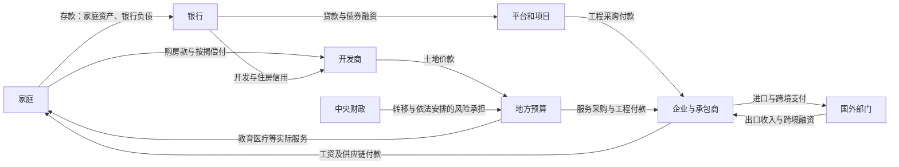
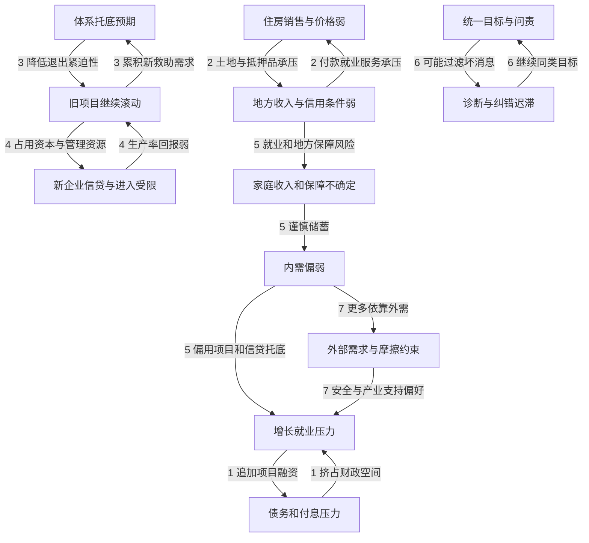

# 地方债、房地产与损失吸收：从谁欠钱追到谁少了选择

地方债券按时付息，为什么企业仍可能等不到工程款，家庭仍可能不愿买房或增加消费？因为债券兑付只是支付链的一处。旧项目的回报、开发商交付、银行资本、地方服务和家庭现金缓冲，分别处在不同账户。降低一处的到期压力，可以保存价值，也可以把成本转给另一处。

本篇以中国房地产调整与地方财政为应用案例，追问三个问题：损失是什么，如何被确认与承担，怎样判断处置改善了未来的收入和生活。本文数据固定到明确发布版本，访问日为 **2026-10-09**；事实、教学账本、机制假说和政策价值判断分别标明。来源复核不等于实证复现，重要论证仍需独立审阅；实验、测试、模拟及客户端验收均为 `not_run`。

初次阅读可顺着下节一笔贷款走到账单和保障；已有基础可先看「五个阈值」，再回来问每个指标属于哪个账户。收入与财富、GDP与融资、税收与预算的主定义分别在先修页，本篇只补现实传导与反例。

## 一笔贷款：换了期限，损失是否就没有了

以下是**虚构教学账本**，单位为亿元；不是某个中国项目的估计。设银行向项目公司贷款100，项目原来预计未来可回收100，后来在给定折现率、现金流及清算成本下只能回收70。这里30是这笔贷款的经济价值缺口；银行是否已按会计规则确认、谁法律上承担，须另问。

| 动作 | 项目与债权 | 银行 | 地方或中央财政 | 真实资源是否因此增加 |
| --- | --- | --- | --- | --- |
| 尚未处置 | 本金合同仍为100，可回收价值假定70 | 持有贷款；经济缺口30 | 若无明确责任，不能先记财政负债100 | 没有 |
| 延期，年利率6%→3% | 当前每年利息从6降至3；本金未减 | 利息收入减少，期限变长 | 财政若未介入，不能自动计财政救助 | 降息本身没有；避免停工、急售可能另保存价值 |
| 财政依法接手100并发行新债偿还贷款 | 原贷款清偿，债务责任转到政府 | 贷款换成付款或新债，风险归属改变 | 新承诺与融资必须逐笔登记 | 没有机械增加100 |
| 在原债权上减记30 | 债权降为70；债务解除须符合适用规则 | 未由既有拨备吸收的部分降低净资产 | 未补偿时，财政不自动承担30 | 减记承认缺口，不创造30 |
| 在损失确认后注资30 | 项目回报仍要单独修复 | 在本例忽略其他变化时补回30权益 | 获得股权、付出现金；投资价值须另评 | 不自动增加30产出 |

第二行假设年内本金不变，利息现金流差为 $100\times(6\%-3\%)=3$ 亿元/年。这是减息量；不能拿它替代30的价值缺口。降息本身可能改变债权现值；因此表中70必须固定为某一估值假设，处置后应重新估值，不能宣称缺口永远固定30。重新经营、完工交付或避免急售可能让回收价值提高；继续浪费和停工损坏也可能让它下降。

更关键的是不要重复加总：同一笔贷款是银行的资产与项目的负债，把双方的100加成“全社会债务200”错了；项目价值少30与银行相应损失也不能当两次资源毁灭。国内债权债务在指定合并范围内抵销，已经浪费的材料、土地用途、人力和未来生产能力却不会被抵销。账户边界见 [[社会科学/20-经济流动与宏观/05-国民账户部门余额与开放经济|部门余额与金融账户]]。

住房价格下降也不全是同一种损失。一套房由90降到70、按揭仍为60，房主账面净值由30降到10；房子能继续居住，银行也不因此立即损失20。无房买家可能得到更低的进入价格，地方和行业就业可能同时受压。**资产重估、真实资源损耗、流动性短缺、偿付或待遇承诺缺口**必须分开。

## 从土地到工资：钱在何处停住

土地使用权出让收入与一般公共预算税收不是同一账户；土地毛收入还对应征地、开发等支出，不能整笔当随意可用于经常服务的净财力。城投也不是地方国库的另一个名字：企业经营性债务、政府承担偿还责任的债务和担保承诺须逐项分类。中央拨给地方的转移，在中央地方合并时抵销；只有实际向家庭、企业或服务供给方支付，才进入相应非政府账户。两级预算的主账本见 [[社会科学/40-公共政策与社会学/11-税制公共预算与中央地方关系#从收入到服务：两级预算怎样合并|预算合并例子]]。

图中实线均是标注的交易或服务方向；它不是因果效应的估计，也不意味着每笔政府债务都由银行或中央承担。房屋销售下降会削弱开发商回款，可能压低拿地与施工；地方减少采购或推迟付款，会使承包商资产端的应收款增长，工资、上游货款和银行还款承压。即使公开债券继续兑付，这条链仍可能受损。

“政府欠款”还要区别争议合同、正常账期、逾期未付、已经确认但未支付的应付款；应收款总额不能全算政府拖欠。要找合同付款日期、账龄、确认金额与实际到账，不能只找清欠公告。

以下七条是**可能反馈的机制假说**，并非七条已经识别的全国因果结论：

每条都有可能断开：有效基础设施可提高未来收入；透明救助可保存企业价值并附带退出条件；银行展期可配合经营恢复；中央审计可改善坏消息传递；高技术出口可带来工资、税源和生产率。要判哪条占主导，需把预算、项目现金流、付款与结果接起来，而不是用图的循环制造必然性。

## 数据读数：压力与反证要在同一页

下表只列本次实际打开并读取的原始发布。名义同比均针对原发布中的可比口径；不能由均值推出每一家庭或地区。

| 统计期与对象 | 已核读数 | 支持什么、不能支持什么 |
| --- | --- | --- |
| 2025年末国债与地方法定债 | 国债412317.68亿元；地方548230.82亿元，其中一般175120.36、专项373110.46 | 官方显性存量，地方数包含已经置换的隐债；不能再把已置换部分加一次 [S1] |
| 2026年1—8月地方一般预算 | 本级收入86515亿元，+3.1%；支出153274亿元，+0.3% | 收支压力与转移依赖须接完整预算桥；差额不是可直接认定的赤字 [S3] |
| 同期土地与全国功能支出 | 土地出让收入13753亿元，-28.6%；社会保障和就业支出+6.5%，卫生健康支出+9.2% | 土地压力与部分民生支出增长并存；全国科目增长不能保证各县现金和服务改善 [S3] |
| 2026上半年居民收支 | 人均可支配收入22981元，名义+5.2%、实际+4.2%；消费14836元，名义+3.7%、实际+2.7%；收入中位数19036元，名义+4.7% | 原交接的实际消费+2.7%复核正确；收入、消费均非全国绝对下降，分组与保障风险仍未知 [S4] |
| 2026年1—8月规上工业 | 利润总额同比+15.7%，私营+10.4%；汽车制造-16.0%，电热气水生产供应合计-12.0% | 排除“所有企业利润持续下跌”；规上工业不代表服务业、小微或家庭，行业类别不能直接当所有制类别 [S5] |
| 2025医保年度公报 | 总收入35921.32、总支出30055.19亿元；单列统筹当期结存5257.72亿元 | 全国年度账面收支有余量；不能推出所有地方或患者保障充分 [S6] |
| 2026财政政策进度 | 财政部10月1日文章披露截至8月末置换债发行5.8万亿元，育儿补贴资金已下达999亿元 | 发行、下达是进度；未逐项目查置换完成，也未查每户领取 [S8] |

国债与地方法定债在该同一期末口径下相加为 $412317.68+548230.82=960548.50$ 亿元，即96.05485万亿元。[作者手算] 本页没有重核同版名义GDP分母，故不把交接中的68.5%沿用为新核比例。

| 债务口径 | 纳入什么 | 与其他行能否相加 |
| --- | --- | --- |
| 国债与地方法定债 | 分别在官方报告列示的政府债务 | 同期同口径可组成上面的显性合计 |
| 官方识别的地方隐债 | 行政识别、政府责任口径 | 须去除已置换部分，不等于全部城投债 |
| IMF一般政府债务 | IMF所用政府机构与工具范围 | 与官方合计有交叠，不能再相加 |
| IMF扩展政府债务 | 在其方法中加入部分准财政活动 | 包含与一般政府重叠部分，不能相加 |
| 全部非金融部门债务 | 政府、非金融企业及住户等 | 不能把其中政府再加一次；也不是政府会承担的总额 |

交接中的IMF扩展债务126.6%、2030年153.7%及全社会313%本次未完成原表、分母及方法复核，**不列为已核当前数值**。预测路径还依赖财政、利率和增长假设；债务率不存在跨越后必然全国违约的统一自然常数。

## 疫情是怎样进入原有结构的

“2024房产泡沫破裂”不能当统一起点。融资约束、预售与期限错配、土地依赖、人口及投资回报问题早已存在；2020年“三道红线”融资收紧，2021年开发商与销售调整，2022年疫情和管控冲击，2023—2024解封后地产与部分需求继续调整，是不同事件。[S9]

| 时段 | 要同时保留的机制 | 反事实边界 |
| --- | --- | --- |
| 2021 | 防控减少感染和医疗压力，部分工业闭环及全球商品需求支持生产；线下服务仍有限制 | 不能把低基数反弹当趋势恢复，也不能把所有管控一概判为净损害 |
| 2022 | 传播、停工和出行限制都影响收入；售房、施工、财政防疫费用和服务业现金缓冲相互作用 | 管控强度由疫情和地方条件决定，简单前后差不识别净影响 |
| 2022年末至2023 | 退出恢复活动，又面临感染与医疗压力；消耗的现金、交付和长期保障未自动恢复 | 应比较不同准备与退出路径，不能拿“无病毒无管控”的世界作基准 |
| 2023—2024及以后 | 制造业和外需可以增长，地产、家庭预期和地方财力继续调整 | 全国正增长、地方困难和群体福利下降可以并存 |

美联储作者以截至2024年的活动指标研究认为近期官方增长与其替代指标较一致，并强调工业与零售走势分化；其模型假定官方GDP提供长期趋势信息。因此它提供反证与交叉核验，不能作为统计无误的认证。[S9] 该文图注两处写“2023年12月”结束限制，与正文“2022年末”不一致；本页不采用错误图注日期。

公共卫生模型提供另一条必要约束：Nature Medicine 2022研究在当时的接种、传播及医疗参数下，比较不同疫苗、抗病毒与非药物干预组合，预测缺乏充分准备会导致严重医疗压力。[S10] 本页没有重跑模型，模型死亡数不当观察事实。评价2022政策必须包括健康收益、收入与服务损失、退出准备及可行替代方案；“疫情可能放大调整”是综合机制判断，**加速几年、永久增长损失多少、抗议贡献多少，本页不知道**。

社区经历能发现食物、就医、账单或办事障碍；语言、地域、主动发帖、删帖和表达风险使它们不能估全国意见。宏观变化也不能自动归因于信任：要区别未来收入、资产价格、待遇获得、政策稳定及程序公平的预期。住户贷款减少同样可能来自少购房、提前还贷、少用消费贷、人口构成、银行供给或借款需求；存款增加也不等于国民账户储蓄同比例增加。识别这些原因，应连接贷款合同、借款申请与拒绝、家庭收入和资产变动，不能只用存贷款净增量代替家庭情绪。

## 国家吸收能力：能展期与能改善生活是不同能力

“中央”至少包含最高层决策、财政、央行、产业与投资部门、金融监管；再连地方、银行、平台与企业、家庭。目标和信息并不完全一致。央行提供流动性不等于财政承担项目损失；中央发债不等于任一地方可以无授权新增债；银行是金融公司，分析性合并不改变机构法律权限。见 [[社会科学/40-公共政策与社会学/10-财政货币与分配/02-财政支出税收发债与合并边界|财政与央行的合并边界]]。

把能力拆开，有助于避免“集权所以能解决”或“集权所以永不改”的捷径：

| 能力 | 应观察的东西 | 两个竞争方向 |
| --- | --- | --- |
| 动员 | 发债、资金支付、跨部门协调、重组速度 | 可以阻止连锁急售，也可以快速扩大低效项目 |
| 信息 | 坏消息、真实现金流、审计修订、分组服务结果 | 统一统计和审计可改善可比性；惩罚失败的激励可过滤信息 |
| 纠错与承诺 | 认损规则、责任分担、项目退出、持续待遇与申诉 | 集中决策可迅速转向；承认旧决策成本也可能更困难 |

吸收渠道包括财政税源和跨期融资、银行利润拨备资本、国企和政策金融、家庭现金与承受意愿、外汇及外部收入。它们是不同期限、风险、单位和主体的约束，**不能相加成一个“总吸收容量”或用概念式宣布容量已超过损失**。存款是银行负债，不是国家可以免费调用的财富；外汇储备不是同额国内民生预算；国有资产总值不等于可分配净收益。

币种和债权人改变调整方式。若债务主要以本币计价、由境内机构持有，财政与金融协调可以更容易调整期限、流动性与损失承担，减少外汇突然停止的直接约束；但不能凭本币支付创造医生、能源或进口设备，通胀、汇率、财政责任和信任仍有边界。若借外币短债却收入为本币，贬值和续借失败会同时恶化偿付，不是同一缓冲结构。是否能行政协调也要查实际权限、债权人与合同，不由币种一个变量决定。

财政置换确实改变短期约束。2024年11月公布：2024—2026每年2万亿元的新增限额，共6万亿元；2024—2028每年8000亿元专项债化债，共4万亿元；另有2029年以后到期2万亿元棚改隐债按原合同偿还。14.3万亿元是官方识别的2023年末隐债口径，后三项并非同性质的12万亿元立即偿还。[S2] 置换减息、规范责任与降低再融资风险可以创造稳定价值；长期效果还须看收入、欠款、服务、退出与项目经营。

| 吸收者 | 可能的承担渠道 | 必须防止的误判 |
| --- | --- | --- |
| 银行股东与财政 | 拨备、利润、权益损失及依法资本补充 | 注资不是不良资产已清理，低不良率不是经济价值无损 |
| 地方和中央预算 | 付息、承接责任、转移、减少其他用途 | 转移抵销后仍需看最终支付与地区归宿 |
| 企业与劳动者 | 回款延迟、融资、招聘工资与退出 | 应收总额不全是政府欠款，利润增长不排除现金困难 |
| 家庭 | 房产净值、存款实际回报、税费、照护与服务 | 低名义利率不必然是低实际回报；要计物价、债务成本及受益 |
| 未来居民 | 债务利息、服务及生产能力的机会成本 | 未来也可能获得有效公共资产，不能只列债不列收益 |

## 为什么可能拖延，又为什么可能突然转向

一个可检验的解释是：地方希望保收入与眼前付款，银行不愿集中损失侵蚀资本，平台与开发商等待融资，家庭提高现金缓冲，中央避免体系连锁风险。各自合理的动作可能形成延迟清理、内需偏弱与继续托底的均衡；它不需要秘密协调。

软预算约束关心的是**预期未来救助怎样改变今天行为**，不是简单“有救助所以错”。在感染、挤兑、交付和供应链外部性存在时，救助可避免额外价值毁灭；无条件反复救助又可能奖励风险与推迟退出。[S11] 银行展期是否成为僵尸信用，须同时看经营恢复、资本、损失确认、资源占用与健康企业进入。不能从“展期”一个词直接判定。

“政策优先维护产业、金融和项目，再改善家庭福利”是目标排序假说，而非已读到内部权重。财政和真实供给不足、执行信息摩擦、产业安全信念、组织化利益及未来补偿不可执行，是四类竞争解释；它们会共同产生相似工具。地方增长目标研究在历史样本发现目标缺口与投资、土地及债务响应，为机制提供线索；本页不把其模型归因量套到2026。[S12]

2026民生支出增长、育儿资金下达、消费税后移与下划地方的公开推进方向，是“毫无改革、毫无家庭支持”的反证。[S3、S8] 但方向、预算、下达、到账、可获得待遇与行为结果必须分阶段检查。真正能降低“只维护旧均衡”解释权重的证据，是这些待遇持续可得，低效项目退出、欠款减少、家庭收入与服务改善，而非仅增加文件。

## 医保与公用事业：余额和价格最后怎样落到人

### 医保没有一个可以随意互调的全国钱包

全国年度总收入减总支出为 $35921.32-30055.19=5866.13$ 亿元，居民医保为 $11237.72-10678.63=559.09$ 亿元。[S6，作者手算] 总量包括职工个人账户；统筹基金公报另列当期结存5257.72亿元。**三个数不能互换**，当期差额也不是累计结余、现金在手或长期精算盈余。年度公报是后续版本，不能把3月快报与7月年报差异直接称为造假。

更不能用全国余额否定人口流出、年龄较高、筹资弱地区的压力；地方盈余也不保证患者得到保护。目录内报销比例没有覆盖目录外费用、未就医、交通照护成本；医院迟收款和患者高自付可以与基金结余并存。反过来，支出提高可能扩大有价值治疗，不一定是治理失败。

2026月报有两处重要口径桥：自2024年公布统筹收支不含职工个人账户；2026年3月以来部分省份将全年居民个人缴费按权责发生制确认，抬高同期收入增幅。[S7] 这不自动证明现金增加、参保增加或待遇增强。画时间序列前先按地区、账户、现金/应计、当期/累计、快报/年报分列，旧数保留版本。

在住房、就业和地方保障共受当地地产冲击时，家庭风险可能高度相关。扩大统筹能分散地方冲击，却不能消除全国共同风险。教学设 $n$ 个等方差 $\sigma^2$ 的地区、任意两区相关系数 $\rho$，则

$$
\mathrm{Var}(\bar X)=\frac{n\sigma^2+n(n-1)\rho\sigma^2}{n^2}
=\sigma^2\left[\rho+\frac{1-\rho}{n}\right].
$$

$n$ 为正整数；等相关协方差可行时 $-1/(n-1)\le\rho\le1$（$n>1$）。例取 $n=100$，$\rho=0$ 时0.01倍，$\rho=0.5$ 时0.505倍。这只是手推教学量，**不是中国相关性的估计**。全国筹资、跨期财政缓冲、风险调整和实际医生护理供给须一起设计；更大风险池可以保留地方服务适配与居民申诉。

医保评价应同时看支付流动性、长期筹资、健康结果及财务保护：全部实际自付、灾难性支出、未就医、复杂病例接收、风险调整后的再入院、医院回款天数。按病种付费可以约束过度医疗，也可能在定价或风险调整不足时诱发拒收和费用外移，具体净效应需数据。

IMF WP25/259使用2012—2022地级数据研究社保支出与储蓄，正文“五年约降0.5个百分点”的概括，与附表A2农村样本 T+4=-0.455、T+5=-0.213且后者无显著星号存在差异。[S13] 本页不选择性引用为消费乘数；时点差异待解释，固定效应也不自动解决政策内生性。未得统一效应不削弱医保的健康、风险和时间价值。

### 公用提价要把账单、补贴和服务放在一起

运营者可能是地方国企、特许经营者或其他企业；自然垄断、有效成本、计量差错、关联交易、无效投资和财政抽取是不同问题。提价合理性要读成本监审与服务结果，不由“国企”或利润正负直接定性。

教学设某低收入家庭每月基本用量账单由100变120，同时自动得到30的补助，基本用量相同，则其净现金负担从100降为90；未覆盖家庭则多付20。企业多收20、补助筹资30，还要追财政或其他用户负担及维护收益。若补助难申领、用量变化或服务恶化，不能沿用这个结果。

由此要穿透四步：账单增额→企业与财政净资源→维护、利润、分红或旧债用途→群体现金、健康与服务变化。基本用量保护、自动补助、效率审查和独立计量申诉是可比较方案；冻结价格可能推迟必要维护，成本加成也可能奖励过度建设。所有方案均有机会成本。投诉可检验纠错是否有效，不能换算全国支持率。

## 财税与消费转型：改革的不是一个税率按钮

这里的“转型”是把收入来源、支出责任、风险共担和真实供给接起来；评价最终要看受益兑现及分配，而非只看消费/GDP上升。投资暴跌使消费占比被动上升，不能称为成功。

以下是**政策比较与规范判断**，不宣称现行规则已经全部采用：优先保护依法应付的工资与采购款、已付款住房交付、基本医疗和基本生活用量，允许旧股权、无必要项目与不合理估值承担损失。不同价值排序可能改变方案，须公开说明。

| 方案与执行主体 | 筹资与受益时点 | 改善机制 | 供给/执行限制与失败信号 |
| --- | --- | --- | --- |
| 中央支持清欠与保交付，地方和项目负责核对支付 | 明确债务责任、债券或预算、原股东债权损失；实际付款/完工才兑现 | 修复企业和购房者现金、减少停工损坏 | 虚假合同、原价收储、钱只进平台不进供应商；付款账龄未改善 |
| 定向现金或可退还税收抵免，财税与民政等执行 | 税源/减低效支出/获授权融资；定期到账 | 缓解低收入与失业现金约束，选择自主 | 资格误排、福利悬崖、供给瓶颈；未申领与到账迟延 |
| 社保筹资调剂与公共照护，较大风险池筹资、地方供给 | 持续税收与缴费、透明转移；待遇可携带并执行 | 减尾部风险、照护时间并创造服务就业 | 减缴无补筹、缺医生护理人员、复杂患者受排除 |
| 消费税后移/分享、地方稳定税源及事权调整 | 总筹资与地区分配须核；改革施行后 | 缓解只重生产地和土地的激励 | 税源波动、跨地争夺、普通必需品负担；收入增加却服务无改 |
| 国有资本净收益合理上缴、低效投资退出 | 扣除合理维护与资本需求，不能调用资产总额 | 释放资源用于保障与高价值用途 | 过度抽取损伤有效企业；退出未实现、收入一次性化 |
| 房地产持有税制度准备与渐进过渡 | 登记估值、豁免/递延、交易税调整与地区节奏 | 增加稳定收入，兼顾无房者与基本居住 | 现金困难与估值争议，地方税源仍分化；不宣称现已全国实施 |
| 耐用品补贴/消费贴息 | 明确年度预算与渠道成本；购买当期 | 可托底销售、促进节能升级 | 垫付门槛、渠道涨价、提前需求；不是永久可支配收入 |

单纯提高个税扣除未必帮助原来没有税额的低收入者；可退还抵免要把税额为零时的支付和资格设计讲清。降低社保缴费必须有补充筹资，不用削待遇制造表面减负。消费税下划地方可能改善激励与财力，不能未经地区模拟就保证净增消费。

公共医疗、托育、教育和养老服务同时形成就业、生产和风险保障。医院建设是资本形成，实际诊疗是服务，现金转移本身不计政府最终消费；政府购买、家庭实际消费和实物转移要按账户分类，不能算两次GDP。政府投资进入 $I$，政府最终消费才进入 $G$；经常账户包含净初次/二次收入，并不等于 $NX$。定义和可复算闭合例只引用 [[社会科学/20-经济流动与宏观/05-国民账户部门余额与开放经济|国民账户主解释]]。

## 五个阈值：用什么证据区分受管理调整与能力耗损

“阈值”在这里是制度功能变化的检查框架，**没有估出全国统一临界数**。需要地区、群体和持续时间，而非一次坏数字。

| 功能 | 观察与可能触发 | 政策响应与承担者 | 会削弱危机解释的证据 |
| --- | --- | --- | --- |
| 财政支付链 | 欠款账龄与拖欠工资、基本服务及维护跨地区持续；土地税源与转移不足以维持付款 | 清欠、中央承担/公式转移、项目退出；财政、供应商、劳动者承担不同成本 | 置换后实际付款、基本服务与私营投资持续恢复 |
| 银行信用配置 | 资本补充反复发生，旧债占用资源而健康企业进入/融资持续受限 | 资产审查、认损与再资本化、处置规则；股东、债权人与财政 | 展期后经营恢复、资本真实改善、新借款者获得信用 |
| 家庭预期 | 中位实际收入、工时、流动性与服务风险；暂时谨慎变为长期降低承诺 | 可预期收入与风险保护；家庭、雇主和筹资者 | 持续保障改善后消费与长期计划恢复；无房者因可负担性得益 |
| 外部约束 | 外需弱、外币短债、资本流动、储备与进口约束共同恶化 | 汇率/贸易/融资调整，避免外币错配；进口者、出口者、公共预算 | 外部收入稳定、币种期限匹配改善，内需吸收增强 |
| 组织纠错 | 信息是否穿透、责任规则、目标与待遇是否修正；维持旧安排的成本上升 | 有规则的重组、调整考核与责任、申诉及审计；清理过渡成本需补偿 | 坏消息及时公开、纠错常态化、地区试验与纪律同时有效 |

最后一项可以触发改革，不能一律解释成失控。名义兑付持续与慢性福利耗损可以并存；反过来，短期认损或支出上升，也可能是健康重组和有效保障。

一个手算说明债务率为何还取决于名义增长。设债务与GDP同币同价，$d$ 为债务/GDP，$i>-1$ 为上一期债务的名义有效利率，$g>-1$ 为名义GDP增速，$p$ 为本期初级赤字/GDP，$a$ 为按本期GDP计的其他存量流量调整。在这组定义下：

$$
d_t=\frac{1+i_t}{1+g_t}d_{t-1}+p_t+a_t.
$$

教学取 $d_{t-1}=1,i=0.03,p=0.03,a=0$：$g=0.06$ 得 $1.03/1.06+0.03\approx1.0017$，即100.17%；$g=0.01$ 得 $1.03/1.01+0.03\approx1.0498$，即104.98%。这不是中国预测；实际利率与实际增长不能混放，新确认负债、金融交易和汇率重估也不能被漏掉。GDP增长更不能证明政府项目现金流或家庭福利同比增长。

2024—2028化债安排提供政策观察期限；2028之后可检验是否形成稳定收入、真实清欠与风险保护。**2028—2032仅可作为交接提出的复查窗口，没有到期墙或倒计时证据**。管理型调整、中央有限再平衡、突然透明清理、复合风险、生产率改善，可以依次或并存发生；本文不给未经校准的概率。

“维持型融资份额”可作为研究问题：分母先固定期间和公共/准公共主体，新融资用途互斥分为旧债置换、清欠、资本补充、资产承接、新投资和经常运转；一个债券同时清欠和置换时不能重复计。用净新增债务作分母还可能出现零或负值，不能机械求比率。当前没有统一数据，不宣称全国份额过半或已经全面从发展转为维护；公共服务无商业收入也不等于无社会回报。

## 历史比较检验什么

| 比较对象与来源 | 可比较的机制 | 必须保留的不同条件 |
| --- | --- | --- |
| 日本1990年代后；Caballero、Hoshi、Kashyap 2008 [S14] | 问题贷款延续可能抑制退出、重组和健康企业扩张 | 企业与银行暴露、收入福利、人口和外部头寸不同；本次只核论文摘要，未复现，不估中国僵尸份额 |
| 韩国1997外汇危机 | 外币短债、可用外汇与突然停止是另一组约束 | 本币兑付与外汇偿付不可替代；原交接“39.4亿美元”未找到该日期原表，不采用作已核数 |
| 爱尔兰房地产银行危机；中央银行2018回顾 [S15] | 土地房产税源、银行集中风险、政府保证及注资形成反馈 | 欧元区制度、外部批发融资、小型开放经济与中国不同，不能复制结局 |
| 中国1990年代末；统计局历史材料 [S16] | 集中体系能重组企业、调整劳动关系并承担大规模过渡成本 | 1998—2001累计2550万下岗、1700多万再就业是该历史口径；今天人口、城市化、住房负债与外需缓冲须重查 |

中国历史反例直接否定“政策永远不能转向”。它不证明今天可以无成本照做，或新产业必能吸收同样就业。中央化有时改善审计和跨区风险池，有时加剧信息过滤；需要比较具体制度，而非用政体标签代替机制。

## 下一次更新如何真正推翻本篇

把省市县、平台、银行及家庭分开记录，追踪2018年以来冲击前暴露与政策进度。每个指标至少保留机构、日期、数据期、分母、现价/实际、账户、现金/应计、修订与来源位置。实际支付与服务结果比文件数量更有辨别力。

| 待执行接口 | 预期区分的结果 | 需要的材料与证据位置 | 当前状态 |
| --- | --- | --- | --- |
| 地方置换前后付款与服务面板 | 流动性改善后欠款是否持续下降、服务是否恢复 | 财政发行与执行、审计、采购账龄；后续证据放本页来源对应附件或既有资料目录 | `not_run`；额度内生、须检验预趋势 |
| 家庭相关风险比较 | 同收入冲击下，地产就业保障共同暴露是否提高谨慎储蓄 | 有合法访问权限的家庭面板，住房/就业/地区分组；失访、跨城溢出和共同冲击另列 | `not_run`；未取得微观数据 |
| 医保账户与现金桥 | 收入确认变化与现金到账、待遇和参保有何差别 | 省级账表、年报月报、医院回款、实际自付和未就医 | `not_run`；地方原表和患者结果不足 |
| 公用事业净归宿 | 补助覆盖、有效维护与无效成本谁主导 | 听证方案、成本监审、企业/财政决算、计量申诉与分组账单 | `not_run`；未核具体城市价格案 |
| 政策目标与纠错比较 | 项目优先是约束、信念、权力还是执行摩擦 | 文件连预算、支付、审计、退出与持续待遇；反例地区必须入样 | `not_run`；文本不是行为效果 |

无数据时可以完善字典与反事实，不能填回归结果。疫情内生于流动和经济活动、防控强度内生于病例、地产暴露与趋势相关，且全国政策和地区溢出同时存在；城市固定效应不自动消除这些问题。研究方法的主解释在 [[社会科学/10-共同工具/03-因果图反事实与识别|反事实与识别]] 与 [[社会科学/40-公共政策与社会学/07-政策评估RCT与准实验|政策评估]]。

读到这里，应能回答：换债为什么有价值但仍需认损；为什么全国余量不等于地方待遇；为什么家庭不借款既可能来自需求也可能来自供给；以及怎样用实际付款、服务和分配来检验政策。福利评价进一步连到 [[哲学与文化/20-论证知识与规范/02-伦理与政治正当性|效率、公平、健康与自主性的规范取舍]]，不能只用消费额排名。

## 来源与修订账本

访问日均为2026-10-09。定位为本次实际核读的范围，未核部分明确保留；历史交接资料不因此整批获得认证。

| 编号与直接来源 | 日期、定位与本次用途 | 已修订或仍未决 |
| --- | --- | --- |
| S1 [财政预算报告摘要](https://www.mof.gov.cn/zhengwuxinxi/caizhengxinwen/202603/t20260306_3984742.htm) | 2026-03-06；2025执行部分地方预算、社会保险基金预算与年末债务段 | 核国债/地方债及预算、转移账户；无GDP分母比例新核 |
| S2 [隐债置换发布会](https://www.mof.gov.cn/zhengwuxinxi/caizhengxinwen/202411/t20241109_3947230.htm) | 2024-11-09；首问与节约利息、监管说明 | 6、4、2万亿元是不同安排，官方估算不当实际实现 |
| S3 [2026年1—8月财政](https://gks.mof.gov.cn/tongjishuju/202609/t20260918_3997709.htm) | 2026-09-18；一般预算地方收支、功能科目、基金收入 | 保留土地弱与民生增长反证，非税同比+1.5%不沿用2024+25.4% |
| S4 [2026上半年居民收支](https://www.stats.gov.cn/sj/zxfb/202607/t20260715_1964129.html) | 2026-07-15；收入、消费段、表1及附注；网页工具超时后直接下载官方HTML核读 | 原消费实际+2.7%正确；中位增速+4.7%为名义 |
| S5 [2026年1—8月工业利润](https://www.stats.gov.cn/sj/zxfb/202609/t20260928_1965425.html) | 2026-09-28；总体、所有制、行业与范围附注；直接下载官方HTML核读 | 排除普遍利润下降；总体与私营不是可相加类别 |
| S6 [2025医保年度公报](https://www.nhsa.gov.cn/art/2026/7/16/art_7_21451.html) | 2026-07-16；开头总收支、职工基金、居民基金与待遇 | 手算总/居民差额不当统筹结存、累计或现金；快报留作历史版本 |
| S7 [2026上半年医保月报](https://www.nhsa.gov.cn/art/2026/7/24/art_7_21555.html) | 2026-07-24；两项统计注释 | 图片表未取数；账户剔除、部分省份应计确认是断点 |
| S8 [财政政策文章](https://www.mof.gov.cn/zhengwuxinxi/caizhengxinwen/202610/t20261001_3998520.htm) | 2026-10-01；第一部分民生与风险、第三部分基层财政 | 消费税推进方向≠全国立法完成；育儿下达≠家庭到账；发行≠逐笔置换完毕 |
| S9 [FEDS Notes活动指标研究](https://www.federalreserve.gov/econres/notes/feds-notes/is-china-really-growing-at-5-percent-20250606.html) | 2025-06-06；模型假设、第三节与结论，数据至2024 | 多指标反证而非统计认证；图注退出年份存在内部差异，本页采用正文2022年末 |
| S10 [Nature Medicine原始模型](https://www.nature.com/articles/s41591-022-01855-7) | 2022；Results的baseline及combined mitigation策略 | 仅核情景与参数边界，未重跑，不采用模型死亡数为观测 |
| S11 [软预算约束论文正式页](https://www.aeaweb.org/articles?id=10.1257/002205103771799999) | 2003，JEL 41(4):1095—1136；摘要与元数据 | #116所留10.1257/002205103322436188实为艺术拍卖论文，纠正DOI；未全文复现理论模型 |
| S12 [增长目标研究作者稿](https://www.brookings.edu/wp-content/uploads/2025/03/1_Chang-et-al.pdf) | 2025-03版本；摘要与正文增长目标、投资、债务机制 | 历史实证入口，未复现；不采用14%归因量为当期事实 |
| S13 [IMF WP25/259原始PDF](https://www.imf.org/-/media/files/publications/wp/2025/english/wpiea2025259-source-pdf.pdf) | 2025-12；印刷页8正文、9图4、24表A2农村样本（PDF页9、10、25） | 正文与T+4/T+5差异核实，解释待查作者/修订；未取其为政策乘数 |
| S14 [日本僵尸贷款原始论文页](https://www.aeaweb.org/articles?id=10.1257/aer.98.5.1943) | 2008，AER 98(5):1943—1977；摘要及元数据 | 日本机制比较，未核全文样本与识别或推中国份额 |
| S15 [爱尔兰中央银行危机回顾](https://www.centralbank.ie/news/article/the-banking-crisis-a-decade-on-ES12Sept2018) | 2018-09-12；Results of the crisis与原因段 | 官方回顾支持反馈机制，不是中国因果或未来结局 |
| S16 [统计局国企改革历史材料](https://www.stats.gov.cn/zt_18555/ztfx/yjsld/202303/t20230301_1920320.html) | 页面路径为2023存档；正文统计期1998—2001，“下岗”与再就业段 | 保留历史口径；原交接AMC1.4万亿、债转股4050亿未核，不纳入已核数 |

原交接中的2026银行监管指标、住户存贷款、IMF扩展政府债务预测、韩国指定日可用储备、地方医保赤字、JAMA超额死亡、政治信任与夜间灯光反事实估计均需继续核原表和方法。没有这些数字并不妨碍上述账户及条件机制，但它们不能用未核来源补成确定全国趋势。测试、模拟、回归、客户端显示、同步及真人理解均未执行或验收，不能从正文存在推断通过。
