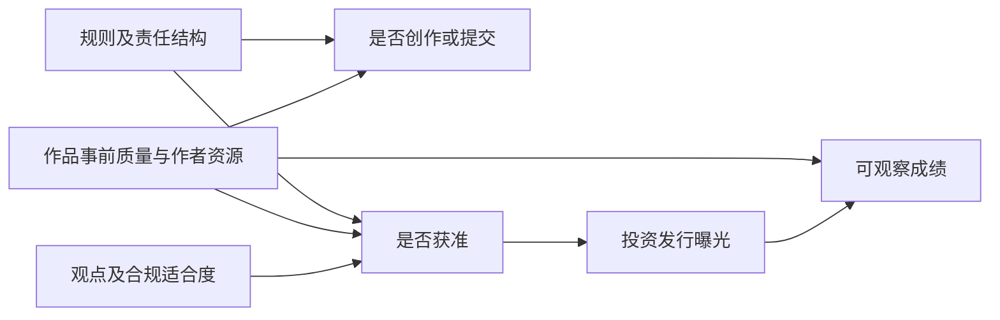
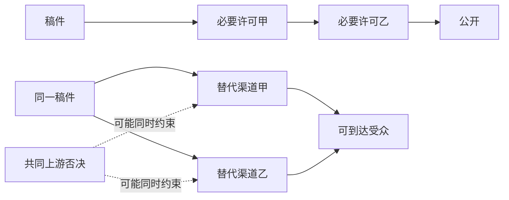

# 模糊许可、审查与文化生态：沿一部作品追踪选择、风险和纠错

一部作品获准、制作精良、销量增加，能证明准入制度改善了文化吗？还不能。需要同时看谁没有开始创作、哪些稿件被撤回、谁获得投资、哪些题材被替换，以及受不利判断的人能否挑战理由并恢复传播。**准入改变的是一整套选择与风险分配；获批样本的表现只是其中一个结果。**

本页讨论针对观点、政治忠诚、道德正统或审美趣味的准入与传播约束。结论按结果逐项提出：制度可能有效实现控制目标，同时出现技术质量提高、某些创新增加、另一些题材萎缩。判断生态不能把这些现象压成一个必然上升或下降的分数，也不能由文化损失预测政权何时崩溃。

## 从一个项目开始：先固定制度，再观察结果

以下是教学情境，不是实际审查事件。编辑林准备出版一部描写地方冲突的小说，需要支付采访、写作与编辑费用，随后寻找出版和传播渠道。即使最终能够出版，写作前的不确定性、等待期和作品公开后的规则变化，也可能改变他的选择。

把规则拆成三个独立维度。明确标准也可能配上封闭程序；透明程序也可能执行模糊标准；最初明确的许可也可能在投资完成后改变。不能看到好结果便将制度重新命名为“真正的专业选择”，看到坏结果才叫审查。

| 维度 | 应记录的对象 | 林实际面临的问题 |
| --- | --- | --- |
| 标准 | 限制行为、可证明伤害，还是观点、忠诚、道德或审美；边界、适用对象、理由是否可知 | 哪些情节会被拒绝？“影响不好”能否对应可核查条件？ |
| 程序 | 决定者、材料与证据、期限、独立复核、改判效力、费用与防报复 | 拒绝后谁解释、谁复核？最终通过时是否已错过销售窗口？ |
| 事后变更 | 新规则对未来与既有作品的适用、过渡安排、许可撤回、资格与收入后果 | 已完成的投资是否会因新解释失去渠道？能否恢复、补偿或转投？ |

“存在模糊措辞”是文本观察，“执行者误判”需要案件证据，“模糊性故意用来控制”还需要意图与组织过程证据。部门冲突、能力不足、复杂语境和信号变化也是竞争解释，不能从效果直接倒推统一策划。

### 生命周期上的约束不能混称

| 环节与措施 | 直接改变什么 | 需要另核什么 |
| --- | --- | --- |
| 法律上的事前许可 | 获得某种活动或发行的法律资格 | 许可针对机构、服务还是单件作品；适用法域及版本 |
| 平台上传过滤 | 内容进入可见页面前是否放行 | 技术错误、平台自定规则、法律要求与委托关系 |
| 发布后的删除 | 已公开材料继续可见及证据留存 | 删除理由、时间、申诉、原受众能否再访问 |
| 降推荐、搜索限制 | 可发现性与触达，而非必然彻底消失 | 与普通排序波动、需求变化区别；不能凭低浏览量断定暗中限制 |
| 不资助、取消变现 | 资金与持续生产能力 | 是否仍有合法可行替代；未获资助不自动等于禁止出版 |
| 职业或机构资格限制 | 后续项目、团队存续和专门技能回报 | 具体依据与外溢范围，不能由单件拒稿推出终身禁入 |
| 编辑拒稿、社会批评 | 某一组织的选择、声誉与受众反馈 | 退出、转投与反驳是否可行；私人判断的法律身份不同 |

这些措施可以共同诱发发布前自我约束，但不因此具有相同法律身份。文件可存在、却难被发现或无法持续融资；这是一组需要测量的功能差异，不是任何内容自动享有无限推荐的法律结论。

## 风险怎样从判断者传给创作者

先看林是否继续项目。用一个有单位的示意式组织问题：

$$
B_i-C_i-p_iL_i>U_i^{\mathrm{alt}}.
$$

$B_i$ 是项目预期收益，$C_i$ 是制作及合规成本，$p_i\in[0,1]$ 是主观处罚概率，$L_i\ge0$ 是处罚的货币等价损失，$U_i^{\mathrm{alt}}$ 是替代活动收益；各项均使用同一货币单位和时间口径。它仅适用于能用期望净收益近似决策的设定，不能把职业、自由或权利损失视为已经测得的货币数值。风险厌恶、现金储备和无法估计的概率还需别的模型。

由此可以提出**寒蝉机制**：当某些原本允许的表达也被认为可能触发巨大损失，林会提前删改、改题材、转渠道或退出。要观察主观风险如何形成，而不只是数实际罚了几人。少量处罚故事可能被同行反复传播，是 Stern 与 Hassid 研究所提示的线索；本次只核对作者机构记录，未完整重读访谈证据，因此此处保留为待核机制。[作者机构记录](https://www.law.berkeley.edu/center-article/amplifying-silence-uncertainty-and-control-parables-in-contemporary-china/)

再看编辑：如果“放过违规稿件”可能令机构受罚，而“错拒允许稿件”的损失主要由作者承担，那么编辑即使重视专业判断，也可能偏向拒绝边界作品。这是**责任不对称**，不是“编辑必然没有能力”。法国宪法委员会 2020-801 DC 裁决 §§13–19 正面讨论了复杂法律判断、24 小时时限、逐次刑罚及免责不足造成的过度删除激励，并否决相关条款。它支持制度风险的法学判断，也显示约束能够被制衡；不属于条款实施后的因果估计，不直接估计政治观点许可的效应。[官方裁决](https://www.legifrance.gouv.fr/juri/id/CONSTEXT000042053930)

**专业判断的空间**还要问：编辑能否要求证据、比较真实伤害、承认不确定性；还是必须首先保证某种身份与正统信号？假设固定工时 $E=e_q+e_l$，更多工时投入合规信号 $e_l$ 会压缩专业工作 $e_q$，这只是有限资源模型。总工时、资金或团队规模可变，忠诚信号与能力也可能相关；不能从这个恒等式推出“忠诚者更无能”或“所有人投入都减少”。要追踪被奖励的技能、预算与职业出口。

回到林：如果同行提供有依据且稳定的规则说明，误拒能迅速纠正，风险可能下降；如果预算增加、商业需求扩大或新的表达体裁出现，总产出可能上升。这些观察都必须进入判断，不能一律改解释成“更高级的控制”。

## 获批质量为什么不能替代生态质量

先问评价谁的目标：监管者可能重视可控协调，编辑重视发行和责任，作者重视表达与收入，公众重视知识、可理解性与权利。制度实现自身目标的能力，与公众福利及正当性不是同一结果。以下五项可分别变动：控制目标、获批作品质量、参与者与题材组合、公开核验和纠错、表达与退出保障。

假设 $A_i=1$ 表示作品获准，$q_i$ 表示在一个预先固定的评分协议下的质量。$E[q_i\mid A_i=1]$ 是获批均值；它不能告诉我们缺席者、数量、未来技能存量或被拒作品的价值。若审批同时受政治适合度 $o_i$ 与质量影响，只看获批者还可能制造二者的样本内关系。

图是候选因果结构；箭头不表示已经识别。林通过后得到更多宣传，销量上涨，可能体现审批后的资源配置。估计政策总效应时，把这笔宣传资源当普通控制变量，会截去一部分政策路径；只观察获批者则可能在选择点 $A$ 上条件化。**先修**：读 [[社会科学/10-共同工具/03-因果图反事实与识别#因果图把结构主张放到桌面上|中介与碰撞点]]，回来说明研究究竟估计总效应、直接效应还是获批者的描述均值。

生态还包含存量：编辑经验、作者训练、档案、题材知识和读者解码能力。公司进入、作者进入、题材进入是不同分母；当年出版流量也不是这些存量。放松限制后是否迅速恢复，取决于人才、材料与可行渠道是否保留。替代体裁也可能创造真实价值，不能只算旧题材损失而拒绝计入新收益。各维度权重未估计、部分可能重叠，因此本页不把“创新＋信任＋多样性”直接相加为福利金额。

## 形式反例一：多层许可与替代入口的方向相反

设五位判断者面对同一组本应允许的作品，各自误拒事件为 $E_j$，$P(E_j)=p=0.05=1/20$。作品真实允许性已由教学题设固定；这不是某机构实测误拒率。

**串联许可**要求五层全同意，故排除事件是 $\bigcup_{j=1}^5 E_j$。若误判相互独立：

$$
P(\text{被排除})=1-(1-p)^5
=1-\frac{19^5}{20^5}
=\frac{723901}{3200000}=0.2262190625.
$$

手算中 $19^5=2476099$、$20^5=3200000$，误拒约 22.62%。若五层总是错拒完全相同的作品，即 $E_1=\cdots=E_5$，联合排除反而只有 5%。所以“正相关必然使串联误拒更高”被反驳。一般需要联合分布；两两相关系数不足以确定五维尾部事件。

**并联替代**要求至少一家接受，故排除事件为 $\bigcap_{j=1}^5 E_j$。独立时：

$$
P(\text{被所有入口排除})=p^5
=\frac{1}{3200000}=0.0000003125
=0.00003125\%.
$$

若共用同一误判，仍有 5% 被全部拒绝。这次共同偏差削弱替代渠道的保护。较低总排除率也可能伴随某一题材稳定被排除；总量与分配不能互换。

图只比较结构。实际“可替代”还需合法性、迁移费用、发现成本、支付与原受众可达性；五个平台不能自动编码成五个独立入口。这是概率与可靠性结构的**形式类比**，不通过工程公式证明社会净效果。**概率先修**见 [[数学/30-概率与统计/01-概率分布条件概率与贝叶斯关系#联合、边缘与条件概率|联合事件与独立条件]]，然后返回判断林的每个环节属于串联、替代还是复核。

## 形式反例二：删除、改写与不可见分母不是同一信息通道

设现实状态为良好 $G$、糟糕 $B$，先验各 $1/2$。原报道正面为 $+$、负面为 $-$，且 $P(+\mid G)=0.8$、$P(+\mid B)=0.2$。联合表可直接手算：

| 联合概率 | 正面 $+$ | 负面 $-$ | 状态边缘 |
| --- | ---: | ---: | ---: |
| 良好 $G$ | 0.4 | 0.1 | 0.5 |
| 糟糕 $B$ | 0.1 | 0.4 | 0.5 |

看到正面的后验 $P(G\mid+)=0.4/(0.4+0.1)=0.8$。现在比较两种变换：

| 机制 | 受众知道什么 | 观察正面后的后验 | 观察空白后的后验 |
| --- | --- | ---: | ---: |
| A：仅删除负面，正面不变 | 每天恰有一个报道位置，空白只可能来自删掉负面 | 0.8 | $0.1/(0.1+0.4)=0.2$ |
| B：负面全部改写成正面 | 无论状态都输出正面 | $0.5/(0.5+0.5)=0.5$ | 空白概率为零，条件后验未定义 |

机制 A 中正面与空白仍能区分状态；机制 B 中正面没有更新先验。因此不能只由“删过负面”推出赞扬必然失去全部区分力。现实若隐藏发布机会、删除数量，混合不同删除原因，或受众不知规则，机制 A 的特殊条件便不成立；需写出实际观察机制再计算。**先修**见 [[数学/30-概率与统计/01-概率分布条件概率与贝叶斯关系#贝叶斯公式的推导|贝叶斯公式]]。

该反例没有证明删除无害。能推知坏状态、能公开核验证据、能知道其他人知道、能协调行动是不同能力。即使每个人从空白猜到问题，彼此仍未必能验证证据与共同承诺。

## 纵向反馈、共同知识与可信承诺

林的地方冲突材料可能以内部报告传到管理者，却不允许公开跨地汇总。此情境有两条通道：**纵向**传给有决策权者，**横向**使公众相互核验与组织。Lorentzen 的 2014 年形式模型允许在一定条件下选择性开放监督报道，以改善治理又控制协调风险；这是对“公众受限所以顶层必然同样失明”的反例，本次只核摘要及作者框架，未复算模型。[论文摘要](https://doi.org/10.1111/ajps.12065)、[作者研究页](https://peterlorentzen.com/research/)

内部信息可以替代部分事实采集，但不自动替代公众查证、责任追究、救济与规则学习。掌握信息的人可能有处理激励，也可能只希望压低公开责任。研究要沿“发现—归责—救济—学习”逐段追踪，而非以“领导知道”作为纠错完成。**机制应用**：接 [[社会科学/40-公共政策与社会学/13-拒错内卷与组织纠错|组织纠错]] 与 [[社会科学/40-公共政策与社会学/15-公共可纠错性的制度条件|公共可纠错性]]，回来检查林的损失由谁受理、是否改判、是否改变后续规则。

可信承诺也涉及时间：林先投入专门成本，判断者事后仍有重新解释权。写在文件里的“允许”不足以让创作者放心；需要观察规则变更是否公开、是否给过渡期、复核者是否能改判、恢复是否及时，以及报复成本是否受到约束。这里的**二阶可争辩性**是综合分析概念：不仅能反驳某句话，还能挑战决定其能否发表的规则、证据与裁决。它不是本页已经实证验证的新定律。

对照 [[哲学与文化/10-主题/01-文化政治与组织结构/11-帝国兴亡叙事与君权约束|君权约束与解释权]]，关系是**机制比较**：解释规范的人是否同时掌握不受纠正的裁决权。再接 [[社会科学/40-公共政策与社会学/12-代表产生司法监督与执行|裁判与执行]]，检查“获有利决定”与“实际恢复传播或获救济”的距离。不能由存在申诉按钮认定独立救济，也不能预设所有申诉无效。

等待本身也有价值损失。纯示意式 $V(T)=V_0e^{-rT}-cT$ 中，$T\ge0$ 以天计，$V_0$ 是初始价值，$r\ge0$ 单位为每天，$c\ge0$ 是每日持有成本。$r$ 大的时事作品与长期小说不同；审批最终通过率相同，延迟后果也可不同。公式未拟合，不能据此声称某地审批造成多少损失。延期使“获得许可”与“项目值得继续”分离，现金储备不足者可能先退出；放松、补偿与融资改善也可能逆转这种机制。

## 最强反证必须实际改变哪些判断

本页采用对称标准：负面研究要查选择、口径与识别，正面研究也要查；不能用可能存在的代价抹去已经观察到的正向指标。

| 原始研究与范围 | 当前能够承受的判断 | 不能推出什么 |
| --- | --- | --- |
| Blasutto、de la Croix（2023），1400—1750 意大利大学与学院学者，结构模型 | 作者估计无审查反事实下平均每学者的对数出版指标高 43%；27%—59% 是不同模型设定的敏感性范围。目录含版本和身后出版。正文、数据定义与相关结论已回查 | 不是出版数量增加 43%，不是 0.43 对数点，不能算 $e^{0.43}-1$；不是现代国家的统一效应量，也不等于艺术质量 |
| Comino、Galasso、Graziano（2025），16 世纪威尼斯出版商 | 高暴露企业相对受损、出版方向重排；原文报告年均进入由 5.5 到 7，增加集中于短寿命企业，净进入约每年一家且前后无显著差异。相关原文段落由期刊检索可见文本回查；全文未完成阅读，未重跑估计 | 企业进入必降被撤回；前后进入增加不是单独识别出的净因果效应，更不证明作者、题材或思想自由都增加 |
| Grajzl、Murrell（2026）及 2025 作者工作稿摘要，1525—1700 英国主题年度面板 | 摘要报告受影响主题的相对文本创新提高，数量冲击约十年恢复；这是对“审查下创新必降”的实质反证 | 本次只核作者出版记录与作者工作稿摘要，期刊全文未取得；不补写工具变量排除限制、附录或复现，不将文本新颖性等同所有福利 |
| Chen、Yang（2019），18 个月信息访问实验 | 官方摘要报告仅给访问不自动增加敏感信息获取，短期鼓励可产生持续变化；需求可以激活 | 不能推出全部人口永久不愿获取信息，也不能只讲限制后的低需求而删去可恢复性 |

上述行分别见 [意大利原文](https://academic.oup.com/ej/article/133/656/2899/7230362)、[威尼斯原文](https://academic.oup.com/jleo/article/41/3/1045/7679891)、[英国作者摘要](https://papers.ssrn.com/sol3/papers.cfm?abstract_id=5382070)及[作者出版记录](https://grajzlp.academic.wlu.edu/research/)、[信息访问实验摘要](https://www.aeaweb.org/articles?id=10.1257/aer.20171765)。

英国反证应促使我们提出新问题：替代体裁、隐喻和形式实验的价值是否增加；哪些读者能够解码；限制撤除后何种技能保留。答案可有正负两面，未核全文时不能选择性补写代价。威尼斯则要求把进入、退出、题材转换、长期组织能力同时观察。

**反对单调结论的另外两个边界。** 同一分布下增加独立抽样次数 $N$，最大值分布满足 $P(\max q_i\le x)=F(x)^N$，可说明更多试验不降低该最大值的随机序；期望比较还需可积性。它不说明任意扩大方差都提高上限。例如抽两次：分布 A 为 $\pm1$ 各半，方差 1、期望最大值 0.5；分布 B 为 $\pm20$ 各概率 0.0025，0 的概率 0.995，均值同为 0、方差 2，而期望最大值 $20[1-(0.9975)^2]-20(0.0025)^2=0.09975$。更大方差没有给出更高期望极值。

公开一致也不能机械推断真实同意或全部伪装。Carter 等 2024 论文使用 2020 年两次在线配额样本，直接问答与列表实验结果不同；本次读到设计及结果，不将 50%—70% 写成 2026 年人口支持率。“上限”依赖作者对残余隐瞒的解释，并非无需假设的统计界限。[原文设计与结果](https://doi.org/10.1017/S0305741023001819)。Shen、Truex 的跨国拒答指标则只测一种可能隐瞒形式，并报告明显异质性；拒答不等于全部伪装，也不能拿它与列表实验当同一测量的直接胜负。[原文跨国结果](https://doi.org/10.1017/S0007123419000735)

## 法规文本、执行事实与跨语种比较

以下核对的是公布版本的条款，不是对 2026 年所有配套规则、司法解释与执行实践的完整法律调查：

| 文件与定位 | 有限文本事实 | 需要保留的界限 |
| --- | --- | --- |
| 2017《互联网新闻信息服务管理规定》第 2、5、9、11、12、28 条 | 新闻服务范围、许可类型、三年有效期及续办、总编辑责任与审核制度分别有条款；网络出版及视听另有规定 | 机构/服务许可不能直接等于所有个人发言逐条许可；重大选题或网络出版的具体义务另找适用文件 |
| 2019 公布、2020 施行《网络信息内容生态治理规定》第 5—7、10—12 条 | 鼓励内容、违法信息、不良信息防范以及平台处置、重点呈现和推荐要求分层规定 | 非鼓励内容不自动属于违法；第 11 条对重点环节的不良信息呈现有禁止，不能只写鼓励而漏掉约束；类别存在不测量误判规模 |
| 法国 2020-801 DC，§§13—19 | 对短期删除、复杂判断及处罚结构作比例性审查，相关条款被否决 | 法学裁决说明制衡与风险分析，不是实行该条款后的作品或信任效应 |

出处：[新闻服务公布文本](https://www.cac.gov.cn/2017-05/02/c_1120902760.htm)、[内容生态公布文本](https://www.cac.gov.cn/2019-12/20/c_1578375159509309.htm)、[法国官方裁决](https://www.legifrance.gouv.fr/juri/id/CONSTEXT000042053930)。

伊賀司（2012）关于马来西亚阿卜杜拉时期媒体的研究摘要把法律、产业、记者规范与互联网架构共同纳入，并描述国家控制与市场竞争并存。这里使用的是日文研究的历史比较，已核期刊页摘要，未重读全文；不是日本社会性格证据，也不是马来西亚现行法律判断。[日文期刊与摘要](https://www.jstage.jst.go.jp/article/malaysianstudies/1/0/1_2012.1.073/_article/-char/ja/)

英语 censorship、法语 censure、日语 検閲 的法律边界要回到具体法域，不能凭翻译认定措施等价。分级、伤害治理和文化配额仍可作边界对照，但不直接证明政治忠诚许可的效果。国家之外的出版集团、宗教与行业组织也可能排斥内部成员；**比较链接** [[哲学与文化/10-主题/01-文化政治与组织结构/05-宗教思想组织的自治困境#自治门槛不是单一变量|组织自治的多维条件]] 提醒读者：保护组织持续存在与保护成员退出、反驳是两个问题。

## 研究接口：三个可推翻局部主张的设计

以下均为 **not_run**。本次未运行调查、实验、模拟、代码复算或 Obsidian 客户端；两个指定反例及极值例采用上文手工推导。未来研究记录应保存处理版本、单位、观察窗口、比较组、原始记录与缺失机制；不把生成的潜在作品当观测事实。

| 接口 | 数据单位与预先固定目标量 | 预期及反证 | 主要识别障碍与证据位置 |
| --- | --- | --- | --- |
| 渠道拓扑与救济 | 同一内容项目及尝试渠道；误拒率、特定题材共同排除、改判到恢复触达的天数 | 共同上游约束可能削弱替代；若存在低成本独立转投且能到达原受众，就撤回该项目“入口完全垄断”编码 | 允许性须独立判定；拒绝不能只靠低流量猜测。保存版本、理由、渠道记录、复核和恢复日期，状态 not_run |
| 规则变化后的创作组合 | 申请/投稿项目面板；作者退出、转题材、毛进入、净进入与存续分别估计 | 受限题材可能退出或转向；若可比受影响题材进入与创新提高，修订对应负面方向，不要求所有指标齐升 | 比较前趋势、补贴、需求、技术及跨渠道溢出；获批资源是中介。保存项目面板、处理时点及缺失敏感性说明，状态 not_run |
| 公开、内部与匿名的信息差 | 有合法授权与知情同意的意见测量及问题报告；表达差、报告到调查/补救/改规则时滞 | 恐惧、真诚支持、无知与注意力不足都可能解释沉默；内部渠道若实质补救，就削弱“完全无反馈”主张 | 样本选择、列表设计效应、拒答及报复风险；匿名度提高也不自动发现真值。保存测量协议与分阶段记录，状态 not_run |

最小有意义幅度和观察期限应在取数前确定，随题材与目标量给依据，不在看过结果后移动门槛。没有潜在作品分母时，限制在可观察总体或做部分识别；不假称已经恢复所有失去的可能。**测量警告**：进入 [[社会科学/10-共同工具/04-比较研究偏差与证据审计|分母与观察程序审计]]，回来核目标总体与可见存档；若用机器文本指标，再读 [[AI/20-LLM/70-工程应用与工具链/10-LLM评测污染裁判偏差与统计检验#LLM裁判是有用测量器，不是无误真值|裁判误差]]，比较体裁、年代、语言和立场的人工盲评误差。高预测准确不能自动保证因果估计无偏。

风险并不必然形成逐级收紧的棘轮：司法制衡、竞争入口、澄清边界、技术变化和组织学习都可能导致收缩或恢复。应记录“何时规则改变—谁预期改变—什么选择改变—什么结果随后出现”，而不把示意棘轮式当拟合结果。规范上可以主张平等地位、免于任意支配与可争辩性；其辩护不依赖虚构一个所有产出都下降的福利总额。**规范比较**见 [[哲学与文化/20-论证知识与规范/02-伦理与政治正当性|伦理与政治正当性]]，事实与规范不能互相冒充。

## 从旧讨论到当前判断

讨论材料保存在 [[Clippings/WorkWithLLM/对话原稿/2026-10-09-issue117-模糊事前许可与文化生态|#117 内容级整编及校注]]；它是有来源边界的内容归档，不是逐字导出。本页将其中十二类过强主张作如下处理：

| 旧主张 | 当前处理与阅读位置 |
| --- | --- |
| 出版数量高 43% | 更正为平均对数指标的结构反事实，见最强反证表 |
| 威尼斯证明全部进入必降 | 撤回；毛进入、短寿命进入与净进入分开 |
| 串联误判正相关必更糟 | 撤回；形式反例一给联合分布边界 |
| 删除负面必令所有正面无信息 | 撤回；形式反例二区分删除与改写 |
| 顶层必然与公众同样失明 | 撤回；纵向反馈与横向核验分开 |
| 忠诚必排除能力、所有投入必降 | 降为有限资源及激励条件下的机制 |
| 方差增大必提高文化上限 | 撤回；固定分布的试验次数与变分布不同 |
| 英国创新无需改变判断 | 撤回；它修订对应创新主张，保留摘要限制 |
| 改善质量就不再属于审查 | 撤回；按标准、程序、事后变更事前编码 |
| 必须所有指标齐升才能证伪 | 撤回；目标量、幅度、期限逐项规定 |
| 一份规则支持全部许可/出版义务 | 拆分；按具体文件与条款，完整当前适用状态仍未核 |
| 棘轮与低噪音失败是实证定律 | 降为可逆机制与待检验时序，不作崩溃预测 |

**返回问题**：林最终出版且销量增加，能支持“获批项目在实际资源配置下成功”；若不知道未提交项目、转题材和被拒者的去向，还不能证明制度提高文化生态。反过来，观察到一类题材损失，也不能否定其他维度真实改善。文化判断应允许这种可被证据修订的分解。以 [[哲学与文化/10-主题/01-文化政治与组织结构/08-路径依赖反例与可检验命题|路径依赖与可检验命题]] 作**反决定论出口**：固定比较对象、寻找竞争机制，把制度与文化之间的箭头逐段检验。

## 从裁判材料返回法学方法

本页用规范和裁判辨认约束，用研究材料检验效果。继续到[[社会科学/63-法学/01-法源版本与跨法域比较#有效、适用、正当、有效果：四个问题怎么互相约束|法源与不同待证命题]]，携带法规版本、行为日与裁判原文范围；返回说明哪项判断得到规范支持，哪项效果仍需对照和竞争解释。再将“公共主体决定”的分类问题放进[[社会科学/63-法学/04-共同案情与证据接口#F3 公共图书馆准入|公共准入比较]]，不能用裁判存在证明实际效果。
